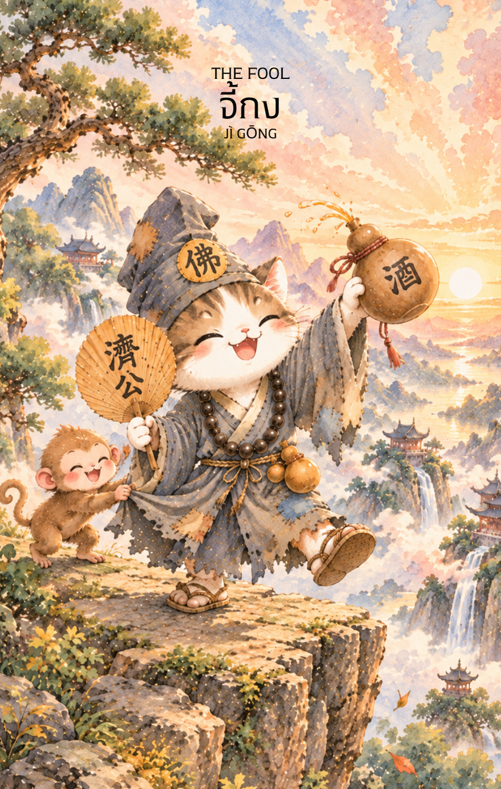

# 0-จี้กง (Ji Gong - 濟公) : The Fool

Created: February 3, 2026 6:25 PM

## **จี้กง (Ji Gong - 濟公) : The Fool**

---

**ธาตุประจำตัว:** น้ำ (💧 Water)

**คอนเซปต์หลัก:** ปัญญาที่ซ่อนเร้น ความลื่นไหล และการทำลายพันธนาการแห่งตัวตน

1. **แก่นแท้ของตัวละคร (The Essence)**
    
    จี้กงคือตัวแทนของ **"อิสระที่แท้จริง"** ท่านคือพระอรหันต์ผู้สวมจีวรขาดรุ่งริ่ง ดื่มสุรา และทำตัวเหมือนคนบ้าบอ แต่ภายใต้หน้ากากนั้นคือ **ปัญญาญาณ (Intuition)** ที่หยั่งรู้ทุกสรรพสิ่ง เช่นเดียวกับธาตุน้ำที่ไม่เคยหยุดนิ่ง และปรับรูปร่างได้ตามสถานการณ์อย่างไร้ขีดจำกัด การปรากฏของท่านคือการเตือนให้เรามองข้าม "เปลือกนอก" เพื่อเข้าถึงแก่นแท้ของความจริง
    
2. **สัญลักษณ์และปรัชญา (Symbolism & Philosophy)**
    - **น้ำเต้าแห่งสัญชาตญาณ:** ภายในไม่ได้มีเพียงสุรา แต่คือ "ยาอายุวัฒนะ" และภาวะ **"ไร้จิตปรุงแต่ง"** สื่อถึงการใช้ใจนำทางมากกว่าตรรกะที่เคร่งเครียดจนเกินไป
    - **พัดใบลานสะบัดทุกข์:** สัญลักษณ์ของการปัดเป่ากิเลสและความยึดมั่นถือมั่น พัดยังหมายถึงการ **"เปลี่ยนกระแสลม"** หรือการจบปัญหาเก่าเพื่อเริ่มต้นบทใหม่ของชีวิต
    - **จีวรขาดวิ่น:** การทำลายอัตตา (Ego) และหัวโขนทางสังคม (Persona) ไม่ยึดติดกับภาพลักษณ์ที่โลกสร้างให้ แต่ให้คุณค่ากับความบริสุทธิ์ของจิตใจภายใน
3. ก**ลยุทธ์เมื่อปรากฏไพ่ใบนี้ (The Strategy)**
    
    *"เมื่อวิธีธรรมดาใช้ไม่ได้ผล ถึงเวลาใช้... วิถีจี้กง"*
    
    - **คมในฝัก (Play Dumb):** บางครั้งการแสร้งโง่คือความฉลาดที่สุด การทำตัวสบายๆ ไร้พิษสงจะทำให้คู่แข่งตายใจ และช่วยให้เรามองเห็นธาตุแท้ของสถานการณ์ได้ชัดเจนขึ้นโดยไม่ต้องออกแรงปะทะ
    - **คิดนอกกรอบ (Radical Thinking):** อย่าเดินตามทางที่คนอื่นขีดไว้ ลองใช้วิธีที่คนทั่วไปมองว่า "บ้า" หรือเป็นไปไม่ได้ เพราะในความบ้าคลั่งนั้นมักมีทางออกที่อัศจรรย์ซ่อนอยู่เสมอ
    - **ลื่นไหลตามน้ำ (Improvise):** เลิกกังวลเรื่องแผนการที่สมบูรณ์แบบในกระดาษ สัญชาตญาณแรกของคุณมักจะถูกต้องเสมอ จงพร้อมที่จะปรับเปลี่ยนแผนหน้างานและลุยไปก่อนแล้วค่อยแก้ปัญหาเอาดาบหน้า
4. **คำแนะนำและการทำนาย (Reading Guidance)**
    - **ภาพรวมของไพ่ใบนี้:** นี่คือไพ่แห่ง **"การปลดปล่อยและการเริ่มต้นใหม่"** บอกให้คุณอยู่กับปัจจุบัน อดีตผ่านไปแล้ว อนาคตยังมาไม่ถึง อย่าเสียดายต้นทุนที่ลงไป (Sunk Cost) หากสิ่งนั้นไม่ใช่ทางที่ใช่ จงกล้าตัดจบแล้วเริ่มจากศูนย์ใหม่ด้วยรอยยิ้ม ความกล้าที่จะปล่อยวางคือพลังที่ยิ่งใหญ่ที่สุดของคุณในตอนนี้
    - **การงาน/ธุรกิจ:** อย่าติดกับดักตรรกะหรือกรอบเดิมๆ ลองใช้วิธีนอกตำราหรือนวัตกรรมที่ดูแปลกใหม่ แล้วผลลัพธ์จะสำเร็จอย่างคาดไม่ถึง
    - **การเงิน:** มองเงินให้เป็นเหมือนกระแสน้ำ มีไหลเข้าและไหลออก อย่าให้ตัวเลขมาล่ามโซ่ความสุข หากต้องเสียบางส่วนเพื่อรักษาภาพรวม (Cut Loss) จงกล้าทำทันที
    - **ความรัก:** เลิกมองคนจากเปลือกหรือเช็กลิสต์ในสมอง ลองถอดหัวโขนเข้าหากัน การยอมรับในความไม่สมบูรณ์แบบของกันและกันคือหัวใจสำคัญที่จะทำให้ความสัมพันธ์ไปรอด
    - **สุขภาพ:** ความเครียดจากสมองซีกซ้ายคือศัตรูตัวฉกาจ "เสียงหัวเราะ" และการปล่อยวางคือยาที่ดีที่สุด ระวังปัญหาที่เกี่ยวกับของเหลวในร่างกายหรือระบบหมุนเวียนเลือด
5. **บุคลิกของคนทีเป็นตัวแทนไพ่**
    
    เมื่อไพ่จี้กงปรากฏแทนบุคคล บุคคลนั้นมักเป็นคนรักอิสระ มองโลกในแง่ดี มีอารมณ์ขัน และไม่ชอบถูกจำกัดด้วยกฎเกณฑ์ที่ไม่จำเป็น เป็นคนเปิดใจ พร้อมเรียนรู้สิ่งใหม่ กล้าลองผิดลองถูก และมักมีวิธีคิดที่แตกต่างจากคนส่วนใหญ่
    
    บุคคลประเภทนี้มักสร้างแรงบันดาลใจให้ผู้อื่น เพราะกล้าใช้ชีวิตในแบบของตนเองและไม่กลัวการเริ่มต้นใหม่
    
    **ในด้านเงา** หากพลังของไพ่ยังไม่สมดุล บุคคลนี้อาจขาดวินัย หุนหันพลันแล่น ไม่วางแผน หรือหลีกเลี่ยงความรับผิดชอบโดยอ้างคำว่า “อิสระ”
    
6. **อาชีพที่พบได้บ่อย**
    
    บุคคลที่สะท้อนพลังของไพ่ใบนี้มักทำงานเกี่ยวข้องกับความคิดสร้างสรรค์ การเดินทาง การค้นพบ และการใช้ชีวิตอย่างยืดหยุ่น เช่น ศิลปิน นักเขียน นักเดินทาง ครีเอเตอร์ นักแสดง
    ผู้ประกอบการ Startup ฟรีแลนซ์ วิทยากร
    
    บุคคลที่เป็นตัวแทนของไพ่ใบนี้มักเข้ามาในชีวิตเพื่อสอนให้คุณกล้าปล่อยวางความกลัวและเริ่มต้นบทใหม่ของชีวิต
    
7. **Key Affirmation:**
    
    "ไหลไปดั่งสายน้ำ ปล่อยวางดั่งลมพัด และจงฉลาดภายใต้ท่าทีที่เรียบง่าย"
    
8. **Keyword**
    
    การเริ่มต้น • อิสรภาพ • ศรัทธา • เปิดใจเรียนรู้ • ผจญภัย • บริสุทธิ์ใจ • ศักยภาพไร้ขีดจำกัด • New Beginning • Freedom • Faith Curiosity • Adventure • Innocence • Potential
    
9. **ประวัติเทพเจ้า**
    
    จี้กง (濟公) จี้กง หรือที่รู้จักในนาม หลวงจีนจี้กง เป็นหนึ่งในบุคคลที่มีชื่อเสียงมากที่สุดในตำนานจีน และเป็นพระภิกษุที่ได้รับความเคารพจากผู้คนทั้งในฐานะนักบวช ผู้วิเศษ และผู้ช่วยเหลือคนยากไร้ แม้จะมีตัวตนจริงในประวัติศาสตร์ แต่เรื่องราวของท่านได้ถูกเล่าขานและเพิ่มเติมผ่านกาลเวลาจนกลายเป็นตำนานที่ได้รับความนิยมอย่างกว้างขวางทั่วโลกจีน
    
    จี้กงมีนามเดิมว่า หลี่ซิวหยวน (李修緣) เกิดในสมัยราชวงศ์ซ่งใต้ ราวคริสต์ศตวรรษที่ 12 ในครอบครัวที่มีฐานะดีและมีการศึกษา ตั้งแต่วัยเยาว์ เขาเป็นคนฉลาด มีเมตตา และชอบช่วยเหลือผู้อื่น แต่กลับไม่สนใจชื่อเสียงหรือความมั่งคั่งเหมือนคนทั่วไป
    
    เมื่อเติบโตขึ้น หลี่ซิวหยวนตัดสินใจละทิ้งชีวิตทางโลกและเข้าบวชที่วัดหลิงอิ่น (靈隱寺) เมืองหางโจว ได้รับฉายาทางธรรมว่า "เต้าจี้" (道濟) ต่อมา ผู้คนจึงเรียกขานท่านว่า "จี้กง" ซึ่งหมายถึงพระภิกษุจี้ผู้เปี่ยมด้วยเมตตา
    
    สิ่งที่ทำให้จี้กงแตกต่างจากพระสงฆ์ทั่วไป คือพฤติกรรมที่ดูแปลกประหลาดและไม่ยึดติดกับแบบแผน ท่านมักสวมจีวรเก่าขาดรุ่งริ่ง ถือพัดใบลานคู่กาย และใช้ชีวิตอย่างอิสระ หลายครั้งยังปรากฏเรื่องเล่าว่าท่านดื่มสุราและรับประทานเนื้อสัตว์ ซึ่งขัดกับภาพลักษณ์ของพระภิกษุในสายตาผู้คน
    
    อย่างไรก็ตาม เบื้องหลังพฤติกรรมที่ดูผิดแผกนั้น จี้กงกลับเป็นผู้มีจิตเมตตาอย่างยิ่ง ท่านมักช่วยเหลือชาวบ้าน คนยากจน ผู้ถูกเอารัดเอาเปรียบ และผู้ที่กำลังเผชิญความทุกข์ โดยไม่สนใจฐานะ ชาติกำเนิด หรือผลตอบแทน
    
    ตำนานจำนวนมากเล่าว่า จี้กงมีอิทธิฤทธิ์เหนือธรรมชาติ สามารถรักษาโรค ปราบปีศาจ มองเห็นสิ่งที่ผู้อื่นมองไม่เห็น และช่วยเหลือผู้คนจากภัยอันตรายต่าง ๆ ได้ หลายครั้งท่านใช้วิธีการที่ดูประหลาดหรือคาดไม่ถึง แต่กลับนำไปสู่ผลลัพธ์ที่ดีที่สุดในท้ายที่สุด
    
    หนึ่งในความเชื่อที่แพร่หลายที่สุดกล่าวว่า จี้กงเป็นภาคจุติของพระอรหันต์ผู้บำเพ็ญบารมีลงมาช่วยเหลือมนุษย์ แม้จะไม่ยึดติดกับกฎเกณฑ์ภายนอก แต่กลับเข้าถึงแก่นแท้ของความเมตตาและการช่วยเหลือสรรพชีวิตอย่างแท้จริง
    
    เรื่องเล่าหลายตอนยังสะท้อนให้เห็นว่า จี้กงมักมองเห็นคุณค่าของผู้คนในสิ่งที่คนอื่นมองข้าม บางครั้งท่านช่วยเหลือผู้ที่ถูกดูหมิ่น บางครั้งช่วยผู้ที่กำลังหลงผิดให้กลับมาสู่หนทางที่ถูกต้อง และบางครั้งก็ใช้คำพูดหรือการกระทำที่ดูแปลกประหลาดเพื่อเตือนสติผู้คนให้ตระหนักถึงความจริงของชีวิต
    
    ด้วยเหตุนี้ จี้กงจึงกลายเป็นสัญลักษณ์ของปัญญาที่ไม่ถูกจำกัดด้วยกรอบเดิม ๆ ความเมตตาที่ไม่แบ่งแยก และอิสรภาพทางจิตวิญญาณที่กล้าก้าวข้ามข้อจำกัดของสังคมเพื่อทำในสิ่งที่ถูกต้อง
    
    ตลอดหลายร้อยปีที่ผ่านมา เรื่องราวของจี้กงถูกนำไปสร้างเป็นนิทาน งิ้ว ละคร และภาพยนตร์นับไม่ถ้วน ทำให้ชื่อของท่านยังคงเป็นที่รู้จักและได้รับความรักจากผู้คนมาจนถึงปัจจุบัน
    
    แม้ภาพลักษณ์ภายนอกของจี้กงจะดูเป็นเพียงพระภิกษุผู้มอมแมมและไร้ระเบียบ แต่ในสายตาของผู้ศรัทธา ท่านคือผู้มีหัวใจอิสระ ผู้ไม่ยึดติดกับชื่อเสียง กฎเกณฑ์ หรือภาพลักษณ์ภายนอก และเลือกเดินตามหนทางแห่งความเมตตาและความจริงด้วยตนเอง