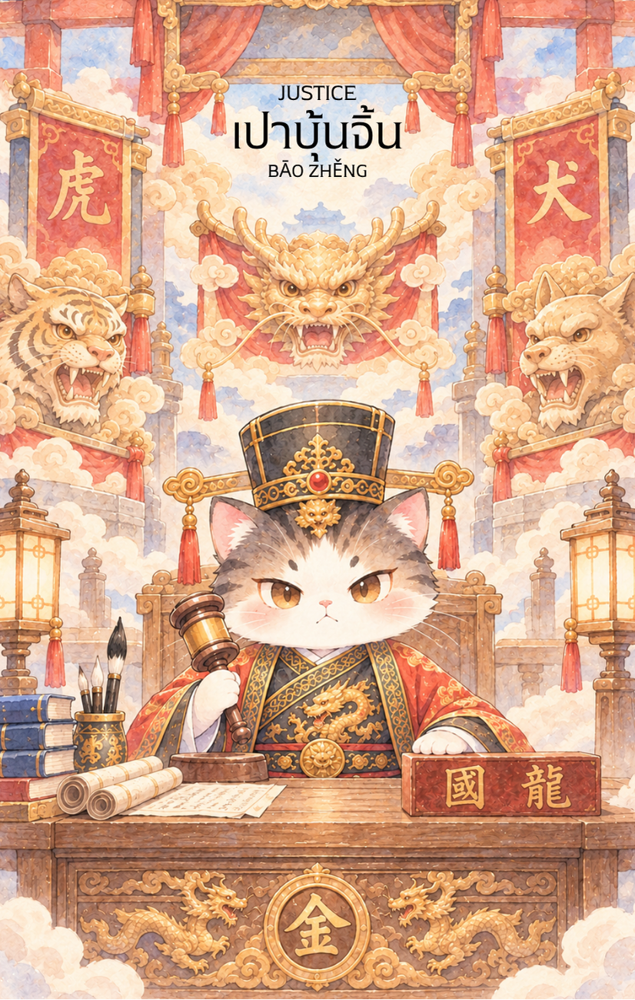

# 11-เปาบุ้นจิ้น (Bao Zheng - 包拯) : Justice

Created: February 3, 2026 7:44 PM

## **เปาบุ้นจิ้น (Bao Zheng - 包拯) : The Iron Judge**

**ธาตุประจำตัว:** ทอง (🏅 Metal)
**คอนเซปต์หลัก:** ความยุติธรรมที่เที่ยงตรง การตัดสินด้วยข้อเท็จจริง และกฎแห่งกรรมที่หลีกเลี่ยงไม่ได้

### **1. แก่นแท้ของตัวละคร (The Essence)**

เปาบุ้นจิ้น หรือ "ท่านเปา" คือสัญลักษณ์สูงสุดแห่งความซื่อสัตย์และยุติธรรม เจ้าของฉายา "เทพเจ้าหน้าเหล็ก" ผู้ไม่เคยหวั่นไหวต่ออิทธิพลใดๆ แก่นแท้ของท่านคือ **"ความเป็นกลาง" (Impartiality)** และการมองเห็นความจริงที่ถูกซ่อนเร้น เปรียบเสมือนธาตุทอง (โลหะ) ที่แข็งแกร่ง เยือกเย็น และเฉียบคมดั่งกระบี่อาญาสิทธิ์ที่ฟันผ่าความเท็จและนำความจริงออกมาตีแผ่ให้ปรากฏ ท่านคือตัวแทนของกฎหมายและมโนธรรมที่ไม่เคยประนีประนอมกับความผิด

---

### **2. สัญลักษณ์และปรัชญา (Symbolism & Philosophy)**

- **หน้าเหล็กสีดำ (Iron Face):** สื่อถึงความเด็ดขาด ไม่เห็นแก่หน้าใคร และไม่ถูกซื้อได้ด้วยเงินทองหรืออารมณ์ ปรัชญาของการยึดถือหน้าที่และความถูกต้องเหนือความสัมพันธ์ส่วนตัว
- **เครื่องประหาร 3 หัว (มังกร, พยัคฆ์, สุนัข):** สัญลักษณ์ของความเสมอภาคภายใต้กฎหมาย ไม่ว่าจะเป็นเชื้อพระวงศ์ ขุนนาง หรือสามัญชน หากกระทำผิดย่อมได้รับโทษทัณฑ์เท่าเทียมกัน
- **พระจันทร์เสี้ยวบนหน้าผาก:** สื่อถึง "ดวงตาที่สาม" หรือปัญญาญาณที่สามารถมองเห็นความจริงได้แม้ในที่มืด (รวมถึงการตัดสินคดีในยมโลกตามตำนาน) ปรัชญาของการค้นหาความจริงให้ถึงที่สุด
- **บัลลังก์พิพากษาและไม้ตบโต๊ะ:** สื่อถึงอำนาจในการตัดสินใจขั้นสุดท้าย การประกาศความจริงที่ชัดเจนและไม่อาจโต้แย้งได้

---

### **3. กลยุทธ์เมื่อปรากฏไพ่ใบนี้ (The Strategy)**

> *"ใช้เหตุผลเหนืออารมณ์ ให้ความจริงเป็นผู้ตัดสิน"*
> 
- **Fact-Based Decision (กลยุทธ์ตัดสินด้วยความจริง):** ในสถานการณ์นี้ ให้ถอยออกมาจากอารมณ์ความรู้สึก รวบรวมหลักฐานและข้อมูลที่เป็นข้อเท็จจริง (Hard Facts) เท่านั้น อย่าตัดสินใจบนพื้นฐานของการคาดเดาหรือคำบอกเล่า
- **Unwavering Integrity (กลยุทธ์ความซื่อสัตย์):** ยึดมั่นในความถูกต้องและจริยธรรม แม้ว่าจะไม่มีใครเห็น หรือแม้ว่าการทำสิ่งที่ถูกจะทำให้คุณลำบากใจก็ตาม เครดิตและความน่าเชื่อถือคือสินทรัพย์ที่มีค่าที่สุดของคุณในตอนนี้
- **Clear Boundaries (กลยุทธ์การขีดเส้น):** กำหนดกฎกติกา ขอบเขต และข้อตกลงให้ชัดเจน (เช่น ในสัญญาจ้าง หรือข้อตกลงความสัมพันธ์) หากมีการล้ำเส้น ต้องมีมาตรการจัดการที่ยุติธรรมและเด็ดขาด

---

### **4. คำแนะนำและการทำนาย (Reading Guidance)**

- **ภาพรวมของไพ่ใบนี้:** เป็นไพ่แห่ง **"ความจริงและกฎแห่งกรรม"** สิ่งที่เคยกระทำไว้กำลังจะส่งผล (What goes around, comes around) เป็นช่วงเวลาที่ต้องสะสางเรื่องราวให้ถูกต้องตามกฎเกณฑ์ ความจริงจะถูกเปิดเผย และความยุติธรรมจะปรากฏ
- **การงาน/ธุรกิจ:** เกี่ยวข้องกับเรื่องกฎหมาย สัญญา เอกสารข้อตกลง หรือการตรวจสอบ (Audit) ควรทำทุกอย่างให้โปร่งใสที่สุด หากมีการเจรจาต่อรอง ผลลัพธ์จะเป็นไปอย่างยุติธรรมตามข้อเท็จจริง
- **การเงิน:** การเงินสมดุล (Balanced) รายรับรายจ่ายชัดเจน เป็นช่วงเวลาของการเคลียร์หนี้สิน หรือสะสางธุรกรรมทางการเงินให้ถูกต้อง หากมีคดีความเกี่ยวกับการเงิน มีแนวโน้มได้รับความเป็นธรรม
- **ความรัก:** เน้นความเสมอภาคและการให้เกียรติซึ่งกันและกัน หากความสัมพันธ์ไม่สมดุล (ฝ่ายหนึ่งเอาเปรียบ) จะถึงเวลาที่ต้องตัดสินใจด้วยเหตุผล หากมีการทำสัญญาผูกมัด (เช่น จดทะเบียน หรือสัญญาก่อนแต่งงาน) จะเป็นประเด็นสำคัญ
- **สุขภาพ:** สุขภาพร่างกายสมดุลดี แต่ให้ใส่ใจสัญญาณเตือนของร่างกายตามความเป็นจริง อย่าหลอกตัวเอง หากมีอาการผิดปกติให้รีบตรวจหาสาเหตุที่แท้จริง

---

5. **บุคลิกของคนที่เป็นตัวแทนไพ่**

บุคคลที่สะท้อนพลังไพ่ใบนี้มักซื่อตรง มีหลักการ กล้าปกป้องความถูกต้อง และพิจารณาเรื่องต่าง ๆ จากหลักฐานมากกว่าอคติ เป็นที่พึ่งด้านความเป็นธรรมได้ดี ส่วนด้านเงาอาจเคร่งครัดหรือวิจารณ์ผู้อื่นโดยไม่เปิดพื้นที่ให้ความเมตตา

6. **อาชีพที่พบได้บ่อย**

เหมาะกับงานกฎหมาย การตรวจสอบ การกำกับดูแล ราชการ การสืบสวน การบริหารความเสี่ยง จริยธรรมองค์กร และบทบาทที่ต้องตัดสินใจอย่างเป็นกลาง

7. **Key Affirmation:** "ฉันยึดมั่นในความถูกต้อง ความจริงคือเกราะคุ้มกันของฉัน และฉันตัดสินใจทุกสิ่งด้วยปัญญาที่เที่ยงธรรม"

8. **Keyword**

ความยุติธรรม • ความจริง • ความซื่อสัตย์ • หลักฐาน • ความเป็นกลาง • Justice • Truth • Integrity • Evidence • Impartiality

9. **ประวัติบุคคลและตำนาน**

…

เปาบุ้นจิ้น (包拯)

เปาบุ้นจิ้น หรือ เปาเจิ่ง (包拯) เป็นขุนนางผู้มีตัวตนจริงในประวัติศาสตร์จีน สมัยราชวงศ์ซ่งเหนือ (ค.ศ. 999–1062) และได้รับการยกย่องว่าเป็นสัญลักษณ์แห่งความยุติธรรม ความซื่อสัตย์ และความเที่ยงธรรม จนได้รับการขนานนามว่า "ผู้พิพากษาแห่งใต้หล้า" และกลายเป็นหนึ่งในบุคคลที่ชาวจีนเคารพนับถือมากที่สุดตลอดหลายศตวรรษที่ผ่านมา

เปาบุ้นจิ้นเกิดที่เมืองเหอเฝย์ มณฑลอันฮุย ในครอบครัวขุนนางระดับสามัญ ตั้งแต่วัยเยาว์ เขาเป็นผู้ใฝ่ศึกษา มีสติปัญญาเฉลียวฉลาด และยึดมั่นในคุณธรรม เมื่อเติบโตขึ้น เขาสอบผ่านจอหงวนและเข้ารับราชการในราชสำนักซ่ง

แม้จะดำรงตำแหน่งสำคัญหลายตำแหน่ง แต่สิ่งที่ทำให้เปาบุ้นจิ้นได้รับการจดจำมิใช่ความสำเร็จทางการเมือง หากเป็นความซื่อสัตย์สุจริตและการปฏิบัติหน้าที่โดยไม่เกรงกลัวอิทธิพลของผู้มีอำนาจ ท่านกล้าตักเตือนขุนนางที่ทุจริต กล้าคัดค้านการตัดสินใจที่ไม่เป็นธรรม และให้ความสำคัญกับความถูกต้องเหนือผลประโยชน์ส่วนตน

ในบันทึกประวัติศาสตร์ เปาบุ้นจิ้นเป็นที่รู้จักในฐานะข้าราชการผู้ไม่ยอมรับสินบนและดำเนินชีวิตอย่างเรียบง่าย จนได้รับความเคารพจากประชาชนทั่วไป หลายเรื่องเล่ากล่าวว่า แม้แต่ญาติพี่น้องหรือผู้ใกล้ชิดก็ไม่อาจใช้ความสัมพันธ์ส่วนตัวเพื่อขอความช่วยเหลือในทางมิชอบจากเขาได้

เมื่อเวลาผ่านไป เรื่องราวของเปาบุ้นจิ้นได้ถูกนำไปเล่าขานในนิทานพื้นบ้าน งิ้ว และวรรณกรรมจีน จนค่อย ๆ ผสมผสานกับจินตนาการและความเชื่อของผู้คน เกิดเป็นตำนาน "ท่านเปา" ผู้สามารถตัดสินคดีได้อย่างแม่นยำและยุติธรรมเหนือมนุษย์ทั่วไป

ในตำนานพื้นบ้าน เปาบุ้นจิ้นมักถูกพรรณนาว่ามีใบหน้าสีดำและมีพระจันทร์เสี้ยวอยู่กลางหน้าผาก สีดำมิได้หมายถึงความชั่วร้าย แต่เป็นสัญลักษณ์ของความซื่อตรง ความเด็ดขาด และความเที่ยงธรรม ส่วนพระจันทร์เสี้ยวเชื่อกันว่าเป็นเครื่องหมายแห่งปัญญาและอำนาจในการแยกแยะความจริงออกจากความเท็จ

ตำนานยังเล่าว่า เปาบุ้นจิ้นได้รับอำนาจจากสวรรค์ให้สามารถพิจารณาคดีได้ทั้งสามภพ ได้แก่ โลกมนุษย์ โลกวิญญาณ และยมโลก ด้วยเหตุนี้ จึงมีเรื่องเล่าจำนวนมากที่กล่าวถึงการตัดสินคดีฆาตกรรม คดีอธรรม และการช่วยเหลือวิญญาณผู้บริสุทธิ์ให้ได้รับความเป็นธรรม แม้ผู้กระทำผิดจะเป็นขุนนางชั้นสูง เชื้อพระวงศ์ หรือผู้มีอำนาจเพียงใดก็ตาม

สิ่งที่ปรากฏอยู่ในตำนานบ่อยครั้งคือ "ประหารสามกิโยติน" อันประกอบด้วย มีดหัวมังกรสำหรับเชื้อพระวงศ์ มีดหัวพยัคฆ์สำหรับขุนนาง และมีดหัวสุนัขสำหรับสามัญชน สัญลักษณ์เหล่านี้สะท้อนแนวคิดสำคัญที่ว่า กฎหมายและความยุติธรรมควรใช้กับทุกคนอย่างเท่าเทียม ไม่ว่าผู้นั้นจะมีฐานะสูงส่งเพียงใด

ตลอดหลายศตวรรษที่ผ่านมา เปาบุ้นจิ้นจึงไม่ได้เป็นเพียงบุคคลสำคัญในประวัติศาสตร์ หากยังกลายเป็นสัญลักษณ์ทางวัฒนธรรมของความซื่อสัตย์ ความกล้าหาญในการปกป้องความถูกต้อง และการยืนหยัดในหลักการแม้ต้องเผชิญแรงกดดันจากผู้มีอำนาจ

ด้วยเหตุนี้ ชื่อของเปาบุ้นจิ้นจึงยังคงได้รับการกล่าวถึงมาจนถึงปัจจุบัน ในฐานะผู้พิพากษาในอุดมคติ ผู้ที่เชื่อว่าความยุติธรรมควรอยู่เหนืออำนาจ เงินทอง และผลประโยชน์ทั้งปวง และผู้ที่พิสูจน์ให้เห็นว่า ความเที่ยงธรรมคือพลังที่ยิ่งใหญ่ที่สุดในการปกครองบ้านเมืองและดูแลผู้คน