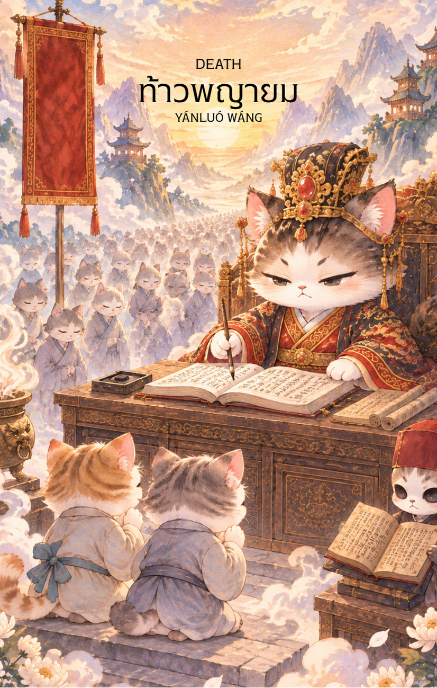

# 13-เหยียนหลัวหวาง (Yan Luo Wang - 閻羅王) : Death

Created: February 3, 2026 7:51 PM

## **เหยียนหลัวหวาง (Yan Luo Wang - 閻羅王) : The Sovereign of Finality**

**ธาตุประจำตัว:** น้ำ (💧 Water)
**คอนเซปต์หลัก:** การสิ้นสุดของวัฏจักร การชำระล้างอดีต และการไหลเวียนสู่สภาวะใหม่

### **1. แก่นแท้ของตัวละคร (The Essence)**

เหยียนหลัวหวาง หรือ "พญายมราช" คือผู้ปกครองสูงสุดแห่งยมโลกและผู้ถือบัญชีเป็นตาย แก่นแท้ของท่านคือ **"ความเที่ยงธรรมของการสิ้นสุด"** ท่านคือตัวแทนของพลังงานธาตุน้ำที่นิ่งสงบ เยือกเย็น และลึกซึ้ง ความตายในที่นี้ไม่ใช่จุดจบที่น่าสยดสยอง แต่คือการ "ล้างกระดาน" เพื่อให้ดวงวิญญาณได้เริ่มต้นใหม่ ไพ่ใบนี้สื่อถึงกระบวนการที่ชีวิตต้องผ่านการชำระล้างเอาสิ่งเก่าที่เน่าเสียออกไป เพื่อให้พลังงานไหลเวียนได้อีกครั้ง เปรียบเสมือนน้ำที่พัดพาตะกอนทิ้งไปเพื่อคืนความใสสะอาดให้ลำน้ำ

---

### **2. สัญลักษณ์และปรัชญา (Symbolism & Philosophy)**

- **สะพานไน่เหอ (Bridge of No Return):** สื่อถึงจุดเปลี่ยนที่ย้อนกลับไม่ได้ ปรัชญาของการยอมรับว่าบางสิ่งในชีวิตต้องจบลงเพื่อก้าวข้ามไปสู่บทใหม่
- **น้ำแกงลืมชาติ (Soup of Forgetfulness):** สัญลักษณ์ของการลบความทรงจำหรือพันธนาการเก่าๆ ปรัชญาของการ "Reset" จิตใจให้บริสุทธิ์ก่อนเริ่มต้นใหม่
- **กระจกส่องกรรม (Nie Jing Tai):** สื่อถึงความจริงที่ใสกระจ่างดั่งผิวน้ำที่นิ่งสงบ การเห็นภาพสะท้อนของผลลัพธ์จากการกระทำของตนเองอย่างไม่อาจปฏิเสธได้
- **ความมืดมิดของยมโลก:** ปรัชญาของความว่างเปล่าที่ก่อกำเนิดทุกสรรพสิ่ง (Yin Energy) การยอมรับความมืดคือหนทางเดียวที่จะเห็นแสงสว่างครั้งใหม่

---

### **3. กลยุทธ์เมื่อปรากฏไพ่ใบนี้ (The Strategy)**

> *"กล้าที่จะจบ เพื่อพบการเริ่มต้นที่ยิ่งใหญ่"*
> 
- **Radical Transformation (กลยุทธ์การล้างกระดาน):** ถึงเวลาที่คุณต้องเปลี่ยนแปลงตัวเองอย่างถอนรากถอนโคน ทิ้งนิสัยเดิมๆ หรือวิธีการทำงานแบบเก่าที่ฉุดรั้งคุณไว้ การเริ่มต้นใหม่จากศูนย์ในจังหวะนี้จะนำมาซึ่งพลังที่แข็งแกร่งกว่าเดิม
- **Accepting the Unavoidable (กลยุทธ์การยอมรับความจริง):** หากมีสิ่งที่กำลังจะจบลง (เช่น โปรเจกต์ที่ไปไม่รอด หรือความสัมพันธ์ที่เป็นพิษ) อย่าพยายามยื้อไว้ด้วยอารมณ์ จงไหลไปตามน้ำและยอมรับความจริงนั้นเพื่อความสงบสุขในระยะยาว
- **Purification (กลยุทธ์การชำระล้าง):** สะสางสิ่งที่ค้างคาในใจ ให้อภัยอดีต และลบ "ขยะ" ในชีวิตออกไป เพื่อให้มีที่ว่างสำหรับโอกาสใหม่ๆ ที่กำลังจะไหลเข้ามา

---

### **4. คำแนะนำและการทำนาย (Reading Guidance)**

- **ภาพรวมของไพ่ใบนี้:** เป็นไพ่แห่ง **"จุดจบที่เลี่ยงไม่ได้"** (Necessary Ending) เพื่อนำไปสู่สิ่งที่ดีกว่า คุณกำลังเผชิญกับการเปลี่ยนแปลงครั้งใหญ่ที่อาจดูน่าหวั่นใจในตอนแรก แต่แท้จริงแล้วมันคือการเคลียร์พื้นที่ให้ชีวิตได้เกิดใหม่ พลังงานของไพ่นี้เน้นการปล่อยวางและการเปลี่ยนผ่าน
- **การงาน/ธุรกิจ:** การสิ้นสุดของสัญญาเดิมหรือการปิดตัวของรูปแบบธุรกิจเก่า เพื่อเปิดทางสู่นวัตกรรมหรืออาชีพใหม่ที่ต่างไปจากเดิมอย่างสิ้นเชิง อย่ากลัวที่จะเริ่มใหม่จากศูนย์
- **การเงิน:** มีเกณฑ์การสูญเสียเงินก้อนเพื่อจบภาระหนี้สิน หรือการตัดใจขาดทุน (Cut Loss) ในส่วนที่ไม่สร้างกำไรเพื่อรักษาเสถียรภาพโดยรวม การเงินจะกลับมาลื่นไหลหลังจากที่คุณเคลียร์ปัญหาเก่าจบ
- **ความรัก:** ความสัมพันธ์ที่มาถึงทางตันจะจบลงอย่างชัดเจน หรือเป็นการจบสภาวะเดิมเพื่อเปลี่ยนสถานะไปสู่ความลึกซึ้งที่ต่างออกไป การยึดติดกับอดีตมีแต่จะทำให้เจ็บปวด
- **สุขภาพ:** สุขภาพที่เจ็บป่วยมานานจะเริ่มเข้าสู่กระบวนการรักษาที่ต้นเหตุ ระวังปัญหาเกี่ยวกับระบบทางเดินปัสสาวะ ไต หรือภาวะทางอารมณ์ที่จมดิ่งเกินไป การบำบัดด้วยน้ำหรือการพักผ่อนในที่เงียบสงบจะช่วยฟื้นฟูพลังงานได้ดี

---

5. **บุคลิกของคนที่เป็นตัวแทนไพ่**

บุคคลที่สะท้อนพลังไพ่ใบนี้มักสุขุม ลึกซึ้ง กล้ายอมรับความจริง และมีความเด็ดขาดเมื่อต้องปิดฉากสิ่งที่หมดเวลาแล้ว จุดแข็งคือการฟื้นตัวและเรียนรู้จากการเปลี่ยนแปลง ส่วนด้านเงาอาจมองโลกสิ้นหวังหรือยึดติดกับความสูญเสีย

6. **อาชีพที่พบได้บ่อย**

เหมาะกับงานด้านกฎหมาย การตรวจสอบ การแพทย์และการฟื้นฟู งานวิกฤต การเปลี่ยนแปลงองค์กร การให้คำปรึกษา และงานที่ต้องจัดการเรื่องค้างคาหรือเปลี่ยนผ่าน

7. **Key Affirmation:** "ฉันกล้าปล่อยวางอดีต ยอมรับการเปลี่ยนแปลง และพร้อมที่จะเกิดใหม่อย่างสง่างาม"

8. **Keyword**

การสิ้นสุด • การเปลี่ยนผ่าน • การชำระล้าง • การปล่อยวาง • การเกิดใหม่ • Transformation • Release • Renewal • Closure • Rebirth

9. **ประวัติเทพเจ้า**

.

เหยียนหลัวหวาง (閻羅王)

เหยียนหลัวหวาง หรือที่คนไทยรู้จักกันในนาม "ท้าวพญายม" เป็นหนึ่งในเทพผู้มีบทบาทสำคัญที่สุดในความเชื่อเกี่ยวกับโลกหลังความตายของจีน พระองค์ได้รับการยกย่องให้เป็นผู้พิพากษาแห่งยมโลก ผู้ทำหน้าที่ตัดสินความดีความชั่วของดวงวิญญาณหลังจากละจากโลกมนุษย์ และเป็นสัญลักษณ์ของความยุติธรรม กฎแห่งกรรม และผลแห่งการกระทำ

ต้นกำเนิดของเหยียนหลัวหวางมีความเกี่ยวข้องกับความเชื่อทางพุทธศาสนาและคติพื้นบ้านจีน โดยชื่อ "เหยียนหลัว" มีรากมาจาก "ยมราช" (Yama) เทพแห่งความตายในคติอินเดีย เมื่อพุทธศาสนาแพร่เข้าสู่จีน เรื่องราวของยมราชจึงค่อย ๆ ผสมผสานเข้ากับความเชื่อท้องถิ่น จนพัฒนาเป็นภาพลักษณ์ของเหยียนหลัวหวาง ผู้ปกครองและพิพากษาดวงวิญญาณในยมโลกตามที่รู้จักกันในปัจจุบัน

ในคติความเชื่อของจีน ยมโลกมิใช่สถานที่แห่งความทรมานเพียงอย่างเดียว หากเปรียบเสมือนศาลยุติธรรมขนาดใหญ่ที่ทำหน้าที่พิจารณาการกระทำของวิญญาณทุกดวงหลังความตาย เชื่อกันว่าเมื่อมนุษย์สิ้นชีวิต วิญญาณจะถูกนำตัวมายังยมโลกเพื่อรับการตรวจสอบและตัดสินตามบุญกรรมที่ได้กระทำไว้

ตำนานยุคหลังมักกล่าวถึง "สิบศาลยมโลก" (十殿閻羅) ซึ่งประกอบด้วยกษัตริย์ยมโลกสิบองค์ ทำหน้าที่พิจารณาคดีในด้านต่าง ๆ ของดวงวิญญาณ โดยเหยียนหลัวหวางเป็นหนึ่งในผู้พิพากษาที่มีอำนาจสูงและเป็นที่รู้จักมากที่สุด จนในเวลาต่อมาผู้คนจำนวนมากเรียกรวมเทพผู้พิพากษาแห่งยมโลกทั้งหมดว่า "เหยียนหลัวหวาง"

ตำนานเล่าว่า ภายในท้องพระโรงแห่งยมโลกจะมีบัญชีแห่งชีวิตและความตาย ซึ่งบันทึกการกระทำของมนุษย์ทุกคนไว้อย่างละเอียด ไม่มีผู้ใดสามารถปกปิดความจริงหรือหลบหนีผลแห่งการกระทำของตนได้ ไม่ว่าจะเป็นกษัตริย์ ขุนนาง หรือสามัญชน ทุกดวงวิญญาณล้วนต้องได้รับการตัดสินอย่างเท่าเทียม

ด้วยเหตุนี้ เหยียนหลัวหวางจึงมักถูกพรรณนาเป็นผู้พิพากษาผู้เคร่งครัด มีพระพักตร์สง่างาม น่าเกรงขาม และเปี่ยมด้วยอำนาจ แต่ในขณะเดียวกันก็ทรงยึดมั่นในความยุติธรรมอย่างเคร่งครัด พระองค์มิได้ลงโทษวิญญาณด้วยความโกรธหรือความพอใจส่วนตัว หากตัดสินทุกสิ่งตามกฎแห่งเหตุและผลที่แต่ละคนได้สร้างไว้

ในนิทานพื้นบ้านจีนจำนวนมาก มีเรื่องเล่าเกี่ยวกับผู้คนที่ได้รับโอกาสเดินทางไปยังยมโลกผ่านความฝัน นิมิต หรือประสบการณ์เฉียดตาย และได้พบกับเหยียนหลัวหวาง เรื่องราวเหล่านี้มักจบลงด้วยการที่บุคคลนั้นกลับมาสู่โลกมนุษย์พร้อมบทเรียนสำคัญเกี่ยวกับคุณธรรม ความซื่อสัตย์ และการใช้ชีวิตอย่างไม่ประมาท

นอกจากนี้ เหยียนหลัวหวางยังปรากฏอยู่ในวรรณกรรมจีนหลายเรื่อง ไม่ว่าจะเป็นไซอิ๋ว เปาบุ้นจิ้น หรือวรรณกรรมพื้นบ้านต่าง ๆ โดยมักถูกนำเสนอในฐานะผู้พิพากษาสูงสุดแห่งยมโลก ผู้รักษาสมดุลระหว่างความดีและความชั่ว และผู้ดูแลให้กฎแห่งกรรมดำเนินไปอย่างยุติธรรม

ตลอดหลายศตวรรษที่ผ่านมา ชาวจีนจำนวนมากเคารพนับถือเหยียนหลัวหวางไม่ใช่เพราะความหวาดกลัว แต่เพราะพระองค์เป็นตัวแทนของความยุติธรรมที่ไม่ลำเอียง เป็นเครื่องเตือนใจว่าทุกการกระทำล้วนมีผลตามมา และไม่มีผู้ใดอยู่เหนือกฎแห่งเหตุและผล

ด้วยเหตุนี้ เหยียนหลัวหวางจึงได้รับการจดจำในฐานะผู้พิพากษาแห่งยมโลก ผู้รักษาความสมดุลระหว่างบุญและบาป และผู้เตือนให้มนุษย์ตระหนักถึงความรับผิดชอบต่อการกระทำของตนเอง เรื่องราวของพระองค์ยังคงถูกเล่าขานมาจนถึงปัจจุบัน ในฐานะสัญลักษณ์ของความยุติธรรม ความเที่ยงธรรม และกฎแห่งกรรมที่ไม่มีผู้ใดหลีกเลี่ยงได้