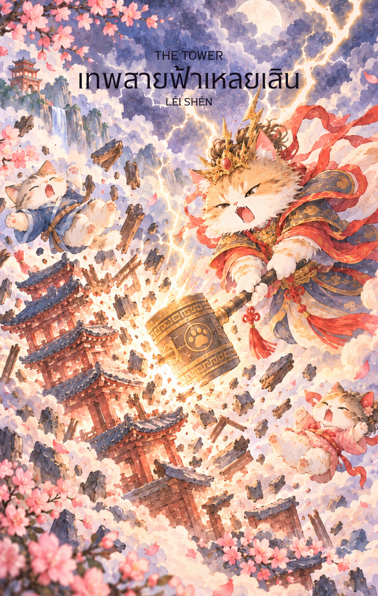

# 16-เหลยเสิน (Lei Shen - 雷神) : The Tower

Created: February 3, 2026 7:57 PM

## **เหลยเสิน (Lei Shen - 雷神) : The Divine Striker**

**ธาตุประจำตัว:** ไฟ (🔥 Fire)
**คอนเซปต์หลัก:** การพังทลายของโครงสร้างที่จอมปลอม ความจริงที่ฟาดฟันลงมาอย่างกะทันหัน และการชำระล้างด้วยพลังสวรรค์

### **1. แก่นแท้ของตัวละคร (The Essence)**

เหลยเสิน หรือ "เทพเจ้าสายฟ้า" คือผู้อยู่เบื้องหลังเสียงกึกก้องและการทำลายล้างที่สั่นสะเทือนไปทั่วสวรรค์และปฐพี แก่นแท้ของท่านคือ **"แรงสั่นสะเทือนเพื่อการตื่นรู้"** ท่านไม่ได้ฟาดสายฟ้าลงมาเพื่อทำร้ายผู้บริสุทธิ์ แต่เพื่อทำลายสิ่งที่ผุพัง สิ่งที่สร้างขึ้นบนรากฐานของคำลวง หรือสิ่งที่มีอีโก้ (Ego) สูงส่งเกินความจริง ไพ่ใบนี้คือสัญลักษณ์ของ "การกดปุ่ม Force Restart" ของจักรวาล เพื่อให้ทุกอย่างกลับคืนสู่ความจริงแท้ แม้กระบวนการนั้นจะดูรุนแรงและน่าตกใจเพียงใดก็ตาม

---

### **2. สัญลักษณ์และปรัชญา (Symbolism & Philosophy)**

- **ค้อนและสิ่ว (Hammer and Chisel):** สื่อถึงการเจาะทะลวงผ่านเปลือกนอกที่แข็งแกร่งที่สุดเพื่อเข้าถึงแก่นความจริง ปรัชญาของการ "ทำลายเพื่อสร้างใหม่" (Destruction as a form of creation).
- **กลองสวรรค์ (Heavenly Drums):** สัญลักษณ์ของเสียงเตือนภัยและการสั่นสะเทือนที่ปลุกให้ตื่นจากภวังค์ คือกระแสแห่งการเปลี่ยนแปลงที่ไม่มีใครต้านทานได้
- **สายฟ้าฟาด (Lightning Bolt):** สื่อถึงแรงบันดาลใจฉับพลัน (Flash of Insight) หรือความจริงที่ปรากฏขึ้นเพียงเสี้ยววินาทีแต่เปลี่ยนทุกอย่างไปตลอดกาล
- **ใบหน้าเทพนักรบที่มีจงอยปาก:** ปรัชญาของความเด็ดขาด รวดเร็ว และแม่นยำดั่งนกอินทรีที่โฉบลงมาจัดการเป้าหมายโดยไม่มีความลังเล

---

### **3. กลยุทธ์เมื่อปรากฏไพ่ใบนี้ (The Strategy)**

> *"เมื่อกำแพงถล่มลงมา อย่าพยายามค้ำยันไว้ แต่จงวิ่งออกมาเพื่อหาพื้นที่สร้างใหม่"*
> 
- **Surrender to Truth (กลยุทธ์การยอมจำนนต่อความจริง):** หากความลับถูกเปิดเผย หรือแผนการที่เคยวางไว้พังทลายลงกะทันหัน อย่าพยายามหาคำแก้ตัวหรือซ่อมแซมสิ่งที่เป็นไปไม่ได้ จงยอมรับความจริงนั้นโดยดุษฎี พลังของเหลยเสินต้องการให้คุณ "เริ่มต้นใหม่บนพื้นฐานความจริง" เท่านั้น
- **Break the Old Pattern (กลยุทธ์ทำลายวงจรเดิม):** ใช้จังหวะที่ทุกอย่างโกลาหลในการทิ้งนิสัยเก่า หรือโครงสร้างงานแบบเดิมที่ฉุดรั้งคุณไว้ เมื่อพายุพัดผ่านไป พื้นที่ที่เคยเต็มไปด้วยขยะจะถูกชำระล้างจนสะอาด พร้อมสำหรับการก่อสร้างใหม่ที่มั่นคงกว่าเดิม
- **Sudden Decisiveness (กลยุทธ์ความเด็ดขาดฉับพลัน):** หากคุณกำลังลังเลที่จะจบสถานการณ์บางอย่าง ไพ่ใบนี้บอกว่า "จักรวาลจะจบให้คุณเอง" หน้าที่ของคุณคือตั้งสติและเตรียมตัวรับแรงกระแทกเพื่อก้าวต่อไปให้เร็วที่สุด

---

### **4. คำแนะนำและการทำนาย (Reading Guidance)**

- **ภาพรวมของไพ่ใบนี้:** เป็นไพ่แห่ง **"วิกฤตที่นำมาซึ่งโอกาส"** (Crisis of Awakening) คุณอาจเจอเหตุการณ์ที่น่าตกใจหรือการเปลี่ยนแปลงแบบสายฟ้าแลบที่ทำให้แผนชีวิตเดิมต้องพังลง แต่อย่าเพิ่งเสียใจไป เพราะสิ่งที่พังลงไปนั้นคือสิ่งที่ไม่ใช่ "ของจริง" สำหรับคุณ
- **การงาน/ธุรกิจ:** ระวังความขัดแย้งที่รุนแรง การถูกเลิกจ้างกะทันหัน หรือโปรเจกต์ที่วางรากฐานมาไม่ดีพังทลายลง เป็นช่วงเวลาที่ "ความเสี่ยง" ทุกอย่างจะปรากฏตัวออกมาให้เห็นชัดเจน
- **การเงิน:** ระวังรายจ่ายฉุกเฉินกะทันหัน อุบัติเหตุทางการเงิน หรือการขาดทุนแบบไม่ทันตั้งตัว ไม่ใช่เวลาที่ควรลงทุนในสิ่งที่มีความเสี่ยงสูงเด็ดขาด
- **ความรัก:** อาจมีการทะเลาะกันอย่างรุนแรง ความลับถูกเปิดเผย หรือการเลิกราที่เกิดขึ้นแบบไม่คาดฝัน ความสัมพันธ์ที่เปราะบางจะถูกทดสอบอย่างหนักในจังหวะนี้
- **สุขภาพ:** ระวังอุบัติเหตุจากการเดินทาง ปัญหาเกี่ยวกับระบบประสาท หัวใจ หรืออาการเจ็บป่วยที่เกิดขึ้นกะทันหัน (Acute Illness) ควรระวังเรื่องอัคคีภัยหรือไฟฟ้าลัดวงจรในที่อยู่อาศัย

---

5. **บุคลิกของคนที่เป็นตัวแทนไพ่**

บุคคลที่สะท้อนพลังไพ่ใบนี้มักกล้าหาญ ฉับไว และไม่หวั่นที่จะเผชิญความจริงที่คนอื่นหลีกเลี่ยง เป็นผู้เปลี่ยนวิกฤตให้เป็นจุดเริ่มต้นได้ ส่วนด้านเงาอาจตัดสินใจหุนหันหรือใช้ความตรงไปตรงมารุนแรงเกินไป

6. **อาชีพที่พบได้บ่อย**

เหมาะกับงานฉุกเฉิน การบริหารวิกฤต วิศวกรรมและความปลอดภัย การสืบสวน งานเปลี่ยนแปลงองค์กร และบทบาทที่ต้องตัดสินใจรวดเร็วเมื่อโครงสร้างเดิมใช้ไม่ได้

7. **Key Affirmation:** "ฉันยอมรับการทำลายล้างของสายฟ้า เพื่อเปิดทางให้ความจริงแท้ได้ปรากฏและสร้างชีวิตใหม่บนรากฐานที่มั่นคง"

8. **Keyword**

การตื่นรู้ • วิกฤต • ความจริง • การเปลี่ยนแปลงฉับพลัน • การเริ่มใหม่ • Awakening • Crisis • Truth • Breakthrough • Renewal

9. **ประวัติเทพเจ้า**

.

เหลยเสิน (雷神)

เหลยเสิน หรือ "เทพแห่งสายฟ้า" เป็นหนึ่งในเทพสำคัญของความเชื่อพื้นบ้านจีน ผู้มีหน้าที่ควบคุมฟ้าร้อง ฟ้าผ่า และปรากฏการณ์แห่งพลังอำนาจบนท้องฟ้า ชาวจีนโบราณเชื่อว่าเสียงฟ้าร้องมิใช่เพียงปรากฏการณ์ทางธรรมชาติ หากเป็นสัญญาณแห่งอำนาจของสวรรค์ที่ใช้เตือนมนุษย์ให้ตระหนักถึงความถูกต้องและคุณธรรม

คำว่า "เหลย" (雷) หมายถึง ฟ้าร้อง หรืออสนีบาต ส่วน "เสิน" (神) หมายถึง เทพเจ้า รวมความแล้วจึงหมายถึงเทพผู้ควบคุมพลังแห่งสายฟ้าและอัสนีบาตอันยิ่งใหญ่

เกี่ยวกับกำเนิดของเหลยเสินนั้น ปรากฏแตกต่างกันไปในแต่ละยุคสมัยและสำนักความเชื่อ บางตำนานกล่าวว่า พระองค์เป็นเทพผู้ถือกำเนิดจากพลังแห่งหยางบนสวรรค์ และได้รับมอบหมายให้ดูแลสมดุลระหว่างฟ้าและดิน ขณะที่บางสำนวนเชื่อว่าเหลยเสินเป็นหนึ่งในขุนนางสวรรค์ผู้ทำหน้าที่บังคับใช้กฎแห่งสวรรค์ต่อมนุษย์

ภาพลักษณ์ของเหลยเสินในศิลปะจีนมักปรากฏเป็นบุรุษร่างกำยำ มีผิวสีน้ำเงินหรือสีเข้ม ใบหน้าดุดัน คล้ายครึ่งมนุษย์ครึ่งอสูร บางภาพมีปีกและกรงเล็บคล้ายนกอินทรี พระองค์มักถือค้อนและสิ่วศักดิ์สิทธิ์ หรือยืนอยู่ท่ามกลางกลองสายฟ้า โดยใช้ค้อนตีลงบนกลองเพื่อก่อให้เกิดเสียงฟ้าร้องกึกก้องไปทั่วสวรรค์และโลกมนุษย์

ในความเชื่อพื้นบ้านจีน เหลยเสินมิได้เป็นเพียงเทพแห่งปรากฏการณ์ธรรมชาติ แต่ยังเป็นผู้พิทักษ์ความยุติธรรมแห่งสวรรค์ เชื่อกันว่าพระองค์สามารถมองเห็นความชั่วร้าย การหลอกลวง การผิดคำสัตย์ และการกระทำที่ขัดต่อคุณธรรม เมื่อถึงเวลาที่เหมาะสม สายฟ้าของเหลยเสินจะถูกส่งลงมาเพื่อเตือนหรือลงโทษผู้กระทำผิด

ด้วยเหตุนี้ ในสำนวนจีนโบราณจึงมักมีการกล่าวถึงคำว่า "ฟ้าผ่า" ในฐานะสัญลักษณ์ของการได้รับผลจากการกระทำที่ไม่ถูกต้อง หลายเรื่องเล่าพื้นบ้านกล่าวถึงคนที่หลอกลวงผู้อื่น คดโกง หรือทำเรื่องอธรรม แล้วถูกสายฟ้าฟาดจนผู้คนเชื่อว่าเป็นการลงโทษจากสวรรค์ผ่านอำนาจของเหลยเสิน

ในคติเต๋า เหลยเสินยังเป็นส่วนหนึ่งของกลุ่มเทพแห่งอสนีบาตหรือ "เหลยปู้" (雷部) ซึ่งประกอบด้วยเทพหลายองค์ที่ร่วมกันควบคุมสภาพอากาศ เมฆ ฝน ลม และฟ้าร้อง โดยมีหน้าที่ช่วยรักษาสมดุลของธรรมชาติและปกป้องกฎเกณฑ์แห่งฟ้าดิน

นอกจากนี้ ยังมีเทพสตรีที่มักปรากฏเคียงข้างเหลยเสิน คือ เตี้ยนหมู่ (電母) หรือเทพธิดาแห่งสายฟ้าแลบ ตามตำนานกล่าวว่า ขณะที่เหลยเสินเป็นผู้สร้างเสียงฟ้าร้อง เตี้ยนหมู่จะใช้กระจกวิเศษปล่อยแสงสายฟ้าออกมา ทำให้เกิดแสงสว่างบนท้องฟ้า ทั้งสององค์จึงทำงานร่วมกันเพื่อควบคุมพลังแห่งพายุและอัสนีบาต

ตลอดหลายศตวรรษที่ผ่านมา ชาวจีนจำนวนมากเคารพนับถือเหลยเสินในฐานะเทพผู้ปกป้องความถูกต้องและผู้รักษาระเบียบของธรรมชาติ บางพื้นที่มีการสร้างศาลเจ้าหรือประกอบพิธีขอพรให้พ้นจากภัยธรรมชาติ ฟ้าผ่า และเหตุร้ายต่าง ๆ ที่อาจเกิดขึ้นจากพลังของธรรมชาติ

แม้ภาพลักษณ์ของเหลยเสินจะดูน่าเกรงขาม แต่แก่นสำคัญของตำนานมิได้อยู่ที่การลงโทษ หากอยู่ที่การรักษาความสมดุลระหว่างมนุษย์กับกฎแห่งสวรรค์ สายฟ้าของพระองค์จึงเปรียบเสมือนเครื่องเตือนใจว่า ทุกการกระทำล้วนมีผลตามมา และไม่มีสิ่งใดสามารถหลบหนีกฎแห่งเหตุและผลได้

ด้วยเหตุนี้ เหลยเสินจึงได้รับการจดจำในฐานะเทพแห่งสายฟ้า ผู้พิทักษ์ความยุติธรรมของสวรรค์ และผู้รักษาความสมดุลของธรรมชาติ อันเป็นพลังที่ยิ่งใหญ่ น่าเกรงขาม และดำรงอยู่เหนือมนุษย์มาแต่โบราณ