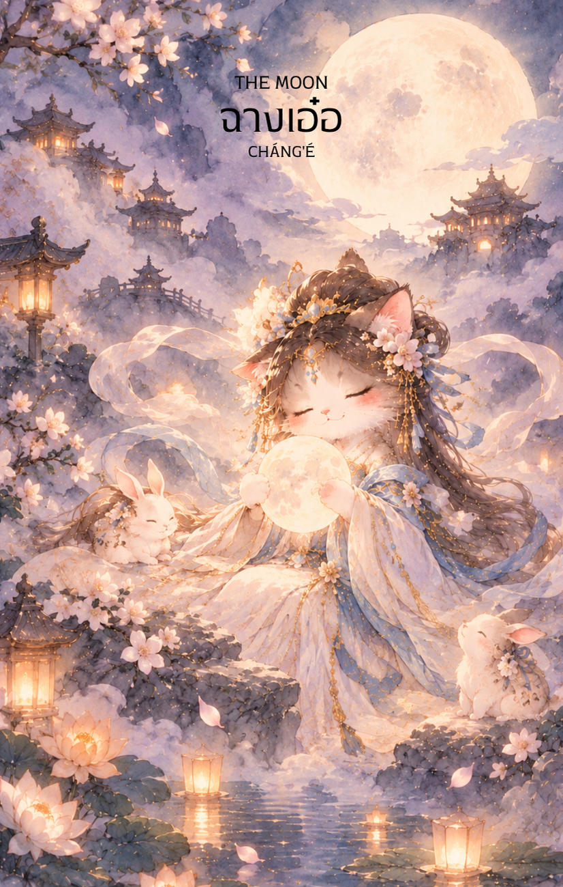

# 18-ฉางเอ๋อ (Chang'e - 嫦娥) : The Moon

Created: February 3, 2026 8:05 PM

## **ฉางเอ๋อ (Chang'e - 嫦娥) : The Lady of the Silver Veil**

**ธาตุประจำตัว:** น้ำ (💧 Water)
**คอนเซปต์หลัก:** ภาพลวงตา ความสับสนในจิตใจ ความเหงาที่งดงาม และพลังแห่งสัญชาตญาณยามค่ำคืน

### **1. แก่นแท้ของตัวละคร (The Essence)**

ฉางเอ๋อ คือตัวแทนของ **"ความลึกลับและความโดดเดี่ยวที่เยือกเย็น"** ท่านคือเทพธิดาแห่งดวงจันทร์ผู้ดื่มน้ำอมฤตแล้วต้องโบยบินสู่ตำหนักกวางหานเพียงลำพัง แก่นแท้ของท่านคือพลังงานหยิน (Yin) ขั้นสุด คือความรู้สึกที่ "จับต้องไม่ได้" ความสวยงามที่แฝงไปด้วยความเศร้า และความจริงที่เปลี่ยนแปลงไปตามจังหวะของการข้างขึ้นข้างแรม ไพ่ใบนี้คือกระจกสะท้อน **"โลกภายใน"** ที่เต็มไปด้วยความกังวล ความฝัน และความลับที่ไม่ได้ถูกเปิดเผยในยามที่มีแสงอาทิตย์

---

### **2. สัญลักษณ์และปรัชญา (Symbolism & Philosophy)**

- **ตำหนักกวางหาน (The Cold Palace):** สื่อถึงความสันโดษและการปกปิดตัวตน ปรัชญาของการรักษาพื้นที่ส่วนตัวที่คนภายนอกเข้าไม่ถึง แต่อาจนำมาซึ่งความอ้างว้างในใจ
- **กระต่ายหยกตำยา:** สัญลักษณ์ของการทำงานที่ซ้ำซากในระดับจิตใต้สำนึก คือการปรุงผสมอารมณ์และความทรงจำให้กลายเป็นประสบการณ์ที่สุกงอม
- **น้ำอมฤตแห่งดวงจันทร์:** ปรัชญาของการแลกเปลี่ยน (Trade-off) การได้มาซึ่งความเป็นนิรันดร์แต่อาจต้องเสียสละสิ่งที่เคยมีในโลกความเป็นจริงไป
- **เงาสะท้อนในน้ำ:** สื่อถึงการหลอกลวงของสายตา (Illusion) สิ่งที่เห็นอาจไม่ใช่ความจริงเสมอไป แต่เป็นเพียงภาพสะท้อนจากอารมณ์ของคุณเอง

---

### **3. กลยุทธ์เมื่อปรากฏไพ่ใบนี้ (The Strategy)**

> *"เมื่อแสงดาวพรางตา จงใช้ใจนำทาง"*
> 
- **Navigate the Mist (กลยุทธ์ฝ่าม่านหมอก):** หากตอนนี้สถานการณ์รอบตัวดูคลุมเครือ ไม่ชัดเจน อย่าเพิ่งรีบดึงดันหาข้อสรุปด้วยตรรกะ เพราะข้อมูลที่คุณเห็นอาจเป็นเพียงภาพลวงตา จง "รอ" ให้หมอกจางลง หรือใช้สัญชาตญาณในการสัมผัสความจริง
- **Embrace the Shadow (กลยุทธ์เผชิญหน้ากับเงามืด):** ยอมรับความกลัวและความกังวลในใจ อย่าเก็บกดมันไว้ แต่จงใช้ความเงียบสงัดทบทวนว่าสิ่งที่กลัวนั้นคือความจริง หรือเป็นเพียง "ภาพหลอน" ที่คุณสร้างขึ้นมาเอง
- **Silent Observation (กลยุทธ์เฝ้าสังเกตในความมืด):** ในจังหวะที่มองไม่เห็นทางข้างหน้า การทำตัวนิ่งเฉยและสังเกตความเคลื่อนไหวรอบข้างอย่างเงียบๆ จะช่วยให้คุณเห็นความผิดปกติที่คนอื่นมองข้าม

---

### **4. คำแนะนำและการทำนาย (Reading Guidance)**

- **ภาพรวมของไพ่ใบนี้:** เป็นไพ่แห่ง **"ความแปรปรวนและความไม่ชัดเจน"** คุณอาจอยู่ในสภาวะที่กังวลใจ หรือรู้สึกว่ามีบางอย่างที่มองไม่เห็นกำลังส่งผลกระทบอยู่ เป็นเวลาที่ควรเชื่อในสัญชาตญาณ (Sixth Sense) มากกว่าคำพูดของคนอื่น แต่อย่าปล่อยให้อารมณ์พาไปจนฟุ้งซ่าน
- **การงาน/ธุรกิจ:** ระวังการถูกแทงข้างหลัง ข้อมูลที่ไม่ครบถ้วน หรือการเมืองในที่ทำงานที่ซ่อนเงื่อน งานที่เกี่ยวกับจินตนาการ ศิลปะ หรือธุรกิจกลางคืนจะโดดเด่น แต่อย่าเพิ่งเซ็นสัญญาสำคัญหากยังไม่ได้ตรวจสอบ "ช่องโหว่" ให้ดี
- **การเงิน:** ระวัง "รายจ่ายที่มองไม่เห็น" หรือการถูกหลอกให้ลงทุนในสิ่งที่เป็นเพียงฝันกลางวัน การเงินในช่วงนี้มีความผันผวนเหมือนน้ำขึ้นน้ำลง ควรสำรองเงินไว้สำหรับสถานการณ์ที่ไม่คาดฝัน
- **ความรัก:** ความสัมพันธ์ที่เต็มไปด้วยความคิดถึงแต่ยากจะเอื้อมถึง หรือความรักที่มีความลับซ่อนอยู่ (Hidden Relationship) ระวังความหึงหวงที่เกิดจากการระแวงไปเองเกินกว่าความจริง
- **สุขภาพ:** ระวังปัญหาเกี่ยวกับระบบฮอร์โมน การนอนไม่หลับ (Insomnia) หรือภาวะซึมเศร้าและความเครียดสะสม การบำบัดด้วยกลิ่นหอม (Aromatherapy) หรือการบำบัดด้วยน้ำจะช่วยปรับอารมณ์ได้ดี

---

5. **บุคลิกของคนที่เป็นตัวแทนไพ่**

บุคคลที่สะท้อนพลังไพ่ใบนี้มักละเอียดอ่อน ช่างสังเกต มีจินตนาการสูง และรับรู้อารมณ์ของตนได้ลึกซึ้ง จุดแข็งคือสัญชาตญาณและความคิดสร้างสรรค์ ส่วนด้านเงาอาจเก็บตัวหรือปล่อยให้ความกังวลกับความระแวงบดบังข้อเท็จจริง

6. **อาชีพที่พบได้บ่อย**

เหมาะกับงานศิลปะ การเขียน ภาพยนตร์ ดนตรี จิตวิทยา การให้คำปรึกษา งานวิจัย และงานที่ต้องใช้จินตนาการหรือทำงานเบื้องหลังอย่างละเอียด

7. **Key Affirmation:** "ฉันยอมรับความลึกลับของชีวิต เชื่อมั่นในสัญชาตญาณ และมองทะลุภาพลวงตาเพื่อเข้าถึงความจริงแท้"

8. **Keyword**

สัญชาตญาณ • ความฝัน • ความลึกลับ • โลกภายใน • การสังเกต • Intuition • Dreams • Mystery • Inner World • Observation

9. **ประวัติเทพเจ้า**

.

ฉางเอ๋อ (嫦娥)

ฉางเอ๋อ เป็นหนึ่งในเทพธิดาที่มีชื่อเสียงและเป็นที่รักมากที่สุดในตำนานจีน นางได้รับการจดจำในฐานะ "เทพธิดาแห่งดวงจันทร์" ผู้พำนักอยู่บนวังจันทราอันเงียบสงบ และเป็นสัญลักษณ์ของความงดงาม ความเป็นอมตะ ความคิดถึง และการเสียสละ เรื่องราวของฉางเอ๋อได้รับการเล่าขานสืบต่อกันมาหลายพันปี และกลายเป็นส่วนสำคัญของเทศกาลไหว้พระจันทร์ (中秋節) ซึ่งยังคงได้รับการเฉลิมฉลองอย่างแพร่หลายในปัจจุบัน

ตำนานของฉางเอ๋อมีหลายสำนวน แต่เรื่องที่เป็นที่รู้จักมากที่สุดเกี่ยวข้องกับ โฮ่วอี้ (后羿) วีรบุรุษนักยิงธนูผู้ยิ่งใหญ่

เล่าว่า ในยุคโบราณ โลกเคยมีดวงอาทิตย์ปรากฏขึ้นพร้อมกันถึงสิบดวง ความร้อนแผดเผาทำให้แม่น้ำแห้งขอด พืชผลเหี่ยวเฉา และผู้คนต้องเผชิญความทุกข์ยากอย่างแสนสาหัส เพื่อช่วยเหลือโลก โฮ่วอี้จึงใช้ธนูวิเศษยิงดวงอาทิตย์ตกลงมาถึงเก้าดวง เหลือไว้เพียงดวงเดียวสำหรับให้แสงสว่างแก่โลกดังเช่นในปัจจุบัน

ด้วยวีรกรรมอันยิ่งใหญ่ โฮ่วอี้ได้รับการยกย่องจากผู้คนและได้รับรางวัลจากซีหวังหมู่ (西王母) หรือราชินีแห่งทิศตะวันตก เป็นยาอายุวัฒนะวิเศษ ซึ่งสามารถทำให้ผู้ดื่มกลายเป็นเซียนและเป็นอมตะได้

อย่างไรก็ตาม โฮ่วอี้ไม่ต้องการละทิ้งภรรยาผู้เป็นที่รัก จึงเก็บยาอายุวัฒนะนั้นไว้โดยยังไม่ดื่ม ฉางเอ๋อจึงเป็นผู้ดูแลยาอันล้ำค่านี้

ต่อมา ศิษย์คนหนึ่งของโฮ่วอี้เกิดความโลภและพยายามขโมดยาอายุวัฒนะ ขณะที่โฮ่วอี้ไม่อยู่บ้าน ฉางเอ๋อจึงตัดสินใจกินยาเข้าไปเพื่อป้องกันไม่ให้ยาอันศักดิ์สิทธิ์ตกไปอยู่ในมือผู้ไม่หวังดี

หลังจากดื่มยา ร่างของนางก็เบาหวิวและลอยขึ้นสู่ท้องฟ้าเรื่อย ๆ ในที่สุดฉางเอ๋อได้ไปถึงดวงจันทร์และพำนักอยู่ ณ พระราชวังกว่างหาน (廣寒宮) หรือวังจันทราอันหนาวเหน็บ

แม้จะได้รับความเป็นอมตะ แต่ฉางเอ๋อกลับต้องพลัดพรากจากโฮ่วอี้ผู้เป็นที่รักตลอดกาล ตำนานจึงมักกล่าวถึงนางในฐานะเทพธิดาผู้โดดเดี่ยวบนดวงจันทร์ เฝ้ามองโลกเบื้องล่างและคิดถึงสามีอยู่เสมอ

ในวังจันทรา ฉางเอ๋อมิได้อยู่เพียงลำพัง ตำนานจีนยังกล่าวถึง "กระต่ายหยก" (玉兔) สหายผู้ซื่อสัตย์ที่คอยตำยาอายุวัฒนะอยู่เคียงข้างนางตลอดเวลา รวมถึง อู๋กัง (吳剛) ชายผู้ถูกลงโทษให้ตัดต้นกุ้ยยักษ์บนดวงจันทร์ชั่วนิรันดร์ เรื่องเล่าเหล่านี้กลายเป็นส่วนหนึ่งของตำนานดวงจันทร์ที่ชาวจีนรู้จักกันอย่างแพร่หลาย

เมื่อถึงคืนวันเพ็ญเดือนแปด ซึ่งเป็นวันที่ดวงจันทร์ส่องสว่างและงดงามที่สุดในรอบปี ผู้คนจึงนิยมจัดพิธีไหว้พระจันทร์ รับประทานขนมไหว้พระจันทร์ และรำลึกถึงเรื่องราวของฉางเอ๋อ ตำนานนี้จึงกลายเป็นสัญลักษณ์ของความรัก ความคิดถึง และการได้อยู่ร่วมกันของครอบครัว

ตลอดหลายศตวรรษที่ผ่านมา ฉางเอ๋อได้รับการยกย่องในฐานะเทพธิดาแห่งดวงจันทร์ ผู้เป็นตัวแทนของความงดงาม ความอ่อนโยน และความเป็นอมตะ แต่ในขณะเดียวกัน เรื่องราวของนางยังสะท้อนให้เห็นว่า แม้จะได้รับสิ่งล้ำค่าที่สุดอย่างชีวิตนิรันดร์ ก็อาจต้องแลกมาด้วยการสูญเสียสิ่งสำคัญในหัวใจ

ด้วยเหตุนี้ ฉางเอ๋อจึงมิได้เป็นเพียงเทพธิดาแห่งดวงจันทร์ หากยังเป็นสัญลักษณ์ของความรัก การเสียสละ ความคิดถึง และความปรารถนาที่อยู่เหนือกาลเวลา เรื่องราวของนางยังคงถูกเล่าขานผ่านบทกวี วรรณกรรม และเทศกาลสำคัญของชาวจีนมาจนถึงปัจจุบัน