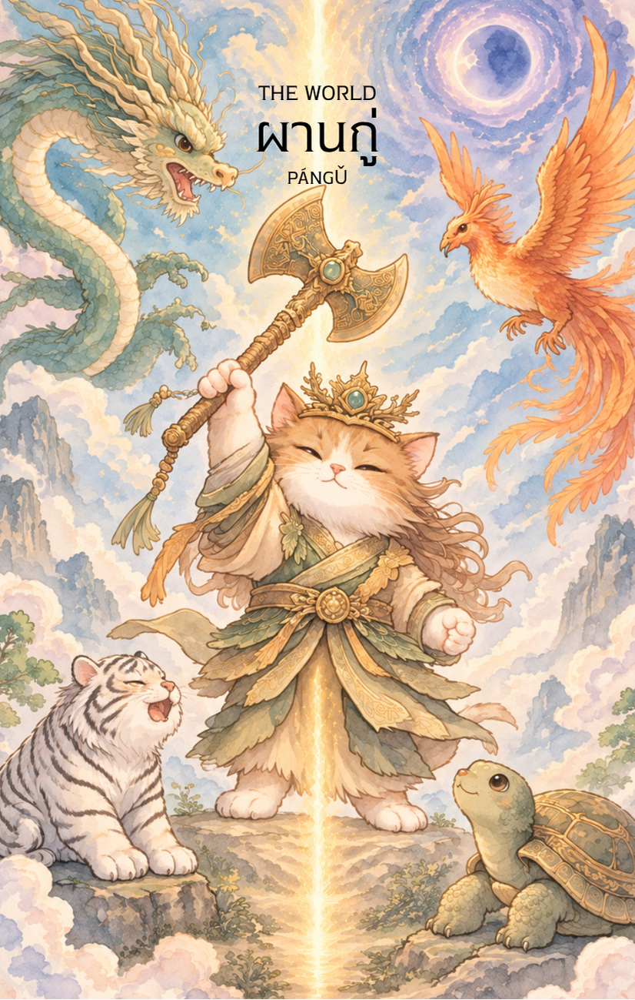

# 21-ผานกู่ (Pangu - 盤古) : The World

Created: February 3, 2026 8:27 PM

## **ผานกู่ (Pangu - 盤古) : The Primordial Architect**

**ธาตุประจำตัว:** ดิน (⛰️ Earth)
**คอนเซปต์หลัก:** การบรรลุความสำเร็จที่ยิ่งใหญ่ การสิ้นสุดของการเดินทางเพื่อเริ่มต้นนิรันดรกาล และความสมบูรณ์พูนสุข

### **1. แก่นแท้ของตัวละคร (The Essence)**

ผานกู่ คือ "ยักษ์ตนแรกผู้สร้างโลก" ท่านคือผู้ที่ตื่นขึ้นท่ามกลางความสับสนอลหม่าน (Chaos) แล้วใช้ขวานจามแยกฟ้าออกจากดิน แก่นแท้ของท่านในไพ่ใบนี้คือ **"การบรรลุจุดประสงค์สูงสุดของชีวิต" (Self-Actualization)** ท่านคือจุดสิ้นสุดของการพากเพียร (การค้ำยันฟ้าดินนับหมื่นปี) และเป็นจุดเริ่มต้นของโลกที่เรารู้จัก การปรากฏของไพ่ใบนี้คือสัญญาณว่า "ภารกิจเสร็จสิ้นแล้ว" ทุกอย่างถูกจัดวางไว้ในที่ที่ควรอยู่ และคุณได้กลายเป็นส่วนหนึ่งของภาพที่ยิ่งใหญ่กว่าเดิม

---

### **2. สัญลักษณ์และปรัชญา (Symbolism & Philosophy)**

- **ขวานแยกฟ้าดิน:** สื่อถึงการมีอำนาจในการจำแนกความจริงออกจากความลวง และการตัดสินใจที่เปลี่ยนโลกไปตลอดกาล ปรัชญาของการ "สร้างพื้นที่" ให้ชีวิตได้เติบโต
- **สภาวะหยินและหยางที่สมดุล:** สัญลักษณ์ของการรวมตัวกันของสิ่งตรงข้ามจนเกิดเป็นเอกภาพ (Unity) คือความเข้าใจถ่องแท้ว่าทุกสิ่งในจักรวาลเชื่อมโยงกัน
- **การเปลี่ยนร่างกายเป็นสรรพสิ่ง:** ปรัชญาของการเสียสละตัวตน (Ego) เพื่อกลายเป็นส่วนหนึ่งของส่วนรวม ผลงานของคุณในตอนนี้จะกลายเป็นมรดกที่ยั่งยืนสืบไป
- **ความว่างเปล่าสู่ความมีอยู่:** สื่อถึงการเติมเต็ม (Fullfillment) จากความไม่มีอะไร สู่ความอุดมสมบูรณ์ที่ไร้ขีดจำกัด

---

### **3. กลยุทธ์เมื่อปรากฏไพ่ใบนี้ (The Strategy)**

> *"เมื่อโลกทั้งใบอยู่ในมือคุณ จงเฉลิมฉลองและก้าวเดินต่อในฐานะผู้รู้แจ้ง"*
> 
- **Global Vision (กลยุทธ์การมองภาพใหญ่):** ตอนนี้ไม่ใช่เวลาจะมาสนใจเรื่องเล็กน้อยยิบย่อย ให้มองทุกอย่างในระดับ "มหภาค" เชื่อมโยงทุกองค์ประกอบเข้าด้วยกัน แล้วคุณจะเห็นโอกาสที่ยิ่งใหญ่ระดับโครงสร้าง
- **Integration & Completion (กลยุทธ์การปิดจบอย่างสมบูรณ์):** หากมีงานที่ค้างคา นี่คือเวลาที่ดีที่สุดในการปิดโปรเจกต์แบบสมบูรณ์แบบ (Masterpiece) ตรวจทานความเรียบร้อยครั้งสุดท้ายและส่งมอบผลงานด้วยความภูมิใจ
- **Expansion of Horizons (กลยุทธ์การขยายขอบเขต):** โลกของคุณกำลังจะกว้างขึ้น ไม่ว่าจะเป็นการเดินทางไปต่างแดน หรือการขยายทางความคิด จงเปิดรับวัฒนธรรมและประสบการณ์ใหม่ๆ เพราะตอนนี้ไม่มีกำแพงใดขวางกั้นคุณได้อีกแล้ว

---

### **4. คำแนะนำและการทำนาย (Reading Guidance)**

- **ภาพรวมของไพ่ใบนี้:** เป็นไพ่แห่ง **"ชัยชนะที่สมบูรณ์แบบ"** (The Ultimate Success) คุณได้เดินทางมาถึงจุดสูงสุดของวงจรนี้แล้ว ความพยายามทั้งหมดได้รับการตอบแทนอย่างคุ้มค่า จิตใจของคุณจะพบกับความสงบและความอิ่มเอมใจ เป็นเวลาแห่งการเก็บเกี่ยวผลผลิตที่คุณปลูกมาอย่างยาวนาน
- **การงาน/ธุรกิจ:** ประสบความสำเร็จในระดับกว้าง หรือได้รับการยอมรับในระดับสากล ธุรกิจมีความมั่นคงและขยายตัวได้อย่างไร้ขีดจำกัด หากมีการติดต่อสื่อสารกับต่างประเทศจะได้รับผลดีอย่างมหาศาล
- **การเงิน:** มั่งคั่งและสมบูรณ์พูนสุข มีอิสรภาพทางการเงิน และสามารถบริหารจัดการทรัพย์สินได้อย่างเป็นระบบ มีเกณฑ์ได้รับโชคลาภจากการลงทุนระยะยาวหรือจากแดนไกล
- **ความรัก:** ความสัมพันธ์ที่ลงตัว สมหวัง และมีความสุขอย่างที่สุด คนโสดมีเกณฑ์พบรักแท้ (Soulmate) ที่มาจากต่างถิ่นหรือเป็นคนที่เข้ามาเติมเต็มชีวิตได้อย่างสมบูรณ์ คนมีคู่คือช่วงเวลาของการสร้างครอบครัวที่มั่นคง
- **สุขภาพ:** สุขภาพกายและใจอยู่ในเกณฑ์ดีเยี่ยม มีพลังชีวิตเต็มเปี่ยม หากเคยเจ็บป่วยจะหายขาดและกลับมาแข็งแรงสมบูรณ์เหมือนได้ร่างกายใหม่ เป็นช่วงเวลาที่ธาตุในร่างกายทำงานอย่างสมดุลที่สุด

---

5. **บุคลิกของคนที่เป็นตัวแทนไพ่**

บุคคลที่สะท้อนพลังไพ่ใบนี้มักมองภาพใหญ่ มีความอดทน รับผิดชอบต่อส่วนรวม และปิดงานสำคัญได้อย่างสมบูรณ์ เป็นผู้สร้างระบบหรือรากฐานที่ส่งผลต่อคนจำนวนมาก ส่วนด้านเงาอาจรับภาระเกินกำลังหรือยึดติดกับความสมบูรณ์แบบ

6. **อาชีพที่พบได้บ่อย**

เหมาะกับงานสถาปัตยกรรม วิศวกรรม การวางระบบ บริหารองค์กร โครงการขนาดใหญ่ การพัฒนาโครงสร้างพื้นฐาน และบทบาทที่ต้องเชื่อมองค์ประกอบต่าง ๆ ให้สำเร็จเป็นภาพรวม

7. **Key Affirmation:** "ฉันคือส่วนหนึ่งของจักรวาล โลกของฉันสมบูรณ์แบบและเต็มไปด้วยโอกาสที่ไร้ขีดจำกัด"

8. **Keyword**

ความสมบูรณ์ • ความสำเร็จ • การบรรลุเป้าหมาย • ภาพใหญ่ • การสร้างโลก • Completion • Achievement • Integration • Wholeness • Creation

9. **ประวัติเทพเจ้าและตำนาน**

.

ผานกู่ (盤古)

ผานกู่ เป็นเทพบรรพกาลผู้ยิ่งใหญ่ในตำนานจีน และได้รับการยกย่องว่าเป็นผู้ให้กำเนิดโลกและจักรวาลตามความเชื่อของชาวจีนโบราณ เรื่องราวของผานกู่ถือเป็นหนึ่งในตำนานการสร้างโลกที่สำคัญที่สุดของจีน และเป็นจุดเริ่มต้นของสรรพสิ่งก่อนการถือกำเนิดของเหล่าเทพ มนุษย์ และสรรพชีวิตทั้งปวง

ตามตำนานเล่าว่า ในยุคแรกเริ่มนั้น จักรวาลยังไม่ได้แยกออกเป็นฟ้าและดิน ทุกสิ่งรวมตัวกันอยู่ภายในความว่างเปล่าอันมืดมิดและไร้รูปร่าง คล้ายไข่ฟองมหึมาที่เต็มไปด้วยพลังแห่งความโกลาหล

ภายในไข่แห่งจักรวาลนั้น มีผานกู่หลับใหลอยู่เป็นเวลานับหมื่นนับแสนปี จนกระทั่งวันหนึ่ง เมื่อพลังแห่งฟ้าดินเริ่มก่อตัวและเติบโตขึ้น ผานกู่จึงตื่นขึ้นจากการหลับใหลอันยาวนาน

เมื่อมองไปรอบตัวและเห็นว่าทุกสิ่งยังคงจมอยู่ในความมืดและความสับสน ผานกู่จึงหยิบขวานยักษ์ขึ้นมาและฟันลงไปยังไข่แห่งจักรวาลเพียงครั้งเดียว

เสียงสนั่นดังกึกก้องไปทั่วความว่างเปล่า

สิ่งที่เบาและบริสุทธิ์ลอยขึ้นสูงกลายเป็นท้องฟ้า ส่วนสิ่งที่หนักและขุ่นมัวจมลงกลายเป็นพื้นพิภพ นับเป็นการแยกฟ้าและดินออกจากกันเป็นครั้งแรก

อย่างไรก็ตาม หลังจากแยกออกแล้ว ฟ้าและดินยังคงพยายามกลับมารวมตัวกัน ผานกู่จึงยืนค้ำระหว่างฟ้ากับดินไว้ด้วยร่างกายของตนเอง ทุกวันท้องฟ้าจะสูงขึ้นหนึ่งจั้ง แผ่นดินจะหนาขึ้นหนึ่งจั้ง และร่างของผานกู่ก็จะเติบโตขึ้นหนึ่งจั้งตามไปด้วย

ตำนานกล่าวว่า ผานกู่ทำเช่นนี้ต่อเนื่องยาวนานถึงหนึ่งหมื่นแปดพันปี จนกระทั่งฟ้าและดินมั่นคงสมบูรณ์และไม่อาจกลับมารวมกันได้อีก

เมื่อภารกิจแห่งการสร้างโลกเสร็จสิ้น ผานกู่ก็หมดแรงและล้มลง ร่างกายของพระองค์ได้แปรเปลี่ยนกลายเป็นส่วนต่าง ๆ ของจักรวาล

ลมหายใจของพระองค์กลายเป็นสายลมและเมฆหมอก

เสียงของพระองค์กลายเป็นฟ้าร้อง

ดวงตาซ้ายกลายเป็นดวงอาทิตย์

ดวงตาขวากลายเป็นดวงจันทร์

โลหิตกลายเป็นแม่น้ำลำธาร

กล้ามเนื้อกลายเป็นผืนดินและภูเขา

เส้นผมกลายเป็นดวงดาวบนท้องฟ้า

กระดูกกลายเป็นแร่ธาตุและอัญมณี

แม้แต่เหงื่อที่ไหลออกจากร่างกาย ก็กลายเป็นสายฝนที่หล่อเลี้ยงสรรพชีวิต

ตำนานบางสำนวนยังกล่าวว่า ปรสิตหรือสิ่งมีชีวิตเล็ก ๆ ที่อาศัยอยู่บนร่างของผานกู่ ได้แปรเปลี่ยนกลายเป็นมนุษย์ในเวลาต่อมา ทำให้ผานกู่ไม่เพียงเป็นผู้สร้างโลก แต่ยังเป็นบรรพชนของสรรพชีวิตทั้งหลายอีกด้วย

แม้เรื่องราวของผานกู่จะปรากฏในเอกสารยุคหลังเมื่อเทียบกับตำนานของหนี่หวาหรือฝูซี แต่บทบาทของพระองค์กลับมีความสำคัญอย่างยิ่งในฐานะผู้เริ่มต้นทุกสิ่ง ตำนานนี้สะท้อนแนวคิดของชาวจีนโบราณเกี่ยวกับการกำเนิดของจักรวาล การแยกตัวของหยินและหยาง และการก่อกำเนิดของระเบียบจากความโกลาหล

ตลอดหลายศตวรรษที่ผ่านมา ผานกู่ได้รับการยกย่องในฐานะเทพบรรพกาลผู้เสียสละตนเองเพื่อสร้างโลก เป็นสัญลักษณ์ของพลังแห่งการเริ่มต้น การสร้างสรรค์ และความมุ่งมั่นที่นำความเป็นระเบียบมาสู่ความว่างเปล่า

ด้วยเหตุนี้ ผานกู่จึงได้รับการจดจำในฐานะผู้แยกฟ้าดิน ผู้สร้างจักรวาล และเทพองค์แรกแห่งตำนานจีน ผู้ซึ่งร่างกายและจิตวิญญาณได้หลอมรวมเป็นส่วนหนึ่งของโลกที่สรรพชีวิตอาศัยอยู่มาจนถึงปัจจุบัน