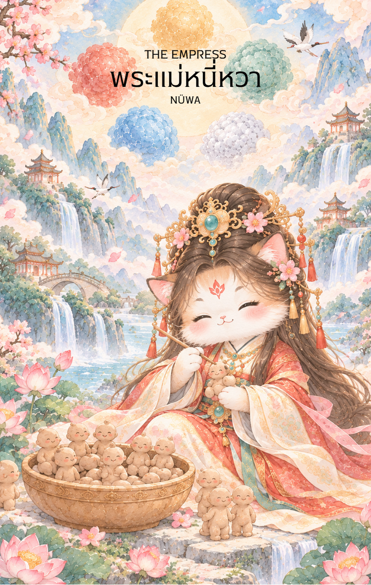

# 3-พระแม่หนี่วา (Nüwa - 女媧) : The Empress

Created: February 3, 2026 6:31 PM

---

## **พระแม่หนี่วา (Nüwa - 女媧) : The Empress**

**ธาตุประจำตัว:** ดิน (⛰️ Earth)

**คอนเซปต์หลัก:** การก่อกำเนิด ความอุดมสมบูรณ์ และการซ่อมแซมส่วนที่สึกหรอของชีวิต

### **1. แก่นแท้ของตัวละคร (The Essence)**

พระแม่หนี่วา คือ "มารดาผู้สร้างมนุษย์" และ "ผู้ซ่อมแซมฟ้า" ท่านคือตัวแทนของพลังงานเพศแม่ที่เต็มไปด้วยความรัก ความทะนุถนอม และความอุดมสมบูรณ์ แก่นแท้ของท่านคือ **การให้กำเนิด (Creation)** ไม่ว่าจะเป็นชีวิตใหม่ ไอเดียใหม่ หรือโอกาสใหม่ๆ ท่านคือผู้ที่เปลี่ยนดินเหนียวให้มีชีวิต และใช้หินห้าสีอุดรอยรั่วของสวรรค์ เปรียบเสมือนธาตุดินที่หนักแน่น เป็นที่พักพิง และเป็นแหล่งกำเนิดของสรรพสิ่งอย่างไม่มีที่สิ้นสุด

---

### **2. สัญลักษณ์และปรัชญา (Symbolism & Philosophy)**

- **หินห้าสี (Five-Colored Stones):** สื่อถึง "การแก้ปัญหาอย่างเบ็ดเสร็จ" และการดึงศักยภาพของธาตุทั้งห้ามาใช้เพื่อคืนความสมดุลให้แก่โลก คือปรัชญาของการเยียวยา (Healing) และการบูรณะสิ่งที่พังทลายให้กลับมาดีดังเดิม
- **ดินเหนียวเหลือง:** สัญลักษณ์ของการสร้างสรรค์จากสิ่งพื้นฐาน การเปลี่ยน "ไอเดีย" (ดิน) ให้กลายเป็น "ความจริง" (มนุษย์) โดยใส่จิตวิญญาณและความรักลงไปในชิ้นงาน
- **ร่างครึ่งมนุษย์ครึ่งงู:** สื่อถึงความเชื่อมโยงระหว่างสติปัญญาของเทพเจ้าและสัญชาตญาณดิบของธรรมชาติ การดำรงอยู่เพื่อรักษาวัฏจักรแห่งการเกิดและการเติบโต
- **วงเวียน/เข็มทิศ (ในบางตำนาน):** สื่อถึงกฎเกณฑ์ของธรรมชาติและความมีระเบียบแบบแผนในความอ่อนโยน การสร้างสิ่งที่ยิ่งใหญ่ต้องมีทั้งเมตตาและหลักการ

---

### **3. กลยุทธ์เมื่อปรากฏไพ่ใบนี้ (The Strategy)**

> *"ดูแลเพื่อเติบโต ซ่อมแซมเพื่อก้าวต่อ"*
> 
- **Nurturing Strategy (กลยุทธ์การบ่มเพาะ):** หากมีโปรเจกต์หรือความสัมพันธ์ในมือ ตอนนี้ไม่ใช่เวลาเร่งรัดผลลัพธ์ แต่เป็นเวลาของการ "รดน้ำพรวนดิน" จงให้ความสำคัญกับการดูแลเอาใจใส่และทำให้ทุกอย่างค่อยๆ เติบโตตามธรรมชาติ
- **Mending the Gap (กลยุทธ์การซ่อมแซม):** หากสถานการณ์รอบตัวเริ่มมีรอยร้าว ให้มองหา "หินห้าสี" หรือทรัพยากรที่มีอยู่มาอุดช่องว่างนั้น การแก้ไขปัญหาที่ต้นเหตุด้วยความละมุนละม่อมจะได้รับความร่วมมือดีกว่าการใช้อำนาจบังคับ
- **Abundance Mindset (กลยุทธ์แห่งความอุดมสมบูรณ์):** วางตัวเป็นผู้ให้ (Giver) มากกว่าผู้รับ ยิ่งคุณแบ่งปันความรู้ พลังงาน หรือความเมตตาออกไปมากเท่าไหร่ บารมีและโอกาสจะยิ่งไหลกลับมาหาคุณมากขึ้นเท่านั้น

---

### **4. คำแนะนำและการทำนาย (Reading Guidance)**

- **ภาพรวมของไพ่ใบนี้:** เป็นช่วงเวลาที่ "ทุกอย่างกำลังเบ่งบาน" คุณจะได้รับความเอ็นดูจากผู้ใหญ่หรือผู้ที่มีอิทธิพล มีความสุขสบายทั้งกายและใจ พลังสร้างสรรค์ของคุณอยู่ในจุดสูงสุด เหมาะแก่การริเริ่มสิ่งใหม่ที่จะสร้างความมั่นคงในระยะยาว
- **การงาน/ธุรกิจ:** มีการขยับขยายหรือได้รับโอกาสใหม่ๆ ที่ดีมาก ธุรกิจที่เกี่ยวกับความสวยความงาม ศิลปะ การดูแลเด็ก สุขภาพ หรือการเกษตรจะโดดเด่นเป็นพิเศษ ผลงานของคุณจะได้รับการยอมรับ
- **การเงิน:** มั่งคั่งและมั่นคง มีกระแสเงินสดไหลเวียนดี มีโชคลาภจากการสร้างสรรค์หรือสิ่งที่ลงทุนไว้ก่อนหน้าเริ่มออกดอกออกผลให้ชื่นใจ
- **ความรัก:** เป็นช่วงเวลาที่แสนหวานและอบอุ่น คนโสดมีเกณฑ์พบคนที่ดูแลเอาใจใส่ดี คนมีคู่มีความสัมพันธ์ที่มั่นคงและอาจมีข่าวดีเรื่องสมาชิกใหม่ในครอบครัว
- **สุขภาพ:** สุขภาพแข็งแรง มีความสมบูรณ์ในร่างกาย สำหรับผู้ที่เจ็บป่วยอยู่นับว่าเป็นข่าวดี เพราะการเยียวยาจะเห็นผลชัดเจน ให้ระวังเพียงเรื่องอาหารการกินที่อาจจะ "อุดมสมบูรณ์" เกินไปจนทำให้น้ำหนักเพิ่ม

---

5. **บุคลิกของคนที่เป็นตัวแทนไพ่**

บุคคลที่สะท้อนพลังไพ่ใบนี้มักเอื้อเฟื้อ ดูแลผู้อื่นเก่ง และมีความสามารถในการฟื้นฟูสิ่งที่เสียหายให้กลับมาเติบโต เป็นผู้สร้างความมั่นคงและความอบอุ่นให้คนรอบตัว ส่วนด้านเงาอาจแบกรับทุกอย่างไว้เองหรือควบคุมการเติบโตของผู้อื่นมากเกินไป

6. **อาชีพที่พบได้บ่อย**

เหมาะกับงานดูแล สุขภาพ การศึกษา เกษตรกรรม ออกแบบและก่อสร้าง การบริหารชุมชน งานครอบครัว และบทบาทที่ต้องซ่อมแซมหรือพัฒนาระบบให้ยั่งยืน

7. **Key Affirmation:** "ฉันคือบ่อเกิดแห่งความอุดมสมบูรณ์ ฉันสามารถเยียวยาและสร้างสรรค์ทุกสิ่งให้งดงามได้เสมอ"

8. **Keyword**

การสร้างสรรค์ • การบ่มเพาะ • ความอุดมสมบูรณ์ • การเยียวยา • ความมั่นคง • Creation • Nurturing • Abundance • Restoration • Stability

9. **ประวัติเทพเจ้า**

---

..

หนี่หวา (女媧)

หนี่หวา หรือ พระแม่หนี่หวา เป็นหนึ่งในเทพผู้ยิ่งใหญ่ที่สุดของตำนานจีนโบราณ และได้รับการยกย่องอย่างกว้างขวางในฐานะ "มารดาแห่งมนุษยชาติ" ผู้ให้กำเนิด คุ้มครอง และฟื้นฟูโลกในยามที่สรรพชีวิตต้องเผชิญวิกฤต นางถือเป็นหนึ่งในเทพบรรพกาลที่มีบทบาทสำคัญต่อการกำเนิดของมนุษย์และความเป็นระเบียบของโลกตามความเชื่อจีนโบราณ

เกี่ยวกับกำเนิดของพระแม่หนี่หวานั้น ปรากฏแตกต่างกันไปในแต่ละคัมภีร์และสำนักความเชื่อ บางตำนานกล่าวว่านางถือกำเนิดขึ้นในยุคแรกเริ่มของจักรวาล ก่อนที่ฟ้าดินจะถูกจัดระเบียบอย่างสมบูรณ์ ขณะที่บางสำนวนเชื่อว่านางเป็นหนึ่งในเทพบรรพกาลผู้ถือกำเนิดจากพลังแห่งธรรมชาติ และได้รับหน้าที่ดูแลความสมดุลของโลกหลังการสร้างสรรพสิ่ง

พระแม่หนี่หวามักถูกพรรณนาว่ามีร่างท่อนบนเป็นมนุษย์และท่อนล่างเป็นงูหรือมังกร เช่นเดียวกับ ฝูซี (伏羲) เทพผู้เป็นทั้งพี่น้องและคู่ครองของนาง ภาพของเทพทั้งสองที่มีหางเกี่ยวพันกันปรากฏอยู่ในศิลปะจีนโบราณจำนวนมาก และเป็นสัญลักษณ์ของความสมดุลระหว่างหยินและหยาง การกำเนิดของชีวิต และความกลมกลืนของจักรวาล

ในตำนานหลายสำนวน หนี่หวาและฝูซีถือเป็นบรรพชนคู่แรกของมนุษยชาติ ทั้งสองได้รับการยกย่องว่าเป็นผู้วางรากฐานอารยธรรมยุคแรก ไม่ว่าจะเป็นการสร้างครอบครัว การกำหนดพิธีแต่งงาน และการสอนให้ผู้คนอยู่ร่วมกันอย่างเป็นระเบียบ ด้วยเหตุนี้ ชาวจีนในหลายพื้นที่จึงเคารพนับถือพระแม่หนี่หวาในฐานะเทพผู้คุ้มครองครอบครัว การแต่งงาน และความอุดมสมบูรณ์

ตำนานที่เป็นที่รู้จักมากที่สุดเกี่ยวกับพระแม่หนี่หวา คือเรื่องราวการสร้างมนุษย์ เล่ากันว่า หลังจากฟ้าดินถือกำเนิดขึ้น โลกยังคงเงียบเหงาและว่างเปล่า แม่น้ำ ภูเขา และผืนป่าล้วนมีความงดงาม แต่กลับไม่มีสิ่งมีชีวิตใดที่สามารถชื่นชมและแบ่งปันความงดงามนั้นได้

วันหนึ่ง ขณะที่พระแม่หนี่หวาเดินอยู่ริมแม่น้ำเหลือง นางได้หยิบดินเหนียวสีเหลืองขึ้นมาปั้นเป็นรูปร่างคล้ายตนเอง เมื่อเป่าลมหายใจแห่งชีวิตลงไป รูปปั้นนั้นก็ลุกขึ้นยืนและมีชีวิต กลายเป็นมนุษย์คนแรกของโลก

พระแม่หนี่หวารู้สึกยินดีเป็นอย่างยิ่ง จึงปั้นมนุษย์เพิ่มขึ้นทีละคนด้วยความตั้งใจและความรัก แต่เมื่อจำนวนมนุษย์เพิ่มมากขึ้น นางตระหนักว่าคงไม่สามารถปั้นทุกคนด้วยมือได้ตลอดไป จึงนำเชือกจุ่มลงในโคลนแล้วสะบัดออกไป หยดดินที่กระจายลงสู่พื้นดินต่างกลายเป็นมนุษย์จำนวนมาก ตำนานนี้จึงกลายเป็นเรื่องเล่าที่อธิบายกำเนิดของมนุษยชาติในคติจีนโบราณ

ตำนานบางสำนวนยังเล่าว่า หลังจากสร้างมนุษย์แล้ว พระแม่หนี่หวาได้สอนให้ผู้คนรู้จักการสร้างครอบครัว การอยู่ร่วมกัน และการสืบทอดเผ่าพันธุ์ เพื่อให้มนุษย์สามารถดำรงชีวิตอยู่ได้ด้วยตนเอง นางจึงไม่ได้เป็นเพียงผู้สร้างชีวิต แต่ยังเป็นผู้ดูแลและเฝ้ามองการเติบโตของบุตรหลานที่ตนสร้างขึ้น

อีกตำนานหนึ่งที่สำคัญไม่แพ้กัน คือเหตุการณ์ที่โลกต้องเผชิญภัยพิบัติครั้งใหญ่ เมื่อเกิดการต่อสู้ระหว่างเทพและอสูรจนเสาค้ำฟ้าพังทลาย ท้องฟ้าแตกร้าว แผ่นดินแยกออกจากกัน เกิดน้ำท่วม ไฟไหม้ และสัตว์ร้ายออกอาละวาดไปทั่วทุกแห่ง มนุษย์จำนวนมากต้องเผชิญความทุกข์ยากและใกล้สูญสิ้น

เมื่อเห็นสรรพชีวิตกำลังเดือดร้อน พระแม่หนี่หวาจึงตัดสินใจช่วยเหลือโลก นางรวบรวมหินห้าสีจากทั่วสารทิศมาหลอมรวมกัน ก่อนนำไปอุดรอยร้าวบนท้องฟ้า จากนั้นจึงตัดขาของเต่ายักษ์มาทำเป็นเสาค้ำจุนฟ้าให้กลับคืนสู่สมดุลอีกครั้ง ตำนานบางสำนวนยังกล่าวว่านางได้ปราบสัตว์ร้ายและควบคุมน้ำหลาก เพื่อฟื้นฟูโลกให้กลับมาสงบสุขดังเดิม

เรื่องราวการซ่อมแซมท้องฟ้านี้ทำให้พระแม่หนี่หวาได้รับการยกย่องไม่เพียงในฐานะผู้สร้างมนุษย์ แต่ยังเป็นผู้พิทักษ์โลก ผู้เสียสละเพื่อปกป้องสรรพชีวิต และผู้ฟื้นฟูความสมดุลของธรรมชาติเมื่อเกิดความวุ่นวาย

ตลอดหลายพันปีที่ผ่านมา ชาวจีนจำนวนมากเคารพนับถือพระแม่หนี่หวาในฐานะเทพแห่งการกำเนิด ความอุดมสมบูรณ์ ความรักของมารดา การแต่งงาน และความสามัคคีของครอบครัว เพราะนางเป็นตัวแทนของพลังแห่งการสร้างสรรค์ การดูแล และการเติบโตอย่างไม่สิ้นสุด

ด้วยเหตุนี้ พระแม่หนี่หวาจึงได้รับการจดจำในฐานะมารดาแห่งมนุษยชาติ ผู้มอบชีวิตให้แก่โลก และผู้คอยปกป้องสรรพชีวิตด้วยความรัก ความเมตตา และความเสียสละอันยิ่งใหญ่ เรื่องราวของนางยังคงได้รับการเล่าขานสืบต่อกันมาหลายพันปี และเป็นหนึ่งในตำนานที่สำคัญที่สุดของอารยธรรมจีนจนถึงปัจจุบัน