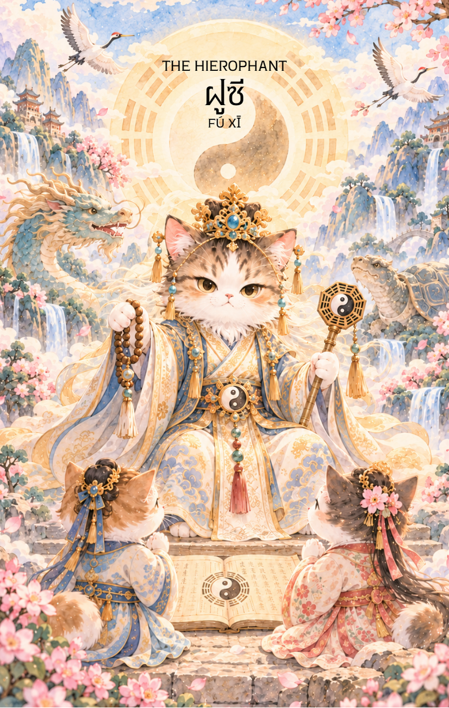

# 5-ฝูซี (Fu Xi - 伏羲) : The Hierophant

Created: February 3, 2026 6:31 PM

## **ฝูซี (Fu Xi - 伏羲) : The Sage of Laws**

**ธาตุประจำตัว:** ไม้ (🌲 Wood)
**คอนเซปต์หลัก:** ปัญญาแห่งการถอดรหัส ระบบระเบียบของธรรมชาติ และการสืบทอดความรู้จากรุ่นสู่รุ่น

### **1. แก่นแท้ของตัวละคร (The Essence)**

ฝูซี คือ "ปฐมกษัตริย์ผู้มอบอารยธรรม" ท่านคือมหาปราชญ์ผู้สังเกตการณ์ความเคลื่อนไหวของดาราศาสตร์และธรรมชาติจนสามารถถอดออกมาเป็น **"ผังแปดทิศ" (Bagua)** แก่นแท้ของท่านคือ **ปัญญาที่เป็นระบบ (Structured Wisdom)** และการเป็นสะพานเชื่อมระหว่างความลับของสวรรค์กับความเข้าใจของมนุษย์ เปรียบเสมือนธาตุไม้ที่เป็นรากฐานของความรู้ที่มั่นคงและแตกกิ่งก้านเป็นวิชาการต่างๆ ท่านคือ "ครู" ผู้สอนให้เราเข้าใจถึง "รูปแบบ" (Patterns) ของชีวิตเพื่อให้เราอยู่ร่วมกับธรรมชาติได้อย่างยั่งยืน

---

### **2. สัญลักษณ์และปรัชญา (Symbolism & Philosophy)**

- **ผังแปดทิศ (Bagua):** สื่อถึง "พิมพ์เขียวของจักรวาล" ปรัชญาของการหาจุดสมดุลและการเข้าใจว่าทุกสิ่งมีกฎเกณฑ์รองรับเสมอ ไม่มีอะไรเกิดขึ้นโดยบังเอิญ
- **แผ่นภาพเหอถู (Ho Tu):** สัญลักษณ์ของตรรกะและคณิตศาสตร์ระดับสูง สื่อถึงการใช้ปัญญาในการวิเคราะห์และจัดหมวดหมู่ความคิดให้เป็นระเบียบ
- **เครื่องมือจับปลาและล่าสัตว์:** สื่อถึง "วิชาชีพ" และการนำความรู้มาใช้เลี้ยงชีพได้จริง ปรัชญาของการสอนให้คนตกปลาดีกว่าการมอบปลาให้
- **มังกรและงู:** สื่อถึงการเปลี่ยนแปลงและวิวัฒนาการของจิตวิญญาณ การสืบทอดสายเลือดแห่งปัญญาที่เก่าแก่ที่สุด

---

### **3. กลยุทธ์เมื่อปรากฏไพ่ใบนี้ (The Strategy)**

> *"เข้าหาผู้รู้ เดินตามระบบ แล้วคุณจะพบคำตอบ"*
> 
- **Seek Mentorship (กลยุทธ์เข้าหาปราชญ์):** หากเจอปัญหาที่แก้ไม่ได้ด้วยตัวเอง ถึงเวลาต้องหาที่ปรึกษา ครูบาอาจารย์ หรือผู้เชี่ยวชาญเฉพาะทาง การเดินตามทางที่ผู้มีประสบการณ์เคยเดินไว้ก่อนจะช่วยให้คุณประหยัดเวลาได้มหาศาล
- **Systemic Thinking (กลยุทธ์การคิดเป็นระบบ):** อย่ามองปัญหาแค่จุดเดียว แต่ให้มองหา "รูปแบบ" (Pattern) ของสิ่งที่เกิดขึ้น ใช้เหตุผลและตรรกะมาจัดระเบียบความวุ่นวาย แล้วทางออกจะปรากฏขึ้นเองตามกฎเกณฑ์
- **Institutional Alignment (กลยุทธ์สืบทอดธรรมเนียม):** ในจังหวะนี้การทำตามขนบธรรมเนียม หรือการเข้าร่วมกับองค์กรที่มีมาตรฐานจะให้ผลดีกว่าการทำตัวเป็นกบฏ การเคารพกฎกติกาจะสร้างเกราะคุ้มกันให้คุณ

---

### **4. คำแนะนำและการทำนาย (Reading Guidance)**

- **ภาพรวมของไพ่ใบนี้:** เป็นไพ่แห่ง "การเรียนรู้และการสืบทอด" คุณกำลังอยู่ในช่วงที่ต้องหาความหมายของชีวิตผ่านความเชื่อหรือระบบระเบียบบางอย่าง พลังงานของไพ่นี้ค่อนข้างหนักแน่นและศักดิ์สิทธิ์ เป็นสัญญาณของการได้รับคำแนะนำที่ดีหรือการค้นพบสัจธรรมที่ช่วยให้ชีวิตมั่นคงขึ้น
- **การงาน/ธุรกิจ:** โดดเด่นเรื่องการศึกษา การฝึกอบรม หรือการวางระบบงานใหม่ให้เป็นมาตรฐาน การทำงานในองค์กรใหญ่ที่มีวัฒนธรรมแข็งแกร่งจะมีความก้าวหน้า มีโอกาสพบ "Mentor" ที่ช่วยชี้แนะแนวทาง
- **การเงิน:** มั่นคงตามระบบระเบียบ ไม่ใช่ช่วงเวลาของการเสี่ยงโชคแบบฉาบฉวย แต่เป็นเวลาของการออมหรือลงทุนตามตำรา การเงินจะดีขึ้นหากคุณมีความรู้ในการจัดการอย่างถูกต้อง
- **ความรัก:** เป็นความสัมพันธ์ที่เน้นความถูกต้องตามประเพณี หรือการคบหาที่อยู่ในสายตาผู้ใหญ่ มีความเข้าใจกันในเชิงจิตวิญญาณและศีลธรรมมากกว่าอารมณ์ชั่ววูบ
- **สุขภาพ:** สุขภาพโดยรวมคงที่ แต่ให้ระวังเรื่องกระดูก ข้อต่อ หรือฟัน การดูแลสุขภาพตามแนวทางโบราณหรือธรรมชาติบำบัดที่ได้รับการพิสูจน์มานานจะให้ผลดีเยี่ยม

---

5. **บุคลิกของคนที่เป็นตัวแทนไพ่**

บุคคลที่สะท้อนพลังไพ่ใบนี้มักใฝ่รู้ คิดเป็นระบบ สังเกตแบบแผนเก่ง และถ่ายทอดความรู้ให้ผู้อื่นเข้าใจได้ มีความอดทนต่อการศึกษาอย่างลึกซึ้ง ส่วนด้านเงาอาจยึดตำราหรือระบบเดิมจนไม่ยืดหยุ่น

6. **อาชีพที่พบได้บ่อย**

เหมาะกับงานวิชาการ การสอน วิจัย วิเคราะห์ข้อมูล วางระบบ เขียนตำรา ที่ปรึกษา และงานที่ต้องเชื่อมโยงข้อมูลซับซ้อนให้เป็นความเข้าใจที่ใช้ได้จริง

7. **Key Affirmation:** "ฉันเรียนรู้กฎของจักรวาล และใช้ปัญญาที่เป็นระบบนำพาชีวิตไปสู่ความเจริญที่มั่นคง"

8. **Keyword**

ปัญญา • การเรียนรู้ • ระบบ • แบบแผน • การถ่ายทอด • Wisdom • Learning • Structure • Patterns • Teaching

9. **ประวัติเทพเจ้า**

.

ฝูซี (伏羲)

ฝูซี เป็นหนึ่งในเทพบรรพกาลที่สำคัญที่สุดของตำนานจีนโบราณ และได้รับการยกย่องให้เป็นหนึ่งใน "สามกษัตริย์" (三皇) ผู้วางรากฐานอารยธรรมจีนในยุคแรกเริ่ม ตามความเชื่อของชาวจีนโบราณ หากพระแม่หนี่หวาเป็นผู้ให้กำเนิดมนุษย์ ฝูซีก็เปรียบเสมือนผู้มอบความรู้ ระเบียบ และวิถีชีวิตที่ทำให้มนุษย์สามารถพัฒนาเป็นสังคมและอารยธรรมได้

เกี่ยวกับกำเนิดของฝูซีนั้น ปรากฏแตกต่างกันไปในแต่ละตำนาน บางสำนวนกล่าวว่าท่านถือกำเนิดขึ้นในยุคแรกเริ่มของโลก ขณะที่บางคัมภีร์เชื่อว่าท่านเป็นหนึ่งในเทพบรรพกาลผู้ถือกำเนิดจากพลังแห่งฟ้าดิน เพื่อทำหน้าที่ดูแลและชี้นำมนุษยชาติในยุคที่โลกยังไร้ระเบียบ

ฝูซีมักถูกพรรณนาว่ามีร่างท่อนบนเป็นมนุษย์และท่อนล่างเป็นงูหรือมังกร เช่นเดียวกับ พระแม่หนี่หวา (女媧) ผู้เป็นทั้งพี่น้องและคู่ครองของท่าน ภาพของทั้งสองที่มีหางเกี่ยวพันกันปรากฏอยู่ในศิลปะจีนโบราณจำนวนมาก และเป็นสัญลักษณ์ของความสมดุลระหว่างหยินและหยาง ตลอดจนความกลมกลืนระหว่างพลังแห่งการสร้างสรรค์และพลังแห่งปัญญา

ในตำนานหลายสำนวน ฝูซีและหนี่หวาถูกยกย่องให้เป็นบรรพชนคู่แรกของมนุษยชาติ หลังจากที่พระแม่หนี่หวาสร้างมนุษย์ขึ้นมาแล้ว ฝูซีได้เข้ามาสอนให้ผู้คนรู้จักการใช้ชีวิตอย่างเป็นระบบ ท่านกำหนดกฎเกณฑ์เกี่ยวกับการแต่งงาน การสร้างครอบครัว และความสัมพันธ์ในสังคม เพื่อให้มนุษย์สามารถอยู่ร่วมกันได้อย่างสงบสุขและเป็นระเบียบ

นอกจากนี้ ฝูซียังได้รับการยกย่องว่าเป็นผู้สอนให้มนุษย์รู้จักการล่าสัตว์ การจับปลา การทำอวน การเลี้ยงสัตว์ และการใช้เครื่องมือพื้นฐานต่าง ๆ ในการดำรงชีวิต เรื่องเล่าเหล่านี้สะท้อนให้เห็นบทบาทของท่านในฐานะผู้เปลี่ยนมนุษย์จากสังคมดั้งเดิมที่ยังขาดความรู้ ให้ก้าวสู่การเป็นอารยธรรมที่มีระเบียบแบบแผนมากขึ้น

ตำนานที่สำคัญที่สุดเกี่ยวกับฝูซี คือเรื่องการกำเนิดของ "ปากั้ว" (八卦) หรือแปดสัญลักษณ์แห่งการเปลี่ยนแปลง ซึ่งถือเป็นรากฐานสำคัญของปรัชญาจีนโบราณ

เล่ากันว่า วันหนึ่งฝูซีได้พบ "ม้ามังกร" (龍馬) ศักดิ์สิทธิ์โผล่ขึ้นมาจากแม่น้ำเหลือง บนลำตัวของมันปรากฏลวดลายลึกลับที่สะท้อนกฎเกณฑ์ของธรรมชาติและการเคลื่อนไหวของจักรวาล ฝูซีจึงนำรูปแบบเหล่านั้นมาศึกษาและพัฒนาเป็นผังปากั้ว เพื่อใช้อธิบายความสัมพันธ์ระหว่างหยินและหยาง รวมถึงวัฏจักรแห่งการเปลี่ยนแปลงของสรรพสิ่ง

ต่อมา แนวคิดเรื่องปากั้วได้กลายเป็นรากฐานสำคัญของคัมภีร์อี้จิง (易經) หนึ่งในคัมภีร์คลาสสิกที่ทรงอิทธิพลที่สุดของจีน และส่งผลต่อศาสตร์แขนงต่าง ๆ ไม่ว่าจะเป็นฮวงจุ้ย โหราศาสตร์ การพยากรณ์ การแพทย์แผนจีน และปรัชญาเต๋า

ด้วยเหตุนี้ ฝูซีจึงไม่ได้เป็นเพียงบรรพชนของมนุษยชาติ หากยังเป็นผู้เปิดประตูแห่งภูมิปัญญา ผู้สังเกตธรรมชาติและค้นพบกฎเกณฑ์ที่ซ่อนอยู่เบื้องหลังการเปลี่ยนแปลงของโลก ท่านเป็นตัวแทนของความพยายามในการทำความเข้าใจจักรวาลผ่านการเรียนรู้ การสังเกต และการใคร่ครวญอย่างลึกซึ้ง

ตลอดหลายพันปีที่ผ่านมา ชาวจีนจำนวนมากเคารพนับถือฝูซีในฐานะครูผู้ยิ่งใหญ่แห่งอารยธรรม ผู้มอบองค์ความรู้ที่ช่วยให้มนุษย์สามารถพัฒนาตนเองและอยู่ร่วมกับธรรมชาติได้อย่างสมดุล เรื่องราวของท่านจึงไม่ได้เป็นเพียงตำนานของเทพโบราณ หากยังเป็นสัญลักษณ์ของปัญญา การเรียนรู้ และการแสวงหาความเข้าใจในกฎแห่งฟ้าดินที่ดำรงอยู่เหนือกาลเวลา

ด้วยเหตุนี้ ฝูซีจึงได้รับการจดจำในฐานะผู้วางรากฐานแห่งอารยธรรมจีน ผู้ค้นพบปากั้ว และมหาปราชญ์ผู้ถ่ายทอดองค์ความรู้จากธรรมชาติสู่มนุษยชาติ อันเป็นมรดกทางปัญญาที่ส่งต่อมาจนถึงปัจจุบัน