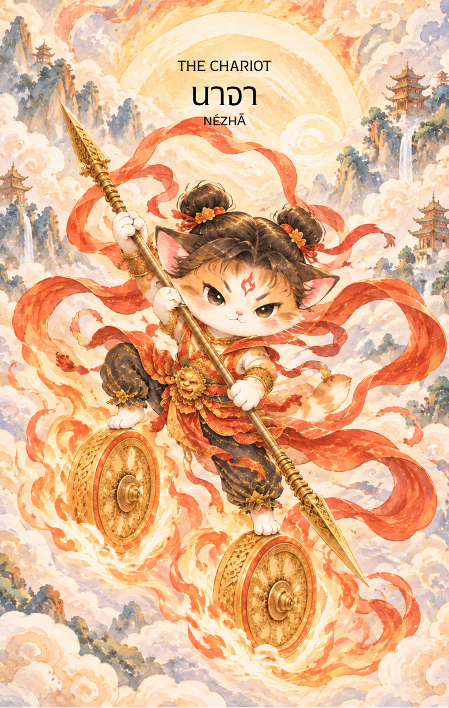

# 7-นาจา (Nezha - 哪吒) : The Chariot

Created: February 3, 2026 6:31 PM

## **นาจา (Nezha - 哪吒) : The Divine Rebel**

**ธาตุประจำตัว:** ไฟ (🔥 Fire)
**คอนเซปต์หลัก:** พลังแห่งการควบคุมความเร็ว ความพยายามที่เอาชนะโชคชะตา และการพุ่งทะยานสู่ชัยชนะ

### **1. แก่นแท้ของตัวละคร (The Essence)**

นาจา คือตัวแทนของ **"เจตจำนงที่ไม่มีใครหยุดได้"** ท่านคือเทพนักรบผู้เกิดมาพร้อมพลังมหาศาลและการท้าทายกฎเกณฑ์เดิมๆ แก่นแท้ของท่านคือความกล้าหาญที่จะเผชิญหน้ากับอุปสรรคยักษ์ใหญ่ (เช่น พญามังกร) และการเกิดใหม่จากดอกบัวซึ่งสื่อถึงการควบคุมพลังงานดิบในตัวเองให้กลายเป็นอาวุธที่ทรงประสิทธิภาพ คือการตัดสินใจที่จะ "บุก" โดยมีเป้าหมายที่ชัดเจนและการควบคุมความเร็วอย่างแม่นยำบนกงล้อไฟ

---

### **2. สัญลักษณ์และปรัชญา (Symbolism & Philosophy)**

- **กงล้อไฟ (Wind Fire Wheels):** สื่อถึงความเร็ว การเคลื่อนที่อย่างรวดเร็ว และพลังที่ไม่เคยหยุดนิ่ง คือปรัชญาของการมุ่งไปข้างหน้าโดยไม่หันหลังกลับ
- **ห่วงจักรวาลและผ้าแพรแดง (Universe Ring & Armillary Sash):** สัญลักษณ์ของการควบคุม (Control) พลังที่รุนแรงหากขาดการควบคุมจะเป็นอันตราย แต่หากควบคุมได้จะเป็นอาวุธที่ไม่มีใครต้านทานได้
- **การเกิดใหม่จากดอกบัว:** ปรัชญาของการ "สร้างตัวตนใหม่" ที่แข็งแกร่งกว่าเดิม การก้าวข้ามความผิดพลาดในอดีตเพื่อมาเป็นผู้ชนะในปัจจุบัน
- **ทวนอัคคี:** สื่อถึงความเฉียบคมและการโฟกัสที่จุดเดียว การโจมตีเป้าหมายอย่างแม่นยำด้วยความรวดเร็ว

---

### **3. กลยุทธ์เมื่อปรากฏไพ่ใบนี้ (The Strategy)**

> *"คุมบังเหียนความเร็ว มุ่งหน้าสู่เป้าหมาย อย่าให้สิ่งใดขวางทาง"*
> 
- **Victory through Willpower (กลยุทธ์ชัยชนะด้วยเจตจำนง):** หากคุณมีเป้าหมายตอนนี้ ห้ามลังเล ไพ่ใบนี้บอกให้คุณ "รุก" ทันที ความพยายามอย่างหนักและการไม่ยอมแพ้จะนำมาซึ่งความสำเร็จที่ยิ่งใหญ่
- **Mastering the Inner Fire (กลยุทธ์ควบคุมอารมณ์):** ในขณะที่พุ่งไปข้างหน้า คุณต้องคุมสติให้อยู่ อย่าให้อารมณ์หรือแรงผลักดันที่วู่วามพาคุณออกนอกลู่นอกทาง การเป็นผู้นำที่เก่งต้องคุมทั้ง "ความเร็ว" และ "ทิศทาง" ให้ได้พร้อมกัน
- **Breakthrough (กลยุทธ์การฝ่าด่าน):** หากเจอทางตันหรือกำแพงที่ขวางหน้า ให้ใช้พลังทั้งหมดพุ่งชนหรือหาทางข้ามไปอย่างรวดเร็ว ความนิ่งเฉยในตอนนี้คือความพ่ายแพ้ การเคลื่อนไหวคือทางรอด

---

### **4. คำแนะนำและการทำนาย (Reading Guidance)**

- **ภาพรวมของไพ่ใบนี้:** เป็นไพ่แห่ง **"ชัยชนะและการเดินทาง"** คุณกำลังเข้าสู่ช่วงเวลาที่ต้องใช้พละกำลังและความอดทนสูง มีโอกาสประสบความสำเร็จในสิ่งที่ยากลำบาก หรือชนะการแข่งขันที่รุนแรง พลังงานรอบตัวคุณพุ่งพล่านและเต็มไปด้วยแรงขับเคลื่อน
- **การงาน/ธุรกิจ:** การแข่งขันจะเข้มข้นแต่คุณจะเป็นฝ่ายชนะ โปรเจกต์ที่ต้องใช้ความรวดเร็วหรือการติดต่อสื่อสารกับต่างถิ่นจะไปได้ดีมาก เป็นช่วงเวลาที่เหมาะกับการขยับขยายหรือบุกตลาดใหม่ๆ
- **การเงิน:** การเงินไหลเวียนเร็ว มีโอกาสได้เงินจากการเดินทางหรือการแข่งขัน แต่อาจมีรายจ่ายที่เกิดขึ้นอย่างรวดเร็วเช่นกัน (Fast In, Fast Out) ให้ระวังการตัดสินใจทางการเงินที่ใจร้อนเกินไป
- **ความรัก:** เป็นความรักที่ต้อง "รุก" หรือต้องฝ่าฟันอุปสรรคร่วมกัน หากมีปัญหากันอยู่ การเดินทางท่องเที่ยวร่วมกันจะช่วยปรับความเข้าใจได้ดี สำหรับคนโสดอาจพบรักจากการเดินทางหรือการทำงาน
- **สุขภาพ:** สุขภาพแข็งแรง มีพลังงานเหลือเฟือ แต่ให้ระวังอุบัติเหตุจากการเดินทาง ความร้อนในร่างกาย หรืออาการบาดเจ็บจากการขยับตัวเร็วเกินไป (Hyperactivity)

---

5. **บุคลิกของคนที่เป็นตัวแทนไพ่**

บุคคลที่สะท้อนพลังไพ่ใบนี้มักกล้าหาญ กระตือรือร้น และมุ่งมั่นเอาชนะข้อจำกัด มีพลังเริ่มต้นใหม่หลังความผิดพลาดและพร้อมรับผิดชอบต่อการกระทำ ส่วนด้านเงาอาจใจร้อน แข่งขันสูง หรือใช้พลังเกินกำลัง

6. **อาชีพที่พบได้บ่อย**

เหมาะกับงานที่ต้องเคลื่อนไหวและตัดสินใจเร็ว เช่น กีฬา ทหารและกู้ภัย การเดินทาง โลจิสติกส์ การแข่งขัน การบริหารโครงการ และงานบุกเบิกที่ต้องฝ่าข้อจำกัด

7. **Key Affirmation:** "ฉันมุ่งหน้าสู่ชัยชนะด้วยเจตจำนงที่แข็งแกร่ง และพลังที่ไม่มีวันมอดไหม้"

8. **Keyword**

ชัยชนะ • ความมุ่งมั่น • ความเร็ว • การควบคุม • การเกิดใหม่ • Victory • Willpower • Momentum • Self-Control • Rebirth

9. **ประวัติเทพเจ้าและตำนาน**

..

นาจา (哪吒)

นาจา เป็นหนึ่งในเทพนักรบที่มีชื่อเสียงและได้รับความนิยมมากที่สุดในตำนานจีน ปรากฏอยู่ในวรรณกรรมสำคัญหลายเรื่อง โดยเฉพาะ ห้องสิน (封神演義) และ ไซอิ๋ว (西遊記) ซึ่งล้วนกล่าวถึงความกล้าหาญ อิทธิฤทธิ์ และการต่อสู้กับอำนาจอยุติธรรมของเขา จนกลายเป็นหนึ่งในเทพผู้พิทักษ์ที่ชาวจีนรู้จักกันอย่างกว้างขวาง

เกี่ยวกับกำเนิดของนาจานั้น ถือเป็นเรื่องราวที่แปลกประหลาดที่สุดเรื่องหนึ่งในตำนานจีน เล่าว่า มารดาของเขา คือ นางอิ่น (殷氏) ภรรยาของแม่ทัพหลี่จิ้ง (李靖) ตั้งครรภ์อยู่นานถึงสามปีหกเดือน ก่อนจะให้กำเนิดก้อนเนื้อประหลาดแทนทารก

เมื่อหลี่จิ้งเห็นก้อนเนื้อดังกล่าว จึงเข้าใจว่าเป็นลางร้ายและใช้ดาบฟันออก แต่ภายในกลับปรากฏเด็กชายผู้หนึ่งที่มีร่างกายสมบูรณ์และเปล่งรัศมีสว่างไสว เด็กคนนั้นก็คือนาจา ผู้ซึ่งได้รับการทำนายตั้งแต่แรกเกิดว่าจะมีชะตาไม่ธรรมดา

หลังจากนั้น ไท่อี่เจินเหริน (太乙真人) เซียนผู้ยิ่งใหญ่แห่งสำนักเต๋า ได้รับนาจาเป็นศิษย์และถ่ายทอดวิชาให้ พร้อมมอบสมบัติวิเศษประจำกายหลายชิ้น ไม่ว่าจะเป็นห่วงจักรวาล (乾坤圈) ผ้าแพรแดงหุนเทียนหลิง (混天綾) และกงล้อไฟวายุ (風火輪) ซึ่งทำให้นาจาสามารถเหาะเหินและต่อสู้กับศัตรูได้อย่างคล่องแคล่ว

แม้จะมีพลังอันยิ่งใหญ่ตั้งแต่วัยเยาว์ แต่นาจาก็มีนิสัยกล้าหาญ เด็ดเดี่ยว และค่อนข้างหุนหันพลันแล่น ตำนานที่เป็นที่รู้จักมากที่สุดเกิดขึ้นเมื่อเขาออกไปเล่นน้ำที่ทะเลตะวันออก และใช้ผ้าแพรวิเศษจนสร้างความปั่นป่วนไปทั่วท้องทะเล เหตุการณ์ดังกล่าวนำไปสู่การเผชิญหน้ากับ อ๋าวปิ่ง (敖丙) โอรสของราชามังกรทะเลตะวันออก

การต่อสู้ครั้งนั้นจบลงด้วยความพ่ายแพ้ของอ๋าวปิ่ง ทำให้ราชามังกรโกรธแค้นอย่างยิ่ง และขึ้นไปฟ้องร้องต่อสวรรค์เพื่อเอาผิดนาจา พร้อมทั้งข่มขู่ว่าจะลงโทษครอบครัวและชาวเมืองให้ได้รับความเดือดร้อน

เมื่อตระหนักว่าการกระทำของตนอาจนำภัยมาสู่บิดามารดาและผู้บริสุทธิ์ นาจาจึงตัดสินใจรับผิดชอบด้วยตนเอง ตำนานเล่าว่า เขาคืนเลือดคืนเนื้อให้แก่บิดามารดา และสละชีวิตตนเองเพื่อยุติความขัดแย้ง เหตุการณ์นี้กลายเป็นตอนสำคัญที่สุดตอนหนึ่งในเรื่องราวของนาจา และมักถูกกล่าวถึงในฐานะสัญลักษณ์แห่งความกตัญญูและความรับผิดชอบต่อผลของการกระทำ

อย่างไรก็ตาม ชีวิตของนาจาไม่ได้สิ้นสุดลงเพียงเท่านั้น

เมื่อเห็นว่าศิษย์ผู้เป็นที่รักยังมีภารกิจสำคัญรออยู่ ไท่อี่เจินเหรินจึงใช้รากบัว ใบบัว และพลังอาคมสร้างร่างใหม่ให้แก่นาจา จนเขากลับมามีชีวิตอีกครั้งในร่างกายใหม่ที่แข็งแกร่งกว่าเดิม ตำนานนี้ทำให้นาจากลายเป็นสัญลักษณ์ของการเกิดใหม่ การเริ่มต้นใหม่ และการก้าวข้ามชะตากรรมเดิมของตนเอง

หลังจากฟื้นคืนชีพ นาจาได้ออกเดินทางฝึกฝนตนเองและเข้าร่วมเหตุการณ์สำคัญมากมายในมหากาพย์ห้องสิน เขาต่อสู้กับอสูร ปีศาจ และกองกำลังที่กดขี่ผู้คน สร้างวีรกรรมจำนวนมาก จนได้รับการยกย่องให้เป็นหนึ่งในเทพนักรบผู้พิทักษ์แห่งสวรรค์

ตลอดหลายศตวรรษที่ผ่านมา นาจาได้รับความนิยมอย่างต่อเนื่องในหมู่ชาวจีน เพราะเรื่องราวของเขาไม่ได้เป็นเพียงตำนานการต่อสู้เท่านั้น แต่ยังสะท้อนถึงการเติบโตของมนุษย์ การเรียนรู้จากความผิดพลาด ความกล้าหาญในการรับผิดชอบต่อการกระทำของตนเอง และการลุกขึ้นเริ่มต้นใหม่หลังผ่านช่วงเวลาที่ยากลำบาก

ด้วยเหตุนี้ นาจาจึงเป็นหนึ่งในเทพที่ได้รับความเคารพนับถือในฐานะผู้พิทักษ์ ผู้ปราบปรามความชั่วร้าย และตัวแทนของพลังแห่งความมุ่งมั่นที่ไม่ยอมจำนนต่อโชคชะตา