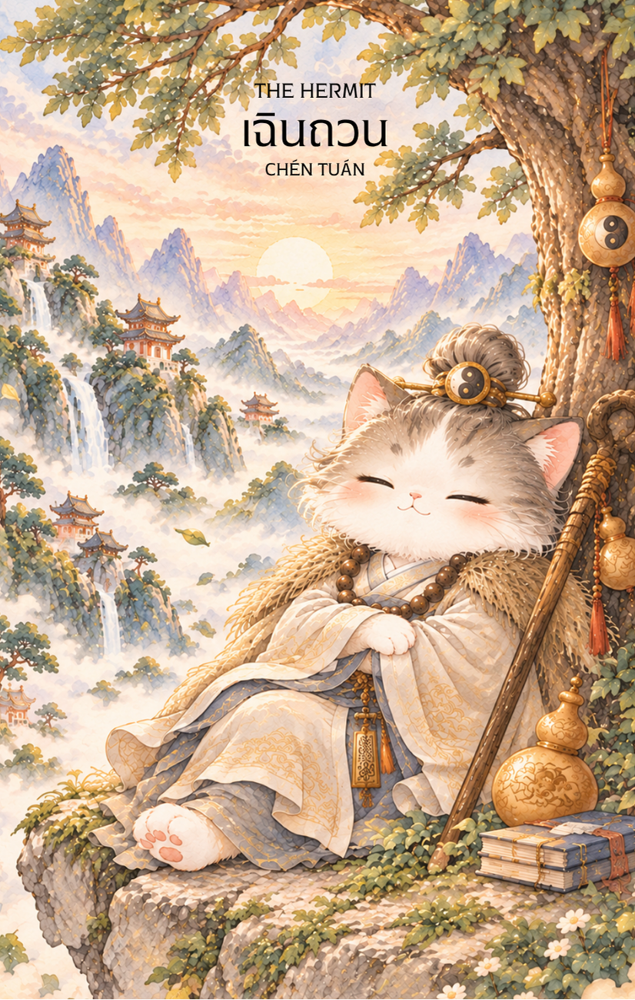

# 9-เฉินป๋อ (Chen Bo - 陳摶) : The Hermit

Created: February 3, 2026 7:36 PM

## **เฉินป๋อ (Chen Bo - 陳摶) : The Sleeping Sage**

**ธาตุประจำตัว:** ดิน (⛰️ Earth)
**คอนเซปต์หลัก:** ปัญญาที่เกิดจากความสงบนิ่ง การเดินทางเข้าสู่ภายใน และการหยั่งรู้กฎแห่งเวลา

### **1. แก่นแท้ของตัวละคร (The Essence)**

เฉินป๋อ หรือ "เฉินซีอี" คือมหาปราชญ์เจ้าของฉายา **"เซียนบรรทม" (The Sleeping Immortal)** ผู้ที่สามารถเข้าสู่ภาวะสมาธิผ่านการนอนหลับได้นานนับเดือน แก่นแท้ของท่านคือ **"ปัญญาญาณจากการหยุดนิ่ง"** ท่านไม่ได้แสวงหาคำตอบจากโลกภายนอก แต่กลับถอยห่างจากความวุ่นวายเพื่อสำรวจจักรวาลภายในจิตใจ จนสามารถถอดรหัสลับของดวงดาว (วิชาซื่อเวยโต่วซู) และคัมภีร์อี้จิงได้ลึกซึ้ง ท่านคือตัวแทนของความสันโดษที่ไม่ได้หมายถึงความอ้างว้าง แต่คือความร่ำรวยด้วยปัญญาที่เกิดจากการตกตะกอนความคิด

---

### **2. สัญลักษณ์และปรัชญา (Symbolism & Philosophy)**

- **ท่านอนหลับ (Sleeping Posture):** ไม่ใช่ความเกียจคร้าน แต่คือ "การเข้าฌาน" ขั้นสูง ปรัชญาของการหยุดความเคลื่อนไหวทางกายเพื่อเปิดการทำงานของจิตวิญญาณ
- **ดวงดาวและแผนภูมิสวรรค์:** สื่อถึงการเชื่อมโยงระหว่างชะตาชีวิตและจักรวาล การมองเห็น "ภาพกว้าง" ของอนาคตผ่านการใคร่ครวญอย่างลึกซึ้ง
- **น้ำเต้าและคัมภีร์:** สัญลักษณ์ของความรู้ที่ถูกจัดเก็บไว้อย่างดีและการบ่มเพาะปัญญาให้สุกงอมก่อนนำมาใช้
- **ภูเขาหัวซาน:** สถานที่ปลีกวิเวก สื่อถึงการตั้งฐานจิตที่มั่นคงดั่งขุนเขา ไม่หวั่นไหวต่อกระแสโลกที่เปลี่ยนแปลง

---

### **3. กลยุทธ์เมื่อปรากฏไพ่ใบนี้ (The Strategy)**

> *"ในความเงียบสงัด... เสียงของคำตอบจะดังที่สุด"*
> 
- **The Power of Stillness (กลยุทธ์สงบนิ่งสยบความเคลื่อนไหว):** หากคุณกำลังเผชิญหน้ากับความสับสน อย่ารีบวิ่งหาคำตอบข้างนอก การถอยออกมาอยู่ในพื้นที่ส่วนตัวเพื่อทบทวนสถานการณ์จะทำให้คุณเห็นสิ่งที่คนอื่นมองข้าม
- **Self-Discovery (กลยุทธ์สำรวจภายใน):** ใช้ช่วงเวลานี้ในการศึกษาหาความรู้เพิ่มเติม หรือทบทวนเป้าหมายที่แท้จริงของตัวเอง การอยู่กับตัวเองจะช่วยให้คุณ "ตกตะกอน" และพบทางออกที่เฉียบแหลมกว่าเดิม
- **Time Mastery (กลยุทธ์การบริหารจังหวะเวลา):** เฉินป๋อรู้ดีว่าเมื่อไหร่ควรหลับและเมื่อไหร่ควรตื่น คุณต้องเรียนรู้ที่จะรอคอยจังหวะที่เหมาะสม อย่าเพิ่งรีบเปิดเผยแผนการหรือลงมือทำในขณะที่ข้อมูลยังไม่ครบถ้วน

---

### **4. คำแนะนำและการทำนาย (Reading Guidance)**

- **ภาพรวมของไพ่ใบนี้:** เป็นช่วงเวลาที่คุณต้อง **"หยุดเพื่อก้าวต่อ"** พลังงานของไพ่เน้นการใช้สมาธิและการปลีกตัวออกจากสังคมชั่วคราวเพื่อค้นหาความจริง คุณจะได้รับคำแนะนำจากผู้รู้หรือเกิดปัญญาญาณขึ้นมาเองในความสงบ
- **การงาน/ธุรกิจ:** ไม่เหมาะกับการออกหน้าหรืองานที่ต้องปะทะกับผู้คนมากนัก แต่โดดเด่นมากสำหรับงานวิจัย งานวางแผนกลยุทธ์เบื้องหลัง หรือการศึกษาต่อ ทักษะที่คุณแอบฝึกฝนเงียบๆ จะกลายเป็นไม้ตายสำคัญในอนาคต
- **การเงิน:** มีรายได้มั่นคงแบบค่อยเป็นค่อยไป ไม่แนะนำให้ลงทุนตามกระแสหรือตามคำชวนของผู้อื่น การเงินจะดีขึ้นจากการวางแผนระยะยาวด้วยตัวเองและการรู้จักใช้จ่ายอย่างพอเพียง
- **ความรัก:** สำหรับคนโสดคือช่วงเวลาที่รักสันโดษและมีความสุขกับตัวเองมากกว่าการมีคู่ ส่วนคนมีคู่อาจต้องการพื้นที่ส่วนตัวหรือระยะห่างเพื่อทบทวนความรู้สึกของตนเอง (Space is needed)
- **สุขภาพ:** สุขภาพโดยรวมปกติ แต่ควรเน้นเรื่องการพักผ่อนและการนอนหลับให้เพียงพอ ระวังความเครียดที่เกิดจากการคิดวนเวียนอยู่ในหัว (Overthinking) การฝึกโยคะหรือนั่งสมาธิจะให้ผลดีเป็นพิเศษ

---

5. **บุคลิกของคนที่เป็นตัวแทนไพ่**

บุคคลที่สะท้อนพลังไพ่ใบนี้มักสงบ รักความเป็นส่วนตัว และใช้เวลาคิดทบทวนก่อนตัดสินใจ มีความสามารถในการสังเกตและสังเคราะห์ข้อมูลอย่างลึกซึ้ง ส่วนด้านเงาอาจแยกตัวมากเกินไปหรือใช้การพักผ่อนหลีกเลี่ยงเรื่องที่ต้องเผชิญ

6. **อาชีพที่พบได้บ่อย**

เหมาะกับงานวิจัย วิเคราะห์ วางแผน ปรัชญา การเขียน การให้คำปรึกษา โหราศาสตร์ และงานเบื้องหลังที่ต้องอาศัยสมาธิและความเข้าใจแบบแผน

7. **Key Affirmation:** "ในความเงียบสงบ ฉันจะพบปัญญาที่แท้จริง และความจริงจะนำทางชีวิตฉัน"

8. **Keyword**

ความสงบนิ่ง • ปัญญา • การใคร่ครวญ • การสันโดษ • จังหวะเวลา • Stillness • Wisdom • Reflection • Solitude • Timing

9. **ประวัติบุคคลและตำนาน**

…

เฉินถวน (陳摶)
เฉินถวน หรือที่รู้จักกันในนาม เฉินถวนเหล่าจู่ (陳摶老祖) เป็นนักพรตและปราชญ์เต๋าที่มีชื่อเสียงในช่วงปลายราชวงศ์ถังและต้นราชวงศ์ซ่ง แม้จะเป็นบุคคลที่มีตัวตนอยู่จริงในประวัติศาสตร์ แต่เรื่องราวเกี่ยวกับท่านได้ถูกเล่าขานและเพิ่มเติมจนกลายเป็นตำนาน จนได้รับการยกย่องให้เป็นหนึ่งในเซียนผู้มีอิทธิพลต่อแนวคิดเต๋า โหราศาสตร์ และศาสตร์พยากรณ์ของจีน
เฉินป๋อเกิดราวคริสต์ศตวรรษที่ 9 ในช่วงเวลาที่แผ่นดินจีนกำลังเผชิญความวุ่นวายจากการเปลี่ยนผ่านทางการเมือง ตั้งแต่วัยหนุ่ม ท่านเป็นผู้ใฝ่ศึกษา มีความรู้แตกฉานทั้งคัมภีร์ขงจื๊อ พุทธศาสนา และลัทธิเต๋า จนได้รับการยอมรับว่าเป็นผู้มีสติปัญญาโดดเด่นเหนือคนทั่วไป
ตำนานเล่าว่า แม้จะมีความสามารถเพียงพอที่จะเข้ารับราชการและสร้างชื่อเสียงในทางโลก แต่เฉินป๋อกลับเลือกละทิ้งเส้นทางแห่งอำนาจ เพื่อออกแสวงหาความจริงของชีวิตและศึกษาวิถีแห่งเต๋า ท่านเดินทางไปยังภูเขาหัวซาน (華山) ซึ่งต่อมากลายเป็นสถานที่สำคัญที่ผู้คนเชื่อว่าเป็นสำนักบำเพ็ญเพียรของท่าน
เรื่องราวที่ทำให้เฉินป๋อเป็นที่รู้จักมากที่สุด คือความสามารถในการเข้าสมาธิเป็นเวลายาวนาน ตำนานหลายสำนวนกล่าวว่า ท่านสามารถหลับต่อเนื่องได้หลายวัน หลายเดือน หรือแม้กระทั่งหลายปี จนได้รับฉายาว่า "เซียนหลับ" (睡仙)
อย่างไรก็ตาม การหลับของเฉินป๋อมิได้หมายถึงความเกียจคร้าน หากเป็นสัญลักษณ์ของการตัดขาดจากความวุ่นวายภายนอกเพื่อเข้าสู่การภาวนาและการตระหนักรู้ภายใน ในคติเต๋า การสงบนิ่งและการกลับคืนสู่ธรรมชาติของจิตใจถือเป็นหนทางสำคัญสู่ปัญญาอันแท้จริง
นอกจากการบำเพ็ญเพียรแล้ว เฉินป๋อยังได้รับการยกย่องว่าเป็นผู้เชี่ยวชาญด้านคัมภีร์อี้จิง (易經) ศาสตร์หยินหยาง และการพยากรณ์ ตำนานบางสำนักเชื่อว่าท่านเป็นผู้ถ่ายทอดองค์ความรู้ที่ต่อมาพัฒนาเป็นศาสตร์ "ไท่อี่" และ "จื่อเว่ยโต่วซู่" รวมถึงมีอิทธิพลต่อแนวคิดด้านฮวงจุ้ยและโหราศาสตร์จีนในยุคหลัง
อีกตำนานหนึ่งที่เป็นที่รู้จักคือเรื่อง "แผนภาพมังกรม้า" และ "แผนภาพเหอถู-ลั่วซู" ซึ่งกล่าวว่าเฉินป๋อสามารถเข้าถึงความลับของจักรวาลผ่านการศึกษากฎแห่งหยินหยางและการเปลี่ยนแปลงของฟ้าดิน จนเข้าใจความสัมพันธ์ระหว่างมนุษย์ ธรรมชาติ และโชคชะตาอย่างลึกซึ้ง
ด้วยความรู้และการบำเพ็ญเพียรอันยาวนาน ผู้คนในยุคต่อมาจึงยกย่องเฉินป๋อให้เป็นเซียนผู้หยั่งรู้อนาคต ผู้เข้าใจความเปลี่ยนแปลงของโลก และเป็นครูทางจิตวิญญาณของผู้แสวงหาปัญญา
ตลอดหลายศตวรรษที่ผ่านมา ภาพลักษณ์ของเฉินป๋อจึงไม่ได้เป็นเพียงนักพรตผู้วิเศษ แต่เป็นสัญลักษณ์ของการใคร่ครวญ การมองลึกเข้าไปในธรรมชาติของชีวิต และการแสวงหาความจริงที่ซ่อนอยู่เบื้องหลังความเปลี่ยนแปลงทั้งปวง
ด้วยเหตุนี้ เฉินป๋อจึงได้รับการจดจำในฐานะปราชญ์ผู้มองเห็นสิ่งที่ผู้อื่นมองไม่เห็น และผู้ใช้ความสงบนิ่งเป็นประตูสู่ปัญญาอันลึกซึ้งของจักรวาล

…

เฉินถวน (陳摶)
เฉินถวน หรือที่รู้จักกันในนาม เฉินถวนเหล่าจู่ (陳摶老祖) และ เซียนซีอี๋ (希夷先生) เป็นนักพรตและปราชญ์เต๋าผู้มีชื่อเสียงในช่วงปลายราชวงศ์ถังถึงต้นราชวงศ์ซ่ง แม้จะเป็นบุคคลที่มีตัวตนจริงในประวัติศาสตร์ แต่เรื่องราวเกี่ยวกับท่านได้ถูกเล่าขานและเพิ่มเติมผ่านกาลเวลาจนกลายเป็นตำนาน และได้รับการยกย่องให้เป็นหนึ่งในเซียนผู้ทรงภูมิปัญญาที่มีอิทธิพลต่อศาสตร์เต๋า โหราศาสตร์ และการพยากรณ์ของจีน
เฉินถวนเกิดในช่วงปลายยุคราชวงศ์ถัง ซึ่งเป็นช่วงเวลาที่บ้านเมืองเต็มไปด้วยความวุ่นวายและการเปลี่ยนแปลงทางการเมือง ตั้งแต่วัยเยาว์ ท่านเป็นผู้ใฝ่รู้และศึกษาคัมภีร์สำคัญทั้งสายขงจื๊อ พุทธ และเต๋า จนได้รับการยอมรับว่าเป็นผู้มีสติปัญญาโดดเด่นกว่าคนทั่วไป
แม้จะมีความรู้ความสามารถเพียงพอที่จะก้าวหน้าในเส้นทางราชการ แต่เฉินถวนกลับเลือกละทิ้งชื่อเสียงและอำนาจทางโลก เพื่อออกแสวงหาความจริงของชีวิตและศึกษาวิถีแห่งเต๋า ท่านเดินทางเข้าสู่ภูเขาหัวซาน (華山) หนึ่งในภูเขาศักดิ์สิทธิ์ของจีน และใช้ชีวิตอย่างสันโดษในการบำเพ็ญเพียร
ตำนานที่ทำให้เฉินถวนเป็นที่รู้จักมากที่สุด คือเรื่องการเข้าสมาธิเป็นเวลายาวนาน จนได้รับฉายาว่า "เซียนหลับ" (睡仙) มีเรื่องเล่าว่าท่านสามารถหลับต่อเนื่องได้หลายวัน หลายเดือน หรือแม้กระทั่งหลายปีโดยไม่ถูกรบกวนจากสิ่งภายนอก
อย่างไรก็ตาม ในคติเต๋า การหลับของเฉินถวนมิได้หมายถึงความเกียจคร้าน หากเป็นสัญลักษณ์ของการปล่อยวางจากความวุ่นวายภายนอก เพื่อกลับเข้าสู่ความสงบนิ่งภายในจิตใจ เชื่อกันว่าท่านใช้ช่วงเวลาเหล่านี้ในการภาวนา ศึกษากฎแห่งธรรมชาติ และเข้าถึงความเข้าใจอันลึกซึ้งเกี่ยวกับจักรวาล
นอกจากการบำเพ็ญเพียรแล้ว เฉินถวนยังได้รับการยกย่องว่าเป็นปรมาจารย์ด้านคัมภีร์อี้จิง (易經) ศาสตร์หยินหยาง และการพยากรณ์ ตำนานหลายสำนักเชื่อว่าท่านมีบทบาทสำคัญในการถ่ายทอดองค์ความรู้ที่เกี่ยวข้องกับแผนภาพเหอถู (河圖) และลั่วซู (洛書) อันเป็นรากฐานสำคัญของศาสตร์จีนหลายแขนง ไม่ว่าจะเป็นฮวงจุ้ย โหราศาสตร์ หรือการคำนวณดวงชะตา
ด้วยความเชี่ยวชาญดังกล่าว ผู้คนในยุคหลังจึงเชื่อว่าเฉินถวนสามารถมองเห็นแนวโน้มของเหตุการณ์ต่าง ๆ ผ่านความเข้าใจในความเปลี่ยนแปลงของฟ้าดิน มากกว่าการทำนายอนาคตด้วยอิทธิฤทธิ์เหนือธรรมชาติ ท่านสอนว่า ทุกสิ่งล้วนเคลื่อนไหวตามวัฏจักรของธรรมชาติ และผู้ที่เข้าใจกฎเหล่านั้นย่อมสามารถดำเนินชีวิตได้อย่างสอดคล้องกับกระแสของจักรวาล
ตลอดหลายศตวรรษที่ผ่านมา เฉินถวนจึงได้รับการเคารพในฐานะเซียนแห่งปัญญา ผู้แสวงหาความจริงผ่านความสงบนิ่ง และปราชญ์ผู้มองเห็นความสัมพันธ์ระหว่างมนุษย์กับฟ้าดินอย่างลึกซึ้ง
เรื่องราวของเฉินถวนไม่ได้สอนให้ผู้คนหลีกหนีโลก หากแต่สอนให้รู้จักหยุดนิ่งเพื่อมองเห็นสิ่งที่สำคัญ เข้าใจจังหวะของธรรมชาติ และตระหนักว่าปัญญาที่แท้จริงมักเกิดขึ้นในยามที่จิตใจสงบและปราศจากความวุ่นวาย