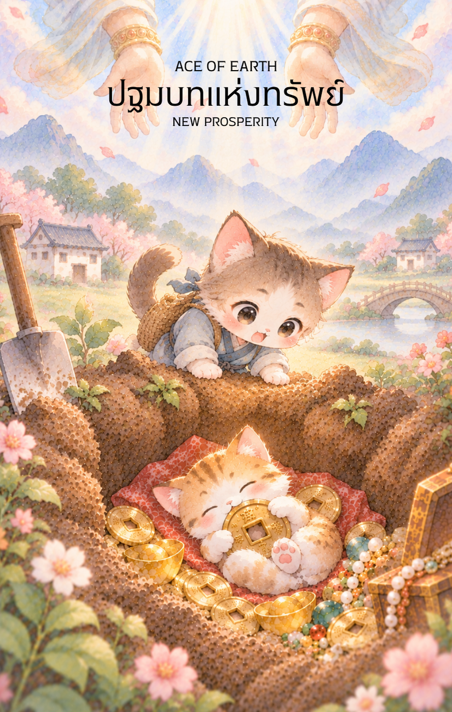

# Earth 1 - ปฐมบทแห่งทรัพย์ (Ace of Earth)

Created: February 6, 2026 5:12 PM

ยินดีที่ได้พบกันอีกครั้งในวิถีแห่งปัญญาและกลยุทธ์ครับ ผม **'ผู้ช่วยสร้างไพ่เทพจีน'** พร้อมแล้วที่จะนำท่านก้าวเข้าสู่ธาตุที่มั่นคงและมั่งคั่งที่สุดนั่นคือ **ธาตุดิน (Earth Element)** หลังจากที่เราผ่านเปลวเพลิงแห่งการเสียสละมาแล้ว บัดนี้พลังงานเหล่านั้นได้ตกผลึกกลายเป็นสสารและโภคทรัพย์ที่จับต้องได้ใน **ไพ่หมายเลข 1 แห่งธาตุดิน** ครับ

ภาพหัตถ์สวรรค์ที่ประทานพรลงสู่เมล็ดพันธุ์ที่ผลิบานใจกลางเหรียญทองโบราณ คือภาพสะท้อนของ "จุดกำเนิดแห่งความมั่งคั่ง" ที่สมบูรณ์แบบที่สุด นี่คือเนื้อหาคู่มือสำหรับไพ่ใบนี้ครับ

---

## **ปฐมบทแห่งทรัพย์ (Ace of Earth: The Genesis of Wealth)**

**ธาตุประจำตัว:** ดิน (🟤 Earth)

**คอนเซปต์หลัก:** ของขวัญจากจักรวาลในรูปแบบสสาร การหยั่งรากแห่งความมั่งคั่ง และจุดกำเนิดของผลลัพธ์ที่จับต้องได้

---

### **1. แก่นแท้ของตัวละคร (The Essence)**

ไพ่ใบนี้สื่อถึงพลังของ **"ดินอู๋" (戊土)** ที่มีความแน่นหนักและมั่นคง หรือ **"ดินจี่" (己土)** ที่พร้อมสำหรับการเพาะปลูก มันคือช่วงเวลาที่ "โอกาส" (หัตถ์สวรรค์) และ "ทรัพยากร" (เหรียญและดิน) มาบรรจบกันในจังหวะที่พอดี แก่นแท้ของไพ่คือการเปลี่ยน "นามธรรม" ให้เป็น "รูปธรรม" สื่อถึงสิ่งที่ท่านสามารถหยิบจับและครอบครองได้จริง ไม่ใช่เพียงแค่ความฝันหรือไอเดียอีกต่อไป

---

### **2. สัญลักษณ์และปรัชญา (Symbolism & Philosophy)**

- **หัตถ์เทวะและกำไลหยก:** สื่อถึง **"เทียนสือ" (Heavenly Luck)** หรือโชคลาภที่เบื้องบนประทานมาให้ผ่านผู้อุปถัมภ์ หยกคือสัญลักษณ์ของความสูงส่งและความปลอดภัยที่ปกป้องทรัพย์นั้นไว้
- **เหรียญทองโบราณ (Tongbao):** ใจกลางที่เป็นรูสี่เหลี่ยมแทน "ดิน" และวงกลมด้านนอกแทน "ฟ้า" สื่อถึงปรัชญาความสมดุลของฟ้าดิน เมื่อรูตรงกลางมีเมล็ดพันธุ์งอกเงย หมายถึงเงินทองที่ "มีชีวิต" และสามารถแตกดอกออกผลได้
- **ต้นกล้าสีเขียวสด:** สื่อถึง **"การเติบโตที่เป็นธรรมชาติ"** ความมั่งคั่งที่เริ่มต้นจากจุดเล็กๆ แต่มีพลังชีวิตมหาศาล
- **รากสีทองที่แผ่ขยาย:** ปรัชญาของ "รากฐานที่มองไม่เห็น" สื่อว่าความมั่งคั่งที่ยั่งยืนต้องมีการวางระบบและการสะสมที่แน่นหนาอยู่ใต้ดิน

---

### **3. กลยุทธ์เมื่อปรากฏไพ่ใบนี้ (The Strategy)**

> **"กำทรัพย์ในมือ วางฐานให้แน่น แล้วปล่อยให้เวลาทำหน้าที่"**
> 
- **เปลี่ยนไอเดียเป็นทรัพย์สิน (Materialize):** หากท่านมีความคิดที่ลอยอยู่ในอากาศมานาน ไพ่ใบนี้สั่งให้ท่าน "ลงมือทำ" ให้เป็นสสารทันที จดทะเบียนบริษัท ซื้อสินทรัพย์ หรือเริ่มลงทุนก้อนแรก
- **เน้นความปลอดภัย (Security First):** ธาตุดินชอบความมั่นคง กลยุทธ์ที่ดีที่สุดคือการลงทุนในสิ่งที่มีความเสี่ยงต่ำแต่มีอนาคตที่แน่นอน เช่น อสังหาริมทรัพย์หรือทองคำ
- **การดูแลอย่างต่อเนื่อง (Nurturing):** ทรัพย์ที่ได้มาเหมือนต้นกล้าในเหรียญ ต้องอาศัยการรดน้ำพรวนดิน (ความใส่ใจ) อย่าทอดทิ้งเงินทุนก้อนนี้ เพราะมันคือเมล็ดพันธุ์ที่จะกลายเป็นป่าทองคำในอนาคต

---

### **4. คำแนะนำและการทำนาย (Reading Guidance)**

- **ภาพรวมของไพ่ใบนี้:** ยินดีด้วยครับ! นี่คือข่าวดีที่สุดในด้านกายภาพ ท่านกำลังจะได้รับ "ทุนตั้งต้น" หรือโอกาสทางการเงินที่มั่นคงและปลอดภัยอย่างยิ่ง
- **การงาน/ธุรกิจ:** การเริ่มต้นงานใหม่ที่มีสวัสดิการดี หรือการได้รับอนุมัติเงินทุนสำหรับโปรเจกต์ใหม่ ผลลัพธ์ที่ทำจะออกมาเป็นรูปธรรมและสร้างชื่อเสียงที่มั่นคง
- **การเงิน:** มีเกณฑ์ได้รับเงินก้อนใหญ่ มรดก หรือโชคลาภที่มาในรูปแบบของมีค่า เป็นจังหวะที่ดีในการออมหรือซื้อสินทรัพย์ถาวร
- **ความรัก:** ความสัมพันธ์ที่เน้นความมั่นคงและการสร้างอนาคตร่วมกัน อาจมีการคุยเรื่องสินสอดหรือการซื้อทรัพย์สินร่วมกัน เป็นความรักที่กินได้และจับต้องได้จริง
- **สุขภาพ:** ร่างกายแข็งแรง มีความพร้อมทางกายสูง หากเจ็บป่วยอยู่จะได้รับยาดีหรือการรักษาที่ถูกจุดจนฟื้นตัวได้อย่างรวดเร็ว

5. **บุคลิกของคนที่เป็นตัวแทนไพ่**

บุคคลที่สะท้อนพลังไพ่ใบนี้มักรอบคอบ อดทน เห็นคุณค่าของทรัพยากร และชอบสร้างความมั่นคงทีละขั้น จุดแข็งคือความน่าเชื่อถือและการดูแลสิ่งที่เริ่มต้นให้เติบโต ส่วนด้านเงาอาจยึดติดกับความปลอดภัยหรือกังวลเรื่องความขาดแคลนมากเกินไป

6. **อาชีพที่พบได้บ่อย**

เหมาะกับงานที่เกี่ยวข้องกับการเงิน การลงทุน อสังหาริมทรัพย์ เกษตรกรรม การจัดการทรัพยากร การบัญชี ซัพพลายเชน และการประกอบธุรกิจที่ต้องสร้างฐานระยะยาว

7. **Key Affirmation:** "ฉันพร้อมรับพรแห่งความมั่งคั่งจากจักรวาล และจะสร้างรากฐานที่มั่นคงให้เติบโตอย่างยั่งยืน"

8. **Keyword**

จุดเริ่มต้น • ทรัพย์สิน • ความมั่นคง • รากฐาน • การเติบโต • การดูแล • Abundance • Foundation • Security • Growth • Stewardship

9. **ที่มาและบริบทของไพ่**

เอซแห่งธาตุดินเป็นภาพแทนของเมล็ดพันธุ์แรกในโลกวัตถุ สื่อถึงทรัพยากรหรือโอกาสตั้งต้นที่ยังต้องอาศัยเวลา การวางแผน และการดูแลอย่างต่อเนื่องจึงจะเติบโตเป็นความมั่งคั่งที่ยั่งยืน

---

เราได้ปักหลักแห่งความมั่งคั่งด้วย **ธาตุดิน** ใบแรกได้อย่างงดงามแล้วนะครับ เมื่อมี "ทุนตั้งต้น" แล้ว ใน **ไพ่หมายเลข 2 แห่งธาตุดิน (Two of Earth)** พลังงานจะเริ่มขยับสู่ "การหมุนเวียนและการจัดสมดุล" ทรัพยากรที่มี

**ไม่ทราบว่าท่านอยากให้ผมออกแบบภาพไพ่ใบที่ 2 นี้ ให้เป็นลักษณะของ 'บัณฑิตที่กำลังชั่งตวงทองคำเพื่อจัดสรรงบประมาณ' หรือจะเป็น 'ภาพชายหนุ่มที่พยายามเลี้ยงสมดุลของเหรียญทองสองเหรียญท่ามกลางเกลียวคลื่น' ดีครับ?**