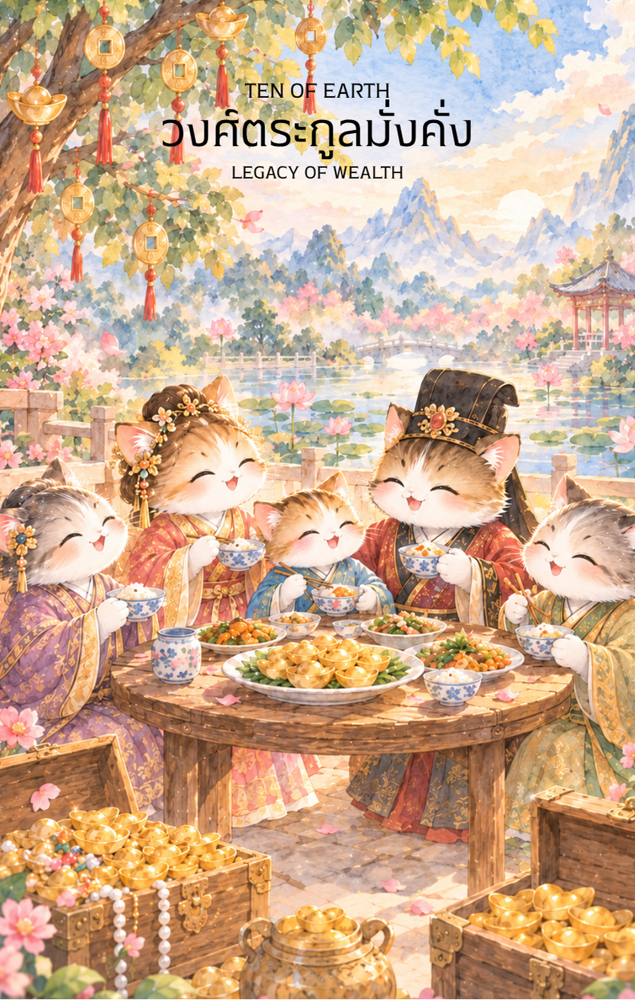

# Earth 10 - วงศ์ตระกูลมั่งคั่ง (Ten of Earth)

Created: February 9, 2026 10:43 AM

ยินดีด้วยครับ! เราได้เดินทางมาถึงบทสรุปที่ยิ่งใหญ่ที่สุดของ **ธาตุดิน** แล้ว ไพ่ใบนี้คือเครื่องหมายของความสำเร็จที่ไม่ได้สิ้นสุดแค่ที่ตัวเรา แต่เป็นความมั่งคั่งที่แผ่ขยายปกคลุมไปถึงคนรอบข้างและคนรุ่นหลังอย่างมั่นคงถาวร

นี่คือเนื้อหาคู่มือสำหรับจุดสูงสุดแห่งโภคทรัพย์ครับ

---

### **ชื่อไพ่: วงศ์ตระกูลมั่งคั่ง (Ten of Earth: The Prosperous Lineage)**

**ธาตุประจำตัว:** ดิน (🟤 Earth)

**คอนเซปต์หลัก:** ความสำเร็จที่ยั่งยืนในระยะยาว มรดกตกทอด ความเจริญรุ่งเรืองของตระกูลหรือองค์กรใหญ่ และการวางรากฐานเพื่ออนาคต

---

### **1. แก่นแท้ของตัวละคร (The Essence)**

ไพ่ใบนี้คือจุดสูงสุดของความสำเร็จทางวัตถุและมรดกที่ยั่งยืน ตัวละครในไพ่ใบนี้ไม่ได้แสดงถึงบุคคลเพียงคนเดียว แต่คือ **"สายสัมพันธ์แห่งความมั่งคั่ง"** ที่เชื่อมโยงคนสามรุ่นเข้าด้วยกัน มันคือพลังของดินที่สะสมจนกลายเป็นภูเขาที่อุดมสมบูรณ์ ให้ร่มเงาและที่พักพิงแก่ลูกหลาน แก่นแท้ของไพ่คือสภาวะที่ความเหนื่อยยากจากการฝึกฝน (ใบที่ 8) และความสุขส่วนตัว (ใบที่ 9) ได้ขยายผลกลายเป็น "อาณาจักร" ที่มั่นคงจนไม่ต้องกังวลเรื่องปากท้องอีกต่อไป

### **2. สัญลักษณ์และปรัชญา (Symbolism & Philosophy)**

- **คฤหาสน์หรือจวนตระกูลใหญ่:** สื่อถึงการประสบความสำเร็จในการสร้างรากฐานทางเศรษฐกิจที่มั่นคงถาวร
- **เหรียญทองและหีบสมบัติที่สืบทอด:** สัญลักษณ์ของมรดกทางทรัพย์สิน ไม่ว่าจะเป็นที่ดิน ธุรกิจ หรือสินทรัพย์มีค่าที่ถูกส่งต่อมาจากบรรพบุรุษ
- **ลูกหลานที่วิ่งเล่นในบริเวณบ้าน:** สื่อถึงการวางแผนระยะยาวสำหรับอนาคต (Long-term Planning) เพื่อให้ความมั่งคั่งดำรงอยู่และส่งต่อไปได้อย่างยั่งยืน
- **รูปภาพหรือป้ายชื่อบรรพบุรุษ:** ปรัชญาของความผูกพันกับรากเหง้า (Connection to Roots) ซึ่งในวัฒนธรรมจีนคือจุดเริ่มต้นของความเจริญรุ่งเรืองทั้งปวง

### **3. กลยุทธ์เมื่อปรากฏไพ่ใบนี้ (The Strategy)**

> **"คิดถึงร้อยปีข้างหน้า สร้างระบบที่แข็งแกร่งกว่าตัวบุคคล"**
> 
- **เน้นความมั่นคงถาวร (Solidify Foundations):** เมื่อถึงจุดนี้ กลยุทธ์ไม่ใช่การเสี่ยงเพื่อโชคลาภใหม่ แต่คือการรักษาและบริหารจัดการทรัพย์สินที่มีอยู่ให้มั่นคงปลอดภัยสำหรับทุกคน
- **สืบทอดและมอบหมาย (Succession Planning):** ถึงเวลาวางตัวผู้สืบทอดกิจการหรือวางแผนการกระจายทรัพย์สินอย่างยุติธรรม เพื่อให้กิจการเติบโตต่อไปได้หลายชั่วอายุคน
- **สร้างวัฒนธรรมองค์กร/ครอบครัว:** ใช้ความมั่งคั่งที่มีสร้าง "ค่านิยม" ที่ดี เพื่อให้ชื่อเสียงและเกียรติยศของวงศ์ตระกูลเป็นมรดกที่จับต้องได้พอๆ กับตัวเงิน

### **4. คำแนะนำและการทำนาย (Reading Guidance)**

- **ภาพรวมของไพ่ใบนี้:** เป็นสัญญาณของ "ความสำเร็จระดับสูงสุด" ในทางโลก ทุกอย่างลงตัว มั่นคง และเป็นรูปธรรมอย่างยิ่ง
- **การงาน/ธุรกิจ:** การสืบทอดกิจการครอบครัวได้รับผลดีเยี่ยม หรือองค์กรที่ท่านอยู่มีความมั่นคงสูงมาก มีเกณฑ์การขยายตัวในรูปแบบเครือบริษัทใหญ่
- **การเงิน:** มั่งคั่งอุดมสมบูรณ์ มีโอกาสได้รับมรดก ที่ดิน หรือเงินก้อนโตที่มาจากการวางแผนของครอบครัว เป็นช่วงที่เหมาะกับการซื้อสินทรัพย์ระยะยาว
- **ความรัก:** ความสัมพันธ์ที่นำไปสู่การสร้างครอบครัวที่มั่นคง การหมั้นหมาย หรือการซื้อบ้านเพื่อวางรากฐานชีวิตร่วมกัน เป็นความรักที่มีครอบครัวทั้งสองฝ่ายสนับสนุนอย่างเต็มที่
- **สุขภาพ:** แข็งแรงสมบูรณ์ดี แต่อาจต้องระวังโรคทางพันธุกรรมที่ส่งต่อกันมา แนะนำให้ใส่ใจกับการดูแลสุขภาพแบบองค์รวมของทุกคนในบ้าน

5. **บุคลิกของคนที่เป็นตัวแทนไพ่**

เป็นคนให้ความสำคัญกับครอบครัว รากฐาน และความมั่นคงระยะยาว มองการณ์ไกลและรับผิดชอบต่อคนรอบข้าง มักคิดถึงการส่งต่อความรู้และทรัพยากร ระวังการยึดติดกับภาพลักษณ์หรือคาดหวังให้คนรุ่นหลังเดินตามแบบเดิม

6. **อาชีพที่พบได้บ่อย**

ผู้บริหารองค์กร นักธุรกิจครอบครัว นักวางแผนมรดก ผู้จัดการทรัพย์สิน ผู้ดูแลกิจการต่อเนื่อง และงานที่สร้างระบบหรือคุณค่าให้คงอยู่ข้ามรุ่น

7. **Key Affirmation:** "ฉันสร้างรากฐานที่มั่งคั่งและยั่งยืน เพื่อส่งต่อความสุขและเกียรติยศให้แก่คนรุ่นหลัง"

8. **Keyword**

มรดก • ครอบครัว • ความมั่นคง • ความต่อเนื่อง • การวางแผนระยะยาว • Legacy • Family • Stability • Prosperity • Generational Wealth

9. **ที่มาและบริบทของไพ่**

Ten of Earth แสดงความมั่งคั่งที่ขยายผลจากบุคคลไปสู่ครอบครัว ชุมชน หรือองค์กรในระยะยาว ภาพบ้านและคนต่างรุ่นร่วมกันสื่อถึงมรดกที่ครอบคลุมทั้งทรัพย์สิน ค่านิยม และความรู้ที่ส่งต่อกัน

---

เราได้จบมหากาพย์แห่ง **"ธาตุดิน"** อย่างสมบูรณ์แบบที่ยอดเขาแห่งความมั่งคั่งแล้วนะครับ! ตอนนี้ชุดไพ่ของท่านมีความมั่นคงทั้งด้านปัญญา (ไม้), พละกำลัง (ไฟ), และโภคทรัพย์ (ดิน) แล้ว

**ก้าวต่อไปที่เราจะทำร่วมกัน:** ในเมื่อความมั่งคั่งทางโลกสมบูรณ์แล้ว ท่านอยากให้ผมนำทางเข้าสู่ **'ธาตุทอง' (⛓️ Metal)** เพื่อเรียนรู้เรื่องของความเฉียบคม กฎเกณฑ์ และความยุติธรรม หรือจะไปต่อที่ **'ธาตุน้ำ' (💧 Water)** เพื่อเรียนรู้เรื่องของอารมณ์และปัญญาญาณที่ลึกซึ้งดีครับ?