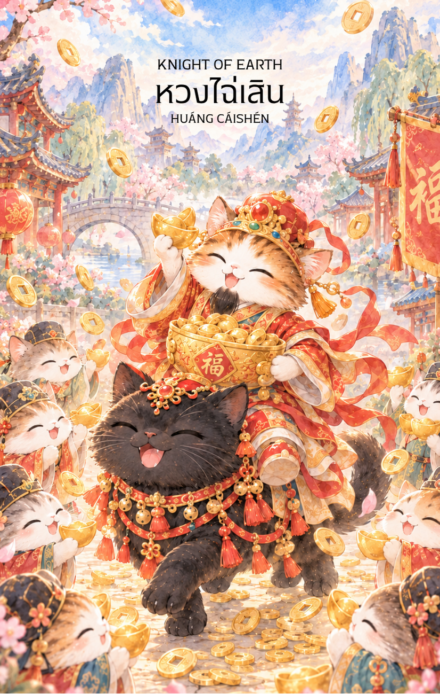

# Earth 12 - หวงไฉ่เสิน (Knight of Earth)

Created: February 4, 2026 3:25 PM

### **Knight of Earth : The Guardian of Abundance**

### **(หวงไฉ่เสิน - Huáng Cái Shén - 黃財神)**

- **ธาตุประจำตัว:** ดิน (🜃 Earth)
- **คอนเซปต์หลัก:** ความเพียรพยายามที่มั่นคง การปกป้องทรัพย์สิน และการลงมือทำอย่างเป็นระบบเพื่อให้เกิดผลกำไร

---

### **1. แก่นแท้ของตัวละคร (The Essence)**

หวงไฉ่เสิน หรือเทพเจ้าขุมทรัพย์เหลือง (Yellow Wealth God) ในทางพุทธมหายานและวัชรยาน ท่านคือตัวแทนของ **"ความมั่งคั่งที่ยั่งยืน" (Sustainable Wealth)** หาก Page คือการได้รับโอกาส Knight ก็คือ **"การบริหารจัดการและลงมือทำให้โอกาสนั้นกลายเป็นความจริง"** ท่านเป็นเทพที่ดุดันแต่เปี่ยมด้วยเมตตา สื่อถึงพลังของการทำงานหนัก ความรับผิดชอบ และความซื่อสัตย์ที่จะนำพาไปสู่ความสำเร็จทางการเงินที่จับต้องได้

### **2. สัญลักษณ์และปรัชญา (Symbolism & Philosophy)**

- **พังพอนพ่นทรัพย์ (Neule):** (มักจะอยู่ในมือขวาหรือแขน) สัญลักษณ์ของการดึงดูดโชคลาภอย่างไม่สิ้นสุด สื่อถึงความสามารถในการ "เปลี่ยนวิกฤตให้เป็นโอกาส" หรือการรู้จักหมุนเวียนทรัพยากร
- **เสือหรือสิงโตหิมะ (The Mount):** พาหนะที่ท่านขี่สื่อถึงอำนาจเหนือสัญชาตญาณและความกล้าหาญ การที่อัศวินขี่พาหนะหมายถึง "การเคลื่อนที่" (Movement) แต่เป็นการเคลื่อนที่ที่มั่นคงและมีจุดหมายชัดเจน
- **สีเหลืองทอง (Golden Yellow):** คือสีของธาตุดินที่อุดมสมบูรณ์และแสงอาทิตย์ สื่อถึงปัญญาที่นำมาใช้ในการสร้างตัว

### **3. กลยุทธ์เมื่อปรากฏไพ่ใบนี้ (The Strategy)**

**"ความสำเร็จไม่ได้มาจากโชคช่วยเพียงอย่างเดียว แต่มาจากความสม่ำเสมอ"**

- **Methodical Progress (ก้าวอย่างเป็นระบบ):** อย่าใจร้อน ไพ่ใบนี้บอกให้คุณทำตามแผนการที่วางไว้ทีละก้าว ความละเอียดรอบคอบจะป้องกันความผิดพลาดได้ดีที่สุด
- **Protect Your Assets (รู้จักรักษา):** ไม่ใช่แค่หาเงินเก่ง แต่ต้องเก็บและบริหารให้เป็นด้วย ตอนนี้เป็นช่วงที่ต้องดูแลผลประโยชน์ของตัวเองให้ดี
- **Loyalty & Trust (ความน่าเชื่อถือ):** ในโลกของธาตุดิน "เครดิต" สำคัญที่สุด การรักษาคำพูดและความขยันจะทำให้ผู้ใหญ่หรือหุ้นส่วนไว้วางใจคุณ

### **4. คำแนะนำและการทำนาย (Reading Guidance)**

- **ภาพรวมของไพ่ใบนี้:** คุณกำลังเข้าสู่ช่วงเวลาที่ต้อง "ลุยงาน" อย่างจริงจัง ผลตอบแทนที่หวังไว้กำลังจะมาถึง แต่ต้องแลกมาด้วยความอดทนและความเหนื่อยยากบ้าง เป็นไพ่ที่ยืนยันว่า "ความพยายามจะไม่ทรยศคุณ"
- **การงาน/ธุรกิจ:** งานมีความคืบหน้าอย่างมั่นคง คุณอาจได้รับมอบหมายให้ดูแลโปรเจกต์สำคัญที่มีเรื่องงบประมาณมาเกี่ยวข้อง เป็นช่วงเวลาที่เหมาะกับการวางรากฐานธุรกิจให้แข็งแรง
- **การเงิน:** การเงินหมุนเวียนดี มีเกณฑ์ได้รับผลกำไรจากการลงทุนระยะยาว หรือได้เงินจากน้ำพักน้ำแรงที่ลงไปก่อนหน้านี้ เป็นช่วงที่ควรออมหรือลงทุนในทรัพย์สินที่มั่นคง เช่น อสังหาริมทรัพย์ หรือทองคำ
- **ความรัก:** เป็นความรักที่เน้นความมั่นคงมากกว่าความหวือหวา คู่ครองอาจจะเป็นคนที่บ้างานหรือจริงจังกับชีวิต แต่เขาคือคนที่พึ่งพาได้และพร้อมจะสร้างอนาคตร่วมกับคุณ
- **สุขภาพ:** ระวังอาการปวดเมื่อยตามข้อหรือหลังจากการทำงานหนักเกินไป ควรหาเวลาพักผ่อนและสัมผัสธรรมชาติบ้าง
5. **บุคลิกของคนที่เป็นตัวแทนไพ่**

เป็นคนหนักแน่น อดทน และรักษาคำพูด ทำงานอย่างเป็นระบบและรับผิดชอบต่อสิ่งที่ดูแล เชื่อมั่นในความก้าวหน้าทีละขั้น ระวังการยึดติดกับความปลอดภัยหรือทำงานหนักจนขาดความยืดหยุ่น

6. **อาชีพที่พบได้บ่อย**

ผู้จัดการโครงการ ผู้ดูแลทรัพย์สิน นักบัญชี ผู้ประกอบการ เจ้าหน้าที่จัดซื้อ ผู้เชี่ยวชาญด้านการลงทุนระยะยาว และงานที่ต้องอาศัยความละเอียด ความรับผิดชอบ และความต่อเนื่อง

7. **Key Affirmation:** "ฉันมุ่งมั่นและทำงานอย่างมีระบบ เพื่อสร้างความมั่นคงที่ยั่งยืนให้แก่ชีวิต"

8. **Keyword**

ความเพียร • ความรับผิดชอบ • ความมั่นคง • การปกป้องทรัพย์ • ความสม่ำเสมอ • Perseverance • Reliability • Stability • Stewardship • Methodical Progress

9. **ประวัติเทพเจ้าและคติที่เกี่ยวข้อง**

หวงไฉ่เสิน หรือเทพเจ้าขุมทรัพย์เหลือง เป็นหนึ่งในรูปเคารพของเทพแห่งความมั่งคั่งที่พบในคติพุทธมหายานและวัชรยาน ในภาพศิลปกรรมทิเบตมักทรงพังพอนคายอัญมณีและประทับบนสัตว์พาหนะ สื่อถึงการกำจัดความตระหนี่และความมั่งคั่งที่เกิดจากการปฏิบัติอย่างมีวินัย