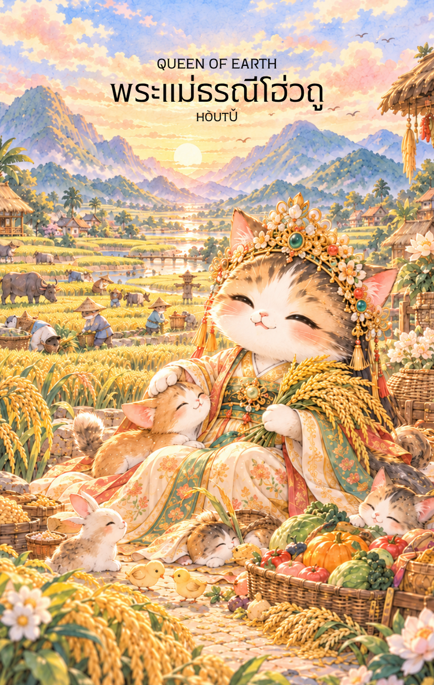

# Earth 13 - พระแม่ธรณีโฮ่วถู่ (Queen of Earth)

Created: February 4, 2026 3:33 PM

## **Queen of Earth : The Eternal Matriarch**

### **(พระแม่ธรณีโฮ่วถู - Hòutǔ / Dì Mǔ - 后土 / 地母)**

- **ธาตุประจำตัว:** ดิน (🜃 Earth)
- **คอนเซปต์หลัก:** ความเมตตาที่ไม่มีประมาณ การโอบอุ้มดูแล และความอุดมสมบูรณ์ที่ยั่งยืน

---

### **1. แก่นแท้ของตัวละคร (The Essence)**

หาก King of Earth คือผู้บริหารจัดการทรัพย์สิน Queen of Earth หรือพระแม่โฮ่วถู คือ **"แหล่งกำเนิดของทรัพย์สินนั้น"** ท่านคือพลังแห่งการให้ที่แท้จริง (The Great Provider) พลังของท่านคือความสงบ หนักแน่น และความอดทน เปรียบเสมือนแม่ที่คอยดูแลลูกๆ อย่างไม่เหน็ดเหนื่อย การปรากฏของไพ่ใบนี้สื่อถึงช่วงเวลาที่ชีวิตมีความมั่นคงทางอารมณ์สูง และมีความสามารถในการ "บ่มเพาะ" สิ่งต่างๆ ให้เติบโตอย่างงดงาม

### **2. สัญลักษณ์และปรัชญา (Symbolism & Philosophy)**

- **รวงข้าวหรือพืชพรรณในหัตถ์:** สัญลักษณ์ของผลผลิตที่งอกเงยจากดิน สื่อถึงความอุดมสมบูรณ์ทางวัตถุที่มาพร้อมกับความอิ่มเอมใจ
- **ชุดฉลองพระองค์สีเหลืองจักรพรรดิ:** สื่อถึงบารมีและความสูงส่ง แต่เป็นความสูงส่งที่โน้มตัวลงมาสัมผัสปฐพี สื่อถึงความติดดิน (Grounded) และความจริงใจ
- **เข็มทิศหรือแผ่นดิน:** ในบางตำนานท่านดูแลเรื่องอาณาเขตและทิศทาง สื่อถึงการมีหลักยึดที่มั่นคงในชีวิต ไม่หวั่นไหวไปตามกระแสลม

### **3. กลยุทธ์เมื่อปรากฏไพ่ใบนี้ (The Strategy)**

**"โอบอุ้มด้วยความรัก สร้างรากฐานด้วยความเมตตา"**

- **Nurture to Success (เลี้ยงดูให้เติบโต):** อย่าเพิ่งรีบร้อนเก็บเกี่ยวตอนนี้ แต่จงใส่ใจกับการดูแลรักษา ไม่ว่าจะเป็นโปรเจกต์งานหรือความสัมพันธ์ ความใส่ใจในรายละเอียดจะนำมาซึ่งกำไรที่มหาศาล
- **Practical Wisdom (ปัญญาทางโลก):** ใช้ความฉลาดในการจัดการชีวิตประจำวันให้เรียบง่ายแต่มีประสิทธิภาพ การมีบ้านที่อบอุ่นและกายที่แข็งแรงคืออาวุธลับของคุณ
- **Generosity as Power (การให้คือพลัง):** ยิ่งคุณแบ่งปันหรือช่วยเหลือผู้อื่น บารมีของคุณจะยิ่งเพิ่มขึ้น และโชคลาภจะไหลกลับมาหาคุณเองตามกฎของธรรมชาติ

### **4. คำแนะนำและการทำนาย (Reading Guidance)**

- **ภาพรวมของไพ่ใบนี้:** เป็นไพ่ที่ยอดเยี่ยมมากสำหรับผู้หญิงหรือผู้ที่ต้องดูแลคนหมู่มาก ชีวิตช่วงนี้จะเต็มไปด้วยความสุขสบาย มีความพร้อมทั้งกายและใจ เป็นช่วงเวลาที่ "ปลูกอะไรก็ได้ผลอย่างนั้น"
- **การงาน/ธุรกิจ:** งานที่เกี่ยวข้องกับอสังหาริมทรัพย์ เกษตรกรรม อาหาร การดูแลสุขภาพ หรือการบริหารจัดการทรัพยากรมนุษย์จะรุ่งเรืองมาก คุณเป็นที่รักและเคารพของลูกน้อง
- **การเงิน:** มั่นคงและมั่งคั่ง มีเงินทองไหลมาเทมาอย่างสม่ำเสมอ เป็นช่วงที่เหมาะกับการซื้อทรัพย์สินถาวร หรือการทำบุญเพื่อต่อยอดบารมี
- **ความรัก:** เป็นความรักที่ลึกซึ้ง มั่นคง และเป็นผู้ใหญ่ คู่ครองจะดูแลกันเหมือนคนในครอบครัว คนโสดมีเกณฑ์พบรักกับคนที่อบอุ่นและมีฐานะมั่นคง
- **สุขภาพ:** แข็งแรงสมบูรณ์ดีมาก แต่ควรระวังเรื่องการกินที่เพลินเกินไปจนน้ำหนักตัวขึ้นได้ง่ายครับ
5. **บุคลิกของคนที่เป็นตัวแทนไพ่**

เป็นคนอบอุ่น ใจกว้าง และมีความสามารถในการดูแลหรือบ่มเพาะผู้คนและโครงการให้เติบโต มีความอดทนและสร้างความรู้สึกมั่นคงให้คนรอบข้าง ระวังการดูแลผู้อื่นจนละเลยความต้องการของตนเอง

6. **อาชีพที่พบได้บ่อย**

ผู้บริหารงานบุคคล ครู ผู้ดูแลเด็กหรือครอบครัว นักเกษตร เจ้าของกิจการอาหาร นักอสังหาริมทรัพย์ และงานที่เกี่ยวข้องกับการดูแลทรัพยากรหรือสร้างความอุดมสมบูรณ์

7. **Key Affirmation:** "ฉันคือบ่อเกิดแห่งความอุดมสมบูรณ์ ฉันมีพลังในการโอบอุ้มและรังสรรค์ความมั่นคงให้แก่โลก"

8. **Keyword**

การดูแล • ความอุดมสมบูรณ์ • ความเมตตา • ความมั่นคง • การบ่มเพาะ • Nurturing • Abundance • Groundedness • Generosity • Sustenance

9. **ประวัติเทพเจ้าและคติที่เกี่ยวข้อง**

โฮ่วถู่ (后土) หรือพระแม่ธรณี เป็นเทพีที่สัมพันธ์กับผืนดินและการปกครองอาณาเขตในคติจีน ได้รับการเคารพในฐานะพลังผู้คุ้มครองและหล่อเลี้ยงชีวิต ภาพของพระองค์จึงเชื่อมโยงกับความอุดมสมบูรณ์ ความมั่นคง และการดูแลผืนแผ่นดิน