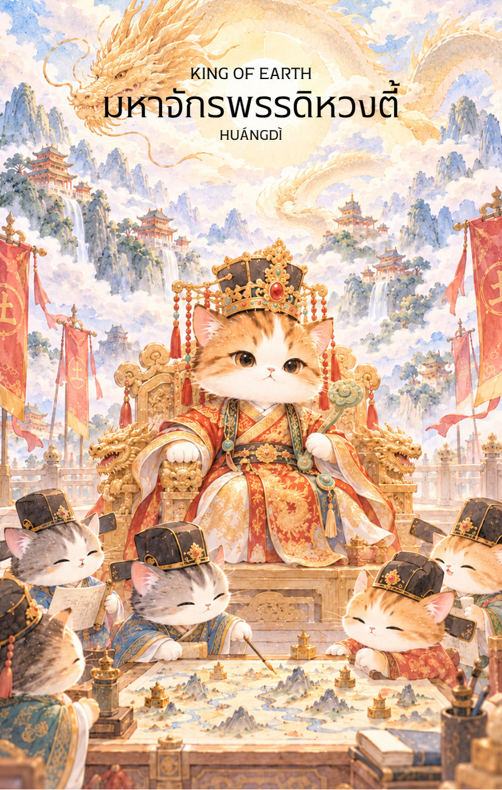

# Earth 14 - มหาจักรพรรดิหวงตี้ (King of Earth)

Created: February 4, 2026 3:34 PM

## **King of Earth : The Sovereign Pillar**

### **(มหาจักรพรรดิหวงตี้ - Huáng Dà Dì - 黃帝)**

- **ธาตุประจำตัว:** ดิน (🜃 Earth - จุดศูนย์กลาง)
- **คอนเซปต์หลัก:** อำนาจแห่งการปกครอง รากฐานแห่งอารยธรรม ความมั่นคงชั่วนิรันดร์ และความเป็นระเบียบเรียบร้อย

---

### **1. แก่นแท้ของตัวละคร (The Essence)**

มหาจักรพรรดิหวงตี้คือตัวแทนของ **"แผ่นดินที่เป็นปึกแผ่น" (Unified Earth)** ท่านคือผู้รวบรวมแผ่นดิน วางรากฐานกฎหมาย การแพทย์ และวัฒนธรรม พลังของท่านไม่ใช่แค่การหาทรัพย์สิน แต่คือการ **"รักษาสถาบันและโครงสร้าง"** ให้ยั่งยืน การปรากฏของไพ่ใบนี้สื่อถึงบุคคลที่มีบารมีสูงสุด มีความเป็นผู้นำโดยธรรมชาติ และเป็นคนที่ทุกคนใช้เป็นที่ยึดเหนี่ยวในยามวิกฤต

### **2. สัญลักษณ์และปรัชญา (Symbolism & Philosophy)**

- **ฉลองพระองค์สีเหลืองทอง (Imperial Yellow):** สีของดินที่อยู่ตรงกลางจักรวาล สื่อถึงความสมดุลและความเป็นที่สุดในทุกด้าน
- **ตราประทับจักรพรรดิ (Imperial Seal):** สัญลักษณ์ของอำนาจสิทธิ์ขาดและการตัดสินใจที่ถือเป็นที่สิ้นสุด หมายถึงความรับผิดชอบที่ยิ่งใหญ่
- **มังกรทอง (Golden Dragon):** ในฐานะราชาแห่งดิน มังกรคือพาหนะที่สื่อถึงพลังอำนาจที่อยู่เหนือธรรมชาติและการคุ้มครองจากสวรรค์

### **3. กลยุทธ์เมื่อปรากฏไพ่ใบนี้ (The Strategy)**

**"บริหารด้วยธรรม ปกครองด้วยวินัย และเป็นหลักชัยให้ผู้อื่น"**

- **Be the Anchor (เป็นสมอเรือ):** ในยามที่รอบข้างวุ่นวาย คุณต้องนิ่งที่สุด ความสงบและหนักแน่นของคุณจะช่วยสยบความวุ่นวายได้
- **Long-term Governance (วางรากฐานระยะยาว):** อย่ามองแค่ผลกำไรระยะสั้น แต่จงสร้าง "ระบบ" ที่สามารถอยู่ได้ด้วยตัวมันเอง แม้ในวันที่คุณไม่ได้ลงมาคุมเอง
- **Integrity is Power (สัจจะเป็นอำนาจ):** ความน่าเชื่อถือคือสมบัติที่ล้ำค่าที่สุดของกษัตริย์ การรักษาคำพูดและความยุติธรรมจะทำให้บารมีของคุณขยายออกไปไม่สิ้นสุด

### **4. คำแนะนำและการทำนาย (Reading Guidance)**

- **ภาพรวมของไพ่ใบนี้:** คุณกำลังอยู่ในจุดที่สูงที่สุดของสถานการณ์ มีอำนาจตัดสินใจเด็ดขาด และได้รับความเคารพยกย่อง เป็นช่วงเวลาแห่งการเสวยสุขจากผลงานที่สร้างมาอย่างยาวนาน
- **การงาน/ธุรกิจ:** ประสบความสำเร็จอย่างยิ่งใหญ่ในระดับโครงสร้าง มีเกณฑ์ได้เลื่อนตำแหน่งเป็นระดับบริหารสูงสุด หรือขยายอาณาจักรธุรกิจให้มั่นคงเป็นปึกแผ่น
- **การเงิน:** ความมั่งคั่งระดับมหาเศรษฐี มีทรัพย์สินถาวรจำนวนมาก การบริหารจัดการเงินอยู่ในเกณฑ์ดีเยี่ยมและมีความมั่นคงสูงสุด
- **ความรัก:** เป็นความรักที่เปี่ยมด้วยเกียรติยศ คู่ครองมักเป็นคนที่มีบารมีหรือสนับสนุนส่งเสริมหน้าตาทางสังคม เป็นความสัมพันธ์ที่เน้นการสร้าง "ตระกูล" และ "ความมั่นคง" ร่วมกัน
- **สุขภาพ:** โดยรวมแข็งแรงดี แต่อาจมีภาระหน้าที่ที่ทำให้เครียดจากความรับผิดชอบ ควรดูแลเรื่องระบบย่อยอาหารและธาตุในร่างกายให้สมดุล
5. **บุคลิกของคนที่เป็นตัวแทนไพ่**

เป็นคนหนักแน่น มีบารมี และมักเป็นศูนย์กลางที่ผู้คนพึ่งพาได้ คิดเป็นระบบและรับผิดชอบต่อส่วนรวม ระวังการยึดอำนาจไว้กับตนเองหรือคาดหวังให้ทุกคนทำตามมาตรฐานเดียวกัน

6. **อาชีพที่พบได้บ่อย**

ผู้บริหารระดับสูง นักปกครอง ผู้กำหนดนโยบาย ผู้ก่อตั้งองค์กร ผู้จัดการระบบขนาดใหญ่ และงานที่ต้องวางรากฐานหรือประสานหลายฝ่าย

7. **Key Affirmation:** "ฉันคือศูนย์กลางแห่งความมั่นคง ฉันปกครองชีวิตด้วยปัญญาและสร้างมรดกที่ยั่งยืนให้แก่โลก"

8. **Keyword**

อำนาจ • ความมั่นคง • การปกครอง • รากฐาน • ความรับผิดชอบ • Authority • Stability • Governance • Foundation • Legacy

9. **ประวัติเทพเจ้าและตำนานที่เกี่ยวข้อง**

หวงตี้ (黃帝) หรือจักรพรรดิเหลือง เป็นบุคคลสำคัญในตำนานจีนและได้รับการยกย่องเป็นบรรพชนของชาวจีน เรื่องเล่าผูกโยงพระองค์กับการรวมผู้คน การวางระเบียบการปกครอง และการพัฒนาความรู้หลายแขนง จึงมักเป็นสัญลักษณ์ของอารยธรรมและรากฐานที่มั่นคง