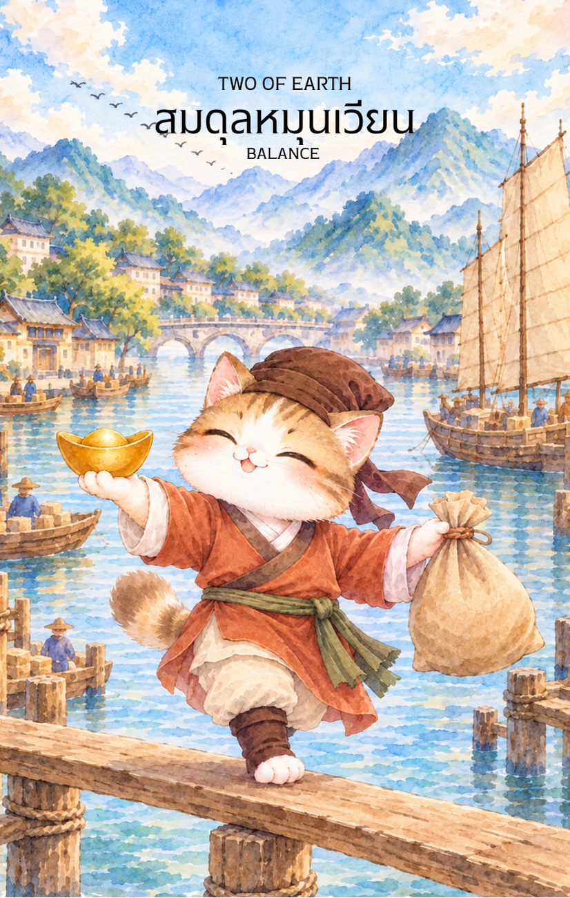

# Earth 2 - สมดุลหมุนเวียน (Two of Earth)

Created: February 6, 2026 8:43 PM

ยินดีที่ได้พบกันอีกครั้งครับในวิถีแห่งปัญญาและกลยุทธ์ ผม **'ผู้ช่วยสร้างไพ่เทพจีน'** พร้อมแล้วที่จะนำท่านก้าวเข้าสู่การบริหารจัดการที่ชาญฉลาดที่สุดของธาตุดิน หลังจากที่เราได้รับ "ของขวัญจากจักรวาล" ในใบแรกไปแล้ว บัดนี้คือเวลาของการประคับประคองและหมุนเวียนให้เกิดผลประโยชน์สูงสุดใน **ไพ่หมายเลข 2 แห่งธาตุดิน** ครับ

ภาพพ่อค้าผู้ชาญฉลาดที่ทรงตัวบนสะพานไม้ท่ามกลางความวุ่นวายของตลาด คือภาพสะท้อนของ "ความมั่นคงที่เคลื่อนไหว" ได้อย่างสมบูรณ์แบบ นี่คือเนื้อหาคู่มือสำหรับไพ่ใบนี้ครับ

---

### **หมุนเวียนสมดุล (Two of Earth: Circulating Balance)**

**ธาตุประจำตัว:** ดิน (🟤 Earth)

**คอนเซปต์หลัก:** ความมั่นคงแบบพลวัต (Dynamic Stability), การบริหารทรัพยากรที่มีจำกัดให้เกิดประสิทธิภาพสูงสุด และทักษะการประคับประคองสถานการณ์

---

### **1. แก่นแท้ของตัวละคร (The Essence)**

ตัวละครพ่อค้าในภาพคือร่างจำแลงของพลัง **"จี่ดิน" (己土)** ที่มีความยืดหยุ่นและคล่องตัวสูง เขาคือผู้เชี่ยวชาญด้านการจัดลำดับความสำคัญ (Prioritization) ที่เข้าใจดีว่าดินที่นิ่งเกินไปจะกลายเป็นดินดานที่ปลูกอะไรไม่ขึ้น แต่ดินที่ถูกพรวนและหมุนเวียนจะนำมาซึ่งความมั่งคั่ง การทรงตัวด้วยขาเดียวสื่อถึงความไม่ประมาทและการเตรียมพร้อมที่จะปรับเปลี่ยนทิศทางตามกระแสเศรษฐกิจรอบตัวอยู่เสมอ

### **2. สัญลักษณ์และปรัชญา (Symbolism & Philosophy)**

- **สะพานไม้ข้ามแม่น้ำ:** สื่อถึง "เส้นทางการค้า" และการเชื่อมต่อสถานการณ์สองฝั่งเข้าด้วยกัน สะพานไม่ใช่พื้นดินที่มั่นคงถาวร แต่เป็นพื้นที่ที่ต้อง "ก้าวผ่าน" อย่างใช้สมาธิ
- **ทองหยวนเป่าและถุงข้าวเปลือก:** ปรัชญาการสมดุลระหว่าง "กำไร" (ทอง) และ "ปัจจัยพื้นฐาน" (ข้าว) สื่อถึงการไม่มุ่งเน้นแต่เพียงตัวเลขจนลืมพื้นฐานที่สำคัญของชีวิตหรืองาน
- **ลูกคิดที่ลอยเด่น:** สัญลักษณ์ของ **"สติปัญญาในการคำนวณ"** สื่อว่าทุกการเคลื่อนไหวต้องผ่านการวางแผนและจัดสรรงบประมาณอย่างรอบคอบ
- **แม่น้ำและเรือสินค้าเบื้องหลัง:** สื่อถึงสภาวะเศรษฐกิจภายนอกที่มีการไหลเวียนตลอดเวลา หากคุณหยุดนิ่งในขณะที่โลกหมุนไป คุณจะเสียสมดุลในที่สุด

### **3. กลยุทธ์เมื่อปรากฏไพ่ใบนี้ (The Strategy)**

> **"เงินที่นิ่งคือเงินที่ตาย เงินที่หมุนเวียนคือเงินที่สร้างชีวิต"**
> 
- **บริหารสภาพคล่อง (Cash Flow Management):** ในโลกปัจจุบัน สภาพคล่องคือหัวใจสำคัญ หากท่านได้รับเงินก้อนมาจากใบแรก (Ace) อย่าเพิ่งนำไปแช่แข็งไว้ทั้งหมด จงหมุนเวียนบางส่วนเพื่อสร้างโอกาสใหม่
- **จัดลำดับความสำคัญ (The Juggling Act):** หากท่านแบกรับหลายภาระในเวลาเดียวกัน จงรู้ว่าควรจะ "เอียง" น้ำหนักไปทางไหนในจังหวะใด การพยายามถือทุกอย่างให้เท่ากันตลอดเวลาจะทำให้ท่านล้มลง
- **ปรับตัวตามสถานการณ์ (Flexible Execution):** อย่ายึดติดกับแผนการที่ตายตัว หากตลาดเปลี่ยนหรือมีปัจจัยแทรกแซง จงพร้อมที่จะ "ย้ายขา" หรือเปลี่ยนวิธีการประคับประคองเพื่อให้งานยังเดินต่อไปได้

### **4. คำแนะนำและการทำนาย (Reading Guidance)**

- **ภาพรวมของไพ่ใบนี้:** เป็นช่วงที่ท่านต้องใช้ทักษะในการ "จัดการ" อย่างสูง สถานการณ์รอบตัวมีความคล่องตัวสูง มีทั้งรายรับและรายจ่ายเข้ามาพร้อมกัน แต่ท่านจะสามารถประคองให้รอดพ้นไปได้ด้วยดี
- **การงาน/ธุรกิจ:** การทำหลายโปรเจกต์พร้อมกัน หรือการต้องประสานงานกับหลายฝ่าย ทักษะการมัลติทาสก์ (Multi-tasking) จะช่วยให้ท่านโดดเด่นและประสบความสำเร็จ
- **การเงิน:** มีเงินเข้ามือซ้ายจ่ายออกมือขวา แต่ยังคงมีสภาพคล่องที่เพียงพอ เหมาะกับการทำบัญชีรายรับรายจ่ายให้ชัดเจน เพื่อให้เห็นภาพรวมของความสมดุล
- **ความรัก:** การบริหารเวลาระหว่างงานและเรื่องส่วนตัว ท่านอาจจะยุ่งจนดูเหมือนละเลยคนรัก แต่การสื่อสารและการจัดตารางที่ลงตัวจะช่วยให้ความสัมพันธ์มั่นคงแบบค่อยเป็นค่อยไป
- **สุขภาพ:** ระวังอาการเมื่อยล้าทางกล้ามเนื้อขาหรือข้อต่อจากการ "แบกภาระ" หรือการเดินสายทำงานหนักเกินไป ควรหาจุดสมดุลในการพักผ่อน

5. **บุคลิกของคนที่เป็นตัวแทนไพ่**

เป็นคนคล่องตัว ปรับตัวเก่ง และจัดการหลายเรื่องพร้อมกันได้ดี มองเห็นทางเลือกในการใช้ทรัพยากรอย่างคุ้มค่า จุดที่ควรระวังคือการรับภาระมากเกินไปจนเสียสมดุล

6. **อาชีพที่พบได้บ่อย**

ผู้จัดการโครงการ ผู้ประกอบการ นักวางแผนการเงิน ผู้ประสานงาน ผู้ค้าหรือนักลงทุน และงานที่ต้องบริหารเวลา งบประมาณ หรือหลายภารกิจพร้อมกัน

7. **Key Affirmation:** "ฉันบริหารจัดการทรัพยากรด้วยความเชี่ยวชาญ และความยืดหยุ่นของฉันคือกุญแจสู่ความมั่นคง"

8. **Keyword**

ความสมดุล • การปรับตัว • การจัดลำดับความสำคัญ • การหมุนเวียน • การบริหารเวลา • Dynamic Stability • Adaptability • Prioritization • Resource Management

9. **ที่มาและบริบทของไพ่**

ไพ่ Two of Earth สื่อถึงการประคับประคองทรัพยากรและภาระหลายด้านให้เคลื่อนไหวอย่างสมดุล ภาพการถือเหรียญสองลูกพร้อมกับการทรงตัวสะท้อนว่าความมั่นคงไม่จำเป็นต้องหยุดนิ่ง แต่เกิดจากการปรับจังหวะและจัดสรรอย่างรู้เท่าทัน

---

เราได้เรียนรู้ศิลปะการประคับประคองทรัพยากรจาก **ธาตุดิน** ใบที่สองไปแล้วนะครับ เมื่อการหมุนเวียนเข้าที่แล้ว ใน **ไพ่หมายเลข 3 แห่งธาตุดิน (Three of Earth)** พลังงานจะเริ่มขยับสู่ "การทำงานร่วมกันและการสร้างสรรค์ที่ประณีต"

**ไม่ทราบว่าท่านอยากให้ผมออกแบบภาพไพ่ใบที่ 3 นี้ ให้เป็นลักษณะของ 'กลุ่มช่างฝีมือสามคนที่กำลังร่วมกันแกะสลักหยกชิ้นเอก' หรือจะเป็น 'การประชุมของปราชญ์สามท่านเพื่อวางรากฐานการสร้างเมืองใหม่' ดีครับ?**