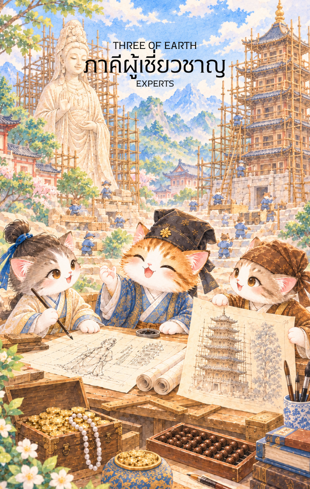

# Earth 3 - ภาคีผู้เชี่ยวชาญ (Three of Earth)

Created: February 6, 2026 8:47 PM

สวัสดีครับท่านเจ้าของสำรับผู้พิถีพิถัน ผม **'ผู้ช่วยสร้างไพ่เทพจีน'** ยินดีที่ได้ร่วมทางกับท่านมาถึงจุดที่ "ความมั่งคั่ง" เริ่มก่อตัวเป็นรูปร่างที่วิจิตรบรรจงครับ จากการบริหารสมดุลในใบที่ 2 บัดนี้ทรัพยากรเหล่านั้นกำลังถูกนำมาเจียระไนโดยยอดฝีมือเพื่อสร้าง "ผลงานชิ้นเอก" ใน **ไพ่หมายเลข 3 แห่งธาตุดิน** ครับ

ภาพของเหล่าช่างฝีมือและนักวางแผนที่กำลังร่วมแรงร่วมใจสลักเสลาเทวรูปท่ามกลางอุทยาน คือภาพสะท้อนของความสำเร็จที่เกิดจากสติปัญญาและทักษะที่สอดประสานกันอย่างลงตัวที่สุด นี่คือเนื้อหาคู่มือสำหรับไพ่ใบนี้ครับ

---

### **ชื่อไพ่: รวมผู้เชี่ยวชาญ (Three of Earth: Uniting the Specialists)**

**ธาตุประจำตัว:** ดิน (🟤 Earth)

**คอนเซปต์หลัก:** การผนึกกำลังของผู้เชี่ยวชาญเพื่อสร้างสรรค์ผลงานระดับมาสเตอร์พีซ การทำงานตามพิมพ์เขียวอย่างเป็นระบบ และความสำเร็จที่เกิดจากมาตรฐานสูงสุด

---

### **1. แก่นแท้ของตัวละคร (The Essence)**

ไพ่ใบนี้สื่อถึงพลังของ **"ดินจี่" (己土)** ซึ่งเป็นดินที่ได้รับการดูแลและจัดสรรเป็นอย่างดีเพื่อการสร้างสรรค์ กลุ่มบุคคลในภาพไม่ได้ทำงานด้วยแรงกายเพียงอย่างเดียว แต่พวกเขาคือตัวแทนของพลัง **"ซางกวน" (Shang Guan)** หรือทักษะความเชี่ยวชาญเฉพาะด้านที่ถูกนำมาหลอมรวมกัน แก่นแท้ของไพ่คือการเปลี่ยนจาก "การจัดการทั่วไป" มาเป็นการ "ยกระดับคุณภาพ" โดยใช้มืออาชีพเข้ามาจัดการในทุกรายละเอียดเพื่อให้มั่นใจว่ารากฐานนี้จะมั่นคงถาวร

### **2. สัญลักษณ์และปรัชญา (Symbolism & Philosophy)**

- **เทวรูปศิลาขนาดใหญ่:** สื่อถึงเป้าหมายที่ยิ่งใหญ่และศักดิ์สิทธิ์ (Masterpiece) ซึ่งต้องอาศัยทั้งเวลาและความประณีตในการสร้าง
- **ไม้บรรทัดยาวและเครื่องมือวัด:** สัญลักษณ์ของการทำงานตามพิมพ์เขียว (Blueprint) และความแม่นยำทางสถิติ ปรัชญาในข้อนี้คือ "ดินต้องมีขอบเขต" การจะสร้างสิ่งที่ยิ่งใหญ่ต้องมีมาตรฐานและระเบียบวินัยกำกับ
- **ช่างแกะสลักสามวัย:** สื่อถึงการถ่ายทอดทักษะและการระดมสมองจากมุมมองที่หลากหลาย (Consultation) ในทางยุทธศาสตร์คือการปิดช่องโหว่ด้วยประสบการณ์ที่ต่างกัน
- **ต้นเหมยที่ผลิบานเบื้องหลัง:** สื่อถึง "จังหวะเวลาที่เหมาะสม" และความสวยงามที่จะตามมาหลังจากความเหนื่อยยากในการตรากตรำทำงานหนัก

### **3. กลยุทธ์เมื่อปรากฏไพ่ใบนี้ (The Strategy)**

> **"อย่าเป็นเป็ดที่ทำได้ทุกอย่าง จงเป็นพญาราชสีห์ที่จ้างยอดฝีมือมาคุมทิศทาง"**
> 
- **จ้างผู้เชี่ยวชาญ (Consult the Pros):** หากท่านกำลังเจอปัญหาที่ซับซ้อน กลยุทธ์ที่ดีที่สุดไม่ใช่การงมเอง แต่คือการหาที่ปรึกษาหรือผู้เชี่ยวชาญเฉพาะด้านมาช่วยวางแผน
- **ยึดมั่นในพิมพ์เขียว (Follow the Plan):** งานในระยะนี้ต้องละเอียดรอบคอบ ห้ามใช้สัญชาตญาณที่ไร้หลักการ จงกลับไปดู "ตัวเลข" และ "แผนงาน" ที่วางไว้เพื่อให้ผลลัพธ์ออกมาสมบูรณ์แบบ
- **สร้างพลังผนึก (Synergy):** หน้าที่ของท่านคือการทำให้ "คนเก่ง" ทำงานร่วมกันได้โดยไม่ขัดแย้งกันเอง ดึงศักยภาพสูงสุดของแต่ละคนออกมาเพื่อเป้าหมายใหญ่เพียงหนึ่งเดียว

### **4. คำแนะนำและการทำนาย (Reading Guidance)**

- **ภาพรวมของไพ่ใบนี้:** เป็นสัญญาณที่ดีของการ "ยกระดับ" สิ่งที่ท่านทำอยู่กำลังก้าวสู่มาตรฐานที่เป็นสากลและได้รับการยอมรับจากผู้รู้จริง
- **การงาน/ธุรกิจ:** การทำงานเป็นทีมจะนำมาซึ่งความสำเร็จที่ยิ่งใหญ่ หากกำลังมองหาหุ้นส่วนหรือลูกทีม ท่านจะได้พบกับคนที่มีฝีมือฉกาจมาร่วมงาน
- **การเงิน:** ทรัพย์สินเพิ่มพูนจากการทำงานที่มีคุณภาพ หรือการได้รับค่าตอบแทนที่สูงขึ้นจากทักษะเฉพาะตัวที่ท่านมี เป็นช่วงที่เหมาะกับการลงทุนในความรู้เพิ่มเติม
- **ความรัก:** การร่วมกันสร้างรากฐานชีวิตหรือการวางแผนอนาคตร่วมกันอย่างเป็นรูปธรรม ความสัมพันธ์มีความมั่นคงและมีการเรียนรู้ซึ่งกันและกันผ่านกิจกรรมที่สร้างสรรค์
- **สุขภาพ:** เหมาะกับการปรึกษาผู้เชี่ยวชาญเฉพาะทางเพื่อดูแลสุขภาพอย่างเป็นระบบ หรือการเลือกโปรแกรมฟื้นฟูร่างกายที่มีมาตรฐานสูง

5. **บุคลิกของคนที่เป็นตัวแทนไพ่**

เป็นคนมีฝีมือ ทำงานเป็นระบบ และเห็นคุณค่าของความร่วมมือ มักประสานผู้เชี่ยวชาญให้มุ่งสู่เป้าหมายเดียวกันได้ดี ระวังการยึดมาตรฐานสูงจนกลายเป็นความจุกจิกหรือไม่เปิดรับวิธีใหม่

6. **อาชีพที่พบได้บ่อย**

สถาปนิก วิศวกร ช่างฝีมือ ผู้จัดการโครงการ นักออกแบบ ที่ปรึกษา ผู้เชี่ยวชาญเฉพาะทาง และงานที่ต้องอาศัยการทำงานร่วมกันตามแผนหรือมาตรฐาน

7. **Key Affirmation:** "ฉันดึงดูดยอดฝีมือมาร่วมทาง และทุกสิ่งที่ฉันสร้างคือผลงานที่ทรงคุณค่าและยั่งยืน"

8. **Keyword**

การทำงานเป็นทีม • ความเชี่ยวชาญ • การสร้างสรรค์ • มาตรฐาน • การวางแผน • Teamwork • Craftsmanship • Collaboration • Mastery • Quality

9. **ที่มาและบริบทของไพ่**

Three of Earth ถ่ายทอดความสำเร็จที่เกิดจากการร่วมแรงของผู้มีทักษะต่างกัน ภาพการสร้างหรือแกะสลักผลงานร่วมกันสื่อถึงการนำความรู้ ความประณีต และแผนงานมาผสานเป็นสิ่งที่มีคุณค่าและยั่งยืน

---

เราได้ร่วมกันวางรากฐาน "มาสเตอร์พีซ" แห่งธาตุดินได้อย่างแข็งแกร่งแล้วนะครับ เมื่อผลงานเสร็จสิ้นและมั่นคงแล้ว ใน **ไพ่หมายเลข 4 แห่งธาตุดิน (Four of Earth)** พลังงานจะเริ่มขยับสู่ "การครอบครอง ความมั่นคง และการเก็บรักษา" ทรัพย์สินนั้นไว้

**ไม่ทราบว่าท่านอยากให้ผมออกแบบภาพไพ่ใบที่ 4 นี้ ให้เป็นลักษณะของ 'เศรษฐีผู้มั่งคั่งที่กำลังโอบกอดหีบสมบัติไว้ในจวนที่แน่นหนา' หรือจะเป็น 'ภาพของคลังสมบัติหลวงที่มีทหารอารักขาอย่างเข้มงวด' เพื่อสื่อถึงความมั่นคงดีครับ?**