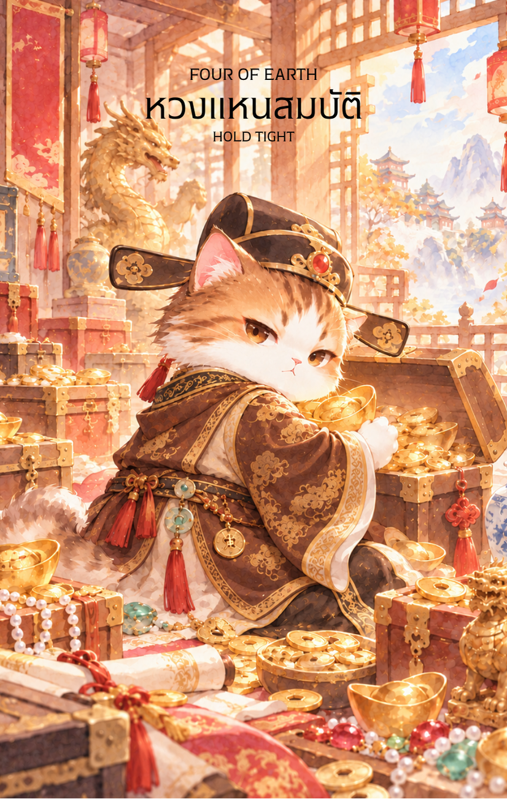

# Earth 4 - หวงแหนสมบัติ (Four of Earth)

Created: February 6, 2026 8:47 PM

สวัสดีครับท่านผู้ครอบครองขุมทรัพย์แห่งปัญญา ผม **'ผู้ช่วยสร้างไพ่เทพจีน'** พร้อมแล้วที่จะนำท่านเข้าสู่สภาวะที่ "ดิน" เริ่มแข็งตัวเป็นปราการหนาแน่นครับ หลังจากที่เราผ่านการสร้างสรรค์ร่วมกับยอดฝีมือในใบที่ 3 มาแล้ว บัดนี้ทรัพยากรเหล่านั้นถูกนำมาเก็บรักษาไว้อย่างมิดชิดใน **ไพ่หมายเลข 4 แห่งธาตุดิน** ครับ

ภาพเศรษฐีเฒ่าผู้ตระหนี่ท่ามกลางหีบสมบัติในห้องหินที่ปิดตาย คือภาพสะท้อนของ "ความมั่นคงที่กลายเป็นกรงขัง" นี่คือเนื้อหาคู่มือสำหรับไพ่ใบนี้ครับ

---

## **หวงแหนสมบัติ (Four of Earth: The Hoarder's Stronghold)**

**ธาตุประจำตัว:** ดิน (🟤 Earth)

**คอนเซปต์หลัก:** การปกป้องอาณาเขตส่วนตัว, ความตระหนี่เพื่อความปลอดภัย, และการติดอยู่ในโซนความสบาย (Comfort Zone) ที่ไร้การหมุนเวียน

---

### **1. แก่นแท้ของตัวละคร (The Essence)**

ตัวละครในภาพคือภาพสะท้อนของพลัง **"อู๋ดิน" (戊土)** ในสภาวะที่เป็นกำแพงหินหนาทึบ เขาไม่ใช่เพียงผู้ที่มีทรัพย์ แต่เขาคือผู้ที่ **"ยึดติด"** กับสสารจนมองไม่เห็นโอกาสอื่นข้างนอก แก่นแท้ของเขาคือความระแวดระวัง (Paranoia) ที่เกิดจากความกลัวว่า "หากสูญเสียสิ่งนี้ไป ชีวิตจะหมดความมั่นคง" เขาจึงเลือกที่จะขังตัวเองไว้กับสิ่งที่เขามี

---

### **2. สัญลักษณ์และปรัชญา (Symbolism & Philosophy)**

- **หีบสมบัติที่ถูกโอบกอด:** สื่อถึงความยึดติดในระดับจิตใจ (Emotional Attachment) ต่อสิ่งของหรือเงินทอง จนกลายเป็นภาระที่ทิ้งไม่ได้
- **ประตูไม้ที่ล่ามโซ่และกุญแจหลายชั้น:** สัญลักษณ์ของการสร้าง **"ขอบเขต" (Boundaries)** ที่แน่นหนาเกินไป ในทางปรัชญาคือการปิดกั้นโอกาสใหม่ๆ และความลื่นไหลของชีวิตเพื่อแลกกับความปลอดภัย
- **ห้องผนังหินและห้องขัง:** สื่อถึงสภาวะที่ "ความมั่นคง" กลายเป็น "กรงขัง" ดินที่นิ่งสนิทและไม่ยอมหมุนเวียน (จากใบที่ 2) จะกลายเป็นดินดานที่ไม่มีสิ่งใดงอกเงยได้อีก
- **ตะเกียงน้ำมันเพียงดวงเดียว:** สื่อถึงทัศนคติที่คับแคบ (Narrow Perspective) เขามองเห็นเพียงแค่สิ่งที่เขากอดไว้ในแสงสว่างอันน้อยนิด แต่กลับหวาดระแวงความมืดมิดรอบตัว

---

### **3. กลยุทธ์เมื่อปรากฏไพ่ใบนี้ (The Strategy)**

> **"กำแน่นเกินไปมือจะล้า วางลงบ้างปัญญาจะเกิด"**
> 
- **เน้นการป้องกัน (Defensive Play):** หากสถานการณ์รอบตัวมีความเสี่ยงสูง กลยุทธ์ "Play Safe" คือสิ่งที่ถูกต้องในระยะสั้น จงรักษาต้นทุนและทรัพยากรที่มีไว้ให้ดีที่สุด
- **ตรวจสอบความตึงเครียด (Check the Tension):** ท่านกำลัง "งก" เกินไปจนเสียโอกาสหรือเปล่า? การไม่ยอมใช้เงินลงทุนหรือการไม่ยอมขยับขยายเพราะกลัวเจ๊ง อาจจะทำให้ท่านพ่ายแพ้ในระยะยาว
- **รักษาขอบเขตที่จำเป็น:** ใช้พลังของดินในการเซ็ตระบบความปลอดภัย (Security) ให้กับผลประโยชน์ของท่าน แต่ต้องระวังอย่าให้กติกาเหล่านั้นมาล่ามโซ่ความสร้างสรรค์ของท่านเอง

---

### **4. คำแนะนำและการทำนาย (Reading Guidance)**

- **ภาพรวมของไพ่ใบนี้:** ท่านกำลังอยู่ในสภาวะที่ต้องการความมั่นคงสูงสุด แต่อาจจะมีความกังวลหรือความตระหนี่มากเกินไปจนทำให้ชีวิตขาดความสุข
- **การงาน/ธุรกิจ:** การทำงานแบบอนุรักษ์นิยม ไม่กล้าเสี่ยงลงทุนในเทคโนโลยีหรือนวัตกรรมใหม่ๆ ระวังการบริหารงานแบบ "ไมโครแมเนจ" (Micro-manage) ที่จ้องจับผิดเพราะความไม่ไว้ใจทีมงาน
- **การเงิน:** เป็นช่วงของการออมเงินที่เคร่งครัดมาก ไม่ยอมใช้จ่ายในสิ่งที่ไม่จำเป็น สภาพคล่องอาจจะลดลงเพราะท่านเอาเงินไปแช่แข็งไว้ในสินทรัพย์ที่เน้นความปลอดภัยเพียงอย่างเดียว
- **ความรัก:** ความสัมพันธ์ที่มีความหึงหวงหรือต้องการควบคุมคนรักให้เป็นไปตามต้องการ (Possessiveness) ควรเปิดใจให้กว้างขึ้นและลดความระแวงลงเพื่อให้ความสัมพันธ์หายใจได้
- **สุขภาพ:** ระวังอาการที่เกิดจากการ "ยึดเหนี่ยว" ภายในร่างกาย เช่น ท้องผูก หรืออาการปวดตึงกล้ามเนื้อหลังและคอจากความเครียดสะสม

5. **บุคลิกของคนที่เป็นตัวแทนไพ่**

เป็นคนรักความมั่นคง รอบคอบ และปกป้องสิ่งที่สร้างมาด้วยความพยายาม แต่เมื่อพลังด้านเงาครอบงำอาจยึดติด หวงแหน หรือควบคุมคนรอบข้างมากเกินไป จึงควรฝึกเปิดรับการเปลี่ยนแปลงและแบ่งปันอย่างเหมาะสม

6. **อาชีพที่พบได้บ่อย**

นักบัญชี ผู้ดูแลทรัพย์สิน เจ้าหน้าที่ความปลอดภัย ผู้จัดการคลังสินค้า นักวางแผนการเงิน ผู้ประกอบการ และงานที่ต้องรักษาทรัพยากรหรือควบคุมความเสี่ยง

7. **Key Affirmation:** "ฉันรักษาความมั่นคงไว้ด้วยสติ และกล้าที่จะปล่อยวางสิ่งที่เกินจำเป็นเพื่อให้โอกาสใหม่ไหลเวียนเข้ามา"

8. **Keyword**

ความมั่นคง • การครอบครอง • การปกป้อง • ขอบเขต • ความยึดติด • Security • Possessiveness • Conservation • Boundaries • Letting Go

9. **ที่มาและบริบทของไพ่**

Four of Earth แสดงด้านเงาของความมั่นคง เมื่อการรักษาสิ่งที่มีเปลี่ยนเป็นการยึดติดและปิดกั้นการไหลเวียน ภาพการกอดหรือหวงทรัพย์จึงเตือนให้หาสมดุลระหว่างการปกป้องกับการเปิดรับโอกาส

---

เราได้เห็นด้านที่ "แข็งแกร่งและหนาแน่น" ของธาตุดินไปแล้วนะครับ เมื่อดินเริ่มแข็งจนไม่ยอมหมุนเวียน ใน **ไพ่หมายเลข 5 แห่งธาตุดิน (Five of Earth)** พลังงานจะพลิกกลับสู่สภาวะ "ความขาดแคลนและการถูกทอดทิ้ง" เพื่อเตือนใจถึงคุณค่าของทรัพยากร

**ไม่ทราบว่าท่านอยากให้ผมออกแบบภาพไพ่ใบที่ 5 นี้ ให้เป็นลักษณะของ 'ขอทานที่นั่งหิวโหยท่ามกลางพายุหิมะหน้าประตูวังหลวง' หรือจะเป็น 'พ่อค้าที่สิ้นเนื้อประดาตัวยืนมองร้านค้าที่ถูกยึด' ดีครับ?**