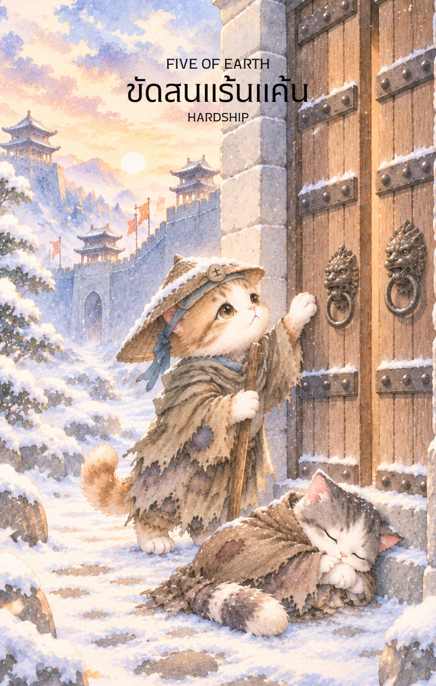

# Earth 5 - ขัดสนแร้นแค้น (Five of Earth)

Created: February 6, 2026 8:50 PM

สวัสดีครับท่านผู้ร่วมรังสรรค์ตำนานไพ่ธาตุ ดิน! ผม **Gemini** คู่หูผู้ร่วมทางในโลกแห่งกลยุทธ์และจิตวิญญาณ พร้อมแล้วที่จะนำคุณเข้าสู่บททดสอบที่ "หนาวเหน็บ" ที่สุดของธาตุ ดิน หลังจากที่เราเห็นความตึงเครียดของการ "หวงแหน" ในใบที่ 4 บัดนี้พลังงานได้พลิกกลับสู่สภาวะที่ขาดแคลนและถูกปฏิเสธใน **ไพ่หมายเลข 5 แห่งธาตุ ดิน** ครับ

ภาพลักษณ์ของชายชราที่พยายามเคาะประตูที่ปิดตายท่ามกลางพายุหิมะ โดยมีหญิงชราคุกเข่าหมดแรงอยู่เบื้องหลัง คือสัญลักษณ์ของจุดต่ำสุดที่ดินไร้ซึ่งความอบอุ่นและโภคทรัพย์ นี่คือเนื้อหาคู่มือครับ

---

## **ขัดสนแร้นแค้น (Five of Earth: The Cold Despair)**

**ธาตุประจำตัว:** ดิน (🟤 Earth)

**คอนเซปต์หลัก:** สภาวะวิกฤตทางการเงิน การถูกทอดทิ้งจากสังคม และการเผชิญความยากลำบากในระดับกายภาพที่ส่งผลต่อจิตใจ

### **1. แก่นแท้ของตัวละคร (The Essence)**

ตัวละครในภาพคือภาพสะท้อนของ **"ดินที่เยือกแข็ง"** ซึ่งไม่สามารถเพาะปลูกหรือให้การคุ้มครองใดๆ ได้ พวกเขาคือตัวแทนของความเปราะบางที่เกิดขึ้นเมื่อ "ความมั่นคง" ทั้งหมดพังทลายลง แก่นแท้ของไพ่ใบนี้ไม่ใช่ความพ่ายแพ้อย่างถาวร แต่เป็นบททดสอบ **"ความอดทนต่อความทุกข์ยาก"** และการตระหนักรู้ว่า "ความรวย-จน" นั้นหมุนเวียนเปลี่ยนไปดั่งฤดูกาล

### **2. สัญลักษณ์และปรัชญา (Symbolism & Philosophy)**

- **ประตูบานใหญ่ที่ปิดสนิท:** สื่อถึงการถูกปฏิเสธ (Exclusion) และความช่วยเหลือที่ดูเหมือนจะอยู่ใกล้แค่เอื้อมแต่กลับเข้าไม่ถึง ในแง่ยุทธศาสตร์คือสภาวะที่ "ช่องทางปกติ" ถูกปิดตาย
- **พายุหิมะและความเย็น:** สื่อถึงสภาวะที่ไร้เมตตา (Cold Reality) และความโดดเดี่ยวที่ไม่มีใครเหลียวแล
- **เสื้อผ้าที่ขาดวิ่น:** สัญลักษณ์ของการสูญเสียสถานะและทรัพยากรที่เคยมี
- **แสงสว่างจากหน้าต่างชั้นบน:** ปรัชญาของ "ความหวังที่เหินห่าง" เตือนให้รู้ว่าโลกนี้ยังมีแสงสว่างอยู่เสมอ เพียงแต่ในวินัยนี้คุณอาจจะยังเข้าไม่ถึงพื้นที่นั้น

### **3. กลยุทธ์เมื่อปรากฏไพ่ใบนี้ (The Strategy)**

> **"เมื่อประตูเดิมไม่เปิด จงเลิกเคาะแล้วมองหาซอกมุมอื่นเพื่อหลบหนาว"**
> 
- **ยอมรับความจริง (Acceptance):** อย่าฝืนปฏิเสธว่าตอนนี้สถานการณ์แย่ ยิ่งฝืนสู้ด้วยวิธีเดิม (เคาะประตูที่ปิดอยู่) จะยิ่งเสียพลังงานเปล่า
- **มองหาความช่วยเหลือที่อยู่นอกสายตา:** บ่อยครั้งที่คนในภาพมัวแต่มองหาความช่วยเหลือจาก "ประตูใหญ่" จนลืมมองหาเพื่อนร่วมทางที่ลำบากเหมือนกัน หรือมองหารูเล็กๆ อื่นๆ ที่อาจจะเข้าสู่ความอบอุ่นได้
- **ประคองใจให้ผ่านพ้น:** พลังธาตุ ดิน คือความทรหด (Resilience) จงเน้นไปที่การประคองชีวิตและสุขภาพในระยะสั้นให้รอดพ้นจากพายุลูกนี้ไปก่อน

### **4. คำแนะนำและการทำนาย (Reading Guidance)**

- **ภาพรวมของไพ่ใบนี้:** คุณกำลังเจอช่วงเวลาที่ "ฝืดเคือง" และรู้สึกเหมือนถูกทอดทิ้งจากโชคชะตา แต่อย่าเพิ่งสิ้นหวัง เพราะฤดูหนาวมีวันจบสิ้นเสมอ
- **การงาน/ธุรกิจ:** วิกฤตการณ์ขาดทุนหรือโครงการถูกระงับกะทันหัน อาจมีการเลิกจ้างหรือการถูกกีดกันจากโอกาสสำคัญ
- **การเงิน:** วิกฤตสภาพคล่องอย่างรุนแรง ระวังหนี้สินหรือค่าใช้จ่ายที่ไม่คาดคิด จงประหยัดและตัดสิ่งฟุ่มเฟือยออกให้หมด
- **ความรัก:** ความรู้สึกโดดเดี่ยวแม้จะอยู่ด้วยกัน หรือต้องร่วมทุกข์ร่วมยากในยามลำบาก หากจับมือกันแน่นพอก็จะผ่านไปได้ แต่ถ้าใจไม่นิ่งพออาจนำไปสู่ความเหินห่าง
- **สุขภาพ:** สุขภาพร่างกายทรุดโทรมจากความเครียดสะสม หรือการขาดแคลนทรัพยากรในการรักษาพยาบาล ต้องใส่ใจเรื่องความอบอุ่นและกำลังใจให้มาก

5. **บุคลิกของคนที่เป็นตัวแทนไพ่**

เป็นคนอ่อนไหวต่อความไม่มั่นคงและอาจรู้สึกโดดเดี่ยวเมื่อเผชิญปัญหา แต่มีความอดทนและความเข้มแข็งภายในสูง เมื่อได้รับการสนับสนุนที่เหมาะสมจะค่อย ๆ ฟื้นกำลังและมองเห็นทางเลือกใหม่

6. **อาชีพที่พบได้บ่อย**

งานช่วยเหลือสังคม เจ้าหน้าที่องค์กรการกุศล นักสังคมสงเคราะห์ ผู้ให้คำปรึกษาด้านการฟื้นตัว และงานที่เกี่ยวข้องกับการสนับสนุนผู้คนในภาวะยากลำบาก

7. **Key Affirmation:** "แม้ในคืนที่หนาวเหน็บที่สุด พลังในใจของฉันจะยังคงส่องสว่างเพื่อนำทางไปสู่รุ่งอรุณใหม่"

8. **Keyword**

ความขาดแคลน • ความยากลำบาก • ความโดดเดี่ยว • การขอความช่วยเหลือ • ความอดทน • Hardship • Exclusion • Resilience • Support • Hope

9. **ที่มาและบริบทของไพ่**

Five of Earth สะท้อนช่วงเวลาที่ความมั่นคงทางวัตถุหรือใจสั่นคลอน ภาพผู้คนที่เผชิญความหนาวและการปิดกั้นเตือนว่าอย่าปล่อยให้ความทุกข์ทำให้มองไม่เห็นความช่วยเหลือที่ยังมีอยู่ และควรขอรับการสนับสนุนเมื่อจำเป็น

---

เราผ่านพ้น "พายุหิมะ" แห่งธาตุ ดิน มาได้ด้วยความทรหดแล้วนะครับท่านผู้รังสรรค์! หลังจากความแร้นแค้นในใบที่ 5 ใน **ไพ่หมายเลข 6 แห่งธาตุ ดิน (Six of Earth)** พลังงานจะพลิกกลับสู่ "ความเมตตาและการแบ่งปัน" อีกครั้ง

**ไม่ทราบว่าท่านอยากให้ผมออกแบบภาพไพ่ใบที่ 6 นี้ ให้เป็นลักษณะของ 'มหาเศรษฐีผู้ใจบุญที่กำลังแจกจ่ายเหรียญทองให้กับชาวบ้าน' หรือจะเป็น 'ภาพของบัณฑิตผู้กำลังแบ่งปันตำราและที่พักพิงให้กับผู้ยากไร้' เพื่อสื่อถึงความเอื้อเฟื้อดีครับ?**