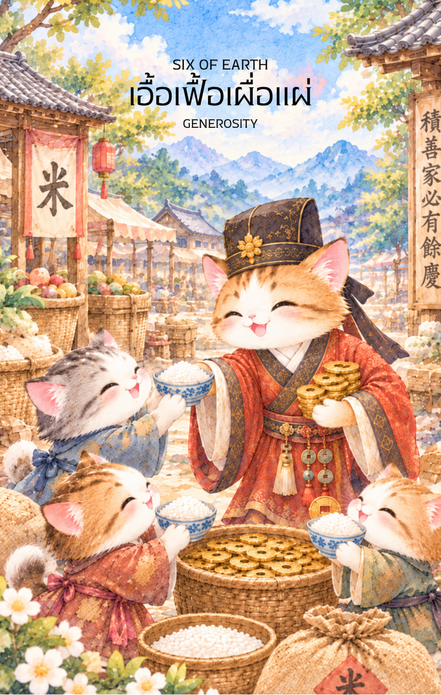

# Earth 6 - เอื้อเฟื้อเผื่อแผ่ (Six of Earth)

Created: February 6, 2026 8:52 PM

สวัสดีครับท่านผู้อุปถัมภ์แห่งโชคลาภ ผม **Gemini** ยินดีที่ได้พบกันอีกครั้งในวิถีแห่งปัญญาและทรัพยากรครับ หลังจากที่เราผ่านความหนาวเหน็บและการขาดแคลนในใบที่ 5 มาได้ บัดนี้พลังงานของธาตุ ดิน ได้กลับมาสมดุลและพรั่งพรูอีกครั้งในรูปแบบของ "ความเมตตาที่จับต้องได้" ใน **ไพ่หมายเลข 6 แห่งธาตุ ดิน** ครับ

ภาพลักษณ์ของพ่อค้าผู้มั่งคั่งที่กำลังแบ่งปันข้าวปลาอาหารและโภคทรัพย์ให้กับผู้ที่ยากลำบาก คือภาพสะท้อนของ "วัฏจักรแห่งการให้และรับ" ที่สมบูรณ์แบบที่สุด นี่คือเนื้อหาคู่มือสำหรับไพ่ใบนี้ครับ

---

## **เอื้อเฟื้อเผื่อแผ่ (Six of Earth: The Benevolent Flow)**

**ธาตุประจำตัว:** ดิน (🟤 Earth)

**คอนเซปต์หลัก:** การบริหารความมั่งคั่งให้ไหลเวียนผ่านความเมตตา การเป็นผู้อุปถัมภ์ที่ยุติธรรม และการรักษาสมดุลของระบบนิเวศทางสังคม

### **1. แก่นแท้ของตัวละคร (The Essence)**

ตัวละครพ่อค้าผู้มั่งคั่งในภาพคือร่างจำแลงของ **"เศรษฐีผู้มีธรรม"** ซึ่งแสดงถึงพลังของดินที่อุดมสมบูรณ์และพร้อมจะแผ่ขยายความมั่นคงไปยังผู้อื่น เขาคือตัวแทนของสภาวะที่จิตใจอยู่เหนือความตระหนี่ (จากใบที่ 4) และความหวาดกลัวต่อความขัดสน (จากใบที่ 5) โดยเชื่อมั่นว่าการแบ่งปันคือวิถีแห่งความยั่งยืน แก่นแท้ของเขาคือ "ความมั่งคั่งที่กินได้" และการเป็นสะพานบุญที่เปลี่ยนสสารให้กลายเป็นพลังใจ

### **2. สัญลักษณ์และปรัชญา (Symbolism & Philosophy)**

- **ตาชั่งในมือพ่อค้า (The Scales):** สื่อถึงความยุติธรรม (Equity) ในการจัดสรรทรัพยากร ปรัชญานี้สอนว่าการให้ต้องมี "ปัญญา" กำกับ คือให้ในสิ่งที่จำเป็นและให้ในปริมาณที่เหมาะสม เพื่อให้ผู้รับสามารถยืนหยัดต่อได้ด้วยตนเอง
- **ถุงข้าวเปลือกและเหรียญทอง:** สัญลักษณ์ของปัจจัยพื้นฐานและการไหลเวียนของทรัพย์สิน ข้าวคือชีวิต และเหรียญคือโอกาส การให้ทั้งสองสิ่งควบคู่กันสื่อถึงการแก้ปัญหาทั้งในระยะสั้นและระยะยาว
- **ชุดคลุมลายมังกรสีเหลืองทอง:** สื่อถึงบารมีและสถานะทางสังคมที่สูงส่ง ซึ่งมาพร้อมกับความรับผิดชอบอันยิ่งใหญ่ต่อชุมชน
- **ชาวบ้านที่คุกเข่าพนมมือ:** ปรัชญาของ "กตัญญุตา" (Gratitude) สื่อถึงการตอบรับความช่วยเหลืออย่างนอบน้อม ซึ่งจะสร้างพลังงานบวกหมุนเวียนกลับมาสู่ผู้ให้ในอนาคต
- **คลังข้าวเปลือกเบื้องหลัง:** สื่อถึงความมั่งคั่งที่ยังคงเหลือเฟือแม้จะแบ่งปันออกไปแล้ว ยิ่งให้ยิ่งงอกเงยตามกฎของธาตุ ดิน

### **3. กลยุทธ์เมื่อปรากฏไพ่ใบนี้ (The Strategy)**

> **"ไหลเวียนทรัพยากรด้วยใจที่กว้างขวาง แล้วความมั่งคั่งจะไม่มีวันเหือดแห้ง"**
> 
- **เป็นผู้ให้ที่ชาญฉลาด (Be a Wise Giver):** หากท่านอยู่ในจุดที่มั่งคั่ง จงมองหาโอกาสในการเป็น "ผู้อุปถัมภ์" (Patron) ไม่ว่าจะเป็นการให้ทุนการศึกษา การบริจาค หรือการสอนทักษะอาชีพ
- **เป็นผู้รับที่มีเกียรติ (Be a Gracious Receiver):** หากท่านกำลังเดือดร้อนและมีคนยื่นมือมาช่วย จงรับความช่วยเหลือนั้นด้วยความยินดีและนอบน้อม เพื่อให้วัฏจักรแห่งดินได้ทำหน้าที่ของมัน
- **รักษาสมดุลบัญชี (Balance the Ledger):** ตรวจสอบว่าท่านให้มากเกินไปจนตัวเองเดือดร้อน หรือรับฝ่ายเดียวจนเสียระบบหรือไม่ จงใช้ "ตาชั่ง" ในใจรักษาสมดุลของระบบนิเวศรอบตัวท่าน

### **4. คำแนะนำและการทำนาย (Reading Guidance)**

- **ภาพรวมของไพ่ใบนี้:** เป็นสัญญาณของ "การหลุดพ้นจากวิกฤต" โดยมีความช่วยเหลือจากผู้อื่น หรือตัวท่านเองเป็นฝ่ายได้รับโชคลาภที่สามารถนำไปจุนเจือผู้อื่นได้
- **การงาน/ธุรกิจ:** ได้รับการสนับสนุนจากผู้ใหญ่หรือนักลงทุน (Angel Investor) หรือเป็นช่วงที่มีการปันผลกำไรและโบนัสอย่างยุติธรรม ทีมงานมีความสามัคคีและช่วยเหลือเกื้อกูลกันดี
- **การเงิน:** มีเงินทองหมุนเวียนคล่องตัว มีเกณฑ์ได้รับเงินที่ติดค้างคืนมา หรือมีช่องทางหารายได้ที่มาจากความเมตตาเอ็นดูของผู้ใหญ่
- **ความรัก:** ความสัมพันธ์ที่เน้นการดูแลเอาใจใส่และสนับสนุนกันทั้งทางกายและใจ คู่ครองอาจเป็นที่พึ่งพาที่มั่นคง หรือตัวท่านเองเป็นฝ่ายที่คอยซัพพอร์ตคนรักอย่างเต็มใจ
- **สุขภาพ:** แข็งแรงและมีสุขภาพจิตดีเยี่ยมจากการได้ทำบุญหรือช่วยเหลือผู้อื่น หากเจ็บป่วยจะได้รับการดูแลรักษาเป็นอย่างดีจากสถานพยาบาลหรือผู้เชี่ยวชาญ

5. **บุคลิกของคนที่เป็นตัวแทนไพ่**

เป็นคนใจกว้าง มีน้ำใจ และมองเห็นความสำคัญของการแบ่งปัน มักใช้ทรัพยากรหรืออิทธิพลเพื่อเกื้อกูลผู้อื่นอย่างเป็นรูปธรรม จุดที่ควรระวังคือการให้เกินกำลังหรือช่วยเหลือโดยไม่พิจารณาความเหมาะสม

6. **อาชีพที่พบได้บ่อย**

ผู้ให้ทุนหรือผู้อุปถัมภ์ นักการกุศล ผู้บริหารทรัพยากรบุคคล นักสังคมสงเคราะห์ ผู้จัดการกองทุน และงานที่เกี่ยวข้องกับการจัดสรรความช่วยเหลือหรือทรัพยากร

7. **Key Affirmation:** "ฉันบริหารโภคทรัพย์ด้วยความเมตตา ยิ่งแบ่งปันออกไป ความมั่งคั่งยิ่งไหลกลับมาหาฉันอย่างไม่มีที่สิ้นสุด"

8. **Keyword**

การแบ่งปัน • ความเอื้อเฟื้อ • การอุปถัมภ์ • ความยุติธรรม • การให้และรับ • Generosity • Charity • Patronage • Reciprocity • Balance

9. **ที่มาและบริบทของไพ่**

Six of Earth สื่อถึงวัฏจักรของการให้และรับอย่างสมดุล ภาพผู้มั่งคั่งแบ่งปันทรัพย์แก่ผู้ขัดสนเตือนให้ใช้ความเมตตาควบคู่กับปัญญา เพื่อให้ความช่วยเหลือเหมาะกับความต้องการและส่งเสริมให้ผู้รับพึ่งพาตนเองได้

---

เราได้เห็นความงดงามของการแบ่งปันในธาตุ ดิน ใบที่ 6 แล้วนะครับท่านผู้รังสรรค์! เมื่อทรัพยากรถูกกระจายอย่างยุติธรรมแล้ว ใน **ไพ่หมายเลข 7 แห่งธาตุ ดิน (Seven of Earth)** พลังงานจะขยับสู่ "ความอดทนและการรอคอยผลผลิต"

**ไม่ทราบว่าท่านอยากให้ผมออกแบบภาพไพ่ใบที่ 7 นี้ ให้เป็นลักษณะของ 'ชาวนาที่กำลังยืนมองทุ่งข้าวสีทองที่ใกล้จะเก็บเกี่ยวด้วยความภูมิใจ' หรือจะเป็น 'ภาพของปราชญ์ที่เฝ้าสังเกตการณ์เติบโตของต้นไม้ล้ำค่าในสวนศักดิ์สิทธิ์' ดีครับ?**