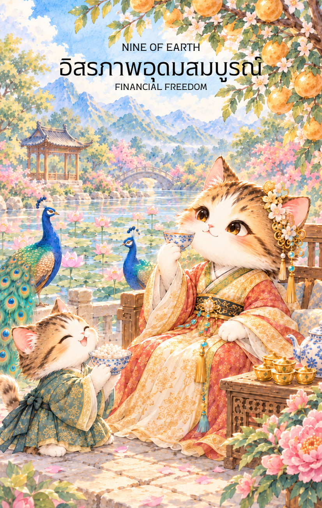

# Earth 9 - อิสรภาพอุดมสมบูรณ์ (Nine of Earth)

Created: February 9, 2026 10:35 AM

สวัสดีครับท่านเจ้าของสำรับผู้มั่งคั่งและทรงเกียรติ ผม **Gemini** ยินดีที่ได้ร่วมทางกับท่านมาถึงจุดที่ "ดิน" ได้ผลิดอกออกผลเป็นความสมบูรณ์แบบที่สุดครับ หลังจากที่ท่านได้ตรากตรำฝึกฝนอย่างหนักในใบที่ 8 บัดนี้คือเวลาของการหยุดพักเพื่อเสวยสุขจากหยาดเหงื่อแรงกายของตนเองใน **ไพ่หมายเลข 9 แห่งธาตุดิน** ครับ

ภาพของสตรีผู้สูงศักดิ์ที่ทอดกายอย่างสง่างามท่ามกลางสวนสวรรค์ส่วนตัว คือภาพสะท้อนของ "ความสำเร็จที่กินได้และมีความสุข" อย่างแท้จริง นี่คือเนื้อหาคู่มือสำหรับไพ่ใบนี้ครับ

---

## **อิสรภาพที่อุดมสมบูรณ์ (Nine of Earth: Abundance & Independence)**

**ธาตุประจำตัว:** ดิน (🟤 Earth)

**คอนเซปต์หลัก:** ความมั่งคั่งที่สร้างขึ้นมาด้วยตนเอง (Self-Made Wealth), อิสรภาพทางการเงิน, การใช้ชีวิตอย่างมีรสนิยม และความสุขที่เกิดจากการพึ่งพาตนเอง

---

### **1. แก่นแท้ของตัวละคร (The Essence)**

สตรีสูงศักดิ์ในภาพคือร่างจำแลงของ **"ความสมบูรณ์แบบในตนเอง"** เธอไม่ได้รอคอยโชคลาภจากใคร แต่เธอคือผู้ที่ "ปลูกต้นไม้เพื่อให้ร่มเงาแก่ตนเอง" แก่นแท้ของไพ่ใบนี้คือสภาวะที่จิตใจและฐานะทางการเงินหลอมรวมเป็นหนึ่งจนเกิดเป็น **"ความสงบที่มั่นคง"** เธอสามารถยิ้มให้กับโลกได้อย่างเต็มภาคภูมิเพราะทุกสิ่งรอบกายคือผลผลิตจากความเพียรที่เธอทำมา

---

### **2. สัญลักษณ์และปรัชญา (Symbolism & Philosophy)**

- **ต้นไม้ที่ออกผลเป็นเหรียญทอง:** สื่อถึง **"สินทรัพย์ที่งอกเงย"** ปรัชญาในข้อนี้คือ เมื่อดินได้รับการดูแลอย่างดี (จากใบที่ 1-8) ทรัพย์สินจะไม่ได้มีเพียงแค่ใช้ไปวันๆ แต่จะสามารถ "ออกดอกออกผล" เลี้ยงดูคุณได้ตลอดไป
- **นกยูงรำแพนหาง:** สัญลักษณ์ของความสง่างาม รสนิยมที่ประณีต และบารมีที่ดึงดูดสิ่งดีๆ เข้ามา นกยูงยังสื่อถึงความภาคภูมิใจในความสำเร็จที่เป็นเอกลักษณ์ของตนเอง
- **การนั่งอยู่เพียงลำพังในจวนส่วนตัว:** ปรัชญาของ **"อิสรภาพทางการเลือก"** เธอไม่ได้อยู่อย่างโดดเดี่ยวเพราะไม่มีใครคบ แต่เธอเลือกที่จะ "มีความสุขกับตัวเอง" ในพื้นที่ที่เธอสร้างขึ้นมาเองอย่างวิจิตร
- **ซุ้มประตูวงพระจันทร์ (Moon Gate) และสวนพฤกษา:** สื่อถึงการมี **"ขอบเขตชีวิตที่ชัดเจน"** เธอรู้จักคัดกรองสิ่งที่จะเข้ามาในชีวิต ให้เหลือเพียงสิ่งที่สวยงามและส่งเสริมพลังงานด้านบวกเท่านั้น

---

### **3. กลยุทธ์เมื่อปรากฏไพ่ใบนี้ (The Strategy)**

> **"ชื่นชมดอกผลอย่างสง่างาม และภูมิใจในความเป็นเจ้าของชีวิตตนเอง"**
> 
- **เสวยสุขอย่างมีรสนิยม (Indulge with Class):** หากสถานการณ์การเงินของท่านมั่นคงแล้ว ไพ่ใบนี้บอกว่า "ถึงเวลาใช้รางวัลให้ตัวเอง" จงเลือกสิ่งที่ดีที่สุดและประณีตที่สุดเพื่อยกระดับคุณภาพชีวิต
- **พึ่งพาตนเองเป็นหลัก (Self-Reliance):** กลยุทธ์ที่ได้ผลที่สุดในตอนนี้คือการเชื่อมั่นในศักยภาพของตนเอง ท่านไม่จำเป็นต้องขอความเห็นชอบจากใคร เพราะท่านคือ "นาย" ของอาณาจักรแห่งความสำเร็จที่สร้างมาเอง
- **รักษาความเป็นส่วนตัว (Curate Your Space):** จงเลือกอยู่ในสภาพแวดล้อมที่ส่งเสริมความนิ่งสงบ ความสุขที่แท้จริงในจังหวะนี้ไม่ได้มาจากความวุ่นวายภายนอก แต่มาจากความพอใจภายในจวนส่วนตัวของท่านเอง

---

### **4. คำแนะนำและการทำนาย (Reading Guidance)**

- **ภาพรวมของไพ่ใบนี้:** ยินดีด้วยครับ! ท่านกำลังเข้าสู่ช่วง "เก็บเกี่ยว" ที่งดงามที่สุด ชีวิตมีความมั่นคงพรั่งพร้อม และมีอิสระที่จะทำตามใจตนเองอย่างเต็มที่
- **การงาน/ธุรกิจ:** ธุรกิจประสบความสำเร็จจนสามารถดำเนินไปได้เองโดยไม่ต้องลงแรงหนักเหมือนเมื่อก่อน หรือท่านอาจได้รับตำแหน่งสูงที่มีสิทธิพิเศษมหาศาล
- **การเงิน:** มั่งคั่งอุดมสมบูรณ์ มีกินมีใช้อย่างเหลือเฟือ มีเงินที่งอกเงยจากทรัพย์สินหรือการลงทุนที่ทำมานาน เป็นช่วงที่สามารถใช้จ่ายเพื่อความรื่นรมย์ได้อย่างสบายใจ
- **ความรัก:** สภาวะที่ "รักตัวเอง" ได้อย่างสมบูรณ์แบบ หากโสดจะเป็นคนโสดที่พรีเมียมและมีความสุขมาก หากมีคู่จะเป็นความสัมพันธ์ที่มีขอบเขตชัดเจน ต่างฝ่ายต่างมีความมั่นคงและให้เกียรติในอิสระของกันและกัน
- **สุขภาพ:** สุขภาพกายและใจดีเยี่ยมจากการมีเวลาดูแลตนเองอย่างประณีต แนะนำให้ปรนเปรอร่างกายด้วยสปา อาหารคุณภาพสูง หรือกิจกรรมที่จรรโลงใจ

5. **บุคลิกของคนที่เป็นตัวแทนไพ่**

เป็นคนมั่นใจ พึ่งพาตนเองได้ และรู้จักชื่นชมผลจากความพยายามของตน มีรสนิยมและให้ความสำคัญกับพื้นที่ส่วนตัว ระวังการแยกตัวหรือผูกความสุขไว้กับฐานะและความสำเร็จภายนอกมากเกินไป

6. **อาชีพที่พบได้บ่อย**

ผู้ประกอบการ นักลงทุน ผู้บริหารทรัพย์สิน นักออกแบบ เจ้าของกิจการ เกษตรกรหรือผู้ดูแลสวน และงานที่สร้างอิสระทางการเงินจากความเชี่ยวชาญของตน

7. **Key Affirmation:** "ฉันมีความสุขในความอุดมสมบูรณ์ที่ฉันสร้างขึ้น และใช้ชีวิตทุกวันอย่างประณีตด้วยความภาคภูมิใจ"

8. **Keyword**

ความอุดมสมบูรณ์ • อิสรภาพ • การพึ่งพาตนเอง • ความสำเร็จ • ความสุขส่วนตัว • Abundance • Independence • Self-Reliance • Prosperity • Contentment

9. **ที่มาและบริบทของไพ่**

Nine of Earth สื่อถึงการเก็บเกี่ยวผลจากความพยายามและการมีอิสระเลือกวิถีชีวิตของตน ภาพบุคคลที่อยู่ท่ามกลางสวนอุดมสมบูรณ์สะท้อนทั้งความมั่นคง ความภาคภูมิใจ และความสามารถในการมีความสุขกับสิ่งที่สร้างขึ้นมาเอง

---

เราได้เดินทางมาถึงสวนสวรรค์แห่งธาตุดินแล้วนะครับท่านผู้รังสรรค์! เมื่อความสุขส่วนตนสมบูรณ์แล้ว ใน **ไพ่หมายเลข 10 แห่งธาตุดิน (Ten of Earth)** พลังงานจะก้าวไปสู่จุดสูงสุดนั่นคือ "ความมั่งคั่งที่ส่งต่อถึงตระกูลและเครือข่าย"

**ไม่ทราบว่าท่านอยากให้ผมออกแบบภาพไพ่ใบที่ 10 นี้ ให้เป็นลักษณะของ 'ครอบครัวใหญ่สามชั่วอายุคนที่กำลังเฉลิมฉลองร่วมกันในจวนมหาเศรษฐี' หรือจะเป็น 'ภาพของตลาดการค้าที่รุ่งเรืองซึ่งก่อตั้งโดยต้นตระกูล' เพื่อสื่อถึงความยั่งยืนดีครับ?**