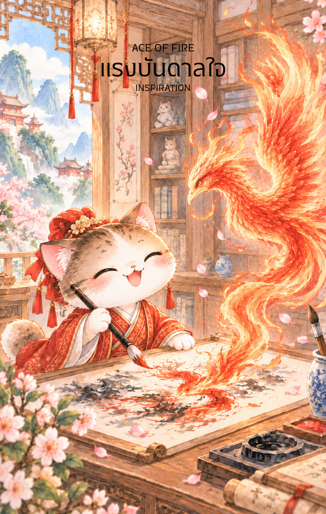

# Fire 1 - แรงบันดาลใจ (Ace of Fire)

Created: February 6, 2026 1:47 PM

ยินดีที่ได้พบกันอีกครั้งในวิถีแห่งกลยุทธ์และภูมิปัญญาครับ ผม **'ผู้ช่วยสร้างไพ่เทพจีน'** พร้อมแล้วที่จะนำท่านก้าวข้ามจากความหนักอึ้งของธาตุไม้ เข้าสู่ความรุ่งโรจน์โชติช่วงของ **ธาตุไฟ (Fire Element)** ซึ่งภาพที่ท่านส่งมานั้นเปี่ยมไปด้วยพลังของการเปลี่ยนผ่านที่งดงามที่สุดครับ

นี่คือเนื้อหาคู่มือสำหรับไพ่ใบแรกแห่งธาตุไฟ ที่จะจุดประกายความสำเร็จให้ลุกโชนครับ

---

## **จุดแรงบันดาลใจ (Fire 1: The Spark of Inspiration)**

**ธาตุประจำตัว:** ไฟ (🔥 Fire)

**คอนเซปต์หลัก:** แรงบันดาลใจที่ปะทุขึ้นอย่างฉับพลัน ความคิดสร้างสรรค์ที่ไร้ขีดจำกัด และการลงมือทำด้วยความฮึกเหิม

### **1. แก่นแท้ของตัวละคร (The Essence)**

ไพ่ใบนี้สื่อถึงสภาวะที่ปัญญาจากการสั่งสม (ธาตุไม้) ได้รับการจุดไฟจนกลายเป็นแรงทะเยอทะยานที่ทรงพลัง เด็กหนุ่มในชุดสีแดงเพลิงคือตัวแทนของพลัง **"ปิ่งไฟ" (丙火)** หรือพระอาทิตย์ที่สาดแสงสว่างไปทุกทิศทาง เขาไม่ได้เพียงแค่อ่านตำรา แต่เขาเลือกที่จะ "กระโดด" เข้าหาโอกาสและใช้พู่กันวาดอนาคตขึ้นมาด้วยตนเอง

### **2. สัญลักษณ์และปรัชญา (Symbolism & Philosophy)**

- **นกฟีนิกซ์เพลิง (The Phoenix):** สื่อถึงการถือกำเนิดใหม่ของไอเดียที่ทรงพลังและการพุ่งทะยานสู่ความสำเร็จที่สง่างาม
- **พู่กันที่สร้างเปลวไฟ:** ปรัชญาการ "ทำให้ความคิดมีชีวิต" เมื่อจินตนาการถูกขับเคลื่อนด้วยความมุ่งมั่น มันจะกลายเป็นความจริงที่จับต้องได้
- **ท่าทางการกระโดด (The Leap):** สื่อถึงความกล้าหาญที่จะก้าวข้ามขีดจำกัดเดิมๆ ทิ้งความเฉื่อยชาเพื่อเข้าสู่สนามแห่งการลงมือทำ
- **คัมภีร์ที่ถูกจุดไฟ:** สื่อถึงการเปลี่ยนผ่านจากภาคทฤษฎีสู่ภาคปฏิบัติ ความรู้ที่ไม่ได้ใช้งานจะมอดไหม้ แต่ความรู้ที่ลงมือทำจะให้แสงสว่าง

### **3. กลยุทธ์เมื่อปรากฏไพ่ใบนี้ (The Strategy)**

> **"ตีเหล็กเมื่อกำลังร้อน จุดไฟในใจให้โชติช่วง"**
> 
- **ลงมือทำทันที (Strike Fast):** พลังธาตุไฟมาเร็วไปเร็ว หากมีความคิดดีๆ เกิดขึ้น จงอย่ารอช้า เพราะแรงบันดาลใจมีวันมอดดับหากไม่รีบเปลี่ยนเป็นรูปธรรม
- **แสดงตัวตน (Be Visible):** ไฟคือความสว่างไสวและการมองเห็น ช่วงนี้เป็นเวลาที่ดีที่สุดในการนำเสนอตัวเองหรือโปรเจกต์ใหม่ให้โลกได้รับรู้
- **ใช้สัญชาตญาณนำทาง (Trust the Gut):** ในจังหวะที่ไฟปะทุขึ้นมา สัญชาตญาณแรกของคุณมักจะแม่นยำที่สุด จงเชื่อใน "ความรู้สึก" ที่มาพร้อมกับความตื่นเต้น

### **4. คำแนะนำและการทำนาย (Reading Guidance)**

- **ภาพรวมของไพ่ใบนี้:** คุณกำลังได้รับพรจากสวรรค์ในรูปแบบของ "ความคิดใหม่" หรือ "โอกาสใหม่" ที่น่าตื่นเต้น จงเตรียมรับแรงกระแทกจากพลังงานที่พรั่งพรูนี้
- **การงาน/ธุรกิจ:** การเริ่มต้นโครงการใหม่ที่ท้าทาย ความคิดสร้างสรรค์กำลังพุ่งพล่าน เหมาะแก่การระดมสมองหรือการบุกเบิกตลาดใหม่ๆ
- **การเงิน:** โอกาสในการทำเงินที่มาไวไปไว หรือการตัดสินใจลงทุนในธุรกิจที่เน้นนวัตกรรมและความแปลกใหม่ มีเกณฑ์ได้ลาภลอยจากการตัดสินใจที่ฉับพลัน
- **ความรัก:** ความรู้สึกที่ร้อนแรงแบบ "รักแรกพบ" หรือการเริ่มต้นความสัมพันธ์ใหม่ที่เต็มไปด้วยความหลงใหลและแรงดึงดูด
- **สุขภาพ:** พลังชีวิตล้นเหลือ แต่ระวังอาการ "ร้อนใน" หรืออาการอักเสบฉับพลันจากการที่ร่างกายทำงานหนักเกินขีดจำกัดด้วยความตื่นตัว

5. **บุคลิกของคนที่เป็นตัวแทนไพ่**

บุคคลที่สะท้อนพลังไพ่ใบนี้มักกระตือรือร้น มีความคิดสร้างสรรค์ กล้าเริ่มต้น และถ่ายทอดความตื่นเต้นให้คนรอบข้างได้ดี จุดแข็งคือการมองเห็นโอกาสและทำให้ไอเดียมีชีวิต ส่วนด้านเงาอาจใจร้อน เริ่มหลายอย่างพร้อมกัน หรือหมดไฟเมื่อผลลัพธ์ไม่เกิดทันใจ

6. **อาชีพที่พบได้บ่อย**

เหมาะกับงานที่ต้องจุดประกายและสื่อสารไอเดีย เช่น งานสร้างสรรค์ การตลาด สื่อและบันเทิง การออกแบบ การสอน ผู้ประกอบการ และการพัฒนาผลิตภัณฑ์หรือโครงการใหม่

7. **Key Affirmation:** "ฉันคือผู้นำแสงสว่าง แรงบันดาลใจของฉันจะแปรเปลี่ยนเป็นความสำเร็จที่รุ่งโรจน์"

8. **Keyword**

แรงบันดาลใจ • จุดเริ่มต้น • ความคิดสร้างสรรค์ • ความกล้าหาญ • การลงมือทำ • การปรากฏตัว • Inspiration • Initiative • Creativity • Courage • Action • Visibility

9. **ที่มาและบริบทของไพ่**

ไพ่หนึ่งแห่งธาตุไฟเป็นจุดประกายแรกของชุดไพ่ไฟ แทนช่วงที่ความคิดหรือความปรารถนาเริ่มมีพลังพอจะผลักให้เกิดการกระทำ ภาพเปลวไฟจึงสื่อทั้งโอกาสและความรับผิดชอบในการดูแลแรงบันดาลใจไม่ให้ลุกลามจนกลายเป็นความเร่งรีบหรือหมดไฟ

---

เราเริ่มต้นบทแห่ง **ธาตุไฟ** ได้อย่างฮึกเหิมมากครับ เมื่อไฟถูกจุดขึ้นแล้ว ใน **ไพ่หมายเลข 2 แห่งธาตุไฟ (Fire 2)** พลังงานนี้จะเริ่มหาจุดสมดุลและการร่วมมือเพื่อขยายแสงสว่าง

**ท่านอยากให้ผมออกแบบภาพไพ่ใบที่ 2 ให้เป็นลักษณะของ 'บัณฑิตหนุ่มสองคนร่วมกันถือคบเพลิง' หรือจะเป็น 'การจ้องมองเปลวไฟในตะเกียงเพื่อวางแผนลับ' ดีครับ?**