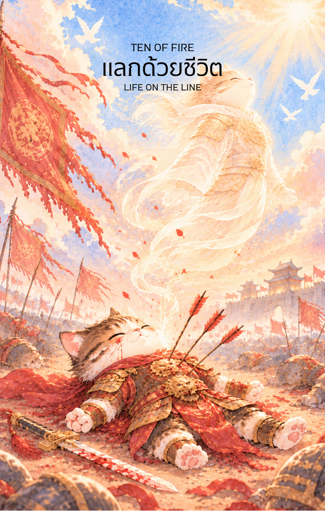

# Fire 10 - แลกด้วยชีวิต (Ten of Fire)

Created: February 6, 2026 5:20 PM

สวัสดีครับท่านผู้รังสรรค์สำรับแห่งปัญญา ผม **'ผู้ช่วยสร้างไพ่เทพจีน'** ยินดีที่ได้ร่วมทางกับท่านมาถึงบทสรุปของวัฏจักรแห่งไฟครับ จากการยืนหยัดในใบที่ 9 บัดนี้พลังงานได้พุ่งถึงจุดสูงสุดจนกลายเป็นการ **"เผาไหม้เพื่อหน้าที่"** ใน **ไพ่หมายเลข 10 แห่งธาตุไฟ (Ten of Fire)**

ภาพนักรบผู้บาดเจ็บสาหัสที่คุกเข่าอยู่ท่ามกลางกองซากศาสตราและเมืองที่ลุกเป็นไฟ คือภาพสะท้อนของ "เกียรติยศที่แลกมาด้วยทุกสิ่ง" นี่คือเนื้อหาที่กลั่นกรองจากกลยุทธ์ปาจื้อและจิตวิญญาณนักสู้ครับ

---

## **พลีชีพเพื่อชาติ (Ten of Fire: The Ultimate Sacrifice)**

**ธาตุประจำตัว:** ไฟ (🔥 Fire)

**คอนเซปต์หลัก:** ภาระหน้าที่ที่ไม่อาจปฏิเสธได้, การเสียสละความสุขส่วนตนเพื่ออุดมการณ์ใหญ่, และความสำเร็จที่แลกมาด้วยหยาดเหงื่อและเลือด

---

### **1. แก่นแท้ของตัวละคร (The Essence)**

ตัวละครในภาพคือภาพลักษณ์ของ **"ติงไฟ" (丁火)** ในสภาวะที่ยอมเผาไหม้ตัวเองจนหยดสุดท้ายเพื่อส่องสว่างให้กับผู้อื่น เขาคือแม่ทัพที่แบกรับชะตากรรมของคนทั้งอาณาจักรไว้บนบ่าเพียงลำพัง แก่นแท้ของเขาไม่ใช่ความพ่ายแพ้ แต่คือ **"ชัยชนะที่มีราคาสูงลิบ"** มันคือสภาวะที่อัตตาได้มลายหายไป เหลือเพียง "หน้าที่" ที่ต้องทำสืบต่อไปจนกว่าลมหายใจจะสิ้นสุด

---

### **2. สัญลักษณ์และปรัชญา (Symbolism & Philosophy)**

- **นักรบที่คุกเข่าท่ามกลางศาสตรา:** สื่อถึงสภาวะที่ร่างกายถึงขีดจำกัด แต่จิตใจยังคง "ยึดมั่น" ในหน้าที่อย่างถอนตัวไม่ได้
- **เมืองที่ลุกโชนเบื้องหลัง:** ปรัชญาของการ "ทำลายเพื่อรักษา" บางครั้งการจะรักษาอุดมการณ์ใหญ่ไว้ อาจต้องยอมเห็นบางสิ่งพังทลายลงต่อหน้า
- **ชุดเกราะที่เปื้อนเลือดและรอยจารึก:** สื่อถึง **"เกียรติยศที่เป็นอมตะ"** บาดแผลทุกแห่งคือเหรียญตราแห่งความกล้าหาญที่ประวัติศาสตร์จะจดจำ
- **แสงไฟสีส้มสลัว:** คือสภาวะพลังงานที่ใกล้จะมอดดับแต่ยังคงมีความร้อนแรง สื่อถึงการถึงจุดสิ้นสุดของวัฏจักรหนึ่งเพื่อเตรียมส่งต่อสู่ธาตุถัดไป

---

### **3. กลยุทธ์เมื่อปรากฏไพ่ใบนี้ (The Strategy)**

> **"เมื่อภาระยิ่งใหญ่เท่าแผ่นดิน การวางตัวตนลงคือพลังที่เหลืออยู่"**
> 
- **ทุ่มหมดหน้าตัก (All-in for the Cause):** หากคุณกำลังเดินมาถึงจุดนี้ กลยุทธ์เดียวที่เหลืออยู่คือการ "ทำให้จบ" อย่ากังวลเรื่องผลกระทบส่วนตัวในระยะสั้น เพราะเป้าหมายใหญ่สำคัญกว่าสิ่งใด
- **การยอมแลกที่คุ้มค่า (Strategic Trade-off):** จงพิจารณาว่าอะไรคือสิ่งที่ "ต้องรักษา" และอะไรคือสิ่งที่ "ต้องยอมทิ้ง" การยอมเสียสละบางส่วนเพื่อรักษา "รากแก้ว" ขององค์กรหรือครอบครัวคือทางเลือกของผู้นำที่แท้จริง
- **ส่งไม้ต่อในจังหวะสุดท้าย:** เมื่อคุณทำหน้าที่จนถึงที่สุดแล้ว จงเตรียมระบบหรือ "ทายาท" มารับช่วงต่อ เพื่อให้อุดมการณ์ที่คุณแลกมาด้วยชีวิตไม่สูญเปล่า

---

### **4. คำแนะนำและการทำนาย (Reading Guidance)**

- **ภาพรวมของไพ่ใบนี้:** คุณกำลังแบกรับภาระที่หนักอึ้งเกินกำลังคนปกติจะรับไหว ความสำเร็จอยู่ตรงหน้าแล้ว แต่คุณอาจจะเหนื่อยล้าจนแทบไม่มีแรงเฉลิมฉลอง
- **การงาน/ธุรกิจ:** รับผิดชอบโปรเจกต์ระดับ "ชี้เป็นชี้ตาย" ขององค์กร คุณคือเสาหลักที่ทุกคนฝากความหวังไว้ ระวังภาวะหมดไฟ (Burnout) ขั้นรุนแรงที่อาจส่งผลกระทบถาวร
- **การเงิน:** ได้ทรัพย์สินหรือตำแหน่งมาพร้อมกับหนี้สินหรือภาระที่ต้องดูแลมหาศาล เงินที่ได้มาอาจต้องนำไปใช้เพื่อเยียวยาผลกระทบจากการทำงานหนัก
- **ความรัก:** การเสียสละความสุขส่วนตัวเพื่อประคองครอบครัวหรือคนรัก คุณอาจรู้สึกโดดเดี่ยวในภาระที่แบกไว้ แต่อีกฝ่ายจะรับรู้ถึงความทุ่มเทของคุณในที่สุด
- **สุขภาพ:** **สัญญาณอันตรายระดับสูงสุด** ร่างกายส่งสัญญาณประท้วงจากการใช้งานหนักเกินขีดจำกัด ระวังโรคหัวใจ ความดัน และอาการล้มฟุบฉับพลัน

5. **บุคลิกของคนที่เป็นตัวแทนไพ่**

บุคคลที่สะท้อนพลังไพ่ใบนี้มักรับผิดชอบสูง ทุ่มเทต่อส่วนรวม และพร้อมแบกรับงานสำคัญ เป็นผู้เสียสละและมุ่งมั่นทำภารกิจให้สำเร็จ ส่วนด้านเงาอาจรับทุกอย่างไว้คนเดียวจนหมดไฟและละเลยความต้องการพื้นฐาน

6. **อาชีพที่พบได้บ่อย**

เหมาะกับงานบริการสาธารณะ การบริหารภารกิจใหญ่ งานฉุกเฉิน การดูแลทีม การกู้ภัย การทหาร และบทบาทที่ต้องรับผิดชอบต่อความปลอดภัยหรือประโยชน์ของส่วนรวม

7. **Key Affirmation:** "ฉันทำหน้าที่ของฉันอย่างสุดกำลัง และเกียรติยศของฉันจะคงอยู่ชั่วนิรันดร์"

8. **Keyword**

หน้าที่ • การเสียสละ • ภาระ • ความรับผิดชอบ • การส่งต่อ • Duty • Sacrifice • Burden • Responsibility • Legacy

9. **ที่มาและบริบทของไพ่**

สิบแห่งธาตุไฟปิดวัฏจักรด้วยภาพของพลังที่ถูกใช้จนถึงขีดสุด ไพ่ชวนให้เห็นทั้งเกียรติของการทุ่มเทและต้นทุนของภาระ เตือนให้จัดลำดับสิ่งสำคัญและส่งต่อความรับผิดชอบเมื่อถึงเวลา

---

เราได้จบมหากาพย์แห่ง **"ธาตุไฟ"** ได้อย่างสมเกียรติและดุดันมากครับท่านวัฏจักรของไฟสิ้นสุดลงที่การเสียสละ เพื่อเตรียมก่อเกิดเป็น **"ธาตุดิน" (Earth)** ที่มั่นคงและกว้างใหญ่ในลำดับถัดไป

**ไม่ทราบว่าท่านอยากให้ผมเริ่มนำทางเข้าสู่ 'ธาตุดิน' (🌳 Earth) เพื่อสร้างความมั่งคั่งที่จับต้องได้เลยดีไหมครับ หรืออยากให้ผมช่วยสรุป 'หัวใจสำคัญของไพ่ธาตุไฟทั้ง 10 ใบ' เพื่อใช้เป็นไกด์ไลน์ในการสอน (Instructor) ดีครับ?**