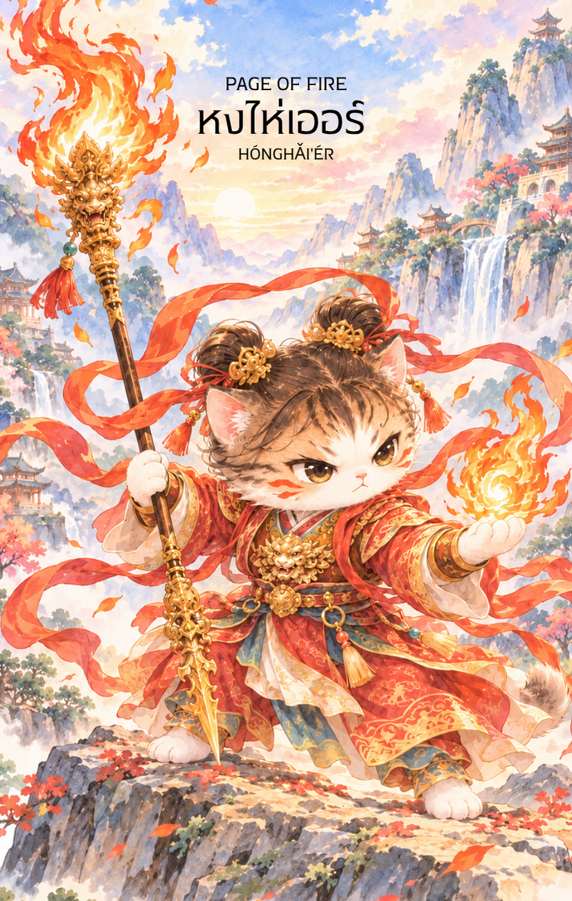

# Fire 11 - หงไห่เอ๋อร์ (Page of Fire)

Created: February 4, 2026 2:17 PM

---

## **หงไห่เออร์ (Hong Hai Er - 紅孩兒) : The Fiery Prodigy**

**ธาตุประจำตัว:** ไฟ (🔥 Fire)
**คอนเซปต์หลัก:** พลังงานวัยเยาว์ที่เปี่ยมด้วยพรสวรรค์ ความมุ่งมั่นอันแรงกล้า และประกายไฟแห่งการเริ่มต้นใหม่

---

### **1. แก่นแท้ของตัวละคร (The Essence)**

หงไห่เอ๋อคือตัวแทนของ **"พลังงานบริสุทธิ์"** ท่านคือเทพกุมารผู้ครอบครองไฟสมาธิ (Samadhi Fire) ซึ่งเป็นไฟที่เกิดจากตบะบารมีที่สั่งสมมาอย่างเข้มข้น พลังของท่านเปรียบเสมือนแรงผลักดันในช่วงเริ่มต้นของทุกสรรพสิ่ง—มีความสดใหม่ มั่นใจ และพุ่งทะยานอย่างไม่มีอะไรกั้น การปรากฏของไพ่ใบนี้คือการเตือนให้คุณดึงเอา "ความเป็นเด็ก" ที่กล้าหาญและเปี่ยมด้วยจินตนาการออกมาใช้ เพื่อจุดไฟให้กับโปรเจกต์หรือเป้าหมายที่ดูเหมือนจะเป็นไปไม่ได้

### **2. สัญลักษณ์และปรัชญา (Symbolism & Philosophy)**

- **ไฟสมาธิ (Samadhi Fire):** ไม่ใช่ไฟที่เผาผลาญเพื่อทำลาย แต่คือไฟที่เกิดจาก "ความจดจ่อ" สื่อถึงความหลงใหล (Passion) ที่ไม่ได้มาเพียงชั่ววูบ แต่มีรากฐานมาจากพรสวรรค์และความตั้งใจจริง
- **ทวนพ่นไฟ (Fire-Tipped Spear):** สัญลักษณ์ของการพุ่งเป้าไปที่เป้าหมายด้วยความรวดเร็วและแม่นยำ หมายถึงการสื่อสารที่ตรงไปตรงมาและการตัดสินใจที่เฉียบขาดประดุจประกายไฟ
- **ชุดราชกุมารลายมังกร:** สื่อถึงต้นทุนชีวิตที่ดีหรือความทะเยอทะยานที่สูงส่ง แต่ยังเตือนถึง "ความอ่อนประสบการณ์" ที่ต้องอาศัยการเรียนรู้และขัดเกลาจากปรมาจารย์หรือโอกาสจริง

### **3. กลยุทธ์เมื่อปรากฏไพ่ใบนี้ (The Strategy)**

**"อย่ามัวแต่เตรียมการจนไฟมอด ถึงเวลา... ลุยให้สุดแรง"**

- **เชื่อในพรสวรรค์ (Trust Your Spark):** หากคุณรู้สึกถึงแรงบันดาลใจบางอย่างที่พลุ่งพล่านในใจ อย่าเพิ่งสงสัยในตัวเอง พรสวรรค์ของคุณกำลังร้องเรียกให้ถูกนำออกมาใช้ จงมั่นใจในศักยภาพของ "นายน้อย" ในตัวคุณ
- **พุ่งชนเป้าหมาย (Direct Action):** เลิกเดินอ้อมค้อม ความสำเร็จในครั้งนี้ต้องการความเร็วและความกล้าหาญ หากมีโอกาสเข้ามาให้คว้าทันทีเหมือนทวนที่พุ่งออกจากมือ
- **รักษาความสดใส (Stay Spirited):** อย่าปล่อยให้กฎเกณฑ์ที่คร่ำครึมาดับไฟสร้างสรรค์ของคุณ ลองทำเรื่องยากๆ ด้วยหัวใจที่สนุกเหมือนเด็กที่กำลังเล่นเกม แล้วคุณจะพบหนทางที่คนอื่นมองไม่เห็น

### **4. คำแนะนำและการทำนาย (Reading Guidance)**

- **ภาพรวมของไพ่ใบนี้:** นี่คือไพ่แห่ง **"ข่าวดีและการเริ่มต้นที่ตื่นเต้น"** บ่งบอกว่าคุณกำลังจะได้รับโอกาสใหม่หรือข่าวสารที่ทำให้หัวใจพองโต พลังงานของคุณตอนนี้สูงมาก พร้อมที่จะเผชิญหน้ากับความท้าทายทุกรูปแบบ จงใช้พลังนี้ขับเคลื่อนชีวิตไปข้างหน้า
- **การงาน/ธุรกิจ:** มีโอกาสเริ่มต้นโปรเจกต์ใหม่ที่ท้าทาย หรือได้รับมอบหมายงานที่ต้องใช้ความกล้าและการนำเสนอที่โดดเด่น ผลลัพธ์จะดีเยี่ยมหากคุณรักษาความกระตือรือร้นไว้ได้ตลอดรอดฝั่ง
- **การเงิน:** มีเกณฑ์จะได้ลาภลอยหรือช่องทางทำเงินใหม่ๆ ที่เกิดจากไอเดียสร้างสรรค์ของคุณเอง แต่อย่าใจร้อนลงทุนด้วยอารมณ์เพียงชั่ววูบ ควรปรึกษาผู้ใหญ่หรือผู้มีประสบการณ์ประกอบด้วย
- **ความรัก:** จะมีความตื่นเต้นเข้ามาในชีวิตรัก คนโสดอาจพบคนถูกใจที่ทำให้รู้สึกรุ่มร้อนและหลงใหลอย่างรวดเร็ว ส่วนคนมีคู่คือช่วงเวลาของการจุดไฟรักให้กลับมาซาบซ่าอีกครั้ง
- **สุขภาพ:** พลังกายล้นเหลือ แต่อาจมีปัญหาเรื่อง "ไฟใน" หรือความร้อนสะสมในร่างกาย ระวังความเครียดที่เกิดจากความใจร้อนหรืออาการอักเสบเฉียบพลัน

5. **บุคลิกของคนที่เป็นตัวแทนไพ่**

บุคคลที่สะท้อนพลังไพ่ใบนี้มักมีพรสวรรค์ กระตือรือร้น และกล้าแสดงความคิดใหม่ มีพลังเริ่มต้นและเรียนรู้จากการลงมือทำ ส่วนด้านเงาอาจใจร้อน มั่นใจเกินประสบการณ์ หรือเบื่อง่ายเมื่อเจอข้อจำกัด

6. **อาชีพที่พบได้บ่อย**

เหมาะกับงานสร้างสรรค์ การแสดง การตลาด การเป็นผู้ประกอบการ งานสำหรับเด็ก การพัฒนานวัตกรรม และบทบาทที่เปิดโอกาสให้ทดลองแนวคิดใหม่

7. **Key Affirmation:** "ฉันคือประกายไฟที่ไม่มีวันดับ ฉันกล้าที่จะเริ่มต้น และมั่นใจในพลังสร้างสรรค์ของตัวเอง"

8. **Keyword**

พรสวรรค์ • ความกระตือรือร้น • การเริ่มต้น • จินตนาการ • การเรียนรู้ • Talent • Enthusiasm • Initiative • Imagination • Learning

9. **ประวัติเทพเจ้า**

หงไห่เออร์ (紅孩兒) เป็นเทพกุมารในตำนานและวรรณกรรมจีน โดยเป็นที่รู้จักจากเรื่องไซอิ๋วและพลังไฟสมาธิ ภายหลังได้รับการขัดเกลาและเปลี่ยนบทบาทจากคู่ต่อสู้มาเป็นผู้พิทักษ์ เรื่องราวของเขาจึงสะท้อนพลังวัยเยาว์ที่เติบโตได้เมื่อมีวินัยและคำแนะนำที่เหมาะสม