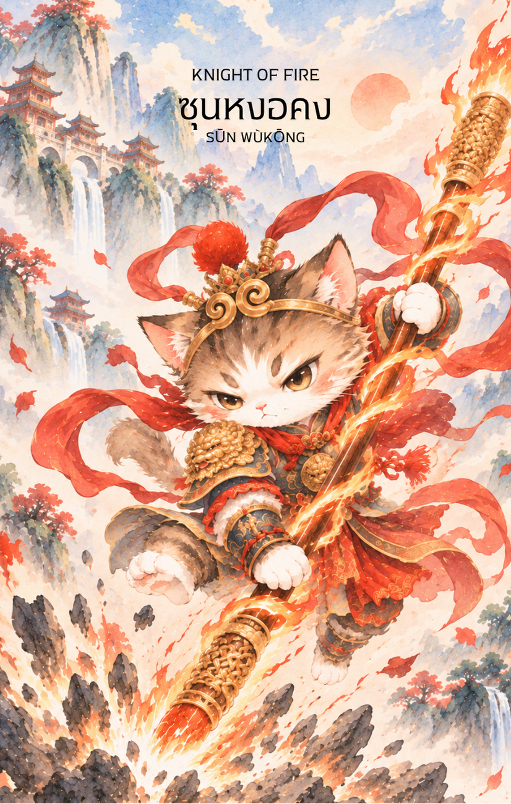

# Fire 12 - ซุนหงอคง (Knight of Fire)

Created: February 4, 2026 2:28 PM

## **Knight of Fire : The Great Sage, Heaven's Equal**

### **(ซุนหงอคง - Sūn Wùkōng - 孫悟空)**

- **ธาตุประจำตัว:** ไฟ (🔥 Fire) - (กำเนิดจากหินแต่ถูกหลอมในเตาหลอมยาของไท่ซ่างเหล่าจวินจนแกร่งกล้า พลังงานคือหยางอัคคีที่พลุ่งพล่าน)
- **คอนเซปต์หลัก:** พลังขับเคลื่อนที่ไม่มีวันหยุดยั้ง ความกล้าหาญบ้าบิ่น และการลงมือทำอย่างรวดเร็วปานสายฟ้า

---

### **1. แก่นแท้ของตัวละคร (The Essence)**

ซุนหงอคงคือตัวแทนของ **"การกระทำที่รวดเร็วและทรงพลัง" (Action & Intensity)** เขาคือพญาวานรผู้ไม่เคยเกรงกลัวฟ้าดิน พร้อมที่จะบุกตะลุยไปข้างหน้าเพื่อเป้าหมาย พลังของเขาคือความมุ่งมั่นอันแรงกล้าที่ผสมผสานกับความใจร้อน บ้าบิ่น แต่ก็เปี่ยมไปด้วยไหวพริบและการแก้ปัญหาเฉพาะหน้าที่ยอดเยี่ยม การปรากฏของไพ่ใบนี้คือสัญญาณว่า "เวลาแห่งการรอคอยสิ้นสุดลงแล้ว ถึงเวลาบุก!"

### **2. สัญลักษณ์และปรัชญา (Symbolism & Philosophy)**

- **กระบองวิเศษหรูอี้ (Ruyi Jingu Bang):** อาวุธที่หนักอึ้งและยืดหดได้ดั่งใจ สื่อถึง "เจตจำนงที่แน่วแน่" และความสามารถในการปรับเปลี่ยนวิธีการเพื่อบรรลุเป้าหมาย เป็นการลงมือทำที่ทรงประสิทธิภาพ
- **เมฆวิเศษก斗อวิ๋น (Somersault Cloud):** สื่อถึงความรวดเร็วปานสายฟ้าแลบ การก้าวกระโดดไปสู่ความสำเร็จ หรือการเดินทางและการเปลี่ยนแปลงที่เกิดขึ้นอย่างฉับพลันทันที
- **ดวงตาอัคคี (Fiery Golden Eyes):** การมองเห็นธาตุแท้ของปัญหา (มองเห็นปีศาจที่แปลงกายมา) สื่อถึงการโฟกัสที่เป้าหมายอย่างจดจ่อ รู้เท่าทันสถานการณ์ แม้จะอยู่ในความชุลมุนวุ่นวาย

### **3. กลยุทธ์เมื่อปรากฏไพ่ใบนี้ (The Strategy)**

**"อย่าลังเล... พุ่งชนเป้าหมายด้วยความเร็วสูงสุด"**

- **Act Now (ลงมือทันที):** ความลังเลคือศัตรู สถานการณ์นี้ต้องการความเด็ดขาด รวดเร็ว และการลงมือทำทันที ไม่ใช่เวลามานั่งวางแผนละเอียดลออ
- **Be Bold & Disruptive (กล้าที่จะแหกกฎ):** บางครั้งต้องกล้าท้าทายวิธีการเดิมๆ หรืออำนาจเก่าๆ เพื่อสร้างการเปลี่ยนแปลง (เหมือนตอนที่หงอคงอาละวาดสวรรค์) ความมั่นใจในตัวเองคืออาวุธสำคัญ
- **Channel Your Energy (ควบคุมพลังงาน):** พลังของคุณตอนนี้มหาศาลดั่งไฟป่า แต่ต้องควบคุมทิศทางให้ดี (เหมือนมีมงคลสวมหัวคอยเตือนสติ) อย่าปล่อยให้ความใจร้อนทำให้พลังงานที่พลุ่งพล่านกลายเป็นความวุ่นวายที่ไร้ทิศทาง

### **4. คำแนะนำและการทำนาย (Reading Guidance)**

- **ภาพรวมของไพ่ใบนี้:** นี่คือช่วงเวลาที่ชีวิตจะหมุนไปอย่างรวดเร็วมาก มีเรื่องตื่นเต้น ท้าทาย และอาจต้องเดินทางหรือเคลื่อนไหวตลอดเวลา (ชีพจรลงเท้า) เตรียมตัวรับแรงกระแทกจากความเปลี่ยนแปลงที่ถาโถมเข้ามา และจงสนุกไปกับมัน
- **การงาน/ธุรกิจ:** ต้องทำงานเชิงรุก (Proactive) อย่างมาก การแข่งขันสูง เหมาะกับงานที่ต้องใช้ความกล้าเสี่ยง การบุกเบิกตลาดใหม่ หรือการตัดสินใจที่ฉับไว โปรเจกต์จะคืบหน้าแบบก้าวกระโดด แต่อาจเหนื่อยจนแทบไม่มีเวลาพัก
- **การเงิน:** เงินหมุนเวียนเร็วมาก มีโอกาสทำกำไรจากการเก็งกำไรระยะสั้น การลงทุนที่เสี่ยงแต่ผลตอบแทนสูง หรือเงินที่มาจากการเดินทาง แต่ให้ระวังการใช้จ่ายที่วู่วามตามอารมณ์ (Impulsive Spending)
- **ความรัก:** รักที่ร้อนแรงดั่งไฟและมาเร็วเคลมเร็ว อาจเป็นความสัมพันธ์ที่น่าตื่นเต้นแบบรักแรกพบ หรือความสัมพันธ์ที่มีปากเสียงกันบ่อยครั้งเพราะความใจร้อนและความเอาแต่ใจของฝ่ายใดฝ่ายหนึ่ง
- **สุขภาพ:** พลังงานล้นเหลือจนอยู่นิ่งไม่ได้ ระวังอุบัติเหตุที่เกิดจากความประมาท ความรีบร้อน อาการอักเสบเฉียบพลัน หรือภาวะ Burnout จากการใช้ร่างกายหนักเกินไป

5. **บุคลิกของคนที่เป็นตัวแทนไพ่**

เป็นคนกล้าหาญ มีพลังสูง ตัดสินใจและลงมือทำได้รวดเร็ว ชอบความท้าทายและแก้ปัญหาเฉพาะหน้าเก่ง ระวังความใจร้อน การหุนหันพลันแล่น หรือการใช้พลังจนหมดแรง

6. **อาชีพที่พบได้บ่อย**

ผู้ประกอบการ นักกีฬา นักดับเพลิง ผู้กู้ภัย ทหาร ผู้บุกเบิกโครงการ และงานที่ต้องตอบสนองเร็ว กล้าเสี่ยง หรือขับเคลื่อนการเปลี่ยนแปลง

7. **Key Affirmation:** "ฉันเคลื่อนไหวว่องไวดั่งสายฟ้า ฉันกล้าหาญ และไม่มีอุปสรรคใดหยุดยั้งฉันได้"

8. **Keyword**

การลงมือทำ • ความรวดเร็ว • ความกล้าหาญ • พลังขับเคลื่อน • การบุกเบิก • Action • Momentum • Courage • Boldness • Initiative

9. **ประวัติตัวละครและตำนานที่เกี่ยวข้อง**

ซุนหงอคงเป็นตัวละครสำคัญจากวรรณกรรมจีนเรื่องไซอิ๋ว มีพลังวิเศษและความกล้าท้าทายสวรรค์ ก่อนจะร่วมเดินทางอัญเชิญพระไตรปิฎกกับพระถังซัมจั๋ง ระหว่างทางเขาเรียนรู้การใช้พลังและความสามารถเพื่อคุ้มครองคณะเดินทาง เรื่องราวของเขาจึงเชื่อมโยงกับความกล้าหาญ การเปลี่ยนแปลง และการฝึกตน