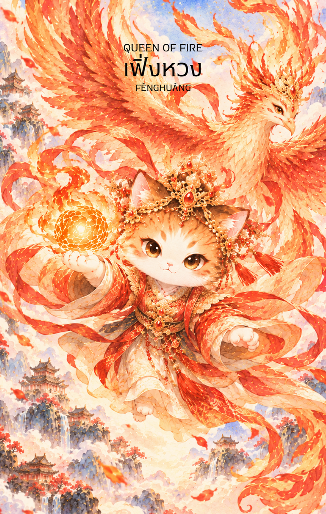

# Fire 13 - เฟิ่งหวง (Queen of Fire)

Created: February 4, 2026 2:43 PM

### **เฟิ่งหวง (Feng Huang - 鳳凰) : The Immortal Grace**

**ธาตุประจำตัว:** ไฟ (🔥 Fire)
**คอนเซปต์หลัก:** ความสง่างามที่ไม่มีวันดับสูญ พลังแห่งการฟื้นฟู และบารมีที่เปี่ยมด้วยความเมตตา

---

### **1. แก่นแท้ของตัวละคร (The Essence)**

เฟิ่งหวง หรือพญานกฟีนิกซ์แห่งตะวันออก คือตัวแทนของ **"ไฟที่อบอุ่นและสร้างสรรค์" (Nurturing Fire)** ต่างจากไฟที่แผดเผาของซุนหงอคง เฟิ่งหวงคือพลังแห่งชีวิตที่นำมาซึ่งความอุดมสมบูรณ์และความสมดุล ท่านคือราชินีเหนือมวลปักษีผู้ปรากฏตัวในยามที่แผ่นดินมีร่มเย็นเป็นสุข การปรากฏของไพ่ใบนี้สื่อถึงบุคคลที่มีเสน่ห์ มีความมั่นใจในตัวเองสูง และมีความสามารถในการจัดการสิ่งต่าง ๆ ให้ลุล่วงด้วยความนุ่มนวลแต่เด็ดขาด

### **2. สัญลักษณ์และปรัชญา (Symbolism & Philosophy)**

- **ขนห้าสี (Five-Colored Plumage):** สื่อถึงคุณธรรม 5 ประการของขงจื๊อ (เมตตา, ความชอบธรรม, มารยาท, ปัญญา, สัจจะ) สื่อว่าพลังที่แท้จริงต้องมาพร้อมกับจริยธรรม
- **การฟื้นจากเถ้าถ่าน (Resurrection):** สัญลักษณ์ของการไม่ยอมแพ้และการเปลี่ยนผ่าน (Transformation) สื่อถึงพลังในการเยียวยาตัวเองและผู้อื่นจากความทุกข์ยาก
- **ต้นอู๋ถง (Wutong Tree):** ตามตำนานเฟิ่งหวงจะเกาะเฉพาะต้นอู๋ถงเท่านั้น สื่อถึง "มาตรฐานที่สูงส่ง" การเลือกเฟ้นสิ่งที่ดีที่สุด และความซื่อสัตย์ต่ออุดมการณ์ของตนเอง

### **3. กลยุทธ์เมื่อปรากฏไพ่ใบนี้ (The Strategy)**

**"ครองใจคนด้วยบารมี และรังสรรค์โลกด้วยความปรารถนาดี"**

- **Lead with Charisma (นำด้วยเสน่ห์):** ใช้มนุษยสัมพันธ์และทัศนคติเชิงบวกในการจูงใจคน ความใจกว้างและรอยยิ้มของคุณคืออาวุธที่ทรงพลังที่สุดในตอนนี้
- **Nurture Your Passion (บ่มเพาะความหลงใหล):** อย่าเพียงแค่ลงมือทำ แต่จงใส่ "หัวใจ" ลงไปในสิ่งที่ทำ พลังของ Queen of Fire คือการทำให้คนรอบข้างรู้สึกฮึกเหิมไปกับเราด้วย
- **Elegant Resilience (ล้มแล้วลุกอย่างสง่างาม):** หากเจออุปสรรค จงใช้ความนิ่งสงบในการแก้ปัญหาและฟื้นตัวกลับมาให้สวยงามกว่าเดิมเหมือนนกฟีนิกซ์

### **4. คำแนะนำและการทำนาย (Reading Guidance)**

- **ภาพรวมของไพ่ใบนี้:** คุณกำลังอยู่ในจุดที่มีพลังงานชีวิตเต็มเปี่ยม มีแรงดึงดูดใจต่อผู้คนรอบข้าง เป็นช่วงเวลาที่เหมาะกับการสร้างสรรค์ผลงาน การออกสังคม หรือการก้าวขึ้นมาเป็นผู้นำที่ได้รับความรักเคารพ
- **การงาน/ธุรกิจ:** งานที่เกี่ยวข้องกับการสื่อสาร การใช้ความคิดสร้างสรรค์ หรือการบริหารจัดการคนจะโดดเด่นมาก คุณมีวิสัยทัศน์ที่กว้างไกลและสามารถบันดาลใจให้ทีมงานร่วมแรงร่วมใจกันได้
- **การเงิน:** สถานะทางการเงินมีความมั่นคงและมีโอกาสเติบโตจากการขยายตัวของธุรกิจหรือความสัมพันธ์ทางสังคม เป็นช่วงที่ "บุคลิกภาพ" จะช่วยดึงดูดทรัพย์และโอกาสใหม่ ๆ เข้ามา
- **ความรัก:** เป็นความรักที่เต็มไปด้วยความอบอุ่น ความเข้าใจ และความซื่อสัตย์ต่อกัน คนโสดจะดูโดดเด่นและมีเสน่ห์ดึงดูดคนดี ๆ เข้ามา ส่วนคนมีคู่จะเป็นฝ่ายที่คอยสนับสนุนและส่งเสริมคู่ครองให้เจริญก้าวหน้า
- **สุขภาพ:** สุขภาพกายและใจแข็งแรงดี มีความกระปรี้กระเปร่า หากเคยเจ็บป่วยจะเป็นช่วงที่ร่างกายฟื้นฟูได้อย่างรวดเร็ว

5. **บุคลิกของคนที่เป็นตัวแทนไพ่**

เป็นคนสง่างาม มีเสน่ห์ และสร้างแรงบันดาลใจให้ผู้อื่นได้ มั่นใจแต่ยังคงอ่อนโยนและคำนึงถึงส่วนรวม มีความสามารถในการฟื้นตัวและประคับประคองผู้คน ระวังการคาดหวังความสมบูรณ์แบบหรือรับบทดูแลทุกคนจนเหนื่อยล้า

6. **อาชีพที่พบได้บ่อย**

ผู้นำองค์กร ผู้บริหาร นักสร้างสรรค์ ศิลปิน นักประชาสัมพันธ์ ครูหรือผู้ให้คำปรึกษา และงานที่ใช้เสน่ห์ การสื่อสาร หรือการฟื้นฟูสร้างแรงบันดาลใจ

7. **Key Affirmation:** "ฉันแผ่ซ่านด้วยความมั่นใจและเมตตา ฉันมีพลังในการสร้างสรรค์และเยียวยาโลกใบนี้"

8. **Keyword**

ความสง่างาม • การฟื้นฟู • เมตตา • เสน่ห์ • ความสร้างสรรค์ • Grace • Renewal • Compassion • Charisma • Nurturing Leadership

9. **ประวัติเทพเจ้าและตำนานที่เกี่ยวข้อง**

เฟิ่งหวง (鳳凰) เป็นนกมงคลในคติจีน มักถูกมองเป็นราชาแห่งปักษาและเป็นสัญลักษณ์ของความสงบ ความเจริญ และคุณธรรม ขนห้าสีเชื่อมโยงกับคุณธรรมหลายประการ ส่วนการปรากฏตัวในยุคที่บ้านเมืองสงบสุขทำให้เฟิ่งหวงเป็นเครื่องหมายแห่งความสมดุลและความหวังใหม่