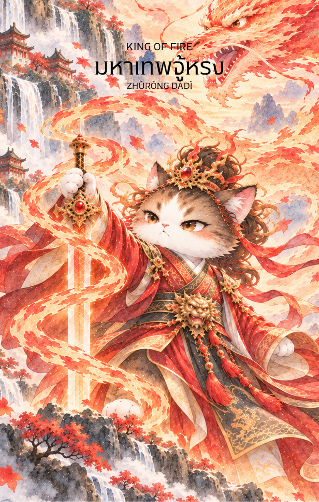

# Fire 14 - มหาเทพจู้หรง (King of Fire)

Created: February 4, 2026 3:05 PM

### **King of Fire : The Sovereign Flame**

### **(มหาเทพจู้หรง - Zhùróng Dà Dì - 祝融大帝)**

- **ธาตุประจำตัว:** ไฟ (🔥 Fire)
- **คอนเซปต์หลัก:** อำนาจการควบคุมขั้นสูงสุด ความเป็นผู้นำที่เด็ดขาด และความสำเร็จที่ยั่งยืนผ่านการจัดการ

---

### **1. แก่นแท้ของตัวละคร (The Essence)**

มหาเทพจู้หรงคือตัวแทนของ **"ไฟที่ถูกควบคุมด้วยปัญญา" (Mastered Fire)** ท่านไม่ใช่ไฟที่ลามปามอย่างไร้ทิศทาง แต่เป็นไฟที่ให้แสงสว่าง ให้ความอบอุ่น และสร้างระเบียบโลก จู้หรงคือภาพลักษณ์ของผู้นำที่ผ่านประสบการณ์มาอย่างโชกโชน มีความมั่นคงดั่งขุนเขาและร้อนแรงดั่งดวงอาทิตย์ การปรากฏของไพ่ใบนี้สื่อถึงช่วงเวลาที่คุณมีอำนาจเต็มในมือ และมีความสามารถในการบริหารจัดการสถานการณ์ที่วุ่นวายให้กลับมาอยู่ในร่องในรอย

### **2. สัญลักษณ์และปรัชญา (Symbolism & Philosophy)**

- **บัลลังก์เพลิงหรือพาหนะมังกรไฟ:** สื่อถึงการอยู่เหนืออารมณ์และสถานการณ์ การมีอำนาจเหนือสัญชาตญาณดิบของตนเองเพื่อนำไปใช้ในทางที่สร้างสรรค์
- **ดาบหรือทวนสุริยะ:** สัญลักษณ์ของกฎระเบียบและการพิพากษา หมายถึงการตัดสินใจที่เด็ดขาดบนพื้นฐานของความถูกต้องและเป็นธรรม
- **แสงรัศมีรอบกาย:** คือ "ปัญญาญาณ" ที่ส่องสว่าง สื่อถึงวิสัยทัศน์ของผู้นำที่มองเห็นภาพรวมและผลลัพธ์ในระยะยาว ไม่ใช่เพียงแค่ชัยชนะชั่วคราว

### **3. กลยุทธ์เมื่อปรากฏไพ่ใบนี้ (The Strategy)**

**"ครองตน ครองคน ครองงาน ด้วยความเด็ดเดี่ยวและเมตตา"**

- **Command with Vision (นำด้วยวิสัยทัศน์):** ในขณะที่อัศวิน (หงอคง) เน้นการบุก แต่ราชา (จู้หรง) เน้นการวางกลยุทธ์ จงใช้บารมีและความน่าเชื่อถือของคุณในการคุมเกม
- **Decisive Authority (เด็ดขาดและชัดเจน):** หากต้องตัดสินใจเรื่องใหญ่ จงเชื่อมั่นในประสบการณ์ของคุณ ความลังเลจะทำให้ไฟของคุณมอดดับ แต่การตัดสินใจที่เฉียบขาดจะทำให้ทุกคนยอมสยบ
- **Master Your Temper (คุมอารมณ์ให้อยู่):** พลังของจู้หรงคือไฟที่ให้ประโยชน์ ไม่ใช่ไฟที่เผาผลาญ จงใช้ความโกรธหรือความมุ่งมั่นเป็นพลังขับเคลื่อนงาน แต่อย่าให้มันมาเผาตัวเองหรือคนรอบข้าง

### **4. คำแนะนำและการทำนาย (Reading Guidance)**

- **ภาพรวมของไพ่ใบนี้:** นี่คือไพ่แห่ง **"ความสำเร็จขั้นสูงสุด"** คุณกำลังก้าวเข้าสู่ช่วงเวลาที่มีอิทธิพล มีตำแหน่งหน้าที่การงานที่มั่นคง หรือเป็นที่ปรึกษาที่ใครๆ ก็เกรงใจ ทุกอย่างอยู่ในความควบคุมของคุณ
- **การงาน/ธุรกิจ:** โดดเด่นในเรื่องการบริหารจัดการ การเป็นเจ้าของกิจการ หรือผู้บริหารระดับสูง โปรเจกต์ที่ทำอยู่จะบรรลุเป้าหมายอย่างยิ่งใหญ่และได้รับการยอมรับในวงกว้าง
- **การเงิน:** มีความมั่นคงทางการเงินสูงมาก สามารถบริหารจัดการทรัพย์สินได้อย่างชาญฉลาด มีเกณฑ์ได้ลาภจากตำแหน่งหน้าที่การงานหรือการลงทุนที่ใช้ทุนหนาและวิสัยทัศน์ไกล
- **ความรัก:** เป็นความสัมพันธ์ที่มั่นคงและมีผู้ใหญ่คอยหนุนหลัง ในความรักคุณอาจเป็นฝ่ายที่คอยดูแลและปกป้อง (Protector) เป็นที่พึ่งพาให้กับคนรักได้อย่างดีเยี่ยม
- **สุขภาพ:** สุขภาพแข็งแรง มีพลังชีวิต (Vitality) สูง แต่อย่าประมาทเรื่องความดันโลหิตหรือโรคที่เกี่ยวกับความร้อนในร่างกายจากการทำงานหนักเกินไป
5. **บุคลิกของคนที่เป็นตัวแทนไพ่**

บุคคลที่สะท้อนพลังไพ่ใบนี้มักมีวุฒิภาวะ มั่นใจ รับผิดชอบ และตัดสินใจได้เด็ดขาดโดยไม่ปล่อยให้อารมณ์นำทาง จุดแข็งคือการควบคุมพลังของตนและนำทีมไปสู่เป้าหมาย ส่วนด้านเงาอาจกลายเป็นผู้ควบคุมหรือกดดันตนเองและผู้อื่นมากเกินไป

6. **อาชีพที่พบได้บ่อย**

เหมาะกับบทบาทผู้บริหาร ผู้ประกอบการ ผู้จัดการโครงการ ผู้นำทีม งานวางกลยุทธ์ และงานที่ต้องตัดสินใจภายใต้ความรับผิดชอบสูง

7. **Key Affirmation:** "ฉันคือผู้นำที่มีอำนาจเหนือสถานการณ์ ฉันบริหารจัดการชีวิตด้วยปัญญาและความเด็ดขาด"

8. **Keyword**

ภาวะผู้นำ • วุฒิภาวะ • อำนาจ • การควบคุมตนเอง • วิสัยทัศน์ • ความสำเร็จ • Leadership • Mastery • Authority • Self-Control • Vision • Achievement

9. **ประวัติเทพเจ้า**

จู้หรง (祝融) เป็นเทพแห่งไฟในตำนานจีน และได้รับการเชื่อมโยงกับการกำกับดูแลพลังไฟและระเบียบของโลก ในภาพของไพ่ ราชาแห่งไฟจึงแทนไฟที่ผ่านการฝึกฝนจนกลายเป็นแสงสว่างและพลังสร้างสรรค์ ไม่ใช่ไฟที่เผาผลาญอย่างไร้ทิศทาง