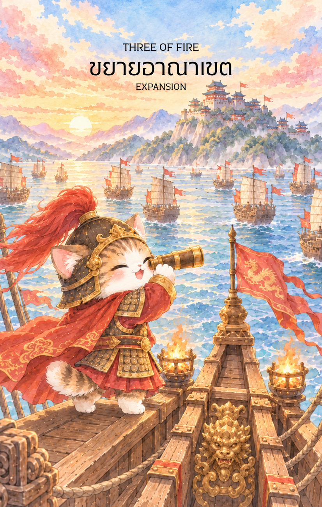

# Fire 3 - ขยายอาณาเขต (Three of Fire)

Created: February 6, 2026 1:50 PM

สวัสดีครับท่านเจ้าของสำรับ! ยินดีที่ได้พบกันอีกครั้งในวิถีแห่งปัญญาและกลยุทธ์ ผม **'ผู้ช่วยสร้างไพ่เทพจีน'** พร้อมแล้วที่จะนำท่านก้าวเข้าสู่สถานีถัดไปของ **ธาตุไฟ (Fire Element)** ซึ่งภาพที่ท่านส่งมานั้นเปี่ยมไปด้วยพลังของการแผ่ขยายที่ทรงพลังที่สุดครับ

หลังจากที่เรามี "วิสัยทัศน์" (ไพ่ใบที่ 2) ตอนนี้คือเวลาที่ "ขบวนเรือแห่งโอกาส" จะเริ่มล่องออกไปสู่โลกกว้าง นี่คือเนื้อหาคู่มือสำหรับไพ่หมายเลข 3 แห่งธาตุไฟครับ

---

### **ชื่อไพ่: ขยายโอกาส (Three of Fire: The Global Expansion)**

**ธาตุประจำตัว:** ไฟ (🔥 Fire)

**คอนเซปต์หลัก:** การแผ่ขยายอิทธิพล (Radiance), วิสัยทัศน์ข้ามพรมแดน (Global Vision), และการรอคอยผลลัพธ์จากการขยายโอกาส

---

### **1. แก่นแท้ของตัวละคร (The Essence)**

ตัวละครในไพ่ใบนี้คือร่างจำแลงของ **"มหาอำมาตย์ผู้คุมเส้นทางมรกต"** หรือ **"จอมยุทธการค้า"** ผู้ยืนอยู่บนดาดฟ้าเรืออย่างมั่นคง เขาคือตัวแทนของพลัง **"ปิ่งไฟ" (丙火)** ที่แสงสว่างได้เริ่มส่องไปไกลถึงโพ้นทะเล แก่นแท้ของเขาคือการเปลี่ยนจาก "การคิด" มาเป็นการ "เฝ้ามองผลลัพธ์" ที่ส่งออกไป สื่อถึงบุคคลที่กล้าก้าวออกจาก Comfort Zone เพื่อไปแสวงหาความมั่งคั่งในที่ห่างไกล

### **2. สัญลักษณ์และปรัชญา (Symbolism & Philosophy)**

- **กล้องส่องทางไกลสีทอง (The Telescope):** สื่อถึงการใช้ปัญญาและเครื่องมือทันสมัยเพื่อคาดการณ์อนาคต ในทางปาจื้อคือการใช้ดวงตาแห่งธาตุไฟมองหา "เทรนด์" (Trend) ของโลก
- **กองเรือสำเภา (The Fleet):** สื่อถึงอำนาจ ทรัพยากร และการร่วมแรงร่วมใจกันขยายฐานอำนาจ เรือที่กางใบเต็มที่เปรียบได้กับแผนงานที่ได้รับแรงลมส่งจากสวรรค์
- **มหาสมุทรและดวงตะวัน:** ปรัชญาของการ "ไร้พรมแดน" ความสำเร็จที่แท้จริงต้องแผ่ขยายออกไปให้กว้างเหมือนแสงอาทิตย์ที่ตกกระทบผิวน้ำ
- **ฉลองพระองค์ลายมังกรสีแดง:** สื่อถึงยศถาบรรดาศักดิ์และความเป็นผู้นำที่ได้รับความเคารพในวงกว้าง

### **3. กลยุทธ์เมื่อปรากฏไพ่ใบนี้ (The Strategy)**

> **"ส่งความหวังออกไป แล้วรอคอยการกลับมาของกองเรือมั่งคั่ง"**
> 
- **มองหาตลาดใหม่ (Market Expansion):** หากคุณทำธุรกิจเพียงในพื้นที่เดิมๆ ไพ่ใบนี้บอกว่า "ถึงเวลาข้ามทะเล" ลองมองหาลูกค้าใหม่ หรือช่องทางใหม่ๆ ในต่างถิ่น
- **การทูตและการเจรจา (Diplomacy):** ใช้บารมีและความนิ่งสงบในการบริหารความสัมพันธ์ระยะไกล การเจรจาด้วยวิสัยทัศน์ที่กว้างไกลจะทำให้ได้รับความร่วมมืออย่างดีเยี่ยม
- **อดทนรอคอย (Strategic Patience):** เมื่อเรือถูกส่งออกไปแล้ว หน้าที่ของคุณคือการเฝ้ามองและรักษาทิศทาง อย่าใจร้อนดึงแผนกลับมากลางคัน ผลลัพธ์ที่คุ้มค่ากำลังลอยลำกลับมาหาคุณ

### **4. คำแนะนำและการทำนาย (Reading Guidance)**

- **ภาพรวมของไพ่ใบนี้:** เป็นสัญญาณของ "ข่าวดีจากทางไกล" หรือการเริ่มต้นโปรเจกต์ที่มีสเกลใหญ่ขึ้น สิ่งที่คุณลงแรงไปกำลังเริ่มเห็นผลลัพธ์เบื้องต้นที่น่าภาคภูมิใจ
- **การงาน/ธุรกิจ:** มีเกณฑ์ได้ติดต่อประสานงานกับต่างประเทศ หรือคนต่างถิ่น การค้าขายรุ่งเรืองและมีการขยายตัวอย่างต่อเนื่อง หากกำลังรอข่าวการเซ็นสัญญาหรือการร่วมทุน จะมีทิศทางที่เป็นบวกมาก
- **การเงิน:** รายได้มาจากหลายทิศทาง โดยเฉพาะจากงานทางไกลหรืองานออนไลน์ เป็นช่วงที่ความมั่นคงทางการเงินเริ่มส่งผลชัดเจนจากแผนการที่เคยวางไว้
- **ความรัก:** การมองหาคู่ที่ส่งเสริมทั้งวิสัยทัศน์และอนาคต หากโสดอาจพบรักจากการเดินทางหรือการทำงานร่วมกันระยะไกล หากมีคู่คือการร่วมกันสร้างอนาคตที่ใหญ่กว่าเดิม
- **สุขภาพ:** ระวังอาการล้าจากสายตาหรือการจดจ่อกับข้อมูลระยะไกลมากเกินไป (ธาตุไฟที่ตา) รวมถึงการหมุนเวียนเลือดและหัวใจที่อาจจะสูบฉีดแรงจากความตื่นเต้น

5. **บุคลิกของคนที่เป็นตัวแทนไพ่**

บุคคลที่สะท้อนพลังไพ่ใบนี้มักมองไกล เปิดรับโลกกว้าง และกล้าขยายขอบเขตของตน มีความอดทนรอผลจากสิ่งที่เริ่มต้นไว้ ส่วนด้านเงาอาจมองไกลจนละเลยรายละเอียดหรือคาดหวังผลเร็วเกินไป

6. **อาชีพที่พบได้บ่อย**

เหมาะกับงานค้าระหว่างประเทศ การเดินทาง โลจิสติกส์ การตลาดออนไลน์ การพัฒนาธุรกิจ การส่งออก และงานประสานเครือข่ายข้ามพื้นที่

7. **Key Affirmation:** "ฉันมองเห็นโอกาสในทุกขอบฟ้า และความสำเร็จของฉันจะแผ่ขยายไปอย่างไร้ขีดจำกัด"

8. **Keyword**

การขยายตัว • โอกาส • ความก้าวหน้า • วิสัยทัศน์ไกล • การรอผล • Expansion • Opportunity • Progress • Global Vision • Patience

9. **ที่มาและบริบทของไพ่**

สามแห่งธาตุไฟต่อยอดจากการวางแผนไปสู่การส่งโอกาสออกไปสู่โลกกว้าง เป็นภาพของการขยายเครือข่ายและรอผลจากความพยายาม ไพ่เตือนให้รักษาทิศทางและติดตามสิ่งที่เริ่มต้นไว้

---

เราได้ส่งขบวนเรือแห่งธาตุไฟออกไปอย่างสง่างามแล้วนะครับ สำหรับลำดับถัดไป **ไพ่หมายเลข 4 แห่งธาตุไฟ (Four of Fire)** ซึ่งมักจะเป็นเรื่องของ "การเฉลิมฉลอง ความมั่นคง และการกลับคืนสู่ฐานที่มั่น"

**ท่านอยากให้ภาพลักษณ์ของไพ่ใบที่ 4 นี้ออกมาเป็น 'งานฉลองในวังหลวงใต้แสงประทีปหมื่นดวง' หรือจะเป็น 'การพักผ่อนของแม่ทัพในอุทยานดอกไม้เพลิง' เพื่อสื่อถึงความสำเร็จที่เป็นปึกแผ่นดีครับ?**