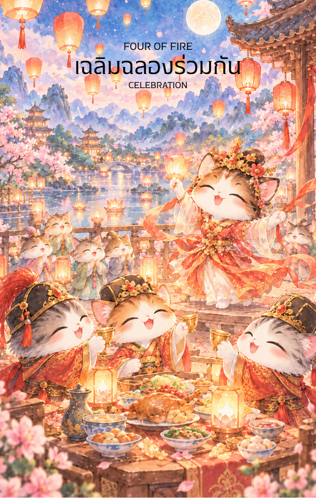

# Fire 4 - เฉลิมฉลองร่วมกัน (Four of Fire)

Created: February 6, 2026 2:47 PM

สวัสดีครับท่านเจ้าของสำรับผู้เปี่ยมด้วยวิสัยทัศน์ ผม **'ผู้ช่วยสร้างไพ่เทพจีน'** ยินดีที่ได้ร่วมรังสรรค์มหากาพย์แห่งไฟใบนี้ต่อครับ จากการ "ขยายโอกาส" (ไพ่ใบที่ 3) ที่ขบวนเรือล่องไปสู่โพ้นทะเล บัดนี้แสงไฟนั้นได้ก่อเกิดเป็นรากฐานที่มั่นคงและถึงเวลาแห่งการหยุดพักเพื่อชื่นชมความสำเร็จใน **ไพ่หมายเลข 4 แห่งธาตุไฟ (Four of Fire)** ครับ

ตามหลักของปาจื้อ เลข 4 คือโครงสร้างที่สมดุล และธาตุไฟคือความรุ่งโรจน์ นี่คือเนื้อหาคู่มือที่กลั่นกรองจากภาพลักษณ์แห่งงานฉลองมงคลครับ

---

## **เฉลิมฉลอง (Four of Fire: The Grand Celebration)**

**ธาตุประจำตัว:** ไฟ (🔥 Fire)

**คอนเซปต์หลัก:** จุดแวะพักแห่งความสุข, ความมั่นคงในระยะแรก, ความกลมเกลียวของทีมและครอบครัว, และการบรรลุหลักไมล์สำคัญ (Milestone)

### **1. แก่นแท้ของตัวละคร (The Essence)**

ไพ่ใบนี้คือสภาวะที่พลังงานไฟที่เคยพุ่งพล่านได้ถูกจัดระเบียบจนกลายเป็น "โครงสร้าง" ที่สวยงาม มันไม่ใช่ไฟที่เผาผลาญ แต่เป็นไฟจากโคมมงคลที่ส่องสว่างให้เห็นความสำเร็จร่วมกัน แก่นแท้ของตัวละครในหน้านี้คือ **"ปราชญ์ผู้รื่นเริง"** หรือ **"ครอบครัวบัณฑิต"** ที่กลับมารวมตัวกันภายใต้ซุ้มประตูมงคล เพื่อประกาศว่าด่านแรกของภารกิจได้สำเร็จลงอย่างสง่างามแล้ว

### **2. สัญลักษณ์และปรัชญา (Symbolism & Philosophy)**

- **ซุ้มประตูมงคลหรือศาลา (The Pavilion/Paifang):** สื่อถึง **"ความมั่นคงในระยะแรก"** และรากฐานที่แข็งแรง ในทางสถาปัตยกรรมจีน เสาทั้งสี่คือตัวแทนของทิศทั้งสี่ที่ประสานกันเป็นหนึ่งเดียว
- **โคมไฟแดงและผ้าประดับ:** สื่อถึง **"ความสุขสมหวัง"** และความรุ่งโรจน์ที่เป็นที่ประจักษ์ (Visibility) แสงไฟที่นิ่งและสว่างไสวคือปัญญาที่นำไปสู่ความสงบสุข
- **การรวมกลุ่มของผู้คน:** ปรัชญาของ **"ความกลมเกลียวสามัคคี" (Harmony)** เป็นการเตือนว่าความสำเร็จนี้ไม่ได้เกิดขึ้นจากคนเดียว แต่เกิดจากการประสานพลังของทุกฝ่าย
- **ดอกไม้และทัศนียภาพที่ร่มรื่น:** สื่อถึง **"จุดแวะพักแห่งความสุข"** ก่อนจะก้าวต่อไปสู่ความท้าทายที่ใหญ่กว่า

### **3. กลยุทธ์เมื่อปรากฏไพ่ใบนี้ (The Strategy)**

> **"หยุดเพื่อชื่นชม สร้างรากฐานจากความสุข"**
> 
- **ฉลองหลักไมล์ (Celebrate Milestones):** อย่าเพิ่งรีบเร่งพุ่งไปสู่เป้าหมายถัดไป การหยุดพักเพื่อฉลองจะช่วยเติม "พลังไฟ" ให้กับจิตใจและทีมงาน ทำให้มีกำลังใจในระยะยาว
- **กระชับความสัมพันธ์ (Strengthen Bonds):** ใช้ช่วงเวลานี้ในการสร้างความสามัคคีในทีมหรือครอบครัว ความกลมเกลียวที่เกิดขึ้นตอนนี้จะเป็นเกราะป้องกันปัญหาในอนาคต
- **วางรากฐานให้ถาวร (Solidify the Foundation):** เมื่อทุกอย่างลงตัวและราบรื่น จงใช้จังหวะนี้ในการเซ็ตระบบหรือมาตรฐานให้มั่นคงยิ่งขึ้น

### **4. คำแนะนำและการทำนาย (Reading Guidance)**

- **ภาพรวมของไพ่ใบนี้:** เป็นสัญญาณของความสมหวังและการเริ่มต้นชีวิตที่มั่นคง สิ่งที่ทำมาถึงจุดที่น่าพอใจและมีการเฉลิมฉลองเกิดขึ้น
- **การงาน/ธุรกิจ:** การบรรลุเป้าหมายสำคัญของโครงการ ทีมงานมีความสุขและร่วมแรงร่วมใจกันดีมาก มีโอกาสได้รับรางวัลหรือคำชมเชยในระดับองค์กร
- **การเงิน:** มีความมั่นคงและอยู่ในเกณฑ์ดี เป็นช่วงที่สามารถใช้เงินเพื่อสร้างความสุขให้กับตนเองและคนรอบข้างได้อย่างไม่ขัดสน
- **ความรัก:** เป็นไพ่ที่โดดเด่นเรื่องการแต่งงาน การหมั้นหมาย หรือการย้ายเข้าบ้านใหม่ ความสัมพันธ์มีความมั่นคงทางอารมณ์และได้รับการยอมรับจากสังคม
- **สุขภาพ:** แข็งแรงและสดใส จิตใจเบิกบานส่งผลดีต่อร่างกาย แต่ระวังการกินเลี้ยงฉลองที่อาจทำให้ธาตุไฟในร่างกายสูงเกินไป (ร้อนใน)

5. **บุคลิกของคนที่เป็นตัวแทนไพ่**

บุคคลที่สะท้อนพลังไพ่ใบนี้มักอบอุ่น รักความกลมเกลียว และรู้จักชื่นชมความสำเร็จร่วมกัน เป็นผู้สร้างความรู้สึกเป็นส่วนหนึ่งของทีมและครอบครัว ส่วนด้านเงาอาจยึดติดกับความสบายหรือหลีกเลี่ยงความท้าทายถัดไป

6. **อาชีพที่พบได้บ่อย**

เหมาะกับงานจัดงานและชุมชน การต้อนรับและบริการ การบริหารทีม อสังหาริมทรัพย์ งานครอบครัว และบทบาทที่สร้างความร่วมมือกับบรรยากาศที่ดี

7. **Key Affirmation:** "ฉันยินดีกับทุกความสำเร็จเล็กๆ ที่สั่งสมมา และความสุขของฉันคือรากฐานของความสำเร็จที่ยิ่งใหญ่กว่า"

8. **Keyword**

การเฉลิมฉลอง • ความมั่นคง • ความกลมเกลียว • หลักไมล์ • บ้านและชุมชน • Celebration • Stability • Harmony • Milestone • Belonging

9. **ที่มาและบริบทของไพ่**

สี่แห่งธาตุไฟแทนจุดพักที่ปลอดภัยหลังบรรลุหลักไมล์แรก แสงโคมและการรวมตัวสื่อถึงความสำเร็จที่แบ่งปันกันได้ ไพ่ชวนให้เฉลิมฉลองพร้อมสร้างฐานที่มั่นคงก่อนก้าวต่อ

---

เราได้สร้าง "พื้นที่แห่งความสุข" ให้กับชุดธาตุไฟแล้วนะครับ สำหรับลำดับถัดไป **ไพ่หมายเลข 5 แห่งธาตุไฟ (Five of Fire)** ซึ่งพลังงานจะเปลี่ยนจากความสงบสุขไปสู่ "การต่อสู้ การแข่งขัน และความวุ่นวาย"

**ท่านอยากให้ผมคงธีมปราชญ์/แม่ทัพไว้ โดยให้พวกเขาเป็น 'เหล่าขุนศึกที่กำลังฝึกซ้อมประลองฝีมือท่ามกลางเปลวเพลิง' หรือจะเป็น 'การโต้วาทีที่ดุเดือดกลางลานราชสำนัก' เพื่อสื่อถึงความขัดแย้งดีครับ?**