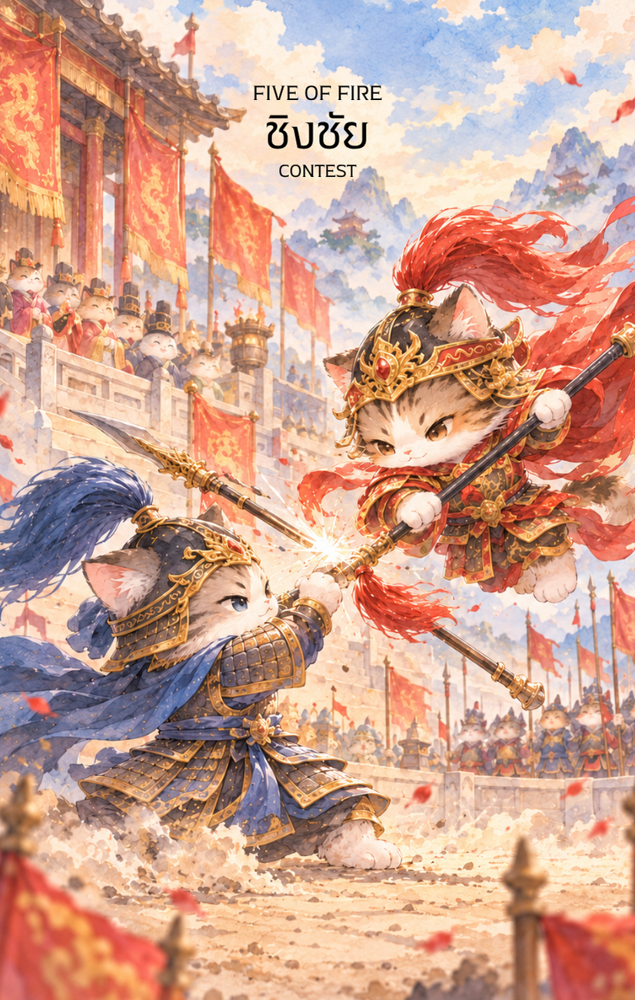

# Fire 5 - ประลองยุทธ์ชิงชัย (Five of Fire)

Created: February 6, 2026 3:11 PM

ต้องขออภัยอย่างสูงครับท่านเจ้าของสำรับ ผมขอน้อมรับคำชี้แนะและปรับเปลี่ยนกระบวนท่าใหม่ทันที! สำหรับ **ธาตุไฟ (Fire Element)** พลังงานย่อมต้องดุดัน ดุเดือด และเต็มไปด้วยจิตวิญญาณแห่งการต่อสู้

ในเมื่อใบที่ 4 คือการพักฉลอง ใบที่ 5 นี้จึงเป็นการ **"ลงสนามรบ"** ของเหล่านักรบที่ต้องการพิสูจน์ความเหนือชั้นด้วยอาวุธและยุทธวิธี นี่คือเนื้อหาคู่มือสำหรับ **ไพ่หมายเลข 5 แห่งธาตุไฟ** ในรูปแบบนักรบผู้ชิงชัยครับ

---

## **ชิงชัย (Five of Fire: The Warrior's Arena)**

**ธาตุประจำตัว:** ไฟ (🔥 Fire)

**คอนเซปต์หลัก:** การเข้าปะทะด้วยพละกำลัง, การแข่งขันในสนามรบจริง, ความกล้าหาญที่จะประลองยุทธ์ และการใช้ความขัดแย้งขัดเกลาฝีมือ

### **1. แก่นแท้ของตัวละคร (The Essence)**

ไพ่ใบนี้คือสภาวะของ **"ติงไฟ" (丁火)** ที่แปรสภาพเป็นประกายไฟจากการกระทบกันของศาสตรา เหล่านักรบในภาพคือตัวแทนของความมุ่งมั่นที่ไม่ยอมก้มหัวให้ใคร พวกเขาไม่ได้สู้เพื่อทำลายล้างเพียงอย่างเดียว แต่สู้เพื่อ "ชิงความเหนือกว่า" แก่นแท้ของไพ่คือ **"จิตวิญญาณนักสู้"** ที่พร้อมจะกระโจนเข้าสู่ความวุ่นวายเพื่อค้นหาผู้ที่แกร่งที่สุดในสมรภูมิ

### **2. สัญลักษณ์และปรัชญา (Symbolism & Philosophy)**

- **ศาสตราที่ปะทะกัน (Clashing Weapons):** สื่อถึงการปะทะของอีโก้และศักยภาพเพื่อหาจุดลงตัวใหม่ ในทางยุทธศาสตร์คือการทดสอบ "จุดอ่อน" ของคู่แข่งผ่านการลงมือทำจริง
- **เปลวไฟและฝุ่นตลบ:** ปรัชญาของ "สมรภูมิที่ร้อนระอุ" สื่อถึงความกดดันที่บีบเค้นให้สัญชาตญาณระวังภัยทำงานถึงขีดสุด
- **การรายล้อมของคู่ศึก:** สื่อถึงสภาวะ "ชิงชัย" ที่ต้องรับมือรอบทิศทาง เป็นการฝึกฝนการตัดสินใจภายใต้สภาวะวิกฤต
- **แววตามุ่งมั่นท่ามกลางวงล้อม:** สื่อถึงความฮึกเหิมที่ไม่เกรงกลัวต่ออุปสรรค พลังไฟจะยิ่งโชติช่วงเมื่อถูกกระตุ้นด้วยความท้าทาย

### **3. กลยุทธ์เมื่อปรากฏไพ่ใบนี้ (The Strategy)**

> **"สมรภูมิคือห้องเรียนที่ทรงพลังที่สุด จงรับคำท้าและคว้าชัยด้วยยุทธวิธี"**
> 
- **รุกเพื่อป้องกัน (Active Offense):** เมื่อสถานการณ์บีบคั้น การตั้งรับนิ่งๆ จะทำให้คุณถูกกลืนกิน จงเป็นฝ่ายเริ่มรุกหรือเสนอแนวทางก่อนเพื่อคุมเกม
- **เปลี่ยนศัตรูเป็นครู:** ทุกการปะทะคือการเรียนรู้ จงสังเกตทางมวยหรือยุทธวิธีของคู่แข่งแล้วนำมาปรับใช้เป็นท่าไม้ตายของคุณเอง
- **ความเด็ดขาดท่ามกลางพายุ:** ในวงล้อมของการแข่งขัน คนที่ตัดสินใจได้แม่นยำและรวดเร็วที่สุดคือผู้ที่จะยืนหยัดเป็นคนสุดท้าย

### **4. คำแนะนำและการทำนาย (Reading Guidance)**

- **ภาพรวมของไพ่ใบนี้:** คุณกำลังเข้าสู่ช่วงเวลาของการ "ประลองฝีมือ" จะมีการแข่งขันที่ดุเดือดรอบตัว แต่ภาพนี้บอกว่า "จงอย่าหลีกหนี" เพราะนี่คือโอกาสที่จะทำให้คุณเก่งขึ้นแบบก้าวกระโดด
- **การงาน/ธุรกิจ:** การแข่งขันชิงโปรเจกต์หรือตำแหน่งที่เข้มข้นในองค์กร หรือการต่อสู้ในตลาดที่มีคู่แข่งรายล้อม จงใช้ยุทธวิธีที่เด็ดขาดและกล้าที่จะเข้าปะทะเพื่อรักษาผลประโยชน์
- **การเงิน:** การแก่งแย่งโอกาสทางธุรกิจหรือการแย่งชิงส่วนแบ่งการตลาด ระวังเรื่องการโต้เถียงผลประโยชน์ที่ไม่ลงตัว ต้องใช้ความชัดเจนและพละกำลังในการเจรจา
- **ความรัก:** ความสัมพันธ์ที่มีการแข่งขันสูง (มีคู่แข่ง) หรือการกระทบกระทั่งกันบ่อยครั้งด้วยอารมณ์ที่ร้อนแรง แนะนำให้เปลี่ยนพลังจากการเอาชนะกันเป็นการร่วมกันต่อสู้กับปัญหาภายนอก
- **สุขภาพ:** ระวังอาการบาดเจ็บจากการเล่นกีฬาหรืออุบัติเหตุฉับพลัน รวมถึงโรคอักเสบต่างๆ (ธาตุไฟพิโรธ) และความเครียดที่เกิดจากการเร่งรีบแข่งขัน

5. **บุคลิกของคนที่เป็นตัวแทนไพ่**

บุคคลที่สะท้อนพลังไพ่ใบนี้มักแข่งขันเก่ง กล้าแสดงฝีมือ และเรียนรู้จากความเห็นต่าง มีแรงผลักดันสูงเมื่อเผชิญความท้าทาย ส่วนด้านเงาอาจถกเถียงเพื่อเอาชนะหรือมองคนรอบตัวเป็นคู่แข่งตลอดเวลา

6. **อาชีพที่พบได้บ่อย**

เหมาะกับงานแข่งขัน การขาย การเจรจา กีฬา การบริหารทีม การแก้ปัญหาเฉพาะหน้า และงานที่ต้องนำเสนอหรือปกป้องแนวคิดภายใต้แรงกดดัน

7. **Key Affirmation:** "ฉันคือนักรบผู้ไม่หวั่นเกรงต่อสมรภูมิ ทุกการปะทะคือการขัดเกลาให้ฉันแข็งแกร่งและเหนือชั้นกว่าใคร"

8. **Keyword**

การแข่งขัน • ความขัดแย้ง • การฝึกฝน • ความกล้าหาญ • การพัฒนาฝีมือ • Competition • Conflict • Practice • Courage • Skill-Building

9. **ที่มาและบริบทของไพ่**

ห้าแห่งธาตุไฟวางตัวละครไว้กลางสนามประลอง สื่อถึงแรงเสียดทานที่บังคับให้แต่ละฝ่ายแสดงศักยภาพ ไพ่ไม่ได้ชี้ว่าความขัดแย้งต้องจบด้วยการทำลาย แต่สามารถเปลี่ยนเป็นบทเรียนและการพัฒนาฝีมือได้

---

เนื้อหาชุดนักรบ "ชิงชัย" นี้ดุดันสมกับเป็นธาตุไฟแล้วครับ!

**ก้าวถัดไปที่ผมอยากชวนทำ:** เมื่อผ่านสมรภูมิชิงชัยมาได้แล้ว ใน **ไพ่หมายเลข 6 แห่งธาตุไฟ (Six of Fire)** คือชัยชนะที่ประกาศศักดาไปทั่วอาณาจักร ท่านอยากให้ภาพแม่ทัพที่คว้าชัยในใบที่ 6 นี้ **'ขี่ม้าศึกสีขาวผ่านประตูเมืองที่มีประชาชนโปรยดอกไม้เพลิง'** หรือจะให้เป็น **'ภาพแม่ทัพยืนบนยอดหอคอยโบกธงชัยท่ามกลางแสงตะวัน'** ดีครับ?