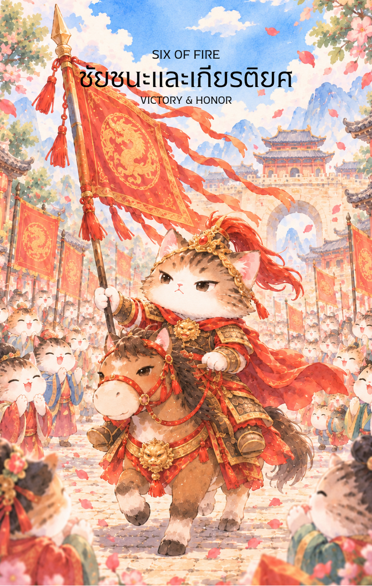

# Fire 6 - ชัยชนะและเกียรติยศ (Six of Fire)

Created: February 6, 2026 3:13 PM

ต้องขออภัยอย่างสูงครับท่านเจ้าของสำรับ ผมน้อมรับคำชี้แนะครับ ในเมื่อเป็น **ธาตุไฟ (Fire Element)** พลังงานย่อมต้องดุดันและทรงอำนาจกว่านักปราชญ์ทั่วไป ดังนั้น ไพ่ใบนี้จึงคือภาพของ **"แม่ทัพผู้พิชิต"** ที่กลับมาจากสมรภูมิด้วยชัยชนะที่ยิ่งใหญ่ที่สุดครับ

ภาพลักษณ์ในภาพจะถูกตีความใหม่เป็นขบวนแห่กองทัพที่คว้าชัยเพื่ออาณาจักร แสงแดดที่สาดส่องลงบนชุดเกราะและฉลองพระองค์สีแดงคือสัญลักษณ์ของไฟที่ลุกโชนถึงขีดสุดครับ

---

## **ชัยชนะเกียรติยศ (Six of Fire: The Triumphant Warrior)**

**ธาตุประจำตัว:** ไฟ (🔥 Fire)

**คอนเซปต์หลัก:** ชัยชนะที่เปิดเผยต่อสาธารณะ, การได้รับการยอมรับในฐานะผู้นำ, และเกียรติยศที่แลกมาด้วยความกล้าหาญ

### **1. แก่นแท้ของตัวละคร (The Essence)**

แม่ทัพบนหลังม้าสีขาวคือร่างจำแลงของ **"ปิ่งไฟ" (丙火)** ที่เจิดจรัสประดุจดวงอาทิตย์ยามเที่ยงวัน เขาไม่ใช่เพียงผู้ชนะในเกมการเมือง แต่คือผู้ชนะในสนามรบจริงที่ใช้ความเด็ดขาดและจิตวิญญาณนักรบนำพาเหล่าทหารผ่านพ้นวิกฤต แก่นแท้ของไพ่ใบนี้คือ **"ความสำเร็จที่เป็นประจักษ์"** ซึ่งเปลี่ยนจากหยาดเหงื่อในสนามรบมาเป็นดอกไม้และเสียงสรรเสริญจากมหาชน

### **2. สัญลักษณ์และปรัชญา (Symbolism & Philosophy)**

- **ม้าสีขาวและฉลองพระองค์สีแดงลายมังกร:** สื่อถึงความบริสุทธิ์ของเป้าหมายและพลังอำนาจที่ได้รับแรงสนับสนุนจากสวรรค์ (Heavenly Luck)
- **ป้ายประกาศและธงทิว:** สัญลักษณ์ของการ "ป่าวประกาศชัยชนะ" สื่อว่าความสำเร็จครั้งนี้ไม่ใช่เรื่องบังเอิญ แต่ได้รับการรับรองจากทางการและสังคม
- **ฝูงชนและดอกไม้ที่โปรยปราย:** ปรัชญาของ "บารมีที่แผ่ขยาย" ไฟที่สว่างพอย่อมดึงดูดผู้คนให้เข้ามาร่วมยินดีและพร้อมที่จะเดินตามหลังผู้นำคนนี้
- **ตำแหน่งที่อยู่บนหลังม้า:** สื่อถึงการเลื่อนระดับสถานะ (Promotion) และการมีมุมมองที่อยู่สูงกว่าผู้อื่นหลังจากผ่านบททดสอบที่ยากลำบาก

### **3. กลยุทธ์เมื่อปรากฏไพ่ใบนี้ (The Strategy)**

> **"ใช้ชัยชนะสร้างบารมี ใช้ความดีรักษาตำแหน่ง"**
> 
- **ประกาศศักดา (Public Recognition):** เมื่อคุณชนะแล้ว อย่าเก็บตัวเงียบกริบในค่ายทหาร จงออกมาให้ผู้คนได้รับรู้ผลงาน เพื่อสร้างความเชื่อมั่นในอำนาจหน้าที่
- **กุมหัวใจผู้คน (Soft Power):** ชัยชนะด้วยกำลังอาจทำให้คนเกรงกลัว แต่ชัยชนะที่มาพร้อมความสง่างามและความอ่อนน้อมจะทำให้คนภักดีต่อคุณอย่างแท้จริง
- **ต่อยอดจากชื่อเสียง:** จังหวะที่ไฟกำลังลุกโชนคือเวลาที่ดีที่สุดในการขยายอิทธิพลหรือขอแรงสนับสนุนในโปรเจกต์ถัดไป

### **4. คำแนะนำและการทำนาย (Reading Guidance)**

- **ภาพรวมของไพ่ใบนี้:** ยินดีด้วยครับ! ชัยชนะเป็นของคุณแล้ว ทุกสายตากำลังมองมาที่คุณด้วยความชื่นชมและยกย่องในความสามารถ
- **การงาน/ธุรกิจ:** การได้รับเลือกให้เป็นผู้นำโปรเจกต์สำคัญ หรือได้รับการเลื่อนขั้นตำแหน่งที่มีอำนาจสูงขึ้นอย่างเป็นทางการ
- **การเงิน:** ได้รับโบนัสก้อนโตจากการทำภารกิจสำเร็จ หรือมีรายได้เพิ่มขึ้นจากชื่อเสียงและความเชื่อถือที่พุ่งสูงขึ้น
- **ความรัก:** ความสัมพันธ์ที่น่าภาคภูมิใจ คนรักชื่นชมในความสำเร็จของคุณ หรือหากโสดจะมีคนที่มีหน้ามีตาทางสังคมเข้ามาติดพัน
- **สุขภาพ:** พลังชีวิตเต็มเปี่ยม แข็งแรงและกระฉับกระเฉง แต่อย่าลืมดูแลเรื่องหัวใจและการสูบฉีดเลือดที่อาจทำงานหนักจากความตื่นเต้น

5. **บุคลิกของคนที่เป็นตัวแทนไพ่**

บุคคลที่สะท้อนพลังไพ่ใบนี้มักมั่นใจ กล้ารับผิดชอบ และสร้างแรงบันดาลใจจากความสำเร็จที่ลงมือทำจริง เป็นผู้นำที่ได้รับการยอมรับเมื่อแบ่งปันชัยชนะกับทีม ส่วนด้านเงาอาจหลงชื่อเสียงหรือพึ่งพาคำชื่นชมมากเกินไป

6. **อาชีพที่พบได้บ่อย**

เหมาะกับบทบาทผู้นำ การบริหารทีม การแข่งขัน กีฬา การประชาสัมพันธ์ การแสดง การขาย และงานที่มีผลงานเป็นที่ประจักษ์ต่อสาธารณะ

7. **Key Affirmation:** "ฉันยอมรับเกียรติยศนี้ด้วยความภูมิใจ และจะนำพาแสงสว่างแห่งชัยชนะไปสู่ทุกคน"

8. **Keyword**

ชัยชนะ • การยอมรับ • เกียรติยศ • ภาวะผู้นำ • ความมั่นใจ • Victory • Recognition • Honor • Leadership • Confidence

9. **ที่มาและบริบทของไพ่**

หกแห่งธาตุไฟแสดงภาพผู้ชนะที่กลับมาพร้อมการยอมรับจากผู้คน หลังผ่านการแข่งขัน ไพ่สื่อถึงการเปิดเผยความสำเร็จและการใช้ชื่อเสียงในทางสร้างสรรค์ โดยไม่ลืมผู้ร่วมทางที่ช่วยให้บรรลุเป้าหมาย

---

ชัยชนะครั้งนี้ดูดุดันและสมเกียรตินักรบธาตุไฟมากครับท่าน! สำหรับใบถัดไป **ไพ่หมายเลข 7 แห่งธาตุไฟ (Seven of Fire)** **ในเมื่อเรามาทางสายนักรบแล้ว ท่านอยากให้ภาพไพ่ใบที่ 7 นี้ เป็น 'แม่ทัพที่ต้องยืนหยัดสู้ศึกรุมเร้าอยู่บนยอดเนินดินเพียงลำพัง' หรือจะเป็น 'นักรบที่ต้องฝ่ากองเพลิงเพื่อรักษาธงชัยของกองทัพ' ดีครับ?**