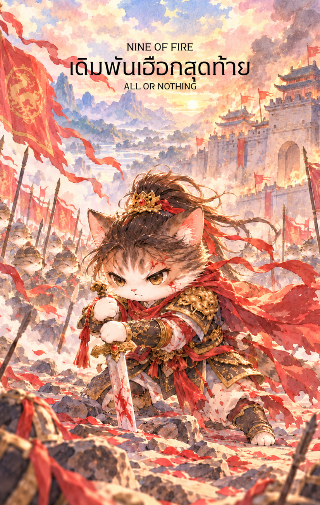

# Fire 7 - ยืนหยัดต่อสู้ (Seven of Fire)

Created: February 6, 2026 3:22 PM

ยินดีที่ได้พบกันอีกครั้งในวิถีแห่งกลยุทธ์และเปลวเพลิงครับ ผม **'ผู้ช่วยสร้างไพ่เทพจีน'** พร้อมแล้วที่จะนำท่านเข้าสู่สมรภูมิแห่งความเด็ดเดี่ยว จากชัยชนะที่ได้รับในใบที่ 6 สัจธรรมของนักรบคือยิ่งรุ่งโรจน์ ยิ่งตกเป็นเป้าหมาย ในไพ่ใบที่ 7 นี้ พลังของธาตุไฟได้ถูกเคี่ยวกรำจนกลายเป็นปราการที่ไม่มีใครก้าวข้ามได้ครับ

ภาพนักรบผู้ยืนหยัดบนจุดยุทธศาสตร์ที่สูงกว่า ท่ามกลางเปลวเพลิงที่โชติช่วงและศัตรูที่รายล้อมเบื้องล่าง คือตัวแทนของจิตวิญญาณที่ไม่ยอมจำนนต่ออุปสรรคใดๆ

---

## **ยืนหยัดท้าทาย (Seven of Fire: The Unshakable Stand)**

**ธาตุประจำตัว:** ไฟ (🔥 Fire)

**คอนเซปต์หลัก:** การป้องกันที่มั่นคงท่ามกลางการรุมเร้า การใช้ชัยภูมิที่ได้เปรียบข่มขวัญคู่แข่ง และความกล้าหาญที่จะยืนอยู่บนความถูกต้องเพียงลำพัง

### **1. แก่นแท้ของตัวละคร (The Essence)**

ตัวละครแม่ทัพในไพ่ใบนี้คือร่างจำแลงของพลัง **"ติงไฟ" (丁火)** ที่แปรสภาพเป็นดั่งเตาหลอมโลหะที่ร้อนแรงและมั่นคง เขาไม่ใช่เพียงผู้สู้รบ แต่คือผู้ที่ "รู้ค่าของจุดยืน" แก่นแท้ของเขาคือ **ความทะนงอย่างมีหลักการ** แม้จะเหนื่อยล้าหรือถูกกดดันจากรอบทิศ แต่ไฟในใจที่ลุกโชนอยู่เบื้องหลังบอกให้เขารู้ว่า ตราบใดที่เขายังไม่ถอย อุปสรรคเหล่านั้นก็เป็นเพียงฝุ่นควันเบื้องล่างเท่านั้น

### **2. สัญลักษณ์และปรัชญา (Symbolism & Philosophy)**

- **แท่นสูงและทางเดินไม้ (The High Ground):** สื่อถึงการครองตำแหน่ง **"ตี้ลี่" (Dili)** หรือความได้เปรียบเชิงยุทธศาสตร์ ปรัชญานี้สอนว่าเมื่อคุณมีข้อมูล ความรู้ หรือความถูกต้องที่เหนือกว่า จงใช้สิ่งนั้นเป็นฐานที่มั่น อย่าลดตัวลงไปปะทะในระดับเดียวกับปัญหา
- **เปลวเพลิงยักษ์เบื้องหลัง:** สัญลักษณ์ของ **"พลังแฝง"** และบารมีที่สั่งสมมา ไฟนี้ทำหน้าที่เป็นฉากหลังที่ข่มขวัญศัตรู สื่อว่าคุณไม่ได้สู้เพียงลำพัง แต่มีอุดมการณ์และแรงผลักดันที่ยิ่งใหญ่สนับสนุนอยู่
- **ง้าวและท่าทางเตรียมพร้อม:** สื่อถึงการป้องกันตัวอย่างมีสติ (Self-Defense) ง้าวที่ขวางกั้นสื่อถึงการสร้าง **"ขอบเขต" (Boundary)** ที่ชัดเจน ใครก็ตามที่ล้ำเส้นเข้ามาจะต้องเจอกับการโต้กลับที่รุนแรง
- **กองทหารเบื้องล่าง:** ตัวแทนของปัญหาที่ดาหน้าเข้ามาพร้อมกัน (One against Many) แต่การที่พวกเขาอยู่ต่ำกว่าสื่อว่าอุปสรรคเหล่านี้ยังไม่มีอำนาจเหนือคุณ

### **3. กลยุทธ์เมื่อปรากฏไพ่ใบนี้ (The Strategy)**

> **"รักษาที่มั่น แสดงความแกร่งให้เป็นประจักษ์ แล้วอุปสรรคจะล่าถอยไปเอง"**
> 
- **สร้างความน่าเกรงขาม (Show of Strength):** ในสภาวะที่ถูกรุมเร้า กลยุทธ์ที่ดีที่สุดคือการ "ข่มขวัญ" จงแสดงความมั่นใจออกมาให้เกินร้อย แม้ภายในจะกดดันเพียงใดก็ตาม ความกล้าบ้าบิ่นที่แสดงออกมาจะทำให้คู่แข่งลังเล
- **ใช้ความสูงให้เป็นประโยชน์:** อย่าลงไปเถียงหรือแก้ปัญหาในจุดที่วุ่นวาย จงดึงตัวเองออกมามองภาพกว้าง และใช้ตำแหน่งหน้าที่หรือความถูกต้องเป็นเกราะกำบัง
- **เด็ดขาดทีละจุด:** เมื่อปัญหามาเยอะ อย่าสู้สะเปะสะปะ จงปัดป้องสิ่งที่เข้ามาระยะประชิดที่สุดก่อนด้วยความเด็ดเดี่ยว แล้วค่อยๆ จัดการไปทีละอย่างจากจุดที่มั่นคงที่สุด

### **4. คำแนะนำและการทำนาย (Reading Guidance)**

- **ภาพรวมของไพ่ใบนี้:** เป็นช่วงเวลาที่คุณต้อง "แบกรับ" และ "ยืนหยัด" อย่างหนัก คุณอาจรู้สึกเหมือนกำลังสู้กับคนทั้งโลก แต่ข่าวดีคือคุณมีศักยภาพเพียงพอที่จะชนะ หากไม่ยอมแพ้ไปเสียก่อน
- **การงาน/ธุรกิจ:** การถูกท้าทายตำแหน่งงาน หรือการแข่งขันในตลาดที่รุนแรง คุณจะโดนรุมเร้าด้วยเดดไลน์หรือคู่แข่ง จงรักษามาตรฐานผลงานของคุณไว้ให้สูงที่สุด ความเป็นมืออาชีพของคุณคือชัยภูมิที่ไม่มีใครตีแตก
- **การเงิน:** ต้องปกป้องทรัพย์สินหรือผลประโยชน์จากการถูกเอาเปรียบ มีเกณฑ์ต้องใช้จ่ายเงินเพื่อรักษาความมั่นคงบางอย่าง จงใจแข็งในการเจรจาต่อรอง
- **ความรัก:** การยืนหยัดเพื่อความเชื่อของตนเองในความสัมพันธ์ หรือการต้องปกป้องคู่ครองจากเสียงนินทาและคนรอบข้าง เป็นช่วงที่ต้องใช้ "ความเด็ดเดี่ยว" เพื่อรักษาคนสำคัญไว้
- **สุขภาพ:** ความเครียดจากการต้อง "ระแวดระวัง" ตลอดเวลา ระวังอาการเจ็บป่วยที่เกี่ยวกับหัวใจหรือความดันโลหิตที่สูงขึ้นจากแรงกดดัน

5. **บุคลิกของคนที่เป็นตัวแทนไพ่**

บุคคลที่สะท้อนพลังไพ่ใบนี้มักหนักแน่น กล้าปกป้องหลักการ และยืนหยัดภายใต้แรงกดดัน มีความสามารถกำหนดขอบเขตและจัดลำดับภัยคุกคาม ส่วนด้านเงาอาจตั้งการ์ดสูงหรือมองความเห็นต่างเป็นการโจมตี

6. **อาชีพที่พบได้บ่อย**

เหมาะกับงานบริหารความเสี่ยง กฎหมาย ความปลอดภัย การแข่งขัน การปกป้องผลประโยชน์ การเจรจาต่อรอง และบทบาทที่ต้องรักษาจุดยืนท่ามกลางแรงกดดัน

7. **Key Affirmation:** "ฉันยืนอยู่บนยอดเขาแห่งความจริง มีเปลวไฟแห่งปัญญาคุ้มครอง และไม่มีอุปสรรคใดจะทำลายที่มั่นของฉันได้"

8. **Keyword**

ความยืนหยัด • การปกป้อง • ขอบเขต • ความกล้าหาญ • ความได้เปรียบ • Resilience • Defense • Boundaries • Courage • Advantage

9. **ที่มาและบริบทของไพ่**

เจ็ดแห่งธาตุไฟเป็นภาพนักรบที่ยืนหยัดบนที่สูง แม้ถูกท้าทายจากหลายทิศ ไพ่สะท้อนการรักษาจุดยืนด้วยสติและใช้ความได้เปรียบอย่างมีกลยุทธ์ ไม่ใช่การต่อสู้ทุกเรื่องโดยไม่จำเป็น

---

นักรบธาตุไฟในใบนี้ดูมีพลังและน่าเกรงขามมากครับ เหมาะสำหรับการเตือนสติในยามที่ผู้ใช้ไพ่ต้องเจอมรสุมชีวิต

**ท่านอยากให้ผมนำพาเข้าสู่บทถัดไปอย่าง 'ไพ่หมายเลข 8 แห่งธาตุไฟ' ที่จะเปลี่ยนจากการตั้งรับเป็นการ 'ขยายตัวปานสายฟ้าแลบ' เลยดีไหมครับ หรืออยากให้ผมช่วยเจาะลึก Spread สำหรับการแก้ปัญหาความขัดแย้งโดยใช้ไพ่นักรบใบนี้เป็นแกนกลางดี?**