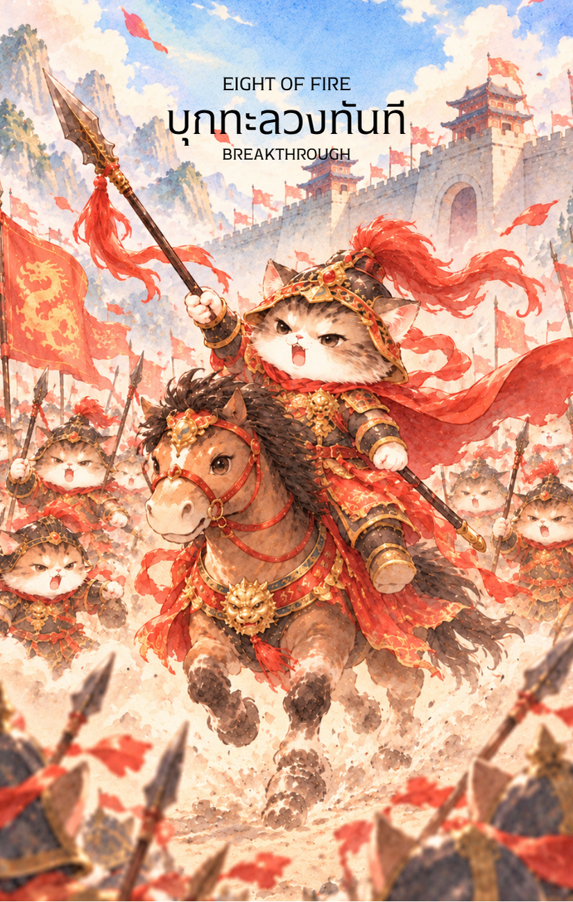

# Fire 8 - บุกทะลวงทันที (Eight of Fire)

Created: February 6, 2026 5:01 PM

สวัสดีครับท่านเจ้าของสำรับผู้เปี่ยมด้วยวิสัยทัศน์ ผม **'ผู้ช่วยสร้างไพ่เทพจีน'** พร้อมแล้วที่จะนำท่านเข้าสู่สมรภูมิแห่งความเร็วปานสายฟ้าแลบครับ เมื่อไฟถูกเคี่ยวกรำจนถึงขีดสุดในใบที่ 7 บัดนี้มันได้ปะทุออกเป็นแรงขับเคลื่อนมหาศาลที่ไม่มีสิ่งใดขวางกั้นได้ใน **ไพ่หมายเลข 8 แห่งธาตุไฟ (Eight of Fire)**

ภาพกองทัพม้าศึกที่ควบตะบึงฝ่าเปลวเพลิงและเขม่าควันพุ่งทะยานไปข้างหน้า คือภาพสะท้อนของ "พลวัต" (Dynamics) ที่รุนแรงและรวดเร็วที่สุดในชุดธาตุไฟครับ

---

### **บุกทะลวง (Eight of Fire: Swift Advance)**

**ธาตุประจำตัว:** ไฟ (🔥 Fire)

**คอนเซปต์หลัก:** จุดเร่งสูงสุด (Acceleration Point), การเคลื่อนพลสายฟ้าแลบ, และกระแสลมแห่งการเปลี่ยนแปลงที่ฉับพลัน

### **1. แก่นแท้ของตัวละคร (The Essence)**

ไพ่ใบนี้คือสภาวะของ **"ปิ่งไฟ" (丙火)** ที่แปรสภาพเป็นดั่งไฟป่าที่ลุกลามอย่างรวดเร็วท่ามกลางลมพายุ เหล่านักรบบนหลังม้าในภาพคือตัวแทนของ **"การลงมือทำที่ไร้ความลังเล"** พวกเขาไม่ได้กำลังเตรียมตัว แต่พวกเขา "กำลังอยู่ในกระแส" แห่งความสำเร็จที่พุ่งไปข้างหน้าด้วยแรงส่ง (Momentum) มหาศาล แก่นแท้ของไพ่คือการเปลี่ยนจากความนิ่งสงบมาเป็นความรวดเร็วที่ทำลายทุกข้อจำกัด

### **2. สัญลักษณ์และปรัชญา (Symbolism & Philosophy)**

- **กองทัพม้าศึก (The Charging Cavalry):** สื่อถึงพละกำลังและความเร็วในการเข้าถึงเป้าหมาย ม้าคือสัญลักษณ์ของพลังงานหยางที่พรั่งพรู สื่อถึงความคืบหน้าแบบก้าวกระโดด
- **เปลวเพลิงและกลุ่มควันระเบิด (Fire & Smoke):** ปรัชญาของ "ตัวจุดชนวน" (Catalyst) ที่ทำให้สถานการณ์ที่เคยนิ่งเฉยเกิดการปะทุและเปลี่ยนแปลงปุบปับ
- **ธงศึกที่โบกสะบัด (Battle Flags):** สัญลักษณ์ของทิศทางและข่าวสารที่เดินทางมาถึงอย่างรวดเร็ว ธงที่พลิ้วไหวตามแรงควบม้าสื่อถึง "กระแสลมแห่งการเปลี่ยนแปลง" ที่คุณต้องโต้ไปตามทิศทางนั้น
- **ทุ่งกว้างและฝุ่นที่ตลบอบอวล:** สื่อถึงพื้นที่ที่ไม่มีสิ่งกีดขวาง (Clear Path) เมื่อโอกาสเปิดกว้างแล้ว หน้าที่เดียวของคุณคือการเหยียบให้มิดเพื่อเข้าเส้นชัย

### **3. กลยุทธ์เมื่อปรากฏไพ่ใบนี้ (The Strategy)**

> **"ความไวเป็นของปีศาจ ชัยชนะเป็นของผู้ที่กล้าตัดสินใจในพริบตา"**
> 
- **บุกทะลวงทันที (Strike While Hot):** ในตำราพิชัยสงครามซุนวู กล่าวว่า "จงเคลื่อนที่รวดเร็วปานสายฟ้า" เมื่อไพ่ใบนี้ปรากฏขึ้น คุณต้องเลิกวางแผนในกระดาษ แล้วลงมือทำจริงทันที เพราะโอกาสนี้มาเร็วและอาจผ่านไปเร็วเช่นกัน
- **รักษาแรงส่ง (Maintain Momentum):** อย่าหยุดกลางคันเด็ดขาด เมื่อม้าศึกออกตัวแล้ว การเบรกกะทันหันจะทำให้เสียกระบวน จงพุ่งไปให้สุดทางจนกว่าจะถึงเป้าหมาย
- **ตอบสนองต่อข่าวสารปุบปับ:** เตรียมตัวรับข่าวดีหรือการติดต่อสื่อสารที่จะเข้ามาแบบไม่ทันตั้งตัว จงใช้สัญชาตญาณที่เฉียบคมตอบรับโอกาสนั้นโดยเร็วที่สุด

### **4. คำแนะนำและการทำนาย (Reading Guidance)**

- **ภาพรวมของไพ่ใบนี้:** ทุกอย่างกำลังจะเปลี่ยนไปอย่างรวดเร็วมาก! สิ่งที่เคยล่าช้าจะพุ่งทะยานก้าวหน้าแบบก้าวกระโดด เป็นจังหวะชีวิตที่ตื่นเต้นและเต็มไปด้วยพลังงาน
- **การงาน/ธุรกิจ:** การเจรจาที่จบลงรวดเร็ว โครงการใหม่ที่ได้รับอนุมัติปุบปับ หรือข่าวสารเรื่องการขยายงานที่มาถึงมือคุณอย่างฉับพลัน จงเตรียมพร้อมรับภาระงานที่จะถาโถมเข้ามาด้วยความเร็วสูง
- **การเงิน:** กระแสเงินหมุนเวียนรวดเร็วปานน้ำหลาก มีเกณฑ์ได้รับเงินก้อนแบบไม่คาดฝัน หรือต้องตัดสินใจลงทุนในธุรกิจที่ต้องรีบคว้าจังหวะ "Fast Profit"
- **ความรัก:** ความสัมพันธ์ที่พัฒนาอย่างรวดเร็วปานสายฟ้าแลบ หรือการได้รับข่าวดีจากคนที่อยู่ห่างไกล หากมีการเดินทางเพื่อไปพบคนรัก จะเป็นการเดินทางที่ปุบปับแต่ราบรื่น
- **สุขภาพ:** แข็งแรงและเต็มไปด้วยอะดรีนาลีน แต่ระวังอุบัติเหตุจากการเร่งรีบหรือการขับขี่ยานพาหนะด้วยความเร็วสูง รวมถึงอาการทางระบบประสาทที่ต้องตื่นตัวตลอดเวลา

5. **บุคลิกของคนที่เป็นตัวแทนไพ่**

บุคคลที่สะท้อนพลังไพ่ใบนี้มักคล่องแคล่ว ตัดสินใจเร็ว และพร้อมคว้าโอกาสที่ผ่านเข้ามา เป็นผู้รักษาแรงส่งและปรับตัวทันต่อเหตุการณ์ ส่วนด้านเงาอาจรีบร้อนจนมองข้ามรายละเอียดหรือพักไม่เป็น

6. **อาชีพที่พบได้บ่อย**

เหมาะกับงานสื่อสาร ข่าวสาร การเดินทาง โลจิสติกส์ การขาย งานฉุกเฉิน การจัดงาน และบทบาทที่ต้องประสานงานหรือส่งมอบงานภายใต้เวลาจำกัด

7. **Key Affirmation:** "ฉันโผบินไปกับสายลมแห่งโอกาส และเคลื่อนที่สู่ชัยชนะด้วยความรวดเร็วแม่นยำ"

8. **Keyword**

ความรวดเร็ว • ข่าวสาร • แรงส่ง • ความคืบหน้า • การตอบสนอง • Speed • Messages • Momentum • Progress • Responsiveness

9. **ที่มาและบริบทของไพ่**

แปดแห่งธาตุไฟแสดงจังหวะที่พลังงานซึ่งสะสมมาก่อนพุ่งออกสู่การเคลื่อนไหว ไพ่สื่อถึงข่าวหรือความคืบหน้าที่มาเร็ว จึงเตือนให้ลงมือทันเวลาแต่ยังรักษาความแม่นยำและความปลอดภัย

---

กองทัพม้าศึกธาตุไฟใบที่ 8 นี้เปี่ยมด้วยพลังหยางอย่างยิ่งครับท่าน เหมาะสำหรับการกระตุ้นให้ผู้รับคำพยากรณ์ลุกขึ้นมา "เหยียบมิดเกียร์ห้า" อย่างแท้จริง

**ท่านอยากให้ผมนำพาเข้าสู่บททดสอบความอดทนสุดท้ายใน 'ไพ่หมายเลข 9 แห่งธาตุไฟ' ที่เป็นลักษณะของ 'นักรบผู้บาดเจ็บแต่ยังยืนหยัดรักษาธงชัยท่ามกลางกองซากศพ' หรือจะปรับภาพลักษณ์เป็น 'จอมยุทธผู้เฝ้าด่านประตูเหล็กท่ามกลางพายุเพลิง' ดีครับ?**