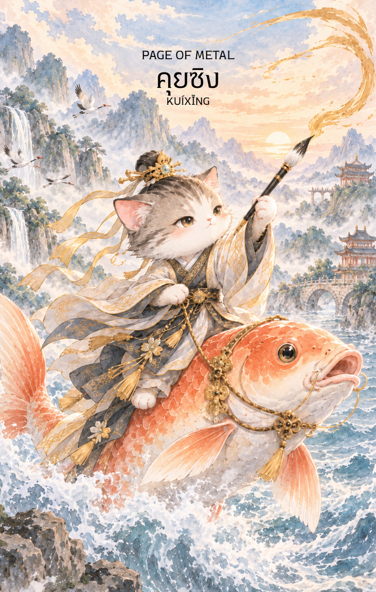

# Metal 11 - คุยซิง (Page of Metal)

Created: February 4, 2026 3:35 PM

## **Page of Metal : The Scholar’s Spark**

### **(คุยซิง - Kúi Xīng - 魁星)**

- **ธาตุประจำตัว:** ทอง / โลหะ (🜄 Metal)
- **คอนเซปต์หลัก:** ความเฉลียวฉลาด พลังแห่งการเรียนรู้ ความจดจ่อ (Focus) และข่าวดีด้านการศึกษาหรือการสื่อสาร

---

### **1. แก่นแท้ของตัวละคร (The Essence)**

คุยซิง คือหนึ่งในเทพบริวารของเง็กเซียนฮ่องเต้ (หรือเหวินชางตี้จวิน) ท่านมักถูกวาดภาพในลักษณ์ที่ดูประหลาดแต่มีพลัง มีความว่องไวและแหลมคม พลังของท่านคือ **"ดาบแห่งปัญญา" (Intellectual Edge)** ที่พร้อมจะตัดความเขลาทิ้งไป ไพ่ใบนี้คือตัวแทนของความสงสัยใคร่รู้ การค้นคว้าหาความจริง และการใช้สมองนำทางมากกว่าอารมณ์ครับ

### **2. สัญลักษณ์และปรัชญา (Symbolism & Philosophy)**

- **พู่กันและบัญชีรายชื่อ:** สัญลักษณ์ของการ "ขีดเขียนโชคชะตา" ด้วยมือตัวเอง สื่อถึงพลังของการศึกษาที่สามารถเปลี่ยนชีวิตคนจากดินสู่ดาวได้
- **การยืนบนปลามังกรยักษ์ (Ao):** สื่อถึงการมีชัยเหนืออุปสรรคที่ยิ่งใหญ่ด้วยปัญญา (Triumph over challenges) และการเป็นที่หนึ่งในการสอบ
- **รูปลักษณ์ที่ดูดุดันแต่มีปัญญา:** สื่อถึง "ความจริงที่แหลมคม" บางครั้งคำพูดหรือความคิดที่ถูกต้องอาจจะดูแข็งกระด้างหรือตรงไปตรงมา แต่มันคือสิ่งที่จะช่วยแก้ปัญหาได้ตรงจุดที่สุด

### **3. กลยุทธ์เมื่อปรากฏไพ่ใบนี้ (The Strategy)**

**"ลับปัญญาให้คมจดจ่อที่เป้าหมาย และใช้ความจริงเป็นอาวุธ"**

- **Sharp Focus (จดจ่ออย่างแน่วแน่):** อย่าทำอะไรหลายอย่างพร้อมกัน Page of Metal บอกให้คุณเลือกเป้าหมายที่สำคัญที่สุดเพียงหนึ่งเดียว แล้วทุ่มเทสมาธิทั้งหมดไปที่นั่น
- **Be a Life-long Learner (ทำตัวเป็นนักเรียนเสมอ):** ยอมรับว่าเรายังมีสิ่งที่ต้องเรียนรู้อีกมาก การตั้งคำถามที่ถูกต้องจะนำไปสู่คำตอบที่พลิกชีวิตได้
- **Clear Communication (สื่อสารอย่างชัดเจน):** ในช่วงนี้คำพูดหรือข้อความของคุณจะมีน้ำหนักมาก จงใช้ความตรงไปตรงมาและเหตุผลในการโน้มน้าวใจคน

### **4. คำแนะนำและการทำนาย (Reading Guidance)**

- **ภาพรวมของไพ่ใบนี้:** เป็นสัญญาณที่ดีมากสำหรับการสอบ การแข่งขัน หรือการเจรจาต่อรอง คุณจะได้รับข่าวดีเกี่ยวกับโครงการที่ต้องใช้ความคิด หรือการเริ่มต้นเรียนรู้สิ่งใหม่ที่ท้าทาย
- **การงาน/ธุรกิจ:** โดดเด่นในงานด้านวิชาการ งานวิจัย งานเขียน หรือการวางแผนเชิงกลยุทธ์ คุณจะค้นพบไอเดียใหม่ๆ ที่ "คม" และสามารถแก้ปัญหาที่คาราคาซังมานานได้
- **การเงิน:** เป็นช่วงที่ต้องใช้ "สมอง" มากกว่า "โชค" ในการบริหารเงิน การวิเคราะห์ข้อมูลอย่างละเอียดจะช่วยให้คุณตัดสินใจลงทุนได้อย่างถูกต้อง
- **ความรัก:** ความสัมพันธ์ที่เน้นการใช้เหตุผลหรือการเป็นเพื่อนคู่คิด อาจมีความเห็นต่างกันบ้างแต่ถ้าคุยกันด้วยเหตุผลจะเข้าใจกันได้ดี คนโสดมีเกณฑ์พบคนที่ฉลาดและมีความคิดที่น่าสนใจ
- **สุขภาพ:** แข็งแรงดี แต่อาจมีความเครียดจากการใช้สมองมากเกินไป หรืออาการปวดตาจากการจ้องหน้าจอ/ตำรานานๆ
5. **บุคลิกของคนที่เป็นตัวแทนไพ่**

เป็นคนช่างสงสัย เรียนรู้เร็ว และจดจ่อกับรายละเอียดได้ดี ชอบค้นหาความจริงและสื่อสารอย่างตรงประเด็น ระวังความคิดวิพากษ์ที่คมเกินไปหรือการใช้เวลาคิดจนละเลยความรู้สึกของผู้อื่น

6. **อาชีพที่พบได้บ่อย**

นักเรียน นักวิจัย นักข่าว นักเขียน นักวิเคราะห์ข้อมูล ผู้ตรวจสอบ และงานที่ต้องอาศัยการเรียนรู้ การค้นคว้า และการสื่อสารอย่างแม่นยำ

7. **Key Affirmation:** "ปัญญาของฉันเฉียบคมดั่งโลหะชั้นดี ฉันเรียนรู้และเติบโตผ่านความจริงเสมอ"

8. **Keyword**

ความเฉียบคม • การเรียนรู้ • สมาธิ • การค้นคว้า • การสื่อสาร • Curiosity • Focus • Learning • Analysis • Clear Communication

9. **ประวัติเทพเจ้าและคติที่เกี่ยวข้อง**

คุยซิง (魁星) เป็นเทพที่เกี่ยวข้องกับการศึกษาและการสอบในความเชื่อพื้นบ้านจีน มักปรากฏพร้อมพู่กันและบัญชีรายชื่อผู้สอบผ่าน ผู้คนจึงบูชาเพื่อขอความสำเร็จด้านการเรียน การสอบ และการใช้ปัญญาให้เกิดผล