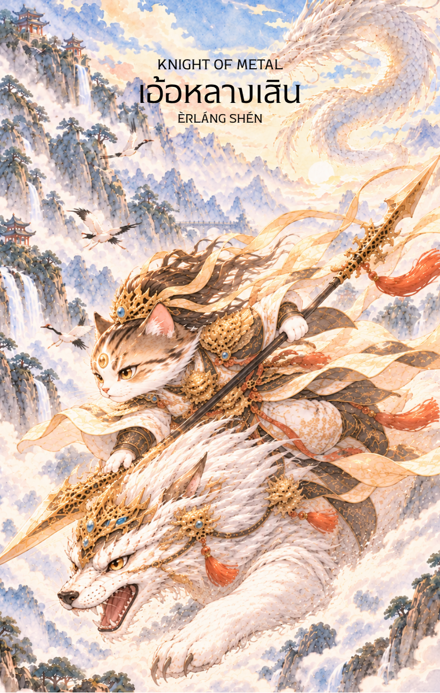

# Metal 12 - เอ้อหลางเสิน (Knight of Metal)

Created: February 4, 2026 3:36 PM

---

## **Knight of Metal : The Vanguard of Clarity**

### **(เอ้อหลางเสิน - Èrláng Shén - 二郎神)**

- **ธาตุประจำตัว:** ทอง / โลหะ (🜄 Metal)
- **คอนเซปต์หลัก:** การลงมือทำอย่างเด็ดขาด การมองเห็นความจริงที่ซ่อนอยู่ (Truth) การเผชิญหน้ากับปัญหา และความยุติธรรม

---

### **1. แก่นแท้ของตัวละคร (The Essence)**

เอ้อหลางเสิน คือเทพนักรบผู้มีความเก่งกาจทั้งบู้และบุ๋น มีความเที่ยงธรรมและไม่เกรงกลัวผู้ใด พลังของท่านคือ **"ปัญญาที่นำไปสู่การกระทำ" (Actionable Wisdom)** หากคุยซิงคือการตั้งคำถาม เอ้อหลางเสินคือการลงมือหาคำตอบด้วยการเผชิญหน้ากับมัน ท่านคือตัวแทนของการตัดสิ่งที่ไม่จำเป็นออกไปจากชีวิต เพื่อให้เหลือเพียงสิ่งที่ถูกต้องและเป็นจริงที่สุด

### **2. สัญลักษณ์และปรัชญา (Symbolism & Philosophy)**

- **ดวงตาที่สาม (The Third Eye):** สัญลักษณ์ที่สำคัญที่สุด หมายถึง "ปัญญาญาณ" (Insight) ที่สามารถมองทะลุภาพลวงตาและเห็นความจริงที่ซ่อนอยู่ได้ ท่านคือผู้ที่รู้เท่าทันคนและสถานการณ์
- **ทวนสามปลาย (Three-Pointed, Double-Edged Lance):** อาวุธคู่กายที่แหลมคม สื่อถึงความสามารถในการตัดขาดจากอุปสรรค ความลังเล หรือความสัมพันธ์ที่เป็นพิษได้อย่างเด็ดขาด
- **สุนัขสวรรค์ (Celestial Dog - Xiàotiān Quǎn):** สื่อถึงความซื่อสัตย์และความสามารถในการติดตามไล่ล่าเป้าหมายอย่างไม่ลดละจนกว่าจะสำเร็จ

### **3. กลยุทธ์เมื่อปรากฏไพ่ใบนี้ (The Strategy)**

**"มองให้ทะลุ แล้วลงมือให้เด็ดขาด อย่าประนีประนอมกับความไม่ถูกต้อง"**

- **Face the Truth (เผชิญหน้าความจริง):** ถึงเวลาที่ต้องหยุดหนีปัญหา แล้วหันกลับมาจ้องตามันตรงๆ ไพ่ใบนี้บอกว่า "ความจริงอาจจะเจ็บปวด แต่มันจะทำให้คุณเป็นอิสระ"
- **Decisive Action (ลงมือทำทันที):** เมื่อเห็นชัดแล้วว่าอะไรคือสิ่งที่ต้องทำ อย่าลังเล ความรวดเร็วและแม่นยำคือหัวใจสำคัญของธาตุโลหะ
- **Cut the Cord (ตัดให้ขาด):** หากมีอะไรที่ถ่วงความเจริญของคุณอยู่ ไม่ว่าจะเป็นนิสัยแย่ๆ หนี้สิน หรือคนที่ไม่จริงใจ นี่คือเวลาที่ดีที่สุดที่จะกำจัดมันออกไปจากชีวิต

### **4. คำแนะนำและการทำนาย (Reading Guidance)**

- **ภาพรวมของไพ่ใบนี้:** เป็นช่วงเวลาที่คุณต้องใช้ความเด็ดขาดและชัดเจนในการจัดการชีวิต สถานการณ์อาจบีบให้คุณต้องเลือกหรือตัดสินใจเรื่องสำคัญ ซึ่งการใช้เหตุผลมากกว่าอารมณ์จะนำไปสู่ผลลัพธ์ที่ดีที่สุด
- **การงาน/ธุรกิจ:** เหมาะกับงานตรวจสอบ งานกฎหมาย หรือการแก้ปัญหาเฉพาะหน้า คุณอาจได้รับมอบหมายให้จัดการกับงานที่ยุ่งยากหรือขัดแย้ง ซึ่งคุณจะสามารถคลี่คลายมันได้ด้วยความสามารถเฉพาะตัว
- **การเงิน:** ต้องเด็ดขาดเรื่องการใช้จ่าย หากมีหนี้สินควรรีบสะสาง เป็นช่วงที่ควรตรวจสอบบัญชีหรือเอกสารสัญญาต่างๆ อย่างละเอียดรอบคอบ
- **ความรัก:** เป็นช่วงที่ต้องการความชัดเจนในความสัมพันธ์ หากมีเรื่องที่ค้างคาใจควรเปิดอกคุยกันตรงๆ หรือหากความสัมพันธ์ไม่ดีอาจถึงเวลาที่ต้องตัดสินใจว่าจะไปต่อหรือพอแค่นี้
- **สุขภาพ:** อาจมีปัญหาเกี่ยวกับระบบประสาท สายตา หรืออุบัติเหตุเล็กน้อยจากของมีคม ควรระมัดระวังในการทำกิจกรรมต่างๆ
- 

5. **บุคลิกของคนที่เป็นตัวแทนไพ่**

เป็นคนกล้าเผชิญความจริง รักความถูกต้อง และตัดสินใจได้เด็ดขาดเมื่อมีข้อมูลเพียงพอ มักลงมือแก้ปัญหาแทนการหลีกเลี่ยง ระวังความตรงหรือความเร่งรีบจนทำให้ผู้อื่นรู้สึกถูกตัดสิน

6. **อาชีพที่พบได้บ่อย**

นักสืบ นักกฎหมาย เจ้าหน้าที่ตรวจสอบ ผู้กู้ภัย นักวิเคราะห์ความเสี่ยง ผู้จัดการวิกฤต และงานที่ต้องค้นหาความจริงแล้วลงมือแก้ไขอย่างรวดเร็ว

7. **Key Affirmation:** "ฉันมองเห็นความจริงอย่างชัดเจน และลงมือทำอย่างกล้าหาญและเที่ยงธรรม"

8. **Keyword**

ความชัดเจน • การลงมือทำ • ความกล้าหาญ • ความจริง • ความยุติธรรม • Clarity • Action • Courage • Truth • Justice

9. **ประวัติเทพเจ้าและตำนานที่เกี่ยวข้อง**

เอ้อหลางเสิน (二郎神) เป็นเทพนักรบในคติจีน มักปรากฏพร้อมดวงตาที่สามและสุนัขสวรรค์คู่ใจ เรื่องเล่าหลายสายยกย่องความสามารถในการมองทะลุภาพลวงตาและปราบอสูร จึงเป็นสัญลักษณ์ของการรู้เท่าทันและการลงมือเพื่อความถูกต้อง