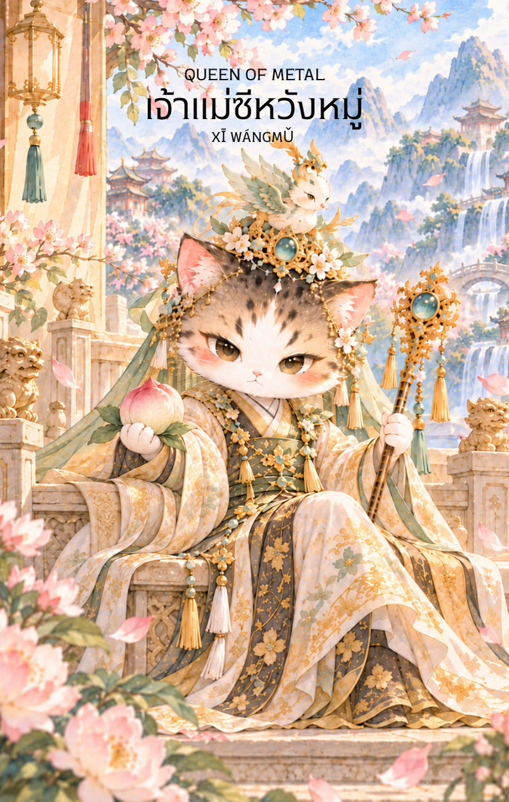

# Metal 13 - ซีหวังหมู่ (Queen of Metal)

Created: February 4, 2026 3:40 PM

## **Queen of Metal : The Matriarch of Immortality**

### **(ซีหวังหมู่ - Xī Wáng Mǔ - 西王母)**

- **ธาตุประจำตัว:** ทอง / โลหะ (🜄 Metal)
- **คอนเซปต์หลัก:** ความเฉลียวฉลาดที่สุขุม ความเป็นอิสระ การรักษาคุณค่า และอำนาจแห่งการตัดสินใจที่ยุติธรรม

---

### **1. แก่นแท้ของตัวละคร (The Essence)**

หาก Queen of Earth คือความอบอุ่นของดิน **Queen of Metal** คือความล้ำค่าของอัญมณีและคมของดาบที่ถูกขัดเกลามาอย่างดี ซีหวังหมู่ในฐานะราชินีแห่งทิศตะวันตก (ทิศประจำธาตุทอง) คือตัวแทนของ **"สติปัญญาชั้นสูง" (Refined Intellect)** ท่านเป็นอิสระ สง่างาม และเด็ดขาด พลังของท่านไม่ใช่การฟูมฟักแบบแม่ แต่เป็นการ "ชี้แนะ" และ "วางระเบียบ" เพื่อให้เกิดความสมบูรณ์แบบชั่วนิรันดร์

### **2. สัญลักษณ์และปรัชญา (Symbolism & Philosophy)**

- **ลูกท้อสวรรค์ (Peaches of Immortality):** สัญลักษณ์ของการรักษาคุณค่าและความเป็นอมตะ สื่อถึง "ความคิดหรือผลงาน" ที่ทรงคุณค่าจนกาลเวลาทำไม่อาจทำลายได้
- **เทือกเขาคุนหลุน (Kunlun Mountains):** ยอดเขาสูงที่ปกคลุมด้วยหิมะและเมฆา สื่อถึงความโดดเดี่ยวที่สูงส่ง (Solitude) และวิสัยทัศน์ที่มองเห็นภาพรวมจากที่สูง
- **นกกระเรียนหรือหงส์ฟ้า:** สื่อถึงความสง่างาม การข้ามผ่านอารมณ์ที่ปั่นป่วนไปสู่ความสงบเยือกเย็นของเหตุผล

### **3. กลยุทธ์เมื่อปรากฏไพ่ใบนี้ (The Strategy)**

**"ขัดเกลาความคิดให้คมกริบ รักษาคุณค่าในตนเอง และใช้เหตุผลเป็นโล่"**

- **Intellectual Independence (อิสระทางความคิด):** อย่าปล่อยให้คำพูดของคนอื่นมาสั่นคลอนความจริงที่คุณเห็น จงเชื่อมั่นในตรรกะและการวิเคราะห์ของตัวเอง
- **Quality over Quantity (คุณภาพเหนือปริมาณ):** ในธาตุทอง เราไม่เน้นความเยอะ แต่เราเน้น "ความดีเลิศ" จงทำสิ่งที่ทำอยู่ให้ดีที่สุดจนไม่มีใครปฏิเสธได้
- **Graceful Discipline (วินัยที่สง่างาม):** การคุมตัวเองให้อยู่ในระเบียบจะทำให้คุณมีอำนาจเหนือสถานการณ์ การนิ่งสงบจะทำให้คู่ต่อสู้เกรงขามมากกว่าการโวยวาย

### **4. คำแนะนำและการทำนาย (Reading Guidance)**

- **ภาพรวมของไพ่ใบนี้:** คุณกำลังอยู่ในจุดที่มีวุฒิภาวะทางปัญญาสูง มีความมั่นใจในตัวเอง และสามารถจัดการทุกอย่างได้ด้วยมือของตัวเอง (Single Power) เป็นไพ่ที่บอกถึงความสำเร็จจากความฉลาดและการวางตัว
- **การงาน/ธุรกิจ:** โดดเด่นมากในงานบริหารระดับสูง ที่ปรึกษา หรือช่างฝีมือชั้นครู คุณจะได้รับความเคารพในฐานะผู้เชี่ยวชาญที่มีมาตรฐานสูง
- **การเงิน:** มั่นคงจากการบริหารจัดการที่ชาญฉลาด ไม่เน้นการเสี่ยงดวง แต่เน้นการเก็บรักษาและลงทุนในสิ่งที่ "ทรงคุณค่า" เช่น เพชรทอง หรือสินทรัพย์ที่ไม่มีวันเสื่อมค่า
- **ความรัก:** เป็นความรักที่เน้นความเข้าใจและเคารพพื้นที่ส่วนตัว หากโสด คุณคือ "นางพญา" ที่มีความสุขกับชีวิตและมาตรฐานที่สูงเกินกว่าจะยอมรับใครง่าย ๆ หากมีคู่จะเป็นความสัมพันธ์ที่ส่งเสริมปัญญาของกันและกัน
- **สุขภาพ:** สุขภาพกายแข็งแรง แต่อาจมีลักษณะของคน "เย็นใน" หรือระวังปัญหาเกี่ยวกับระบบทางเดินหายใจและปอด (อวัยวะธาตุทอง)
5. **บุคลิกของคนที่เป็นตัวแทนไพ่**

เป็นคนสุขุม ฉลาดเฉียบคม และรักษามาตรฐานของตนได้ดี มีความเป็นอิสระและตัดสินใจบนเหตุผล ระวังการปิดกั้นผู้อื่นหรือดูเคร่งขรึมจนเข้าถึงยาก

6. **อาชีพที่พบได้บ่อย**

ผู้บริหาร ที่ปรึกษา นักกฎหมาย นักวิชาการ นักอนุรักษ์ศิลปวัตถุ ผู้เชี่ยวชาญด้านคุณภาพ และงานที่ต้องใช้การวิเคราะห์ วินัย และมาตรฐานสูง

7. **Key Affirmation:** "ปัญญาของฉันบริสุทธิ์และเที่ยงตรง ฉันโอบรับคุณค่าที่ไม่มีวันดับสูญในตัวเอง"

8. **Keyword**

ปัญญา • ความเป็นอิสระ • คุณค่า • วินัย • ความเที่ยงตรง • Refined Intellect • Independence • Discernment • Discipline • Integrity

9. **ประวัติเทพเจ้าและตำนานที่เกี่ยวข้อง**

ซีหวังหมู่ (西王母) หรือราชินีมารดาแห่งตะวันตก เป็นเทพีสำคัญในตำนานจีน ประทับอยู่บนเขาคุนหลุนและเกี่ยวข้องกับลูกท้อแห่งความเป็นอมตะ เรื่องเล่าพัฒนาพระองค์จากเทพผู้ทรงอำนาจสู่ผู้ประทานพรและผู้ดูแลการประชุมของเซียน จึงเป็นสัญลักษณ์ของอำนาจ ปัญญา และอายุยืน