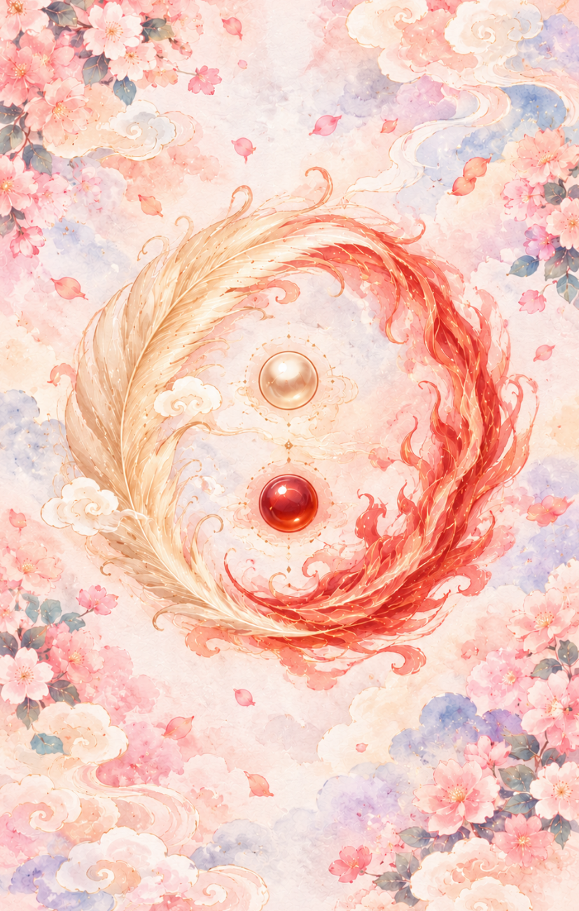

# Special 93 - Martial Saint - มิได้เกิดจากชัยชนะในสนามรบ

## **Special 93 - Martial Saint - มิได้เกิดจากชัยชนะในสนามรบ**

---

**ธาตุประจำตัว:** ธาตุทอง (Metal)

**คอนเซปต์หลัก:** กวนอู (關羽) หรือ กวนอวิ๋นฉาง (關雲長) เป็นขุนพลผู้ยิ่งใหญ่แห่งยุคสามก๊ก และพี่

1. **แก่นแท้ของตัวละคร (The Essence)**
    กวนอู (關羽) หรือ กวนอวิ๋นฉาง (關雲長) เป็นขุนพลผู้ยิ่งใหญ่แห่งยุคสามก๊ก และพี่ เป็นตัวแทนของปัญญาและสัจธรรมที่นำทางสรรพชีวิต สะท้อนความกลมกลืนระหว่างฟ้า ดิน และมนุษย์ตามหลักเต๋าโบราณ

2. **สัญลักษณ์และปรัชญา (Symbolism & Philosophy)**
    - **พลังประจำธาตุ:** สะท้อนการหมุนเวียนของพลังงานธรรมชาติ (ธาตุทอง (Metal)) ที่ไม่หยุดนิ่ง
    - **สัญลักษณ์แห่งปัญญา:** เตือนสติให้มองเห็นแก่นแท้เบื้องลึก มากกว่าภาพลวงตาภายนอก
    - **สมดุลหยินหยาง:** การปรับตัวให้เข้ากับจังหวะเวลาแห่งจักรวาล

3. **กลยุทธ์เมื่อปรากฏไพ่ใบนี้ (The Strategy)**
    - **รู้จังหวะรุกรับ:** ดำเนินการอย่างรอบคอบ ไม่เร่งร้อนหรือดื้อดึงเกินเหตุ
    - **ใช้ปัญญาแทนอารมณ์:** ทุกการตัดสินใจต้องตั้งอยู่บนความจริงและหลักการที่ถูกต้อง
    - **รักษาจุดยืนที่มั่นคง:** ยึดมั่นในความซื่อสัตย์สุจริตและคุณธรรมภายในใจ

4. **คำแนะนำและการทำนาย (Reading Guidance)**
    - **ภาพรวมของไพ่ใบนี้:** ข้อความจากเทพ “ผู้ที่รักษาคำสัตย์ได้ แม้ในวันที่ไม่มีใครมองเห็น
    - **การงาน/ธุรกิจ:** การงานและการเงิน: โอกาสความสำเร็จและการบริหารจัดการตามแนวทางของ ธาตุทอง (Metal)
    - **การเงิน:** จัดการสภาพคล่องอย่างมีวินัย วางแผนระยะยาว และหลีกเลี่ยงความเสี่ยงที่ไม่จำเป็น
    - **ความรัก:** ความรัก: พลังงานเกื้อหนุนตามอิทธิพลของ ธาตุทอง (Metal) และบทเรียนคำสอนประจำไพ่
    - **สุขภาพ:** ดูแลสมดุลธาตุในร่างกาย พักผ่อนให้เพียงพอ และฝึกการเจริญสติ

5. **บุคลิกของคนที่เป็นตัวแทนไพ่**
    เป็นคนมีวิสัยทัศน์ มั่นคง มีเหตุผล และเปี่ยมด้วยความรับผิดชอบ
    
    **ในด้านเงา** อาจดื้อดึง ยึดมั่นในความคิดตนเองมากเกินไป หรือวิตกกังวลกับความสมบูรณ์แบบ

6. **อาชีพที่พบได้บ่อย**
    ผู้นำองค์กร นักบริหาร ที่ปรึกษา ผู้เชี่ยวชาญ นักวิชาการ นักวางแผนกลยุทธ์

7. **Key Affirmation:**
    "ผู้ที่รักษาคำสัตย์ได้ แม้ในวันที่ไม่มีใครมองเห็น"

8. **Keyword**
    พลังธาตุ • จิ่วเทียนอาร์คานา • โชคชะตา

9. **ประวัติเทพเจ้า**
    กวนอู (關羽) หรือ กวนอวิ๋นฉาง (關雲長) เป็นขุนพลผู้ยิ่งใหญ่แห่งยุคสามก๊ก และพี่
