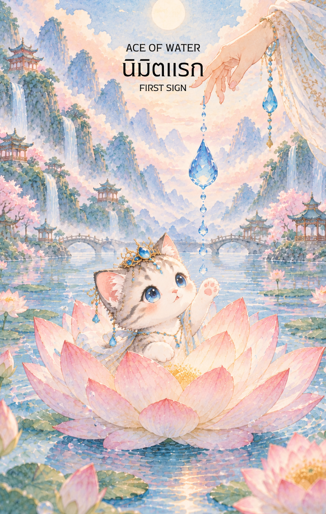

# Water 1 - นิมิตแรก (Ace of Water)

Created: February 4, 2026 3:45 PM

## **Ace of Water : The First Vision**

### **(นิมิตแรกแห่งวารี)**

- **ธาตุประจำตัว:** น้ำ (🜄 Water)
- **คอนเซปต์หลัก:** การเริ่มต้นของความรู้สึกใหม่สัญชาตญาณที่ตื่นรู้ กระแสแห่งความเมตตา และต้นกำเนิดแห่งแรงบันดาลใจ

---

### **1. แก่นแท้ของตัวละคร/พลัง (The Essence)**

**Ace of Water** เปรียบเสมือนหยดน้ำค้างบริสุทธิ์หยดแรก หรือน้ำพุศักดิ์สิทธิ์ที่พุ่งขึ้นจากใจกลางมหาสมุทรแห่งจิตใต้สำนึก "นิมิตแรก" คือช่วงเวลาที่จิตใจเปิดรับความรู้สึกใหม่ๆ ที่ลึกซึ้งกว่าเดิม เป็นการเริ่มต้นของความรัก ความเห็นอกเห็นใจ หรือแม้แต่ความสามารถทางจิต (Psychic Ability) ที่เพิ่งเริ่มผุดขึ้นมา พลังนี้ไม่ใช่การบังคับ แต่เป็นการไหลไปตามธรรมชาติ (Go with the flow)

### **2. สัญลักษณ์และปรัชญา (Symbolism & Philosophy)**

- **จอกหยกหรือแจกันสะอาด:** ในทางคติจีนมักนึกถึง **"แจกันหยกขาว"** ของพระโพธิสัตว์กวนอิม ที่บรรจุน้ำทิพย์แห่งความเมตตา สื่อถึงภาชนะที่สะอาดพร้อมรับพลังงานใหม่ๆ
- **ดอกบัวที่กำลังผุดขึ้นจากน้ำ:** สัญลักษณ์ของความบริสุทธิ์และการตื่นรู้ของจิตวิญญาณที่ก้าวพ้นโคลนตม (อารมณ์ที่ขุ่นมัว)
- **ดวงจันทร์สะท้อนบนผิวน้ำ:** สื่อถึง "นิมิต" หรือภาพสะท้อนของความจริงที่ปรากฏในใจมากกว่าการเห็นด้วยตาเปล่า มันคือความเข้าใจผ่านความรู้สึก

### **3. กลยุทธ์เมื่อปรากฏไพ่ใบนี้ (The Strategy)**

**"เปิดใจให้กว้าง ฟังเสียงสัญชาตญาณ และปล่อยให้ความเมตตานำทาง"**

- **Trust Your Gut (เชื่อในลางสังหรณ์):** หากคุณรู้สึกว่า "ใช่" แม้จะไม่มีเหตุผลรองรับ นั่นคือนิมิตแรกที่ธาตุน้ำกำลังบอกคุณ จงเชื่อในความรู้สึกแรกนั้น
- **Be Receptive (เป็นผู้รับที่อ่อนน้อม):** น้ำจะไหลลงสู่ที่ต่ำเสมอ การทำตัวให้เล็กลงและเปิดใจรับฟังผู้อื่นจะทำให้คุณได้รับโอกาสและมิตรภาพที่ยิ่งใหญ่
- **Emotional Renewal (เริ่มต้นใหม่ทางอารมณ์):** หากเคยเจ็บช้ำมา นี่คือเวลาของการเยียวยา ปล่อยให้อดีตไหลไปกับสายน้ำ และเริ่มต้นโอบรับความสุขครั้งใหม่

### **4. คำแนะนำและการทำนาย (Reading Guidance)**

- **ภาพรวมของไพ่ใบนี้:** เป็นไพ่ที่สวยงามและเป็นมงคลที่สุดใบหนึ่ง สื่อถึงข่าวดีเรื่องความรัก การตั้งครรภ์ หรือการได้รับความเมตตาเอ็นดูจากผู้ใหญ่ เป็นช่วงเวลาที่จิตใจจะสงบและมีความสุขอย่างประหลาด
- **การงาน/ธุรกิจ:** การเริ่มต้นโปรเจกต์ที่เกิดจากแรงบันดาลใจหรือความรัก งานที่เกี่ยวข้องกับการบริการ การเยียวยา ศิลปะ หรือสัญชาตญาณจะประสบความสำเร็จอย่างงดงาม
- **การเงิน:** มีเงินเข้ามาจากความเมตตาหรือโชคลาภเล็กๆ น้อยๆ ที่มาพร้อมกับความสุขใจ การเงินจะคล่องตัวเหมือนสายน้ำที่ไหลเวียนดี
- **ความรัก:** "รักแรกพบ" หรือการเริ่มต้นความสัมพันธ์ใหม่ที่ลึกซึ้งและอ่อนโยน สำหรับคนมีคู่ คือช่วงเวลาของการปรับความเข้าใจและการเริ่มต้นบทบาทใหม่ที่มีความสุขร่วมกัน
- **สุขภาพ:** สุขภาพกายและใจดีเยี่ยม หากป่วยจะได้รับการรักษาที่ถูกจุดด้วยความเมตตา ระวังเพียงเรื่องของอารมณ์ที่อาจจะอ่อนไหวง่ายเป็นพิเศษในระยะนี้
5. **บุคลิกของคนที่เป็นตัวแทนไพ่**

เป็นคนอ่อนโยน เข้าอกเข้าใจ และรับรู้อารมณ์ของตนกับผู้อื่นได้ลึกซึ้ง มีจินตนาการและสัญชาตญาณดี จุดที่ควรระวังคือความอ่อนไหวหรือการซึมซับอารมณ์ของคนรอบข้างจนละเลยขอบเขตของตน

6. **อาชีพที่พบได้บ่อย**

นักบำบัด ผู้ให้คำปรึกษา ศิลปิน นักดนตรี พยาบาล งานบริการ งานดูแลผู้คน และอาชีพที่ต้องใช้ความเห็นอกเห็นใจหรือจินตนาการ

7. **Key Affirmation:** "ฉันเปิดใจรับความรักและสัญชาตญาณอันบริสุทธิ์ ฉันไหลไปตามกระแสแห่งความสุขของจักรวาล"

8. **Keyword**

ความรู้สึก • สัญชาตญาณ • ความเมตตา • การเยียวยา • การเริ่มต้น • Intuition • Compassion • Emotional Renewal • Creativity • Receptivity

9. **ที่มาและบริบทของไพ่**

Ace of Water คือจุดเริ่มต้นของกระแสอารมณ์และความเมตตา ภาพน้ำสะอาด ดอกบัว หรือจอกศักดิ์สิทธิ์สื่อถึงหัวใจที่พร้อมรับความรู้สึกใหม่ การเยียวยา และแรงบันดาลใจที่ผุดขึ้นจากภายใน

---

**องค์ประกอบภาพสำหรับ Gen ในอนาคต (Visual Concept):**

- **จุดเด่น:** มือที่อ่อนช้อยกำลังประคองจอกหยกขาวที่มีน้ำทิพย์ล้นออกมา หรือภาพดอกบัวบานกลางสระน้ำที่เงียบสงบใต้แสงจันทร์
- **แสง:** เน้นแสงสีฟ้าอมเขียว (Turquoise) และแสงนวลของดวงจันทร์ที่สะท้อนผิวน้ำ
- **บรรยากาศ:** เยือกเย็น สงบ และดูศักดิ์สิทธิ์