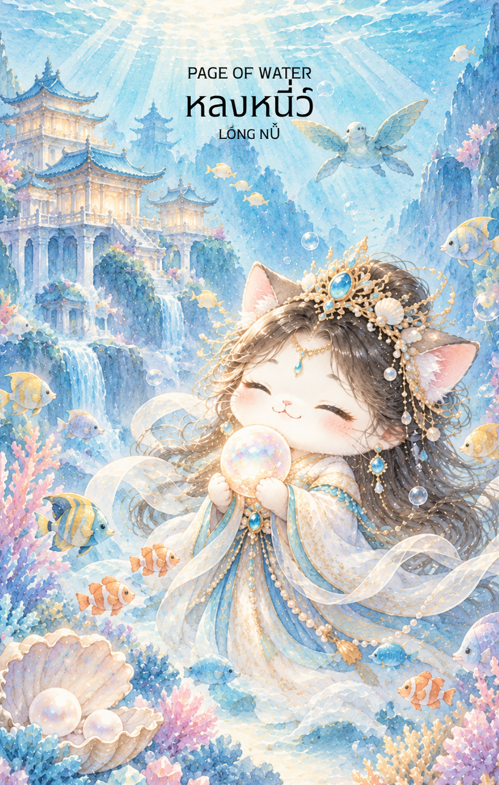

# Water 11 - หลงหนี่ว์ (Page of Water)

Created: February 4, 2026 3:45 PM

---

## **Page of Water : The Messenger of Empathy**

### **(หลงหนี่ว์ - Lóng Nǚ - 龍女)**

- **ธาตุประจำตัว:** น้ำ (🜄 Water)
- **คอนเซปต์หลัก:** การเริ่มต้นเรียนรู้ทางอารมณ์ ความเห็นอกเห็นใจ ข่าวสารที่อบอุ่นใจ และพลังแห่งการจินตนาการ

---

### **1. แก่นแท้ของตัวละคร (The Essence)**

หลงหนี่ว์ คือภาพลักษณ์ของ **"ผู้เริ่มต้นบนวิถีแห่งใจ" (Apprentice of the Heart)** เดิมทีท่านเป็นธิดาของเจ้าสมุทรผู้มั่งคั่ง แต่ยอมละทิ้งความสบายเพื่อมาศึกษาธรรมะและความเมตตา พลังของไพ่ใบนี้คือความอ่อนโยนที่แฝงด้วยความเฉลียวฉลาด เป็นความรู้สึกที่ "สดใหม่" เหมือนน้ำพุที่เพิ่งผุดขึ้นมา สื่อถึงการเปิดรับความรู้สึกใหม่ๆ โดยปราศจากอคติ

### **2. สัญลักษณ์และปรัชญา (Symbolism & Philosophy)**

- **ไข่มุกวิเศษ (The Luminous Pearl):** สัญลักษณ์ของปัญญาที่เกิดจากการกลั่นกรองอารมณ์ หมายถึงค่าตอบแทนทางจิตใจที่ล้ำค่ากว่าวัตถุ
- **เกลียวคลื่นจิ๋วหรือเกล็ดมังกร:** สื่อถึงต้นกำเนิดที่ยิ่งใหญ่ (สายเลือดมังกร) แต่แสดงออกด้วยความอ่อนน้อมถ่อมตน หมายถึงสัญชาตญาณที่เฉียบคมซึ่งถูกซ่อนไว้ภายใต้ท่าทางที่นุ่มนวล
- **แจกันน้ำทิพย์หรือดอกบัว:** สื่อถึงบทบาท "ผู้ช่วย" หรือ "ผู้ส่งสาร" หมายถึงความสุขที่เกิดจากการได้ช่วยเหลือผู้อื่น

### **3. กลยุทธ์เมื่อปรากฏไพ่ใบนี้ (The Strategy)**

**"ใช้ใจนำทาง เปิดรับความอ่อนโยน และรับฟังเสียงกระซิบของสัญชาตญาณ"**

- **Be Emotionally Open (เปิดใจรับความรู้สึก):** อย่ากลัวที่จะแสดงความอ่อนโยนหรือความเห็นอกเห็นใจในช่วงนี้ การแสดงความจริงใจจะช่วยเปิดประตูที่เคยปิดตายได้
- **Active Listening (ฟังด้วยใจ):** ข่าวสารสำคัญมักไม่ได้มาในรูปของคำพูดที่เสียงดัง แต่อาจมาในรูปแบบของความรู้สึกหรือลางสังหรณ์เล็กๆ จงสังเกตสิ่งที่เกิดขึ้นรอบตัวให้ดี
- **Artistic Expression (ระบายความรู้สึกผ่านศิลปะ):** หากมีเรื่องอัดอั้น การเขียนไดอารี่ วาดรูป หรือฟังเพลง จะช่วยให้จิตใจของคุณกลับมาสมดุลได้ดีที่สุด

### **4. คำแนะนำและการทำนาย (Reading Guidance)**

- **ภาพรวมของไพ่ใบนี้:** เป็นช่วงเวลาแห่งความสุขทางใจ คุณอาจได้รับข่าวดีที่ทำให้ยิ้มได้ หรือมีโอกาสได้เริ่มต้นเรียนรู้สิ่งใหม่ที่เกี่ยวข้องกับศิลปะ จิตวิทยา หรือการดูแลผู้คน
- **การงาน/ธุรกิจ:** เหมาะกับงานที่ต้องใช้ความคิดสร้างสรรค์ การเจรจาด้วยความประนีประนอม หรือการเริ่มต้นฝึกงานในสายงานที่ต้องใช้ความละเอียดอ่อน คุณจะเป็นที่รักของเพื่อนร่วมงานด้วยความมีน้ำใจ
- **การเงิน:** มีรายได้เข้ามาจากงานที่ทำด้วยใจรัก หรือมีคนหยิบยื่นโชคลาภเล็กๆ น้อยๆ มาให้ด้วยความเอ็นดู เป็นช่วงที่ควรใช้เงินเพื่อสร้างความสุขทางใจมากกว่าการเก็งกำไรเสี่ยงๆ
- **ความรัก:** จะมีเรื่องราวหวานๆ เข้ามาให้หัวใจเต้นแรง อาจเป็น "รักครั้งใหม่" ที่ดูสดใสเหมือนเด็กๆ หรือการได้รับข้อความบอกรักที่อ่อนโยน คนมีคู่จะเป็นช่วงที่ดูแลความรู้สึกกันได้ดีเป็นพิเศษ
- **สุขภาพ:** ระวังเรื่องของอารมณ์ที่แปรปรวนง่ายหรือความอ่อนไหวเกินไป สุขภาพกายโดยรวมดี แต่อาจมีอาการเกี่ยวกับระบบของเหลวในร่างกายหรือภูมิแพ้
5. **บุคลิกของคนที่เป็นตัวแทนไพ่**

เป็นคนอ่อนโยน ช่างสังเกต และรับฟังความรู้สึกของผู้อื่นได้ดี มักมีจินตนาการและอยากช่วยเหลือผู้คน ระวังการยอมตามผู้อื่นมากเกินไปหรือเก็บความรู้สึกไว้จนเกิดความเหนื่อยล้า

6. **อาชีพที่พบได้บ่อย**

ผู้ช่วยงานดูแลผู้คน นักบำบัด นักจิตวิทยา ศิลปิน นักเขียน พนักงานบริการ และงานที่ต้องใช้การฟัง ความเห็นอกเห็นใจ หรือการสื่อสารความรู้สึก

7. **Key Affirmation:** "ฉันอนุญาตให้หัวใจของฉันนำทางด้วยความเมตตา และฉันพร้อมรับข่าวสารแห่งความสุขจากจักรวาล"

8. **Keyword**

ความเห็นอกเห็นใจ • การรับฟัง • สัญชาตญาณ • จินตนาการ • ข่าวดี • Empathy • Receptivity • Intuition • Creativity • Emotional Awareness

9. **ประวัติตัวละครและตำนานที่เกี่ยวข้อง**

หลงหนี่ว์ (龍女) หรือธิดามังกร เป็นตัวละครในคติพุทธมหายานที่ปรากฏในสัทธรรมปุณฑรีกสูตร เรื่องเล่ากล่าวถึงการแสดงปัญญาและความสามารถในการบรรลุธรรมของนาง จึงสื่อถึงศักยภาพทางจิตวิญญาณที่อาจซ่อนอยู่ภายใต้ภาพลักษณ์อ่อนเยาว์และอ่อนโยน

---

### **Visual Concept สำหรับการจดจำ:**

- **ภาพ:** เด็กสาวในชุดจีนสีฟ้าอ่อนหรือขาวนวล มีเขามังกรเล็กๆ ที่ดูน่ารักและสง่างาม ยืนอยู่ท่ามกลางผิวน้ำที่นิ่งสงบ ในมือประคองไข่มุกเรืองแสง
- **ฉากหลัง:** เกลียวคลื่นที่ดูพริ้วไหวเหมือนภาพวาดพู่กันจีน มีฟองอากาศและปลาตัวเล็กๆ ว่ายวนเวียนอยู่รอบกาย
- **พื้นที่:** เว้นที่ว่างด้านบน 1/3 ตามมาตรฐานเดิมของเราครับ

**ข้อมูลของ Page of Water บันทึกเรียบร้อยครับ! ต่อไปเราจะไปพบกับ "อัศวินผู้อยู่เหนือก้นบึ้งแห่งสมุทร" ในตำแหน่ง Knight of Water กันเลยไหมครับ?**