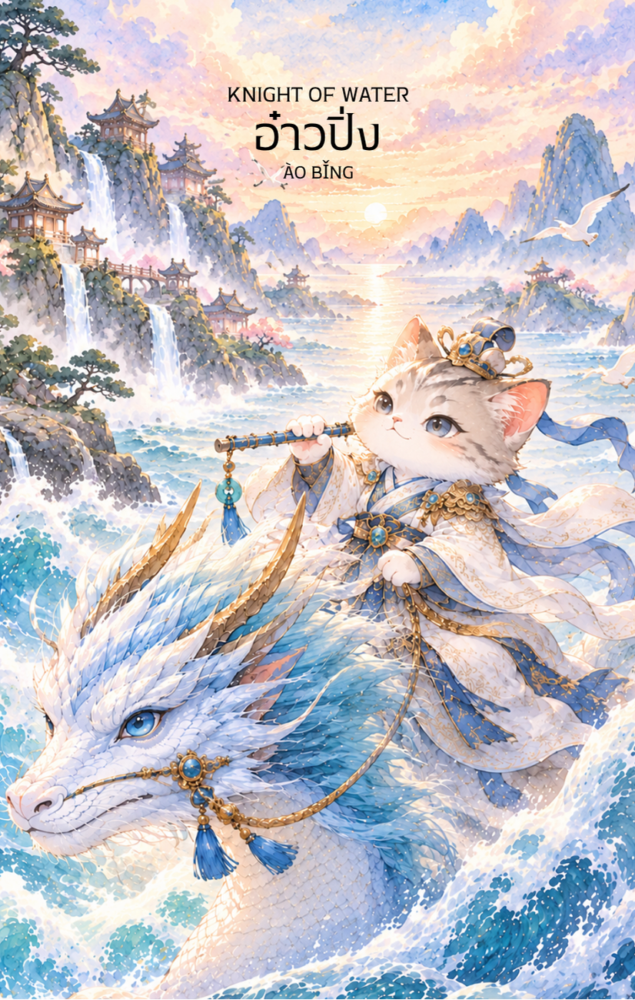

# Water 12 - อ๋าวปิ่ง (Knight of Water)

Created: February 4, 2026 3:46 PM

มาถึงอัศวินผู้งดงามและลึกลับที่สุดในสำรับครับ **Knight of Water** ซึ่งจะเป็นใครไปไม่ได้นอกจาก **อ่าวปิ่ง (Ao Bing)** องค์ชายสามแห่งวังมังกรตะวันออก ผู้เป็นตัวแทนของความสุภาพ สง่างาม และพลังของสายน้ำที่เยือกเย็นแต่ทรงพลัง

---

## **Knight of Water : The Prince of Tides**

### **(อ่าวปิ่ง - Ào Bǐng - 敖丙)**

- **ธาตุประจำตัว:** น้ำ (🜄 Water)
- **คอนเซปต์หลัก:** การทำตามหัวใจ อุดมการณ์ที่งดงาม การเคลื่อนที่ของอารมณ์ และความโรแมนติกที่แฝงด้วยความรับผิดชอบ

---

### **1. แก่นแท้ของตัวละคร (The Essence)**

อ่าวปิ่ง คือภาพลักษณ์ของ **"อัศวินผู้ทรงเสน่ห์" (The Romantic Knight)** ท่านเปรียบเสมือนคลื่นใต้น้ำที่ดูภายนอกสงบนิ่ง แต่ภายในมีความมุ่งมั่นและเปี่ยมด้วยอารมณ์ลึกซึ้ง ต่างจาก Knight of Fire (หงอคง) ที่บุกตะลุยด้วยโทสะ อ่าวปิ่งจะเคลื่อนไหวด้วย **"แรงบันดาลใจ"** ท่านคือผู้ที่นำพาความรู้สึกไปสู่จุดหมาย และเป็นตัวแทนของคนที่ยอมทำทุกอย่างเพื่อปกป้องสิ่งที่ตนรักหรืออุดมการณ์ที่ยึดถือ

### **2. สัญลักษณ์และปรัชญา (Symbolism & Philosophy)**

- **กระบองคู่หรือคทาเยือกเย็น:** สัญลักษณ์ของความสามารถในการควบคุมอารมณ์ให้กลายเป็นพลังที่จับต้องได้ (น้ำที่กลายเป็นน้ำแข็ง) สื่อถึงความเข้มแข็งที่มาพร้อมกับความอ่อนช้อย
- **ชุดเกราะเกล็ดมังกรสีขาวเงิน:** สื่อถึงชาติกำเนิดที่สูงส่งและการปกป้องตนเองจากความวุ่นวายภายนอกด้วยความสงบ
- **เกลียวคลื่นหรือมังกรวารี:** สื่อถึงการเดินทางของจิตวิญญาณ และการไม่หยุดนิ่งของความรู้สึก

### **3. กลยุทธ์เมื่อปรากฏไพ่ใบนี้ (The Strategy)**

**"ขับเคลื่อนด้วยความรัก นำทางด้วยความฝัน และงดงามในทุกย่างก้าว"**

- **Follow Your Heart (จงทำตามเสียงหัวใจ):** หากคุณกำลังลังเลระหว่างเหตุผลและความรู้สึก ไพ่ใบนี้บอกให้คุณลองเชื่อในสิ่งที่ใจรักดูสักครั้ง ความหลงใหล (Passion) ที่ละเมียดละไมจะนำคุณไปสู่ความสำเร็จ
- **Diplomacy & Grace (ใช้ความนุ่มนวลสยบความแข็งกร้าว):** ในการเจรจาหรือการทำงาน อย่าใช้กำลังเข้าหักหาญ แต่จงใช้ความสุภาพและเสน่ห์ส่วนตัวในการโน้มน้าวใจผู้อื่น
- **Dream Big (กล้าที่จะฝัน):** อย่ากักขังจินตนาการของตัวเองไว้ใต้ก้นบึ้งมหาสมุทร จงปล่อยให้มันไหลออกมาเป็นผลงานหรือความคิดสร้างสรรค์

### **4. คำแนะนำและการทำนาย (Reading Guidance)**

- **ภาพรวมของไพ่ใบนี้:** เป็นไพ่แห่ง "ข่าวดีเรื่องความรู้สึก" หรือการมาถึงของใครบางคนที่นำแรงบันดาลใจมาให้ คุณอาจจะได้รับข้อเสนอที่น่าประทับใจ หรือมีโอกาสได้เดินทางไปในที่ที่ทำให้จิตใจสงบและสดชื่น
- **การงาน/ธุรกิจ:** งานที่เกี่ยวข้องกับศิลปะ การออกแบบ การทูต หรือธุรกิจที่ต้องใช้จินตนาการจะรุ่งเรืองมาก คุณจะได้รับคำชมในเรื่องของรสนิยมและความละเอียดรอบคอบในการทำงาน
- **การเงิน:** การเงินไหลเวียนดี แต่อาจมีเกณฑ์เสียเงินไปกับสิ่งที่ให้ความสุขทางใจ ของสวยงาม หรือความรื่นรมย์ในชีวิต ควรระวังการใช้จ่ายตามอารมณ์ชั่ววูบ
- **ความรัก:** โดดเด่นที่สุด! มีเกณฑ์พบคนที่ "ใช่" ในอุดมคติ เป็นความสัมพันธ์ที่ดูราวกับเทพนิยาย อ่อนหวานและให้เกียรติกัน คนมีคู่จะมีการแสดงออกถึงความรักที่ลึกซึ้งและโรแมนติกขึ้น
- **สุขภาพ:** สุขภาพดีเยี่ยม แต่ควรระวังเรื่องของอารมณ์ที่อ่อนไหวง่ายเกินไปจนนำไปสู่ความเศร้าหรือคิดมาก (Melancholy)
5. **บุคลิกของคนที่เป็นตัวแทนไพ่**

เป็นคนสุภาพ อ่อนไหว มีเสน่ห์ และขับเคลื่อนด้วยอุดมการณ์หรือความรู้สึกที่จริงใจ กล้าออกเดินทางตามสิ่งที่รักและปกป้องคนสำคัญ ระวังการเพ้อฝันหรือปล่อยให้อารมณ์นำการตัดสินใจมากเกินไป

6. **อาชีพที่พบได้บ่อย**

ศิลปิน นักออกแบบ นักการทูต นักเดินทาง ผู้ให้คำปรึกษา นักสร้างสรรค์ และงานที่ต้องใช้ความรู้สึกละเอียดอ่อน การสื่อสารอย่างนุ่มนวล หรือจินตนาการ

7. **Key Affirmation:** "ฉันขับเคลื่อนชีวิตด้วยแรงบันดาลใจที่บริสุทธิ์ และความรักคือพลังที่ยิ่งใหญ่ที่สุดของฉัน"

8. **Keyword**

แรงบันดาลใจ • ความโรแมนติก • อุดมการณ์ • ความสุภาพ • การเดินทาง • Inspiration • Romance • Idealism • Diplomacy • Emotional Movement

9. **ประวัติตัวละครและตำนานที่เกี่ยวข้อง**

อ่าวปิ่ง (敖丙) เป็นองค์ชายมังกรในตำนานและวรรณกรรมจีนที่เกี่ยวข้องกับเทพนาจา เรื่องเล่าร่วมสมัยหลายฉบับนำเสนอเขาในฐานะผู้มีเกียรติและมีความรับผิดชอบต่อวังมังกร ความสัมพันธ์กับนาจาสะท้อนความขัดแย้งระหว่างหน้าที่เดิมกับการเลือกเส้นทางของตนเอง

---

### **Visual Concept สำหรับการจดจำ:**

- **ภาพ:** อ่าวปิ่งในรูปลักษณ์บุรุษหนุ่มรูปงามที่มีรัศมีแห่งความสูงส่ง มีเขามังกรสีขาวประดุจหยก สวมชุดเกราะเกล็ดมังกรสีฟ้าครามพริ้วไหว
- **ท่าทาง:** กำลังยืนอยู่อย่างสง่างามบนยอดเกลียวคลื่นที่ม้วนตัวขึ้นมา มือข้างหนึ่งถือคทาที่มีประกายหิมะ อีกข้างหนึ่งดูเหมือนกำลังเรียกมังกรน้ำขึ้นมาจากสมุทร
- **ฉากหลัง:** มหาสมุทรสีลึกที่ดูเย็นตา มีแสงดาวสะท้อนบนผิวน้ำ และเมฆหมอกจางๆ
- **พื้นที่:** เว้นที่ว่างด้านบน 1/3 เช่นเดิมครับ