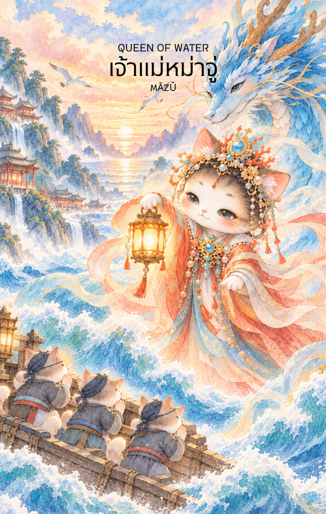

# Water 13 - เจ้าแม่หมาจู่ (Queen of Water)

Created: February 4, 2026 3:48 PM

### **Queen of Water : The Divine Navigator**

### **(หม่าจู้ - Māzǔ - 媽祖)**

- **ธาตุประจำตัว:** น้ำ (🜄 Water)
- **คอนเซปต์หลัก:** ความเมตตาที่ปกป้องคุ้มครอง การนำทางผ่านมรสุมชีวิต และความนิ่งสงบทางจิตใจ

---

### **1. แก่นแท้ของตัวละคร (The Essence)**

หากอ่าวปิ่ง (Knight) คือการเคลื่อนที่ไปตามความฝัน **หม่าจู้ (Queen)** คือการเป็น **"ที่พักพิง"** และ **"ผู้นำทาง"** ท่านคือพลังแห่งการเยียวยาและการดูแลที่อ่อนโยนที่สุดในสำรับ พลังของท่านเปรียบเสมือนน้ำนิ่งที่ลึกเกินหยั่ง เป็นตัวแทนของผู้ที่มีวุฒิภาวะทางอารมณ์สูง สามารถโอบอุ้มความทุกข์ของผู้อื่นและเปลี่ยนให้กลายเป็นความสงบได้ การปรากฏของไพ่ใบนี้สื่อถึงการมีสติท่ามกลางความวุ่นวาย

### **2. สัญลักษณ์และปรัชญา (Symbolism & Philosophy)**

- **โคมไฟหรือดวงประทีปส่องทาง:** สัญลักษณ์ของการมอบความหวังและทางออกในยามมืดมน สื่อถึง "ปัญญาญาณ" ที่นำพาเราออกจากวิกฤตอารมณ์
- **ฉลองพระองค์สีแดงปนฟ้า:** แม้เป็นธาตุน้ำ แต่หม่าจู้มักถูกจดจำในชุดสีแดง (สีแห่งการช่วยชีวิต) สื่อถึงความเมตตาที่กระตือรือร้นและการปกป้องที่ทรงพลัง
- **มหาสมุทรที่สงบนิ่ง:** สื่อถึงจิตใจที่ฝึกฝนมาดีแล้ว จนไม่มีพายุใดๆ มาทำลายความสงบภายในได้

### **3. กลยุทธ์เมื่อปรากฏไพ่ใบนี้ (The Strategy)**

**"จงเป็นประทีปให้ตัวเองและผู้อื่น สงบนิ่งเพื่อมองเห็นทางออก"**

- **Emotional Resilience (ความยืดหยุ่นทางใจ):** ไม่ว่าสถานการณ์รอบตัวจะถาโถมแค่ไหน จงรักษาความสงบภายในไว้ คุณคือผู้ที่คุมเกมอารมณ์ได้ดีที่สุดในตอนนี้
- **Be a Guiding Light (เป็นที่ปรึกษา):** ตอนนี้บารมีและความเมตตาของคุณสูงมาก การให้คำแนะนำหรือการช่วยเหลือผู้อื่นจะย้อนกลับมาส่งเสริมตัวคุณอย่างมหาศาล
- **Compassionate Boundaries (เมตตาอย่างมีขอบเขต):** ช่วยเหลือผู้อื่นได้ แต่อย่าปล่อยให้ความทุกข์ของคนอื่นมาทำให้ "น้ำ" ในใจคุณขุ่นมัว

### **4. คำแนะนำและการทำนาย (Reading Guidance)**

- **ภาพรวมของไพ่ใบนี้:** เป็นไพ่ที่บอกถึงความปลอดภัยและการได้รับการคุ้มครอง หากคุณกำลังเผชิญปัญหา คุณจะพบทางออกหรือมีคนขี่ม้าขาว (หรือล่องเรือ) มาช่วยคุณได้ทันเวลา
- **การงาน/ธุรกิจ:** งานด้านการบริการ สาธารณสุข จิตวิทยา หรือการขนส่งจะโดดเด่นมาก คุณเป็นผู้นำที่ลูกน้องรักเพราะคุณดูแลเขาด้วยใจมากกว่าอำนาจ
- **การเงิน:** การเงินมีความมั่นคงแบบค่อยเป็นค่อยไป มักได้ลาภจากการเดินทางหรือการทำบุญให้ทาน เป็นช่วงที่เงินทองไหลเวียนสะดวกเพราะใจที่เปิดกว้าง
- **ความรัก:** เป็นความรักที่เปี่ยมด้วยความเข้าใจและการอภัย คู่ครองคือที่พักใจที่ดีที่สุด หากโสดมีเกณฑ์พบรักกับคนที่มีวุฒิภาวะสูงหรือพบกันระหว่างการเดินทาง
- **สุขภาพ:** ระวังเรื่องที่เกี่ยวกับระบบไหลเวียนโลหิต หรือความเครียดที่เก็บไว้ในใจจนแสดงออกทางร่างกาย (Psychosomatic) ควรทำสมาธิหรืออยู่ใกล้แหล่งน้ำเพื่อบำบัด
5. **บุคลิกของคนที่เป็นตัวแทนไพ่**

เป็นคนมีเมตตา ใจเย็น และคอยชี้แนะแนวทางให้ผู้อื่นได้ดี มีวุฒิภาวะทางอารมณ์และไม่ตื่นตระหนกง่าย ระวังการรับปัญหาของทุกคนมาเป็นของตนจนหมดแรง

6. **อาชีพที่พบได้บ่อย**

ผู้ให้คำปรึกษา นักบำบัด แพทย์หรือพยาบาล ผู้จัดการทีม นักเดินเรือ เจ้าหน้าที่ช่วยเหลือฉุกเฉิน และงานที่ต้องดูแลหรือแนะนำผู้คนผ่านสถานการณ์ยากลำบาก

7. **Key Affirmation:** "ฉันคือประทีปกลางมหาสมุทร ฉันนำทางชีวิตด้วยความรักและความสงบอันเป็นนิรันดร์"

8. **Keyword**

ความเมตตา • การคุ้มครอง • การนำทาง • ความสงบ • ความเข้มแข็งทางใจ • Compassion • Protection • Guidance • Serenity • Emotional Resilience

9. **ประวัติเทพเจ้าและคติที่เกี่ยวข้อง**

หม่าจู้ (媽祖) เป็นเทพีแห่งท้องทะเลที่ได้รับการเคารพอย่างกว้างขวางในชุมชนจีนและผู้เดินเรือ เดิมมีเรื่องเล่าเชื่อมโยงกับหญิงผู้มีความสามารถช่วยเหลือชาวเรือ ก่อนจะได้รับการยกย่องเป็นเทพผู้คุ้มครองการเดินทางและประทานความปลอดภัยกลางทะเล

---

### **Visual Concept สำหรับการจดจำ:**

- **ภาพ:** เทวีหม่าจู้ในชุดฉลองพระองค์สีแดงสง่างามตัดกับผ้าคลุมสีฟ้า ประทับยืนอยู่เหนือเกลียวคลื่นที่ดูนุ่มนวล
- **จุดเด่น:** ในหัตถ์ถือโคมไฟโบราณที่ส่องแสงสีนวลตา ท่ามกลางบรรยากาศทะเลตอนกลางคืนที่เห็นดวงดาวพราวระยับ
- **บริวาร:** อาจมีภาพลางๆ ของมังกรวารีหรือนกนางนวลที่บินวนเวียนสื่อถึงความปลอดภัย
- **พื้นที่:** เว้นพื้นที่ว่างด้านบน 1/3 เพื่อความสวยงามของไพ่ครับ