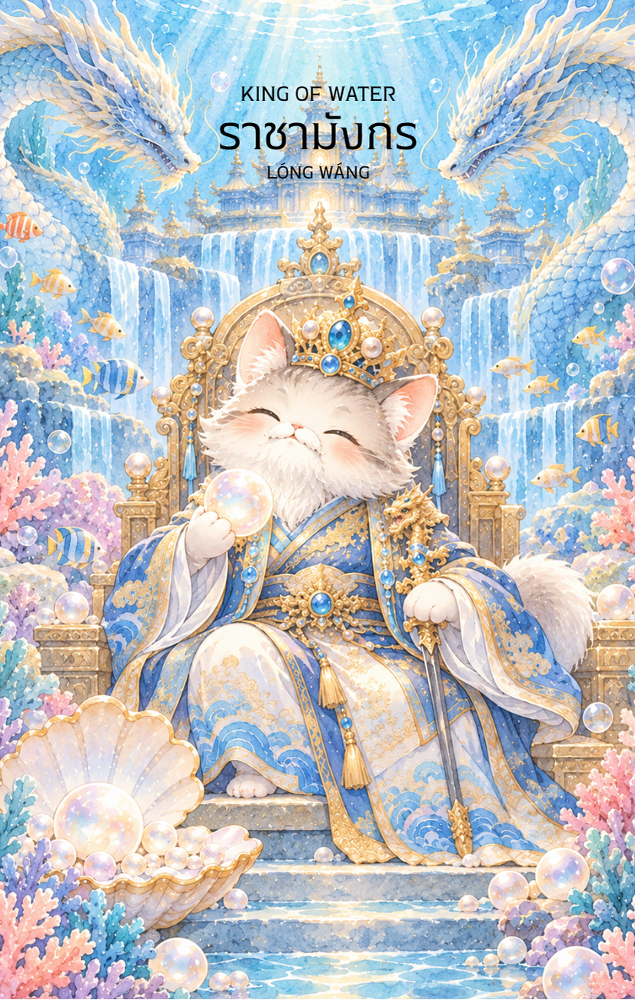

# Water 14 - ราชามังกร (King of Water)

Created: February 4, 2026 3:50 PM

### **Water 14 - ราชามังกร (King of Water)**

### **(จ้าวมังกรสมุทรทั้งสี่ - Sì Hǎi Lóng Wáng - 四海龍王)**

- **ธาตุประจำตัว:** น้ำ (🜄 Water)
- **คอนเซปต์หลัก:** มาสเตอร์แห่งอารมณ์ (Emotional Mastery) อำนาจที่นิ่งสงบ ความรับผิดชอบที่ยิ่งใหญ่ และความหยั่งรู้ลึกซึ้ง

ชื่อและคำบรรยายตาม Reference: ราชามังกร (龍王) — ผู้ครองมหาสมุทร ปกครองด้วยปัญญาและเมตตา

พลังหลักตาม Reference: ปัญญาและวุฒิภาวะทางอารมณ์

หมวดไพ่ตาม Reference: Court Card • Water Suit

คำคมจาก Reference: “มหาสมุทรมิได้ยิ่งใหญ่เพราะคลื่นที่รุนแรง แต่ยิ่งใหญ่เพราะความลึกที่สงบนิ่ง”

---

### **1. แก่นแท้ของตัวละคร (The Essence)**

หาก Queen (หม่าจู้) คือความเมตตาที่ช่วยชีวิต **King of Water** คือ **"อำนาจสิทธิ์ขาดเหนือความรู้สึก"** ท่านคือผู้ที่นั่งอยู่บนบัลลังก์ในวังคริสตัลใต้ก้นบึ้งมหาสมุทร ที่ซึ่งน้ำนิ่งที่สุดและกดดันที่สุด ท่านเป็นตัวแทนของคนที่มีโลกภายในกว้างขวางและลึกซึ้งเกินกว่าใครจะคาดเดาได้ เป็นผู้นำที่ใช้ "ความฉลาดทางอารมณ์" (EQ) ในการปกครองคน ไม่ใช่การบังคับ แต่เป็นการทำให้ยอมรับด้วยบารมีที่เย็นเยือกและมั่นคง

### **2. สัญลักษณ์และปรัชญา (Symbolism & Philosophy)**

- **มุกมังกร (The Dragon Pearl):** สัญลักษณ์ของการควบคุมโชคชะตาและการบันดาลฝนฟ้า สื่อถึงการมีอำนาจเหนือสถานการณ์ที่แปรปรวน
- **วังคริสตัล (Crystal Palace):** ความมั่นคงท่ามกลางความลื่นไหล สื่อถึงการสร้างอาณาจักรหรือรากฐานที่แข็งแกร่งบนโลกแห่งอารมณ์และจินตนาการ
- **ฉลองพระองค์ลายมังกรห้าเล็บ:** สื่อถึงความเป็นที่สุดและกฎระเบียบของธรรมชาติที่ไม่มีใครฝ่าฝืนได้

### **3. กลยุทธ์เมื่อปรากฏไพ่ใบนี้ (The Strategy)**

**"จงนิ่งดั่งก้นมหาสมุทร แต่ทรงพลังดั่งคลื่นยักษ์เมื่อถึงเวลา"**

- **Emotional Maturity (วุฒิภาวะทางอารมณ์):** นี่คือเวลาที่คุณต้องทำตัวเป็นผู้ใหญ่ที่สุดในห้อง อย่าให้อารมณ์ชั่ววูบมาทำลายแผนการใหญ่ ความนิ่งจะทำให้คุณดูน่าเกรงขาม
- **Deep Insight (มองให้ถึงก้นบึ้ง):** อย่ามองแค่สิ่งที่ปรากฏบนผิวน้ำ จงใช้สัญชาตญาณและประสบการณ์วิเคราะห์ถึงรากเหง้าของปัญหา แล้วคุณจะพบทางแก้ไขที่ยั่งยืน
- **Generous Authority (ใช้อำนาจด้วยความโอบอ้อม):** ปกครองและจัดการสิ่งต่างๆ ด้วยความเข้าใจในธรรมชาติของมนุษย์ ยิ่งคุณเข้าใจใจคน คุณจะยิ่งคุมสถานการณ์ได้เบ็ดเสร็จ

### **4. คำแนะนำและการทำนาย (Reading Guidance)**

- **ภาพรวมของไพ่ใบนี้:** เป็นไพ่แห่งความสำเร็จขั้นสูงสุดในด้านความสัมพันธ์และการจัดการอารมณ์ คุณจะได้รับความเคารพในฐานะผู้นำที่มีเมตตาและมีความคิดลึกซึ้ง สถานการณ์ที่เคยวุ่นวายจะถูกจัดระเบียบได้ด้วยบารมีของคุณ
- **การงาน/ธุรกิจ:** โดดเด่นในงานบริหารระดับสูง งานที่ต้องใช้การเจรจาต่อรองขั้นสูง หรือธุรกิจที่เกี่ยวกับน้ำ การติดต่อต่างประเทศ และศิลปวัฒนธรรม คุณคือ "พลาธิการ" ที่ยอดเยี่ยม
- **การเงิน:** มีความมั่งคั่งที่มั่นคงและยั่งยืน (เหมือนขุมทรัพย์ในวังมังกร) มีเกณฑ์ได้รับผลกำไรจากการลงทุนที่ใช้สัญชาตญาณร่วมกับข้อมูลที่แม่นยำ
- **ความรัก:** เป็นความสัมพันธ์ที่ลึกซึ้งและมั่นคงที่สุด คู่ครองเป็นคนที่พึ่งพาได้ เป็นผู้นำครอบครัวที่ยอดเยี่ยมและให้เกียรติคนรักเสมอ
- **สุขภาพ:** แข็งแรงดี แต่อาจต้องระวังเรื่องที่เกี่ยวกับระบบไหลเวียนโลหิตหรือไต (ตามหลักธาตุจีน) ควรดื่มน้ำสะอาดให้เพียงพอ
5. **บุคลิกของคนที่เป็นตัวแทนไพ่**

เป็นคนสุขุม ลึกซึ้ง และเข้าใจความรู้สึกของตนเองกับผู้อื่นได้ดี มักรับบทผู้นำที่มั่นคงในสถานการณ์ซับซ้อน ระวังเก็บอารมณ์จนห่างเหินหรือใช้อำนาจโดยไม่สื่อสารความต้องการให้ชัดเจน

6. **อาชีพที่พบได้บ่อย**

ผู้บริหาร นักเจรจา นักการทูต นักจิตวิทยา ผู้ดูแลกิจการทางน้ำ ผู้จัดการความเสี่ยง และงานที่ต้องใช้วุฒิภาวะทางอารมณ์หรือความเข้าใจเชิงลึก

7. **Key Affirmation:** "ฉันคือมาสเตอร์เหนืออารมณ์ของตนเอง ฉันปกครองชีวิตด้วยความสงบและปัญญาอันลึกซึ้ง"

8. **Keyword**

วุฒิภาวะ • การควบคุมอารมณ์ • ปัญญาลึกซึ้ง • อำนาจ • ความสงบ • Emotional Mastery • Depth • Authority • Composure • Leadership • Wisdom • Compassion

9. **ประวัติเทพเจ้าและตำนานที่เกี่ยวข้อง**

จ้าวมังกรสมุทรทั้งสี่ (四海龍王) เป็นเทพมังกรผู้ปกครองทะเลทั้งสี่ทิศในคติจีน เชื่อมโยงกับฝน น้ำ และความอุดมสมบูรณ์ เรื่องเล่ามักกล่าวถึงวังมังกรใต้ทะเลและอำนาจควบคุมสายน้ำ ซึ่งสะท้อนพลังที่ลึกซึ้งและรับผิดชอบต่อความสมดุลของโลก

---

### **Visual Concept สำหรับการจดจำ:**

- **ภาพ:** พญามังกรในร่างมนุษย์ผู้ทรงอำนาจ (มักเน้นไปที่ **ตงไห่หลงหวัง - อาโอกวง**) ประทับบนบัลลังก์ปะการังและหยกภายในวังคริสตัลใต้สมุทร
- **จุดเด่น:** รัศมีรอบกายเป็นแสงสีฟ้าน้ำทะเลลึก ในหัตถ์ถือคทามุกมังกรที่เปล่งแสงนวล รอบบัลลังก์มีมังกรวารีสี่ตัว (ตัวแทนสี่คาบสมุทร) วนเวียนอยู่
- **บรรยากาศ:** ดูขรึม ขลัง อลังการ และเยือกเย็น
- **พื้นที่:** เว้นพื้นที่ว่างด้านบน 1/3 เพื่อความสม่ำเสมอของชุดไพ่ครับ