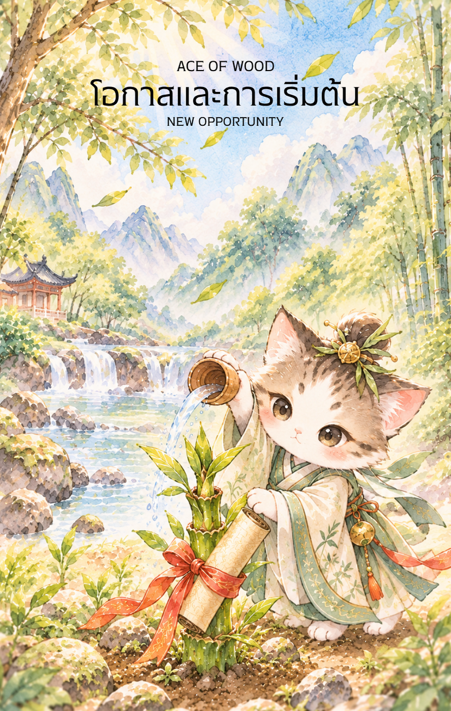

# Wood 1 - โอกาสและการเริ่มต้น (Ace of Wood)

Created: February 4, 2026 6:00 PM

### **ชื่อไพ่: โอกาสและการเติบโต (Opportunity and Growth)**

**ธาตุประจำตัว:** ไม้ (🌳 Wood)
**คอนเซปต์หลัก:** การหยั่งรากทางปัญญา การได้รับโอกาสจากเบื้องบน และความเพียรที่นำไปสู่ความสำเร็จที่ยั่งยืน

### **1. แก่นแท้ของตัวละคร (The Essence)**

ไพ่ใบนี้เปรียบเสมือนพลังของ **"เจี๋ยไม้" (甲木)** หรือไม้ใหญ่ในสภาวะเริ่มต้น คือความมุ่งมั่นที่จะแทรกตัวจากดินขึ้นสู่ท้องฟ้า พลังของเด็กน้อยในภาพสื่อถึงจิตใจที่บริสุทธิ์และพร้อมที่จะเรียนรู้ (Open Mindset) ขณะที่หัตถ์สวรรค์คือแรงสนับสนุนจากภายนอกหรือผู้ใหญ่ (Mentors) ที่เข้ามาในจังหวะที่เหมาะสมที่สุดเพื่อประสิทธิ์ประสาทพรและปัญญา

### **2. สัญลักษณ์และปรัชญา (Symbolism & Philosophy)**

- **หัตถ์เทวะและไอทิพย์สีเขียว:** สื่อถึง "เทียนสือ" (Tianshi) หรือโอกาสจากสวรรค์และจังหวะเวลาที่ถูกต้อง เมื่อคุณเตรียมตัวพร้อม สิ่งศักดิ์สิทธิ์หรือโอกาสใหญ่จะหยิบยื่นมาให้เอง
- **หน่อไม้ทิพย์:** ตัวแทนของศักยภาพที่ซ่อนอยู่ภายใน (Potential) แม้ตอนนี้จะดูเล็กแต่มันคือจุดเริ่มต้นของต้นไผ่ที่แข็งแกร่งและยืดหยุ่นที่สุด
- **คัมภีร์ไม้ไผ่ผูกโบว์แดง:** คือ "ขุมทรัพย์แห่งความรู้" หรือกลยุทธ์ที่ต้องศึกษา การเติบโตโดยไม่มีความรู้คือความเสี่ยง แต่การเติบโตพร้อมคัมภีร์คือความมั่นคงมั่งคั่ง
- **ภูเขาและสายหมอก:** สื่อถึงเป้าหมายที่ยิ่งใหญ่ในอนาคตที่ยังต้องใช้ความพยายามเดินทางไปถึง แต่เป็นเส้นทางที่เต็มไปด้วยความสงบและมงคล

### **3. กลยุทธ์เมื่อปรากฏไพ่ใบนี้ (The Strategy)**

> **"ช้าคือเร็ว หยั่งรากให้ลึกก่อนพุ่งทะยาน"**
> 
- **การเตรียมพร้อม (Preparation):** อย่าเพิ่งรีบร้อนออกตัวแรงหากยังไม่อ่าน "คัมภีร์" หรือศึกษาข้อมูลให้รอบด้าน ช่วงนี้คือการสะสมบารมีและความรู้
- **นอบน้อมต่อโอกาส (Be Coachable):** เปิดใจรับคำแนะนำจากผู้ใหญ่หรือผู้เชี่ยวชาญ พรจากสวรรค์มักมาในรูปของคำสอนหรือมิตรภาพใหม่ๆ
- **ความสม่ำเสมอ (Consistency):** พลังธาตุไม้คือการเติบโตทีละน้อยแต่ไม่เคยหยุดนิ่ง จงรักษาวินัยในการลงมือทำเหมือนการรดน้ำพรวนดินทุกวัน

### **4. คำแนะนำและการทำนาย (Reading Guidance)**

- **ภาพรวมของไพ่ใบนี้:** เป็นสัญญาณที่ดีมากสำหรับการเริ่มต้นใหม่ มีเกณฑ์จะได้รับข่าวดีหรือโอกาสสำคัญที่รอคอยมานาน สิ่งที่ลงแรงไปกำลังจะผลิบาน
- **การงาน/ธุรกิจ:** หากคิดจะเริ่มโครงการใหม่หรือเปลี่ยนงาน นี่คือจังหวะที่ "ฟ้าเปิด" มีผู้ใหญ่คอยหนุนหลัง (Gui Ren) ให้เน้นการวางรากฐานโครงสร้างให้แน่นก่อนขยายตัว
- **การเงิน:** รายได้จะค่อยๆ เพิ่มขึ้นตามความสามารถ (Organic Growth) เป็นช่วงที่เหมาะกับการลงทุนระยะยาว หรือลงทุนในความรู้เพื่อเพิ่มมูลค่าให้ตัวเองในอนาคต
- **ความรัก:** เริ่มต้นด้วยความจริงใจและเรียบง่ายเหมือนเด็กน้อย เป็นความสัมพันธ์ที่ค่อยๆ เติบโตอย่างเป็นธรรมชาติและมีความเข้าใจกันเป็นรากฐาน
- **สุขภาพ:** แข็งแรงและเต็มไปด้วยพลังงานชีวิต ระวังเพียงเรื่องกล้ามเนื้อหรือเส้นเอ็น (ธาตุไม้) ควรยืดเหยียดร่างกายบ่อยๆ เหมือนต้นไผ่ที่โอนอ่อนตามลม

**Key Affirmation:** "ฉันพร้อมรับโอกาสที่งดงาม และจะเติบโตอย่างมั่นคงด้วยปัญญาและความเพียร"

---

---

---

---

---

---

---

---

—

นี่คือข้อมูลสำหรับใส่ลงในคู่มือของไพ่ **1 ไม้ (Ace of Wood)** ที่ปรับปรุงให้สอดคล้องกับภาพล่าสุด ซึ่งเน้นเรื่องราวของมนุษย์ (บัณฑิต) ที่มีแรงเกื้อหนุนจากสวรรค์ (เงาเทพอุปถัมภ์) ครับ

---

## **1 ไม้ (Ace of Wood) : The Scholarly Sprout**

**ธาตุประจำตัว:** ไม้ (🌲 Wood)

**คอนเซปต์หลัก:** รุ่งอรุณแห่งปัญญา โอกาสที่ฟ้าประทาน และการเริ่มต้นจารึกบทใหม่ของชีวิตภายใต้การคุ้มครองจากเบื้องบน

### **1. แก่นแท้ของตัวละคร (The Essence)**

**1 ไม้** คือภาพของ **"บัณฑิตหนุ่ม"** ผู้เปี่ยมความเพียร นั่งอยู่ท่ามกลางแสงแรกของวัน แววตามุ่งมั่นสะท้อนถึงปัญญาที่พร้อมจะผลิบาน แต่สิ่งที่ทำให้ไพ่ใบนี้พิเศษกว่าความขยันทั่วไปคือ **"เงาแห่งมังกรเขียว (Azure Dragon)"** ที่ซ่อนตัวอยู่ในม่านหมอกด้านหลัง แก่นแท้ของไพ่ใบนี้คือการบรรจบกันของ **"ความสามารถของมนุษย์"** และ **"จังหวะของสวรรค์"** มันคือนาทีที่โอกาสระดับเปลี่ยนชีวิตวิ่งเข้ามาหาผู้ที่เตรียมตัวมาพร้อมที่สุด

---

### **2. สัญลักษณ์และปรัชญา (Symbolism & Philosophy)**

- **พู่กันและม้วนกระดาษเปล่า (The Infinite Scroll):** สื่อถึงหน้ากระดาษชีวิตที่ยังไม่ได้ถูกเขียน ปรัชญาของ "จิตใจที่ว่างเปล่า" (Beginner's Mind) ที่ปราศจากอคติ พร้อมจะบันทึกวิชาความรู้และสร้างประวัติศาสตร์ใหม่ของตนเอง
- **หน่อไม้เขียว (The Bamboo Sprout):** สัญลักษณ์ของความซื่อตรง ยืดหยุ่น และการเติบโตที่ก้าวกระโดด หน่อไม้ที่เพิ่งแทงยอดสื่อว่าแผนการหรือการเรียนนี้มีรากฐานที่แข็งแรงพอจะเติบโตเป็นต้นไผ่ที่สูงเสียดฟ้า
- **เงาพญามังกรในม่านหมอก (The Divine Patronage):** สื่อถึงอำนาจวาสนาและผู้ใหญ่อุปถัมภ์ ปรัชญาที่ว่า "เบื้องหลังความสำเร็จที่ยิ่งใหญ่ มักมีแรงหนุนที่มองไม่เห็น" เป็นสัญญาณว่าคุณไม่ได้สู้เพียงลำพัง
- **หน้าต่างที่เปิดกว้าง (The Open Window):** การเปิดรับโลกทัศน์ใหม่ และการได้รับอิสระในการเลือกทางเดินชีวิต

---

### **3. กลยุทธ์เมื่อปรากฏไพ่ใบนี้ (The Strategy)**

> *"เมื่อฟ้าเปิดทางและใจพร้อม พู่กันในมือย่อมเนรมิตโลกได้ทั้งใบ"*
> 
- **The Heaven's Alignment (กลยุทธ์สอดประสานฟ้าดิน):** เมื่อเห็นโอกาสตรงหน้ราะนี่คือช่วงที่ "ดวง" และ "ความสามารถ" มาเจอกันพอดี จงใช้ความตื่นเต้นนี้เป็นเชื้อเพลิงในการเริ่มต้นทันที
- **Scholar’s Humility (กลยุทธ์บัณฑิตผู้อ่อนน้อม):** แม้จะมีเทพอุปถัมภ์ แต่จงรักษากิริยาที่ใฝ่เรียนรู้ การวางตัวเป็น "น้ำไม่เต็มแก้ว" จะดึงดูดให้ผู้ใหญ่และผู้มีอำนาจ (มังกร) เอ็นดูและสนับสนุนคุณมากขึ้นไปอีก
- **Focus on the First Stroke (กลยุทธ์จารึกเส้นแรก):** อย่าเพิ่งกังวลถึงตอนจบของตำรา ให้โฟกัสที่การ "ลงมือทำ" ก้าวแรกให้ดีที่สุด เส้นสายที่มั่นคงในตอนเริ่มต้นจะกำหนดทิศทางของความสำเร็จที่เหลือ

---

### **4. คำแนะนำและการทำนาย (Reading Guidance)**

- **ภาพรวมของไพ่ใบนี้:** เป็นสัญญาณมงคลขั้นสูงสุดของการเริ่มต้นใหม่ คุณจะได้รับ "ไฟเขียว" ให้ลุยต่อในสิ่งที่ตั้งใจ มีเกณฑ์จะได้รับข่าวดีหรือโอกาสที่มาพร้อมกับเกียรติยศ
- **การงาน/การเรียน:** สอบติดในที่ที่หวัง ได้รับการตอบรับเข้าทำงาน หรือได้รับมอบหมายโครงการที่มีความสำคัญระดับ "หน้าตาขององค์กร" เป็นช่วงที่สมองปรอดโปร่ง คิดงานสร้างสรรค์ได้ยอดเยี่ยม
- **การเงิน:** พบช่องทางทำเงินใหม่ๆ ที่มั่นคง มีโอกาสได้ลาภลอยจากการสนับสนุนของผู้ใหญ่ หรือได้รับ "ทุน" เพื่อไปต่อยอดความสำเร็จ
- **ความรัก:** การเริ่มต้นความสัมพันธ์ที่เรียบง่ายแต่ทรงพลัง อาจพบรักในที่เรียนหรือที่ทำงาน เป็นคนที่ช่วยส่งเสริมเรื่องการงานและสติปัญญาซึ่งกันและกัน
- **สุขภาพ:** สุขภาพแข็งแรง พลังชีวิตพุ่งพล่านเหมือนหน่อไม้ผลิใบ แต่อาจมีอาการล้าทางสายตาจากการทุ่มเทอ่านเขียน ให้หาเวลาพักผ่อนมองสีเขียวของธรรมชาติบ้าง

---

5. **บุคลิกของคนที่เป็นตัวแทนไพ่**

เป็นคนใฝ่รู้ เปิดรับคำแนะนำ และมีความคิดริเริ่ม พร้อมค่อย ๆ พัฒนาศักยภาพให้เติบโตเป็นรูปธรรม จุดที่ควรระวังคือการรอจังหวะหรือการสนับสนุนจากผู้อื่นมากเกินไปจนไม่เริ่มลงมือด้วยตนเอง

6. **อาชีพที่พบได้บ่อย**

นักศึกษา นักวิจัย ครู ผู้ช่วยงานสร้างสรรค์ นักเขียน ผู้เริ่มต้นธุรกิจ และงานที่เปิดโอกาสให้เรียนรู้ เติบโต และได้รับคำแนะนำจากผู้มีประสบการณ์

7. **Key Affirmation:** "ฉันน้อมรับโอกาสที่ฟ้าประทาน และจะใช้ปัญญาที่มีสร้างสรรค์ความสำเร็จให้งดงามที่สุด"

8. **Keyword**

การเริ่มต้น • ปัญญา • โอกาส • การเรียนรู้ • การเติบโต • New Beginning • Wisdom • Opportunity • Learning • Growth

9. **ที่มาและบริบทของไพ่**

Ace of Wood คือเมล็ดพันธุ์แห่งความรู้และการเติบโต ภาพบัณฑิตกับคัมภีร์และหน่อไม้สื่อถึงศักยภาพที่เพิ่งเริ่มผลิบาน โดยการศึกษา ความเพียร และการเปิดรับคำชี้แนะจะช่วยให้โอกาสแรกนี้หยั่งรากอย่างมั่นคง

---

**ก้าวต่อไป:**

ข้อมูล Ace of Wood พร้อมแล้วครับ! **คุณอยากให้เราไปต่อที่ไพ่ "2 ไม้" เพื่อดูว่าหลังจากเริ่มจารึกกระดาษแผ่นแรกแล้ว บัณฑิตคนนี้จะวางแผนอนาคตอย่างไรต่อไปดีไหมครับ?**