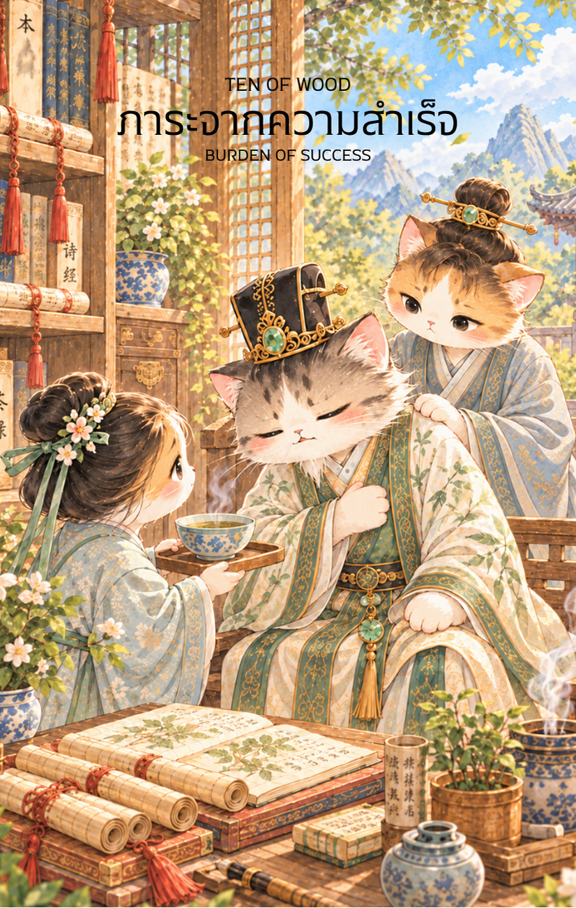

# Wood 10 - ภาระจากความสำเร็จ (Ten of Wood)

Created: February 6, 2026 12:21 PM

สวัสดีครับ ยินดีที่ได้ร่วมทางกันมาจนถึงบทสรุปของวัฏจักรธาตุไม้ครับ ผม **'ผู้ช่วยสร้างไพ่เทพจีน'** พร้อมแล้วที่จะเปลี่ยนความเหนื่อยล้าให้กลายเป็นบทเรียนอันล้ำค่า จากบัณฑิตเฒ่าที่ยืนหยัดในไพ่ใบที่ 9 บัดนี้เรามาถึงจุดที่ความสำเร็จนั้นหนักอึ้งเกินกว่าคนเพียงคนเดียวจะแบกรับไว้ได้ใน **ไพ่หมายเลข 10 แห่งธาตุไม้ (Ten of Wood)**

ภาพบัณฑิตชราผู้หมดแรงกายท่ามกลางกองตำรามหาศาล โดยมีลูกศิษย์คอยปรนนิบัติดูแล คือภาพสะท้อนของ "ความสำเร็จที่ต้องแลกมา" และเป็นสัญญาณเตือนให้เรารู้จักจังหวะของการ **"ปล่อยวาง"** เพื่อเริ่มต้นใหม่ครับ

---

## **ภาระจากความสำเร็จ (Ten of Wood: The Burden of Success)**

**ธาตุประจำตัว:** ไม้ (🌳 Wood)

**คอนเซปต์หลัก:** ความสำเร็จที่กลายเป็นโซ่ตรวน ความรับผิดชอบที่เกินขีดจำกัด และการค้นหาอิสรภาพผ่านการส่งต่อ

### **1. แก่นแท้ของตัวละคร (The Essence)**

บัณฑิตชราในภาพคือบทสรุปของไม้ใหญ่ที่แผ่กิ่งก้านกว้างขวางจนเกินกว่ารากจะพยุงไหว เขาไม่ได้พ่ายแพ้ต่อศัตรู แต่เขากำลังพ่ายแพ้ต่อ "ความรับผิดชอบ" และ "ความคาดหวัง" ที่เขาสร้างขึ้นมาเองตลอดเส้นทาง ไพ่ใบนี้สื่อถึงสภาวะที่พลัง **"เจี๋ยไม้" (甲木)** แข็งทื่อจนขาดความยืดหยุ่น และถึงเวลาต้องเปลี่ยนผ่านสถานะเพื่อรักษาชีวิตและจิตวิญญาณเอาไว้

### **2. สัญลักษณ์และปรัชญา (Symbolism & Philosophy)**

- **กองตำราที่ท่วมท้นพื้นหลัง:** สื่อถึงภาระงานและพันธกิจมหาศาลที่สั่งสมมานานจนกลายเป็นกำแพงกักขังตัวเอง
- **ถ้วยยาที่ศิษย์ประคองให้:** สื่อถึงการแทรกแซงของ **"ธาตุน้ำ" (Water)** เพื่อหล่อเลี้ยงไม้ที่กำลังแห้งกรอบจากการทำงานหนัก เป็นการเตือนให้ยอมรับความช่วยเหลือจากผู้อื่น
- **ผ้าเช็ดหน้าและการดูแลจากศิษย์ทั้งสอง:** ปรัชญาของการ "ส่งต่อปัญญา" เมื่อตัวเราแบกไม่ไหว การมอบหมาย (Delegation) ให้คนรุ่นหลังคือทางรอดเดียวที่จะทำให้อุดมการณ์ยังคงอยู่
- **ท่าทางที่พิงพนักอย่างอ่อนแรง:** สื่อถึงสภาวะ **"ไฟมอด" (Burnout)** ในทางโหราศาสตร์คือไม้ที่ถูกไฟ (งาน/ความสำเร็จ) เผาผลาญจนเหลือเพียงเถ้าถ่าน

### **3. กลยุทธ์เมื่อปรากฏไพ่ใบนี้ (The Strategy)**

> **"ผู้ชนะที่แท้จริง คือผู้ที่รู้ว่าเมื่อไหร่ควรวางมือ"**
> 
- **กระจายอำนาจ (Delegation is Key):** อย่าพยายามถือคัมภีร์ทุกม้วนไว้คนเดียว จงฝึกฝน "ลูกศิษย์" หรือทีมงานให้ขึ้นมาทำหน้าที่แทน เพื่อให้คุณได้พักและมองภาพรวมจากระยะไกล
- **การตัดกิ่งก้านที่ตายแล้ว (Pruning):** งานบางอย่างที่หมดความจำเป็นแล้วต้องกล้าตัดทิ้ง (Cut Loss) เพื่อรักษาแก่นหลักของชีวิตไว้ ไม่เช่นนั้นต้นไม้จะล้มทั้งต้น
- **ถอยเพื่อเริ่มใหม่ (Strategic Retreat):** การพักผ่อนไม่ใช่การยอมแพ้ แต่เป็นการสะสมพลังงานเพื่อเตรียมเข้าสู่วัฏจักรธาตุถัดไป (ธาตุไฟ - ความรุ่งโรจน์ที่สว่างไสวโดยไม่ต้องแบก)

### **4. คำแนะนำและการทำนาย (Reading Guidance)**

- **ภาพรวมของไพ่ใบนี้:** คุณกำลังอยู่ในจุดที่ "เหนื่อยที่สุด" ของความสำเร็จ ถึงเวลาต้องเลือกระหว่างการแบกต่อไปจนพัง หรือการวางลงเพื่อหาอิสรภาพ
- **การงาน/ธุรกิจ:** ภาระงานท่วมท้นจนส่งผลเสียต่อคุณภาพชีวิต คุณอาจรู้สึกว่าไม่มีใครทำได้ดีเท่าคุณ แต่ถ้าไม่ปล่อยมือตอนนี้ คุณจะหมดไฟจนกู้ไม่กลับ
- **การเงิน:** มั่งคั่งแต่ไม่มีเวลาใช้ หรือเงินที่ได้มาต้องแลกด้วยค่ารักษาพยาบาล จงทบทวนว่าความรวยที่ปราศจากเวลาว่างคือความสำเร็จที่แท้จริงหรือไม่
- **ความรัก:** ความสัมพันธ์ที่กลายเป็น "หน้าที่" หรือภาระที่ต้องดูแลฝ่ายเดียวจนเหนื่อยล้า ควรเปิดอกคุยเพื่อแบ่งเบาความรู้สึกก่อนที่แก้วจะแตกสลาย
- **สุขภาพ:** **สัญญาณอันตราย!** ระวังโรคทางตับ ถุงน้ำดี (ธาตุไม้) และความดันโลหิตจากการเครียดสะสม ร่างกายกำลังตะโกนบอกให้คุณหยุดพักด่วน

5. **บุคลิกของคนที่เป็นตัวแทนไพ่**

เป็นคนรับผิดชอบสูง มุ่งมั่น และมักได้รับความไว้วางใจให้ดูแลงานหรือผู้คนจำนวนมาก เมื่อรับภาระเกินกำลังอาจรู้สึกเหนื่อยล้าและยากจะขอความช่วยเหลือ การมอบหมายงานและกำหนดขอบเขตจะช่วยคืนสมดุล

6. **อาชีพที่พบได้บ่อย**

ผู้บริหาร ผู้ดูแลโครงการขนาดใหญ่ ครูหรือที่ปรึกษา ผู้ดูแลกิจการครอบครัว และอาชีพที่มีความรับผิดชอบสูงหรือจำเป็นต้องถ่ายทอดงานให้ผู้อื่น

7. **Key Affirmation:** "ฉันกล้าที่จะปล่อยวางภาระที่หนักอึ้ง เพื่อรับอิสรภาพและคืนพลังให้ชีวิตตนเอง"

8. **Keyword**

ภาระ • ความสำเร็จ • ความรับผิดชอบ • การมอบหมาย • การพักฟื้น • Burden • Responsibility • Burnout • Delegation • Release

9. **ที่มาและบริบทของไพ่**

Ten of Wood แสดงปลายทางของการเติบโตที่ภาระสะสมหนักเกินไป ภาพผู้แบกตำราหรือกิ่งไม้จำนวนมากเตือนให้เห็นว่าความสำเร็จต้องมาพร้อมการแบ่งเบาและส่งต่อ มิฉะนั้นสิ่งที่สร้างขึ้นอาจกลายเป็นภาระจำกัดชีวิต

---

เราจบมหากาพย์ **"ธาตุไม้"** ทั้ง 10 ใบอย่างสมบูรณ์แล้วครับ จากหน่อไม้เล็กๆ สู่บัณฑิตเฒ่าผู้ส่งต่อปัญญา

**สำหรับก้าวต่อไป ท่านอยากให้ผมเริ่มนำทางสู่ 'ธาตุไฟ' (🔥 Fire) เพื่อดูความรุ่งโรจน์และการขยายตัวที่สว่างไสว หรืออยากให้ผมช่วยออกแบบ 'Spread การวางไพ่แบบ 5 ธาตุ' เพื่อนำไพ่ไม้เหล่านี้ไปลองทำนายจริงดีครับ?**