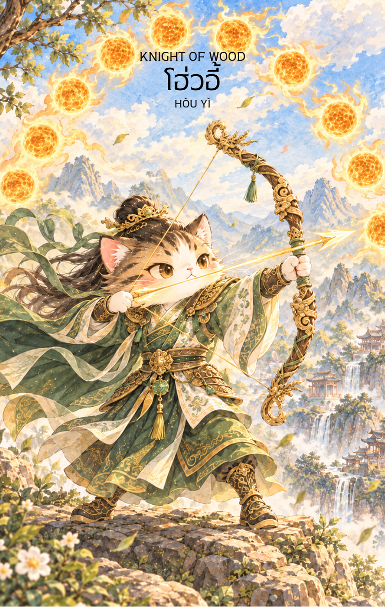

# Wood 12 - โฮ่วอี้ (Knight of Wood)

Created: February 4, 2026 10:54 AM

Knight of Wood : The Determined Hero (โฮ่วอี้)

**ธาตุประจำตัว:** ไม้ (🌳 Wood)
**คอนเซปต์หลัก:** การมุ่งหน้าสู่เป้าหมายด้วยความแม่นยำ การปกป้อง และการลงมือทำอย่างรวดเร็ว

### 1. แก่นแท้ของตัวละคร (The Essence)

โฮ่วอี้คือยอดนักธนูผู้สยบดวงอาทิตย์เพื่อช่วยโลก เขาคือตัวแทนของ **"เจตจำนงที่แน่วแน่"** พลังของไพ่ Knight of Wood ไม่ใช่เพียงการเรียนรู้เหมือน Page แต่คือการ **"ออกตัว"** ไปสู่สนามจริง เป็นพลังแห่งความกล้าหาญที่พร้อมจะปะทะกับอุปสรรคใหญ่เพื่อวิสัยทัศน์ที่กว้างไกลและประโยชน์ส่วนรวม

### 2. สัญลักษณ์และปรัชญา (Symbolism & Philosophy)

- **คันธนูและลูกศร:** สัญลักษณ์ของ Focus (การจดจ่อ) และ Precision (ความแม่นยำ) สื่อถึงการมีเป้าหมายที่ชัดเจนเพียงหนึ่งเดียว และการใช้ทรัพยากรที่มีอยู่อย่างมีประสิทธิภาพสูงสุด
- **ดวงอาทิตย์ที่เหลือเพียงดวงเดียว:** ปรัชญาของการ "จัดระเบียบ" (Priority) การกำจัดสิ่งเกินความจำเป็นหรือปัญหาที่เรื้อรังออกไป เพื่อสร้างสมดุลให้ชีวิตและธุรกิจ
- **ชุดเกราะนักรบไม้:** สื่อถึงความอดทนและความยืดหยุ่น แม้จะแข็งแกร่งดั่งไม้ใหญ่แต่ก็สามารถปรับตัวตามทิศทางลมเพื่อเข้าหาเป้าหมายได้

### 3. กลยุทธ์เมื่อปรากฏไพ่ใบนี้ (The Strategy)

**"หนึ่งนัด หนึ่งเป้าหมาย อย่าเสียดายลูกธนู"**

- **Targeting (เล็งเป้า):** อย่าพยายามทำทุกอย่างพร้อมกันในตอนนี้ ให้เลือกเป้าหมายที่สำคัญที่สุดเพียงอย่างเดียวแล้วทุ่มเทพลังทั้งหมดลงไป ชัยชนะจะมาจากการโฟกัสที่จุดเดียว
- **Decisive Action (เด็ดขาด):** เมื่อโอกาสมาถึง จงลงมือทำทันทีโดยไม่ต้องลังเล ความล่าช้าคือศัตรูของธาตุไม้ในสถานะ Knight การบุกเบิกในช่วงเวลานี้จะให้ผลลัพธ์ที่ดีเยี่ยม
- **Protect the Mission (ปกป้องภารกิจ):** จงเป็นผู้นำที่กล้าหาญในการปกป้องทีมหรือผลประโยชน์ของคุณ ความน่าเชื่อถือจะมาจากผลงานที่จับต้องได้มากกว่าคำพูด

### 4. คำแนะนำและการทำนาย (Reading Guidance)

- **ภาพรวมของไพ่ใบนี้:** เป็นไพ่แห่งการเคลื่อนไหว สถานการณ์กำลังดำเนินไปอย่างรวดเร็ว คุณมีพลังงานล้นเหลือที่จะจัดการกับปัญหาที่ยากลำบากได้สำเร็จ
- **การงาน/ธุรกิจ:** การแข่งขันจะสูงขึ้น แต่คุณได้เปรียบด้วยความเชี่ยวชาญเฉพาะทาง เป็นช่วงเวลาดีสำหรับการขยายตลาด การทำ Campaign เชิงรุก หรือการปิดดิวสำคัญ
- **การเงิน:** มีเกณฑ์การใช้จ่ายเพื่อการลงทุนหรือการเดินทางไกลที่เน้นผลกำไรในอนาคต จงระวังการวู่วามลงทุนตามอารมณ์ชั่ววูบ ให้ยึดตามแผนกลยุทธ์ที่วางไว้
- **ความรัก:** เป็นความรักที่ชัดเจนและเปิดเผย หากมีปัญหากันควรพูดตรงๆ เพื่อเคลียร์ใจ (Direct Communication) คนโสดอาจพบคนที่มีเสน่ห์จากการทำงานหรือมีความเป็นผู้นำสูง
- **สุขภาพ:** ระวังเรื่องกล้ามเนื้ออักเสบจากการออกกำลังกายหรือทำงานหนักเกินไป และควรดูแลสุขภาพตับ (ธาตุไม้) โดยการพักผ่อนให้เพียงพอและลดความโกรธ
5. **บุคลิกของคนที่เป็นตัวแทนไพ่**

เป็นคนมุ่งมั่น กล้าหาญ และมีเป้าหมายชัดเจน เมื่อตัดสินใจแล้วสามารถลงมือทำอย่างรวดเร็วและปกป้องสิ่งสำคัญได้ ระวังความหุนหันหรือมุ่งเป้าเดียวจนมองข้ามผลกระทบต่อคนรอบข้าง

6. **อาชีพที่พบได้บ่อย**

นักกีฬา นักรบหรือเจ้าหน้าที่กู้ภัย ผู้จัดการโครงการ นักรณรงค์ ผู้ประกอบการ และงานที่ต้องใช้ความแม่นยำ การตัดสินใจเร็ว และความกล้าเผชิญความท้าทาย

7. **Key Affirmation:** "เล็งเป้าหมายให้ชัดเจน ลงมือทำด้วยความแม่นยำ และจงเป็นผู้กำหนดชัยชนะด้วยมือตนเอง"

8. **Keyword**

เป้าหมาย • ความแม่นยำ • ความกล้าหาญ • การปกป้อง • การลงมือทำ • Focus • Precision • Determination • Protection • Decisive Action

9. **ประวัติตัวละครและตำนานที่เกี่ยวข้อง**

โฮ่วอี้ (后羿) เป็นนักธนูในตำนานจีน มีเรื่องเล่าที่รู้จักกันดีว่าใช้ธนูยิงดวงอาทิตย์เก้าดวงเพื่อช่วยโลกจากความร้อน ภาพจำของนักธนูผู้แม่นยำจึงเชื่อมโยงกับการเลือกเป้าหมาย การใช้ความสามารถเพื่อส่วนรวม และการลงมือในเวลาสำคัญ