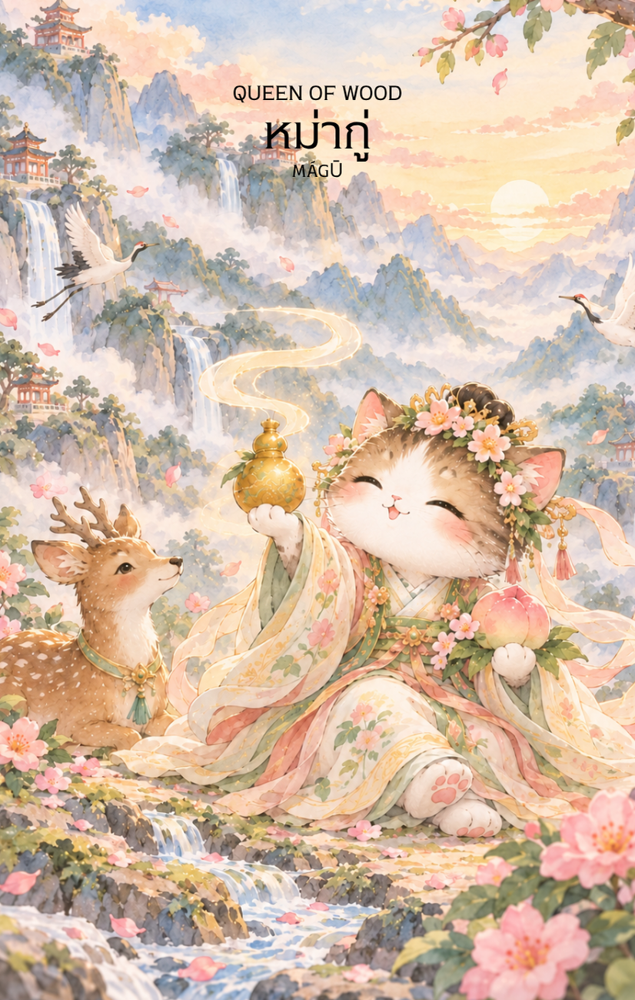

# Wood 13 - หม่ากู่ (Queen of Wood)

Created: February 4, 2026 11:05 AM

Queen of Wood : The Eternal Healer (เทพธิดาหม่ากู่)

**ธาตุประจำตัว:** ไม้ (🌳 Wood - พลังหยิน)
**คอนเซปต์หลัก:** ความเมตตาที่ไร้กาลเวลา การฟื้นฟูเยียวยา และการเติบโตอย่างยั่งยืนจากภายใน

### 1. แก่นแท้ของตัวละคร (The Essence)

เทพธิดาหม่ากู่คือสัญลักษณ์ของ "ความอ่อนเยาว์นิรันดร์" และพลังแห่งการฟื้นฟู หาก Knight of Wood คือการบุกเบิก Queen of Wood คือ **"การบำรุงรักษา"** ท่านคือพลังของไม้ที่อ่อนโยนแต่ทนทาน (Yi Wood) เปรียบเสมือนเถาวัลย์หรือดอกไม้ที่สามารถเติบโตได้ในทุกสภาวะ ความแข็งแกร่งของท่านไม่ได้มาจากการปะทะ แต่มาจากความรัก ความเมตตา และการเข้าใจในวัฏจักรของธรรมชาติ

### 2. สัญลักษณ์และปรัชญา (Symbolism & Philosophy)

- **เหล้าทิพย์จากเห็ดหลินจือ:** สัญลักษณ์ของการ "ปรุงพลังงานภายใน" สื่อถึงการดูแลสุขภาพกายและใจให้แข็งแรงอยู่เสมอเพื่อเป็นรากฐานของความสำเร็จ
- **นกกระเรียนหรือกวาง:** สื่อถึงอายุยืนยาวและความสงบสุข ปรัชญาของการใช้ชีวิตที่ไม่เร่งรีบแต่ไปได้ไกลกว่า (Slow is Smooth, Smooth is Fast)
- **ไร่หม่อนและท้องทะเล:** อ้างอิงจากตำนานที่ท่านเห็นน้ำทะเลกลายเป็นป่าหม่อนหลายชั่วอายุคน สื่อถึง **"วิสัยทัศน์ระยะยาว"** และการเข้าใจว่าทุกวิกฤตย่อมมีการเปลี่ยนแปลงเสมอ

### 3. กลยุทธ์เมื่อปรากฏไพ่ใบนี้ (The Strategy)

**"ใช้อ่อนสยบแข็ง บำรุงรากแก้วเพื่อผลลัพธ์ที่ยั่งยืน"**

- **Soft Power (พลังละมุน):** ในสถานการณ์ที่มีความขัดแย้ง การใช้ความเมตตาและการเจรจาด้วยความเข้าใจจะให้ผลลัพธ์ที่ดีกว่าการใช้กำลังหรือมาตรการที่รุนแรง
- **Sustainability (ความยั่งยืน):** อย่ามองแค่กำไรระยะสั้น ให้เน้นการสร้างความสัมพันธ์ที่ดีกับพันธมิตรหรือลูกค้าในระยะยาว การดูแล "ใจ" ของคนในองค์กรคือกลยุทธ์ที่ดีที่สุดในตอนนี้
- **Healing & Recovery (การฟื้นฟู):** หากโปรเจกต์หรือชีวิตกำลังติดขัด ถึงเวลาต้อง "ซ่อมแซม" จุดที่สึกหรอ กลับไปดูแลพื้นฐาน (Back to Basics) และให้เวลากับการฟื้นฟูพลังงานของตัวเอง

### 4. คำแนะนำและการทำนาย (Reading Guidance)

- **ภาพรวมของไพ่ใบนี้:** เป็นไพ่ที่โดดเด่นเรื่องความเมตตาและการได้รับการสนับสนุนจากผู้ใหญ่ (โดยเฉพาะผู้หญิง) สถานการณ์จะคลี่คลายไปในทางที่ดีขึ้นอย่างค่อยเป็นค่อยไป
- **การงาน/ธุรกิจ:** เน้นงานด้านบริการ สุขภาพ การศึกษา หรือธุรกิจสีเขียว (Green Business) การเป็นที่ปรึกษาหรือการดูแลทีมงานด้วยความเข้าใจจะสร้างความจงรักภักดีและผลงานที่มั่นคง
- **การเงิน:** การเงินไหลเวียนดี มีโชคลาภจากการเสน่หา หรือได้รับการช่วยเหลือทางการเงินจากคนใกล้ชิด เป็นช่วงที่เหมาะกับการลงทุนในสิ่งที่เกี่ยวกับสุขภาพและการดูแลตนเอง
- **ความรัก:** ความสัมพันธ์เต็มไปด้วยความอ่อนโยนและการดูแลเอาใจใส่ หากมีปัญหากันจะมีการให้อภัยและเริ่มต้นใหม่ได้ดี คนโสดมีเกณฑ์พบรักกับคนที่อบอุ่นและมีวุฒิภาวะ
- **สุขภาพ:** สุขภาพแข็งแรงขึ้นอย่างเห็นได้ชัดสำหรับผู้ที่เจ็บป่วย ระวังเพียงเรื่องของระบบย่อยอาหารหรือความอ่อนล้าจากการดูแลคนอื่นมากเกินไป
5. **บุคลิกของคนที่เป็นตัวแทนไพ่**

เป็นคนอ่อนโยน อดทน และมีพรสวรรค์ในการดูแลหรือฟื้นฟูผู้คน มองการเติบโตเป็นกระบวนการระยะยาวและปรับตัวได้ดี ระวังการทุ่มเทดูแลผู้อื่นจนละเลยสุขภาพและขอบเขตของตน

6. **อาชีพที่พบได้บ่อย**

บุคลากรทางการแพทย์ นักบำบัด ครู ผู้ดูแลผู้สูงอายุ นักอนุรักษ์ธรรมชาติ ผู้ให้คำปรึกษา และงานที่เกี่ยวข้องกับการฟื้นฟู สุขภาพ หรือการพัฒนาคน

7. **Key Affirmation:** "ความเมตตาคือพลังที่ยิ่งใหญ่ที่สุดของฉัน และความสงบจากภายในคือบ่อเกิดแห่งความมั่งคั่งที่ยั่งยืน"

8. **Keyword**

ความเมตตา • การเยียวยา • การฟื้นฟู • ความยั่งยืน • การเติบโตภายใน • Compassion • Healing • Renewal • Longevity • Sustainable Growth

9. **ประวัติเทพเจ้าและตำนานที่เกี่ยวข้อง**

หม่ากู่ (麻姑) เป็นเทพธิดาในตำนานจีนที่เกี่ยวข้องกับอายุยืนและการเฉลิมฉลองวันเกิดของซีหวังหมู่ เรื่องเล่าหนึ่งกล่าวถึงการเห็นทะเลเปลี่ยนเป็นไร่หม่อนหลายครั้ง จึงเกิดสำนวน “ทะเลกลายเป็นไร่หม่อน” เพื่อสื่อถึงการเปลี่ยนแปลงอันยาวนานและกาลเวลาที่ผ่านไป