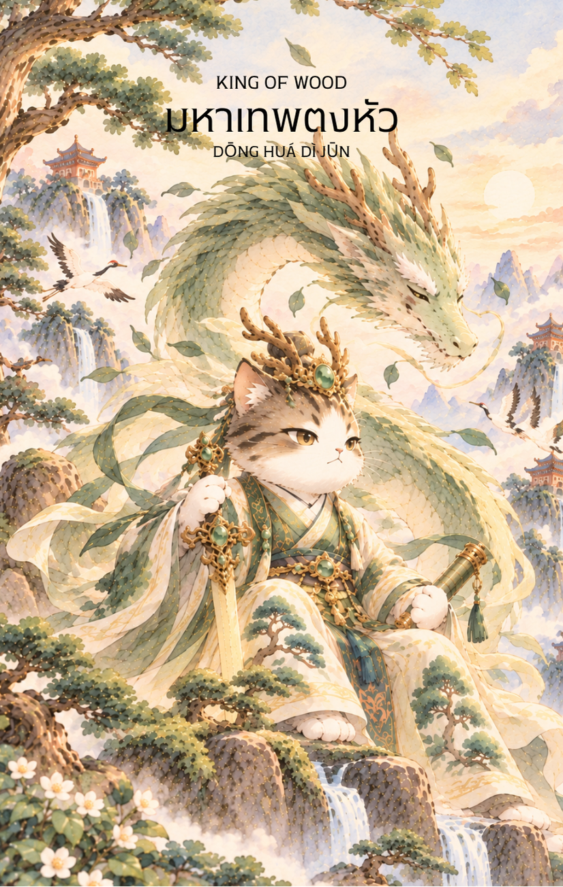

# Wood 14 - มหาเทพตงหัวตีจวิน (King of Wood)

Created: February 4, 2026 11:13 AM

King of Wood : The Sovereign of Growth (มหาเทพตงหัว)

**ธาตุประจำตัว:** ไม้ (🌳 Wood - พลังหยางสูงสุด)
**คอนเซปต์หลัก:** อำนาจที่มั่นคง วิสัยทัศน์ระดับมหภาค และการสร้างรากฐานที่หยั่งลึก

### 1. แก่นแท้ของตัวละคร (The Essence)

มหาเทพตงหัวคือสัญลักษณ์ของ "ไม้ใหญ่ที่แผ่กิ่งก้านสาขาปกคลุมฟ้าดิน" (Jia Wood at its peak) หาก Queen คือการบำรุง King คือ **"การปกครองและการสร้างระบบ"** ท่านคือตัวแทนของอำนาจที่มาพร้อมกับความรับผิดชอบ ประสบการณ์ที่สั่งสมมาอย่างยาวนานจนตกผลึกเป็นปัญญาในการบริหารจัดการวัฏจักรแห่งการเติบโต เป็นความมั่นคงที่ไม่หวั่นไหวต่อพายุ

### 2. สัญลักษณ์และปรัชญา (Symbolism & Philosophy)

- **แผ่นป้ายหยกอาญาสิทธิ์ (Hu):** สัญลักษณ์ของ "กฎระเบียบและโครงสร้าง" สื่อถึงการเปลี่ยนวิสัยทัศน์ให้เป็นระบบการทำงานที่จับต้องได้ และการมีอำนาจในการตัดสินใจขั้นเด็ดขาด
- **มังกรเขียวแห่งตะวันออก:** สื่อถึงพลังอำนาจสูงสุด บารมี และความสามารถในการเปลี่ยนแปลงสถานการณ์จากหน้ามือเป็นหลังมือ (Transformation)
- **ต้นสนพันปีที่หยั่งรากลึก:** ปรัชญาของการ "สร้างฐานให้แน่นก่อนสร้างยอดให้สูง" ความสำเร็จที่แท้จริงต้องมีรากฐาน (Fundamental) ที่แข็งแกร่ง ไม่ใช่เพียงภาพลักษณ์ที่ฉาบฉวย

### 3. กลยุทธ์เมื่อปรากฏไพ่ใบนี้ (The Strategy)

**"มองภาพใหญ่ สร้างระบบ และนำทัพด้วยบารมี"**

- **Establish Structure (สร้างโครงสร้าง):** เลิกทำงานแบบ One-man show ถึงเวลาต้องสร้างทีม สร้างระบบ หรือวางโครงสร้างองค์กร (Corporate Governance) เพื่อรองรับการเติบโตในระดับที่ใหญ่ขึ้น
- **Long-term Strategy (กลยุทธ์ระยะยาว):** อย่าสนใจแค่ชัยชนะในสมรภูมิย่อย ให้มองไปที่การชนะสงครามทั้งกระดาน วางแผนสำหรับ 5-10 ปีข้างหน้า ไม่ใช่แค่ไตรมาสนี้
- **Benevolent Leadership (การนำแบบพ่อปกครองลูก):** ใช้อำนาจควบคู่กับความเมตตา ดูแลบริวารเหมือนต้นไม้ใหญ่ที่ให้ร่มเงากับต้นหญ้า การสร้างทายาททางความคิด (Successor) คือภารกิจสำคัญ

### 4. คำแนะนำและการทำนาย (Reading Guidance)

- **ภาพรวมของไพ่ใบนี้:** เป็นไพ่แห่งความสำเร็จที่ยิ่งใหญ่และความมั่นคงสูงสุด คุณอยู่ในจุดที่มีอำนาจควบคุมสถานการณ์ได้เต็มที่ หรือจะได้รับการสนับสนุนจากผู้ที่มีอิทธิพลสูงมาก
- **การงาน/ธุรกิจ:** เหมาะสำหรับการก้าวขึ้นสู่ตำแหน่งระดับสูง (C-Level, Director) หรือการเป็นเจ้าของกิจการที่มั่นคงแล้ว การตัดสินใจของคุณจะมีผลกระทบในวงกว้าง
- **การเงิน:** มั่งคั่งร่ำรวยอย่างมั่นคง สินทรัพย์ส่วนใหญ่จะเป็นอสังหาริมทรัพย์ ที่ดิน หรือการลงทุนระยะยาวที่ให้ผลตอบแทนสม่ำเสมอ (Passive Income)
- **ความรัก:** เป็นความสัมพันธ์ที่มั่นคง จริงจัง และมองถึงอนาคตร่วมกัน อาจได้พบรักกับคนที่อายุมากกว่า มีฐานะ หรือมีวุฒิภาวะสูงซึ่งเป็นที่พึ่งพาได้
- **สุขภาพ:** แข็งแรง มีพลังชีวิตสูง แต่อาจต้องระวังโรคที่เกิดจากการทำงานหนักเกินไป หรือความเครียดสะสมที่ส่งผลต่อตับและเส้นเอ็น
5. **บุคลิกของคนที่เป็นตัวแทนไพ่**

เป็นคนมีวิสัยทัศน์กว้างไกล สร้างระบบและนำคนได้ดี มีความมั่นคงและรับผิดชอบต่อการเติบโตของส่วนรวม ระวังการควบคุมทุกเรื่องด้วยตนเองหรือยึดติดกับความสำเร็จจนไม่เปิดโอกาสให้ผู้อื่นเติบโต

6. **อาชีพที่พบได้บ่อย**

ผู้บริหารระดับสูง ผู้ก่อตั้งองค์กร นักวางแผนกลยุทธ์ ผู้นำชุมชน นักพัฒนาระบบ และงานที่ต้องขับเคลื่อนการเติบโตในระยะยาวและสร้างผู้สืบทอด

7. **Key Affirmation:** "รากฐานของฉันหยั่งลึกดั่งขุนเขา วิสัยทัศน์ของฉันกว้างไกลดั่งท้องฟ้า ฉันคือผู้สร้างอาณาจักรแห่งความรุ่งโรจน์"

8. **Keyword**

วิสัยทัศน์ • ภาวะผู้นำ • การเติบโต • รากฐาน • การสร้างระบบ • Vision • Leadership • Growth • Structure • Legacy

9. **ประวัติเทพเจ้าและตำนานที่เกี่ยวข้อง**

ตงหัวตี้จวิน (東華帝君) เป็นเทพผู้ทรงเกียรติในคติเต๋าและปรากฏในวรรณกรรมจีนหลายเรื่อง บางสำนวนกล่าวถึงพระองค์ในฐานะผู้ปกครองฝ่ายเซียนและผู้เกี่ยวข้องกับการถ่ายทอดวิถีบำเพ็ญตน เรื่องเล่าจึงเชื่อมโยงพระองค์กับอำนาจทางจิตวิญญาณ การดูแลระเบียบ และการเติบโตสู่ความเป็นอมตะ