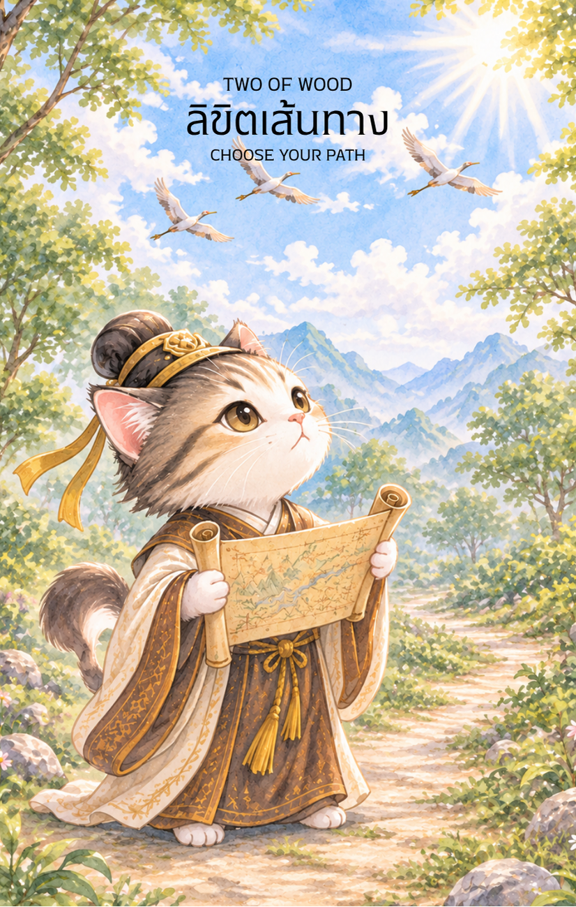

# Wood 2 - ลิขิตเส้นทาง (Two of Wood)

Created: February 4, 2026 8:50 PM

---

### **ชื่อไพ่: ลิขิตเส้นทาง (Two of Wood: Defining the Path)**

**ธาตุประจำตัว:** ไม้ (🌳 Wood)

**คอนเซปต์หลัก:** วิสัยทัศน์ของผู้นำ การตัดสินใจที่เด็ดขาด และการวางกลยุทธ์เพื่อขยายขอบเขตความสำเร็จ

### **1. แก่นแท้ของตัวละคร (The Essence)**

จากเด็กน้อยที่เฝ้ามองด้วยความสงสัย สู่ **เด็กหนุ่ม** ผู้เปี่ยมด้วยพลังงานและพละกำลัง เขาคือตัวแทนของ **"ไม้เจี๋ย" (甲木)** ที่เริ่มแข็งแกร่งและตั้งตรง สายตาที่เขามองไปยังหน่อไม้ทิพย์และคัมภีร์ไม่ใช่เพียงการชื่นชม แต่เป็นการ **ประเมินค่า** และ **วางแผน** เด็กหนุ่มคนนี้มีความรับผิดชอบต่อ "โอกาส" ที่ได้รับมา และพร้อมที่จะเปลี่ยนมันให้กลายเป็น "อาณาจักร" ในอนาคต

### **2. สัญลักษณ์และปรัชญา (Symbolism & Philosophy)**

- **เด็กหนุ่มผู้สง่างาม:** สื่อถึงความพร้อมทางด้านร่างกายและจิตใจ (Vigor) พร้อมที่จะแบกรับภาระและเดินหน้าสู่โลกกว้าง
- **คัมภีร์ไม้ไผ่ที่ถูกเปิดออก:** ในวัยเด็กหนุ่ม คัมภีร์ไม่ได้ถูกผูกไว้เฉยๆ อีกต่อไป แต่หมายถึงการ **นำความรู้มาประยุกต์ใช้จริง** สื่อถึงการมีแผนงานที่เป็นรูปธรรม
- **หน่อไม้ที่เริ่มแข็งเป็นลำ:** ปรัชญาของ "โครงสร้าง" (Structure) การที่ไม้จะโตสูงได้เท่าเด็กหนุ่ม ต้องมีลำต้นที่ตรงและแข็งแรง สื่อถึงการสร้างวินัยให้ตนเอง
- **ทิวเขาสลับซับซ้อน:** สื่อถึงขอบเขตที่กว้างขวางขึ้น (Expansion) เป้าหมายของเด็กหนุ่มไม่ใช่แค่สวนเล็กๆ แต่คือการพิชิตยอดเขาที่อยู่ไกลออกไป

### **3. กลยุทธ์เมื่อปรากฏไพ่ใบนี้ (The Strategy)**

> **"ถือคัมภีร์ในมือ มองให้ไกลกว่าสายตาเห็น แล้วตัดสินใจอย่างมั่นคง"**
> 
- **การมองภาพใหญ่ (Visionary):** อย่ามองแค่ผลประโยชน์ระยะสั้น เด็กหนุ่มต้องมองไปถึงว่า 5-10 ปีข้างหน้า ไม้ต้นนี้จะให้ร่มเงาอย่างไร
- **ทางเลือกที่เด็ดเดี่ยว (Decisiveness):** เลข 2 คือทางแยก การเป็นเด็กหนุ่มหมายถึงต้องกล้าเลือกทางใดทางหนึ่งอย่างเต็มตัว ไม่เหยียบเรือสองแคม
- **การเชื่อมต่อเครือข่าย (Networking):** ในวัยนี้คือช่วงเวลาของการหาพันธมิตรที่เหมาะสม เพื่อมาร่วมกันทำให้คัมภีร์ในมือเป็นจริง

### **4. คำแนะนำและการทำนาย (Reading Guidance)**

- **ภาพรวมของไพ่ใบนี้:** คุณกำลังก้าวเข้าสู่ช่วงวัยที่ต้อง "รับผิดชอบต่อทางเลือก" เป็นเวลาของการสำรวจโอกาสและกำหนดเป้าหมายที่ทะเยอทะยาน
- **การงาน/ธุรกิจ:** มีโอกาสในการขยายกิจการหรือรับตำแหน่งที่สูงขึ้น คุณมีอำนาจในการตัดสินใจอยู่ในมือแล้ว จงใช้ข้อมูล (คัมภีร์) ประกอบกับความมั่นใจ
- **การเงิน:** เป็นจังหวะดีในการพิจารณาการลงทุนที่ต้องใช้ความกล้า (Risk-taking) แต่ต้องเป็นการเสี่ยงที่มีการคำนวณมาอย่างดีแล้ว
- **ความรัก:** ความสัมพันธ์ที่ต้องการ "ความชัดเจน" หากกำลังคบหาดูใจ นี่คือเวลาที่ต้องคุยกันเรื่องอนาคตและการสร้างรากฐานร่วมกันอย่างจริงจัง
- **สุขภาพ:** สุขภาพแข็งแรงดีมาก มีพลังเหลือเฟือ เหมาะกับการออกกำลังกายที่เน้นความแข็งแกร่งของกล้ามเนื้อและการเคลื่อนที่

**Key Affirmation:** "ฉันมีความกล้าที่จะเลือก และมีปัญญาที่จะลิขิตเส้นทางที่รุ่งโรจน์ด้วยตัวฉันเอง"

-

นี่คือข้อมูลสำหรับใส่ลงในคู่มือของไพ่ **2 ไม้ (2 of Wood)** ในธีม **"ทางแยกแห่งชะตาบัณฑิต"** เพื่อให้สอดคล้องกับเรื่องราวที่ต่อเนื่องมาจากใบแรกครับ

จากเนื้อหาที่ส่งให้นี้ ออกแบบภาพประกอบไพ่ ขนาด 9:16

**Artwork Style:** Modern Chinese ink wash painting (Gong Bi), characterized by dynamic, expressive brushstrokes and clean, flowing lines, blending traditional elegance with a contemporary feel on old paper. The primary artwork itself is borderless, allowing elements to organically extend or fade towards the edges of the card canvas.

ชื่อไพ่: ลิขิตเส้นทาง (Two of Wood: Defining the Path)
ธาตุประจำตัว: ไม้ (🌳 Wood)
คอนเซปต์หลัก: วิสัยทัศน์ของผู้นำ การตัดสินใจที่เด็ดขาด และการวางกลยุทธ์เพื่อขยายขอบเขตความสำเร็จ

1. แก่นแท้ของตัวละคร (The Essence)
จากเด็กน้อยที่เฝ้ามองด้วยความสงสัย สู่ เด็กหนุ่ม ผู้เปี่ยมด้วยพลังงานและพละกำลัง เขาคือตัวแทนของ "ไม้เจี๋ย" (甲木) ที่เริ่มแข็งแกร่งและตั้งตรง สายตาที่เขามองไปยังหน่อไม้ทิพย์และคัมภีร์ไม่ใช่เพียงการชื่นชม แต่เป็นการ ประเมินค่า และ วางแผน เด็กหนุ่มคนนี้มีความรับผิดชอบต่อ "โอกาส" ที่ได้รับมา และพร้อมที่จะเปลี่ยนมันให้กลายเป็น "อาณาจักร" ในอนาคต
2. สัญลักษณ์และปรัชญา (Symbolism & Philosophy)
เด็กหนุ่มผู้สง่างาม: สื่อถึงความพร้อมทางด้านร่างกายและจิตใจ (Vigor) พร้อมที่จะแบกรับภาระและเดินหน้าสู่โลกกว้าง
คัมภีร์ไม้ไผ่ที่ถูกเปิดออก
ทิวเขาสลับซับซ้อนและเส้นทางแยก

---

## **2 ไม้ (2 of Wood) : The Scholar’s Crossroads**

**ธาตุประจำตัว:** ไม้ (🌲 Wood)

**คอนเซปต์หลัก:** การตัดสินใจเลือกเส้นทาง วิสัยทัศน์ที่กว้างไกล และการก้าวออกจากจุดที่ปลอดภัยเพื่อแสวงหาอนาคต

### **1. แก่นแท้ของตัวละคร (The Essence)**

หลังจากที่ **1 ไม้** คือรุ่งอรุณแห่งโอกาสและการสอบติด ในไพ่ **2 ไม้** บัณฑิตหนุ่มได้ก้าวเท้าออกจากรั้วสถานศึกษาเป็นครั้งแรก เขายืนอยู่ตรง **"ทางแยกแห่งโชคชะตา"** ที่ซึ่งโลกกว้างรอให้เขาไปพิสูจน์ แก่นแท้ของไพ่ใบนี้คือ **"อำนาจในการเลือก"** สวรรค์ได้หยิบยื่นปัญญามาให้แล้ว แต่ต่อจากนี้คือการตัดสินใจของมนุษย์ว่าจะเดินไปในทางใด ระหว่างเส้นทางที่รุ่งโรจน์ด้วยลาภยศ หรือเส้นทางที่ลึกซึ้งด้วยสติปัญญา

---

### **2. สัญลักษณ์และปรัชญา (Symbolism & Philosophy)**

- **ทางแยกสองสาย (The Fork in the Road):** สื่อถึงความขัดแย้งในใจและการเลือก เส้นทางหนึ่งมุ่งสู่เมืองหลวง (ทางโลก/อำนาจ) อีกเส้นทางหนึ่งมุ่งสู่ขุนเขา (ทางธรรม/ปราชญ์) ปรัชญาคือ "ชีวิตคือผลรวมของการตัดสินใจ"
- **แผนที่และไม้เท้า (The Map & Staff):** สื่อถึงความพร้อมและการวางแผนก่อนออกเดินทาง ไพ่ใบนี้บอกว่าคุณไม่ได้ไปตัวเปล่า แต่คุณมี "เข็มทิศ" แห่งความรู้ติดตัวไปด้วย
- **ไผ่คู่ขนาบทาง (The Twin Bamboo):** แทนเสาหลักสองต้นของความสำเร็จ คือ "วิสัยทัศน์" และ "ความมั่นใจ" ที่ต้องไปคู่กัน
- **เงามังกรเหนือทางแยก (The Watching Dragon):** ในขณะที่มนุษย์ลังเล เงาของมังกรเขียวลอยสงบนิ่งอยู่เบื้องบน สื่อถึงการอุปถัมภ์ที่ไม่ได้เข้ามาบงการ แต่คอย "เฝ้าดูและประคอง" ให้การตัดสินใจนั้นเป็นไปตามครรลองที่ถูกต้อง

---

### **3. กลยุทธ์เมื่อปรากฏไพ่ใบนี้ (The Strategy)**

> *"ก้าวแรกคือความเพียร ก้าวที่สองคือทิศทาง หากทิศทางผิด ความเพียรย่อมสูญเปล่า"*
> 
- **The Visionary Pause (กลยุทธ์การหยุดเพื่อมอง):** เมื่อพบทางแยก อย่ารีบวิ่ง จงหยุดกางแผนที่ดูภาพรวม ไพ่ใบนี้เตือนให้ใช้สติปัญญาไตร่ตรองข้อดีข้อเสียของแต่ละทางเลือกอย่างรอบคอบ
- **Exit the Comfort Zone (กลยุทธ์ก้าวพ้นเขตปลอดภัย):** การยืนอยู่ตรงทางแยกหมายถึงคุณได้ทิ้ง "บ้าน" หรือ "โรงเรียน" มาแล้ว จงมีความกล้าที่จะเดินไปข้างหน้า แม้จะไม่เห็นปลายทางทั้งหมด
- **Define Your Success (กลยุทธ์นิยามความสำเร็จ):** ถามตัวเองว่าเป้าหมายที่แท้จริงคืออะไร? ลาภยศ (เมืองหลวง) หรือ ความสงบ (ขุนเขา) ไพ่ใบนี้บังคับให้คุณต้องซื่อสัตย์กับความต้องการของตนเอง

---

### **4. คำแนะนำและการทำนาย (Reading Guidance)**

- **ภาพรวมของไพ่ใบนี้:** เป็นไพ่แห่งการวางแผนและการขยับขยาย คุณมีพลังงานล้นเหลือที่จะไปต่อ แต่ต้องเลือกเป้าหมายให้ชัดเจนเพียงหนึ่งเดียว
- **การงาน/การเรียน:** มีการติดต่อจากแดนไกล หรือมีข้อเสนอสองทางเลือกเข้ามาพร้อมกัน อาจเป็นการตัดสินใจว่าจะทำงานในองค์กรใหญ่หรือเริ่มธุรกิจตัวเอง เป็นช่วงเวลาที่ดีในการ "วางแผน 5 ปี"
- **การเงิน:** การเงินอยู่ในเกณฑ์มั่นคง แต่เริ่มมีช่องทางในการขยายรายได้ด้วยการลงทุนทางไกล หรือการร่วมหุ้นกับคนที่มีวิสัยทัศน์ตรงกัน
- **ความรัก:** สำหรับคนโสด อาจต้องเลือกระหว่างคนสองคนที่มีบุคลิกต่างกันอย่างสิ้นเชิง สำหรับคนมีคู่ เป็นช่วงเวลาที่ต้องวางแผนเรื่องการย้ายที่อยู่หรือการเดินทางไกลร่วมกัน
- **สุขภาพ:** สุขภาพโดยรวมดี แต่ระวังความเครียดที่เกิดจากการคิดวนเวียนเรื่องการตัดสินใจ ให้ลองเปลี่ยนบรรยากาศไปที่สูงหรือที่โปร่งโล่งจะช่วยให้คิดออก

---

5. **บุคลิกของคนที่เป็นตัวแทนไพ่**

เป็นคนมีวิสัยทัศน์ ชอบวางแผน และกล้าเลือกทิศทางของตนเอง มองเห็นโอกาสในระยะยาวและพร้อมออกจากพื้นที่คุ้นเคย ระวังการลังเลระหว่างหลายทางเลือกหรือมั่นใจในแผนโดยไม่ตรวจสอบข้อมูลให้รอบด้าน

6. **อาชีพที่พบได้บ่อย**

นักวางกลยุทธ์ ผู้ประกอบการ ผู้จัดการพัฒนาธุรกิจ นักวางแผนโครงการ ที่ปรึกษา และงานที่เกี่ยวข้องกับการขยายตลาดหรือกำหนดทิศทางในอนาคต

7. **Key Affirmation:** "ฉันมีปัญญาที่จะเลือก และมีความกล้าที่จะเดินไปสู่เส้นทางที่ไพศาลที่สุด"

8. **Keyword**

วิสัยทัศน์ • การตัดสินใจ • การวางแผน • การขยายตัว • ความกล้า • Vision • Choice • Planning • Expansion • Leadership

9. **ที่มาและบริบทของไพ่**

Two of Wood ว่าด้วยช่วงเวลาที่มีโอกาสมากกว่าหนึ่งทางและต้องเลือกทิศทาง ภาพผู้เดินทางมองเส้นทางไกลสื่อถึงการสำรวจโลกกว้าง วางแผนล่วงหน้า และเปลี่ยนวิสัยทัศน์ให้กลายเป็นการลงมือทำ

---

**ลำดับถัดไป ผมจะ Gen ภาพ "บัณฑิตที่ทางแยก" โดยใช้สไตล์พู่กันจีนร่วมสมัย เต็มขอบภาพ และใส่เงาพญามังกรเหนือทางแยกตามคอนเซปต์นี้นะครับ**

คุณอยากให้เน้นอารมณ์ของบัณฑิตในภาพไปทางไหนดีครับ? ระหว่าง **"ความมั่นใจที่ได้เริ่มเดินทาง"** หรือ **"ความสุขุมเคร่งขรึมในการครุ่นคิด"**?

### **Prompt สำหรับ ไพ่ 2 ไม้ (Two of Wood)**

- **ตัวละคร:** บัณฑิตชายหนุ่ม (Young Adult Scholar) รูปร่างสันทัด สวมชุดเดินทางเรียบง่ายแต่ดูดี มีห่อสัมภาระสะพายหลังและถือไม้เท้าไผ่
- **ท่าทาง:** ยืนอยู่ตรงจุดศูนย์กลางของ **ทางแยกบนภูเขา** มือหนึ่งถือแผนที่ที่กางออก สีหน้าแสดงความตื่นเต้นระคนครุ่นคิด (ผสมความกล้าและกลัว)
- **ฉากหลัง:** ทางแยกสองสาย สายหนึ่งทอดลงไปสู่เมืองหลวงที่มีแสงสีทองรำไร อีกสายหนึ่งคดเคี้ยวขึ้นสู่ขุนเขาที่มีหมอกสีเงินปกคลุม
- **พลังเทพ:** บนท้องฟ้าและม่านหมอกเบื้องหลัง ปรากฏร่างของ **พญามังกรเขียว (Azure Dragon)** ขนาดมหึมาที่เกิดจากกลุ่มเมฆและพลังงานศักดิ์สิทธิ์ ไม่ได้ยื่นมือลงมาแทรกแซง แต่แผ่รัศมีสีเขียวจางๆ ลงมาเป็นพื้นหลัง สื่อถึงการเฝ้ามองอุปถัมภ์
- **สไตล์:** จิตรกรรมพู่กันจีนร่วมสมัย (Chinese Brush Painting) บนกระดาษสาเก่า เน้นสีแร่ธรรมชาติ (Mineral Pigments) สัดส่วน 9:16 เต็มภาพ