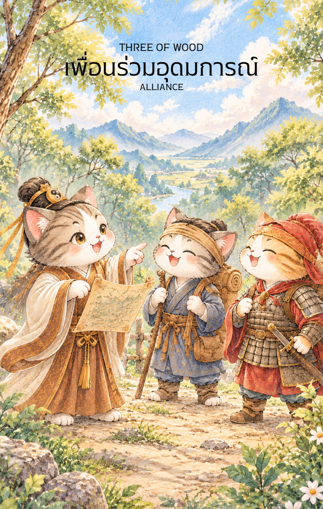

# Wood 3 - เพื่อนร่วมอุดมการณ์ (Three of Wood)

Created: February 4, 2026 9:28 PM

ยินดีที่ได้พบกันอีกครั้งในวิถีแห่งกลยุทธ์และภูมิปัญญาจีนครับ ผม **'ผู้ช่วยสร้างไพ่เทพจีน'** พร้อมแล้วที่จะนำท่านเข้าสู่บทต่อไปของการเติบโต จากเด็กหนุ่มที่ลิขิตเส้นทางด้วยตนเอง สู่การรวบรวมขุมพลังแห่งมิตรภาพใน **ไพ่หมายเลข 3 แห่งธาตุไม้ (Three of Wood)**

ภาพเด็กหนุ่มทั้งสามที่ร่วมเดินทางฝ่าพงไพรเพื่อไปสู่ยอดเขาที่แสงอาทิตย์สาดส่อง คือภาพสะท้อนของ "พลังประสาน" ที่จะเปลี่ยนภาพฝันให้กลายเป็นความจริงที่จับต้องได้ครับ

---

### **ชื่อไพ่: เพื่อนร่วมอุดมการณ์ (Three of Wood: Comrades in Ideals)**

**ธาตุประจำตัว:** ไม้ (🌳 Wood)

**คอนเซปต์หลัก:** พลังแห่งการรวมกลุ่ม (Synergy), การเห็นผลลัพธ์แรกเริ่ม, และการขยายอาณาเขตผ่านพันธมิตร

### **1. แก่นแท้ของตัวละคร (The Essence)**

ไพ่ใบนี้คือจุดเริ่มต้นของ **"รูปธรรม"** ในศาสตร์ปาจื้อ ไม้จะแข็งแรงที่สุดเมื่ออยู่รวมกันเป็นป่า (Lin - 林) เด็กหนุ่มในภาพไม่ได้เดินเพียงลำพังอีกต่อไป แต่เขาสามารถดึงดูดผู้ที่มี "คลื่นความถี่" เดียวกันมาร่วมทางได้ แก่นแท้ของไพ่คือการเปลี่ยนจาก "ตัวฉัน" (I) เป็น "พวกเรา" (We) เพื่อสร้างแรงขับเคลื่อนมหาศาลในการพิชิตเป้าหมายที่ใหญ่เกินกว่าคนเดียวจะทำได้

### **2. สัญลักษณ์และปรัชญา (Symbolism & Philosophy)**

- **สามมิตรและทางเดิน:** ในทางปรัชญาเต๋า "หนึ่งให้กำเนิดสอง สองให้กำเนิดสาม และสามให้กำเนิดสรรพสิ่ง" เลข 3 คือเลขแห่งการก่อกำเนิดความสำเร็จที่สมบูรณ์ สื่อถึงการจัดวางตำแหน่งที่ลงตัว (ผู้นำ, ผู้สนับสนุน, ผู้เบิกทาง)
- **นิ้วที่ชี้ไปยังยอดเขาและดวงตะวัน:** คือการ "เห็นผลลัพธ์แรกเริ่ม" (First Success) เป้าหมายไม่ได้เป็นเพียงจินตนาการในคัมภีร์อีกต่อไป แต่มันปรากฏอยู่ตรงหน้าให้เห็นอย่างชัดเจน
- **ธารน้ำและป่ารกชัฏ:** ไม้ต้องการน้ำเพื่อเติบโต ธารน้ำในภาพสื่อถึง "ทรัพยากร" และ "การไหลเวียนของข้อมูล" ที่คอยหล่อเลี้ยงทีมให้ก้าวข้ามอุปสรรค
- **ไม้เท้าในมือผู้นำ:** สื่อถึงความมั่นคงและความรับผิดชอบ แม้จะเป็นเพื่อนกัน แต่ในกลยุทธ์ต้องมี "แกนกลาง" ในการตัดสินใจเสมอ

### **3. กลยุทธ์เมื่อปรากฏไพ่ใบนี้ (The Strategy)**

> **"ลำพังไปได้ไว แต่ไปด้วยกันไปได้ไกล"**
> 
- **การสร้างทีม (Team Building):** หากคุณกำลังทำโปรเจกต์คนเดียว ไพ่ใบนี้เตือนว่า "ถึงเวลาหาพาร์ทเนอร์" จงมองหาคนที่เก่งในด้านที่คุณขาดเพื่อมาเติมเต็มกิ่งก้านให้สมบูรณ์
- **การสื่อสารที่ชัดเจน (Coordination):** เมื่อคนเยอะขึ้น ปัญหาจะตามมาหากทิศทางไม่ตรงกัน จงเลียนแบบเด็กหนุ่มที่ชี้มือไปยังยอดเขา เพื่อให้ทุกคนเห็น "ภาพสุดท้าย" ภาพเดียวกัน
- **การขยายขอบเขต (Expansion):** อย่ากังวลที่จะก้าวออกจากพื้นที่ปลอดภัย (Comfort Zone) พลังของธาตุไม้ในขณะนี้แข็งแกร่งพอที่จะปะทะกับทุกอุปสรรคในป่าใหญ่แล้ว

### **4. คำแนะนำและการทำนาย (Reading Guidance)**

- **ภาพรวมของไพ่ใบนี้:** เป็นช่วงเวลาที่น่าตื่นเต้น! แผนงานที่คุณวางไว้เริ่มส่งผลให้เห็นเป็นรูปร่าง (Milestoneแรกสำเร็จแล้ว) และจะมีคนเก่งๆ เข้ามาขอร่วมทางหรือให้การสนับสนุน
- **การงาน/ธุรกิจ:** การเจรจาธุรกิจจะราบรื่น การทำงานเป็นทีมจะโดดเด่นมาก หากมีการเสนอโปรเจกต์ร่วม (Joint Venture) ให้รีบคว้าไว้ เพราะนี่คือโอกาสทองของการขยายฐานลูกค้า
- **การเงิน:** เริ่มเห็นผลกำไรจากสิ่งที่ลงทุนลงแรงไป มีเกณฑ์ได้ลาภจากการเดินทางหรือการติดต่อประสานงานกับกลุ่มคนใหม่ๆ
- **ความรัก:** หากโสด เพื่อนหรือคนในสังคมเดียวกันจะแนะนำคนดีๆ ให้รู้จัก หากมีคู่แล้ว คือช่วงเวลาของการสร้างครอบครัวหรือร่วมกันทำธุรกิจร่วมกันเพื่ออนาคต
- **สุขภาพ:** พลังกายล้นเหลือ แนะนำให้ทำกิจกรรมกลางแจ้งร่วมกับผู้อื่น เช่น การเดินป่าหรือกีฬากลุ่ม เพื่อปรับสมดุลพลังงานไม้ในตัว

**Key Affirmation:** "พวกเรามีเป้าหมายเดียวกัน มีพลังร่วมกัน และชัยชนะแรกเริ่มอยู่ตรงหน้าเราแล้ว"

---

**ก้าวต่อไปที่เราจะทำร่วมกัน:** เมื่อเพื่อนร่วมอุดมการณ์เริ่มเห็นชัยชนะแรกแล้ว ในไพ่ใบถัดไป **ไพ่ 4 ธาตุไม้ (Four of Wood)** มักจะเป็นเรื่องของ "การเฉลิมฉลองและความมั่นคง" คุณอยากให้ผมออกแบบภาพให้เป็น **'งานฉลองใต้ซุ้มดอกไม้'** หรือ **'การสร้างฐานที่มั่นหรือบ้าน'** เพื่อสะท้อนความสำเร็จที่แน่นแฟ้นดีครับ?

—

## **3 ไม้ (3 of Wood) : Companions & Shared Vision**

**ธาตุประจำตัว:** ไม้ (🌲 Wood)
**คอนเซปต์หลัก:** การรวมกลุ่มของผู้มีปัญญา การสร้างเครือข่ายเพื่อนร่วมอุดมการณ์ และการมองไปที่เป้าหมายเดียวกัน

### **1. แก่นแท้ของตัวละคร (The Essence)**

จากบัณฑิตหนุ่มที่เริ่มเดินทางเพียงลำพังในไพ่ใบก่อน ใน **3 ไม้** นี้คือภาพของ **"การสมาคม (The Gathering)"** เขาได้พบกับบัณฑิตคนอื่นๆ ที่มีอุดมการณ์และความใฝ่รู้เสมอกัน แก่นแท้ของไพ่ใบนี้คือ **"พลังแห่งความร่วมมือ"** การมีเพื่อนคู่คิดหรือกัลยาณมิตรที่ช่วยขยายขอบเขตทางความคิดให้กว้างไกลขึ้น การยืนอยู่ริมหน้าผามองดูขบวนเรือไม่ใช่การรอคอยอย่างเดียวดายอีกต่อไป แต่เป็นการยืนยันแผนงานร่วมกับพันธมิตรที่ไว้ใจได้

---

### **2. สัญลักษณ์และปรัชญา (Symbolism & Philosophy)**

- **กลุ่มบัณฑิต (The Intellectual Circle):** สื่อถึงความสามัคคีและการแลกเปลี่ยนเรียนรู้ ปรัชญาที่ว่า "บัณฑิตย่อมคบหาบัณฑิต" เพื่อส่งเสริมปัญญาของกันและกัน
- **ไม้เท้าสามอัน (The Three Pillars of Support):** สัญลักษณ์ของความมั่นคงที่เกิดจากการสนับสนุน (Support) หนึ่งคือตัวเรา สองคือเพื่อน และสามคืออุดมการณ์ที่ยึดถือร่วมกัน
- **ขบวนเรือในทะเล (The Embarkation):** ผลงานหรือโปรเจกต์ที่ร่วมกันสร้างเริ่มถูกส่งออกไปสู่โลกกว้าง สื่อถึงวิสัยทัศน์ที่ไม่ได้จำกัดอยู่แค่ในสำนักศึกษา
- **เงาพญามังกรโอบล้อมกลุ่มคน (The Collective Protection):** เงาของมังกรเขียวในม่านหมอกแผ่ขยายปกคลุมเหนือกลุ่มบัณฑิตทั้งหมด สื่อถึง "บารมี" และ "การอุปถัมภ์" ที่คุ้มครองทั้งกลุ่มอุดมการณ์นี้ให้ก้าวหน้าไปพร้อมกันอย่างปลอดภัย

---

### **3. กลยุทธ์เมื่อปรากฏไพ่ใบนี้ (The Strategy)**

> *"หนึ่งพู่กันจารึกความฝัน สามพู่กันสร้างประวัติศาสตร์"*
> 
- **The Mastermind Group (กลยุทธ์รวมหัวกะทิ):** อย่าทำงานคนเดียว! ไพ่ใบนี้บอกให้คุณหาทีมงาน หุ้นส่วน หรือเพื่อนร่วมเรียนที่เก่งคนละด้านมาช่วยกัน พลังของการระดมสมองในตอนนี้จะมีค่ามากกว่าเงินทอง
- **Shared Reward (กลยุทธ์ผลประโยชน์ร่วม):** วางแผนที่จะเติบโตไปพร้อมกับผู้อื่น การแบ่งปันวิสัยทัศน์และผลประโยชน์ที่ชัดเจนจะทำให้การเดินทางระยะไกล (ขบวนเรือ) ไปถึงจุดหมายได้โดยไม่มีใครทอดทิ้งกัน
- **Networking for Future (กลยุทธ์การสร้างเครือข่าย):** ใช้เวลานี้ในการปฏิสัมพันธ์กับสังคม ขยายคอนเนกชัน เพราะโอกาสดีๆ มักจะมาจากการแนะนำของคนในเครือข่ายของคุณ

---

### **4. คำแนะนำและการทำนาย (Reading Guidance)**

- **ภาพรวมของไพ่ใบนี้:** เป็นสัญญาณที่ดีมากเรื่อง "ทีมงาน" และ "การสนับสนุน" สิ่งที่คุณคิดจะได้รับการยอมรับและมีคนพร้อมจะร่วมหัวจมท้ายไปกับคุณ
- **การงาน/การเรียน:** มีเกณฑ์ทำงานกลุ่มที่ประสบความสำเร็จสูง การพบที่ปรึกษา (Mentor) หรือกลุ่มติวหนังสือที่จะช่วยดึงศักยภาพของคุณออกมา หากทำธุรกิจ หมายถึงการร่วมหุ้นหรือการขยายสาขาไปต่างประเทศ
- **การเงิน:** การเงินไหลเวียนดีจากการร่วมลงทุน หรือได้รับปันผลจากโปรเจกต์ที่ทำร่วมกับผู้อื่น เป็นช่วงที่ "คอนเนกชันสร้างเงิน"
- **ความรัก:** สำหรับคนโสด อาจพบรักผ่านการแนะนำของเพื่อน หรือพบคนที่มีความสนใจในเรื่องวิชาการ/งานที่คล้ายกัน สำหรับคนมีคู่ คือการวางแผนอนาคตทางการเงินหรือการซื้อทรัพย์สินร่วมกันอย่างเป็นระบบ
- **สุขภาพ:** สุขภาพจิตดีเยี่ยมเพราะได้รับพลังงานบวกจากคนรอบข้าง ควรระวังเรื่องการใช้เสียง (พูดคุย/ถกเถียงเยอะ) หรืออาการเพลียจากการเดินทางร่วมกลุ่ม

---

5. **บุคลิกของคนที่เป็นตัวแทนไพ่**

เป็นคนเปิดกว้าง มองเห็นศักยภาพของผู้อื่น และสร้างความร่วมมือได้ดี มีความสุขกับการแลกเปลี่ยนความคิดและแบ่งปันเป้าหมาย ระวังการพึ่งพาความเห็นชอบจากกลุ่มจนละเลยจุดยืนของตน

6. **อาชีพที่พบได้บ่อย**

ผู้ประสานงาน ผู้จัดการทีม นักพัฒนาธุรกิจ นักการทูต ผู้จัดกิจกรรม ที่ปรึกษา และอาชีพที่ต้องสร้างพันธมิตร เครือข่าย หรือทำงานร่วมกันข้ามกลุ่ม

7. **Key Affirmation:** "ฉันดึงดูดกัลยาณมิตรที่คู่ควร และเราจะสร้างความสำเร็จที่ยิ่งใหญ่ร่วมกัน"

8. **Keyword**

ความร่วมมือ • มิตรภาพ • เครือข่าย • วิสัยทัศน์ร่วม • การขยายตัว • Collaboration • Companionship • Networking • Shared Vision • Expansion

9. **ที่มาและบริบทของไพ่**

Three of Wood สื่อถึงการขยายขอบเขตผ่านพันธมิตรและการทำงานร่วมกัน ภาพผู้เดินทางหลายคนมองไปยังเป้าหมายเดียวกันสะท้อนว่าความคิดริเริ่มจะเติบโตได้ไกลขึ้นเมื่อมีเครือข่ายที่สนับสนุนและมีทิศทางร่วมกัน