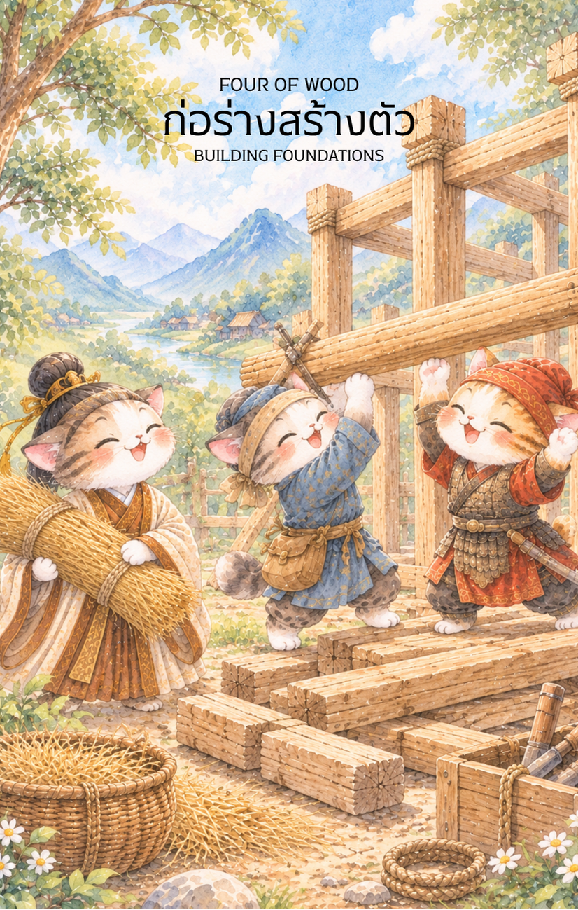

# Wood 4 - ก่อร่างสร้างตัว (Four of Wood)

Created: February 6, 2026 11:07 AM

ยินดีที่ได้พบกันอีกครั้งในวิถีแห่งกลยุทธ์และภูมิปัญญาครับ ผม **'ผู้ช่วยสร้างไพ่เทพจีน'** พร้อมแล้วที่จะนำท่านเข้าสู่บทที่ 4 ของการเติบโต จากการรวบรวมมิตรภาพในไพ่ใบที่แล้ว สู่การ **"ลงหลักปักฐาน"** ที่เป็นรูปธรรมที่สุดใน **ไพ่หมายเลข 4 แห่งธาตุไม้ (Four of Wood)**

ภาพกลุ่มชายหนุ่มที่ร่วมแรงร่วมใจยกเสาหลักของอาคารขึ้นสู่ท้องฟ้า คือภาพสะท้อนของ "ความสามัคคีที่ก่อเกิดโครงสร้าง" ซึ่งเป็นหัวใจสำคัญของการสร้างความมั่งคั่งที่ยั่งยืนตามหลักโหราศาสตร์จีนครับ

---

### **ชื่อไพ่: ก่อร่างสร้างตัว (Four of Wood: Establishing the Foundation)**

**ธาตุประจำตัว:** ไม้ (🌳 Wood)

**คอนเซปต์หลัก:** ความมั่นคงที่เกิดจากความร่วมมือ การสร้างรากฐานที่แข็งแกร่ง และช่วงเวลาแห่งความสุขในบ้านหรือองค์กร

### **1. แก่นแท้ของตัวละคร (The Essence)**

ไพ่ใบนี้คือสภาวะที่พลังของไม้เริ่มเปลี่ยนจาก "การขยายตัว" (3 of Wood) มาเป็น "การสร้างโครงสร้าง" ในศาสตร์ปาจื้อเปรียบได้กับการที่กิ่งก้านได้ผสานกันจนกลายเป็นโครงสร้างที่ปกป้องคุ้มภัยได้ กลุ่มคนในภาพคือตัวแทนของพลัง **"ปี่เจียน" (Bi Jian)** หรือมิตรสหายที่ส่งเสริมกันจนเกิดเป็นความสำเร็จที่จับต้องได้ แก่นแท้ของไพ่คือการเปลี่ยน "แรงกาย" ให้กลายเป็น "ถาวรวัตถุ" หรือระบบที่มั่นคง

### **2. สัญลักษณ์และปรัชญา (Symbolism & Philosophy)**

- **การยกเสาหลัก (Raising the Pillars):** สื่อถึงการวาง "จงซู" (Zhongshu) หรือศูนย์กลางของอำนาจและความมั่นคง เสาที่ตั้งตรงคือความเที่ยงธรรมและความแข็งแกร่งของระเบียบวินัย
- **ผ้าแดงผูกยอดเสา:** สัญลักษณ์แห่ง "หงอวิ่น" (Hong Yun) หรือโชคลาภที่มาพร้อมกับความสำเร็จ เป็นการประกาศชัยชนะเบื้องต้นและการเฉลิมฉลองความเป็นสิริมงคล
- **การเข้าไม้ (Mortise and Tenon):** ปรัชญาการเชื่อมต่อโดยไม่ใช้ตะปู สื่อถึงความสัมพันธ์ที่ผสานกันด้วยใจและเป้าหมายเดียวกัน ความแข็งแรงไม่ได้มาจากคนเดียว แต่มาจาก "รอยต่อ" ที่แนบสนิทของทุกคนในทีม
- **ตอไม้ที่เหลืออยู่ข้างหลัง:** สื่อถึงการผ่านพ้นอุปสรรคและการถากถางทางมาแล้ว ตอนนี้คือเวลาของการสร้างสิ่งที่ "ตั้งอยู่บนดิน" อย่างสง่างาม

### **3. กลยุทธ์เมื่อปรากฏไพ่ใบนี้ (The Strategy)**

> **"รากฐานที่แน่นหนา คือบ่อเกิดแห่งความมั่งคั่งที่ยั่งยืน"**
> 
- **การสร้างระบบ (Systematization):** หากธุรกิจของคุณเริ่มมีรายได้ดีแล้ว ไพ่ใบนี้บอกว่า "ถึงเวลาสร้างระบบ" อย่าพึ่งพาแค่ตัวบุคคล แต่จงสร้างเสาหลัก (Standard/Policy) ให้แข็งแรง
- **การบริหารความสัมพันธ์ (Consolidation):** ดูแลคนในครอบครัวหรือคนในทีมให้ดี เพราะพวกเขาคือ "เสา" ที่พยุงความสำเร็จของคุณอยู่ ความสามัคคีคือต้นทุนที่ถูกที่สุดแต่มีค่าที่สุด
- **การหยุดเพื่อฉลอง (Celebrate the Milestone):** อย่าเอาแต่ก้มหน้าทำงาน จงหยุดพักเพื่อชื่นชมความสำเร็จสั้นๆ เพื่อเติมพลังให้จิตใจ (Mental Support) ก่อนจะก้าวไปสู่ขั้นต่อไป

### **4. คำแนะนำและการทำนาย (Reading Guidance)**

- **ภาพรวมของไพ่ใบนี้:** เป็นสัญญาณมงคลอย่างยิ่ง สื่อถึงความปลอดภัย ความสำเร็จที่เป็นปึกแผ่น และความสงบสุขในที่อยู่อาศัยหรือที่ทำงาน
- **การงาน/ธุรกิจ:** โปรเจกต์ที่ทำมาถึงจุดที่มั่นคงแล้ว มีเกณฑ์การขยายออฟฟิศ การจดทะเบียนบริษัท หรือการวางโครงสร้างองค์กรใหม่ที่ยอดเยี่ยม ทีมงานมีความสามัคคีสูง
- **การเงิน:** มั่นคง มีเกณฑ์ได้ทรัพย์สินชิ้นใหญ่ เช่น ที่ดิน บ้าน หรืออาคารพาณิชย์ เป็นช่วงที่เก็บเกี่ยวผลกำไรเพื่อมาสร้างรากฐานให้ครอบครัว
- **ความรัก:** ความสัมพันธ์ที่สุกงอม มีเกณฑ์การแต่งงาน การย้ายมาอยู่ร่วมกัน หรือการสร้างครอบครัวที่เป็นสุข เป็นความรักที่มีความมั่นคงทางอารมณ์สูง
- **สุขภาพ:** แข็งแรงสมบูรณ์ แต่อาจมีอาการปวดเมื่อยจากการทำงานหนักหรือภาระที่แบกรับไว้ (ไหล่และหลัง) ควรพักผ่อนในบ้านที่สะอาดและอากาศถ่ายเท

5. **บุคลิกของคนที่เป็นตัวแทนไพ่**

เป็นคนรักความมั่นคง รู้จักประสานความร่วมมือ และมีความสามารถในการเปลี่ยนความคิดให้เป็นระบบที่ใช้งานได้จริง ให้ความสำคัญกับบ้านหรือทีมงาน ระวังการให้ความสำคัญกับความสงบจนหลีกเลี่ยงการเปลี่ยนแปลงที่จำเป็น

6. **อาชีพที่พบได้บ่อย**

ผู้จัดการโครงการ สถาปนิก ผู้ประกอบการ ผู้ดูแลชุมชน ผู้จัดงาน นักวางระบบ และงานที่ต้องสร้างโครงสร้างหรือสภาพแวดล้อมที่มั่นคงให้ผู้คน

7. **Key Affirmation:** "ฉันร่วมสร้างรากฐานที่แข็งแกร่งด้วยความสามัคคี เพื่อความมั่งคั่งและสันติสุขที่ยั่งยืน"

8. **Keyword**

รากฐาน • ความมั่นคง • ความร่วมมือ • บ้านและชุมชน • การเฉลิมฉลอง • Foundation • Stability • Community • Harmony • Celebration

9. **ที่มาและบริบทของไพ่**

Four of Wood สื่อถึงการสร้างฐานที่มั่นหลังจากการเริ่มต้นและขยายความร่วมมือ ภาพการยกเสาหรือสร้างบ้านสะท้อนโครงสร้างที่เกิดจากการช่วยเหลือกัน พร้อมบรรยากาศแห่งการเฉลิมฉลองความสำเร็จที่ได้ลงหลักปักฐาน

---

**ก้าวต่อไปที่เราจะทำร่วมกัน:** เมื่อบ้านหรือโครงสร้างได้รับการก่อตั้งอย่างมั่นคงแล้ว ใน **ไพ่หมายเลข 5 แห่งธาตุไม้ (Five of Wood)** มักจะเป็นเรื่องของ "การทดสอบและความขัดแย้ง" ที่ไม้ต้องแย่งชิงแสงแดดกัน คุณอยากให้ผมออกแบบภาพในแนว **'การประลองฝีมือ'** หรือ **'การโต้แย้งเพื่อหาแนวทางใหม่'** ดีครับ?